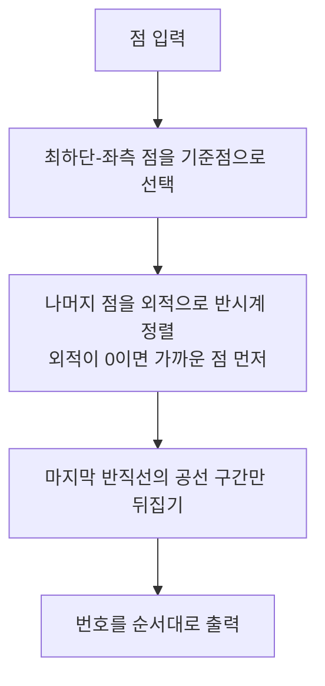

이 글은 평면 위의 점 집합으로 자기 교차 없는 **단순 다각형**을 만드는 **백준 3679번 단순 다각형**을 다룬다. 핵심은 "무게중심 기준 각도 정렬"처럼 그럴듯하지만 깨지는 풀이를 걸러내고, 기준점을 점 집합의 최하단-좌측 점으로 잡은 각도 정렬에 **마지막 공선 구간 뒤집기**를 더하는 정확한 풀이를 이해하는 것이다.

> 이 글을 읽고 나면 (1) 각도 정렬이 단순 다각형을 보장하는 조건을 설명하고, (2) 무게중심 기준 정렬이 깨지는 입력을 만들고, (3) 외적만으로 정확한 정렬 비교 함수를 구현할 수 있다.

## 문제 설명

평면 위에 $n$개의 점이 주어지면, 이 점들을 모두 꼭짓점으로 갖는 단순 다각형의 꼭짓점 순서를 출력한다. 단순 다각형은 인접한 변이 만나는 꼭짓점 외에는 변끼리 교차하지 않는 다각형이다. 같은 위치의 점은 없고, 모든 점이 한 직선 위에 놓이지는 않는다. 가능한 순서가 여러 개이면 하나만 출력한다.

입력의 첫 줄은 테스트 케이스 수 $c$ ($1 \leq c \leq 200$)이다. 각 테스트 케이스는 한 줄이며, 점의 개수 $n$ ($3 \leq n \leq 2000$) 다음에 $n$개의 점의 좌표 $x, y$ ($-10{,}000 \leq x, y \leq 10{,}000$, 정수)가 공백으로 이어진다. 출력은 각 케이스마다 $0$부터 $n-1$까지 점 번호의 순열 한 줄이다.

원문 문제 페이지(acmicpc.net/problem/3679)는 2026년 10월 현재 "BOJ 서비스 종료" 안내 페이지를 반환해 링크를 걸지 않았다. 문제 조건은 이 글에 정리한 내용을 기준으로 한다.

**예제 입력**

```
2
4 0 0 2 0 0 1 1 0
5 0 0 10 0 10 5 5 -1 0 5
```

**예제 출력**

```
0 3 1 2
3 1 2 4 0
```

## 접근 방식

### 왜 각도 정렬인가

기준점 $P$를 하나 정해 다른 점들을 $P$ 둘레의 각도 순으로 이어 붙이면, 각 변 $Q_iQ_{i+1}$은 서로 다른 두 반직선 사이의 쐐기 안에 갇힌다. 쐐기끼리는 반직선 하나 외에는 겹치지 않으므로 서로 다른 쐐기 속 변은 교차할 수 없고, 닫는 변(마지막 점에서 $P$로 돌아오는 변과 $P$에서 첫 점으로 가는 변)도 같은 이유로 안전하다. 이런 다각형을 $P$에서 "별 모양"으로 보이는 다각형이라 한다. 즉 각도 순서가 단순성을 보장하려면 **$P$가 모든 점의 각도를 구분 가능한 한쪽에 놓여야** 하고, 같은 각도의 점들을 어떻게 이을지가 정해져야 한다.

### 무게중심 기준이 깨지는 이유

무게중심 $G$를 기준으로 `atan2`로 정렬하는 풀이는 두 경우에 단순성을 보장하지 못한다. 첫째, $G$가 입력 점과 정확히 일치하면 그 점은 `atan2(0, 0) = 0`으로 각도가 임의로 매겨져 엉뚱한 위치에 끼어든다. 둘째, $G$와 같은 반직선 위에 점이 여럿이면 각도가 같아 정렬 순서가 비결정적이고, 가까운 점과 먼 점을 뒤섞어 이으면 변이 겹친다. 샘플이 우연히 통과하더라도 이 두 경우를 막는 논거가 없으므로 정답 풀이가 아니다.

### 최하단-좌측 기준점과 마지막 공선 구간 뒤집기

기준점을 $y$가 가장 작고, 같으면 $x$가 가장 작은 점 $P_0$로 잡으면 나머지 모든 점이 $P_0$의 위쪽(또는 오른쪽 수평선 위)에 있어 각도가 $[0, \pi)$ 범위에 놓인다. 그러면 각도 비교를 `atan2` 없이 외적 부호만으로 정확히 할 수 있다. 두 점 $A, B$에 대해 $(A-P_0) \times (B-P_0) > 0$이면 $A$의 각도가 더 작다. 외적이 0이면 두 점이 $P_0$와 한 직선 위에 있으므로 $P_0$에 가까운 점을 먼저 둔다. 좌표가 정수이므로 오차가 없다.

이대로 이으면 각도가 가장 큰 마지막 반직선 위에 점이 여럿일 때 문제가 생긴다. 가까운 순으로 이으면 마지막 점에서 $P_0$로 돌아오는 닫는 변이 그 공선 점들을 가로지르며 겹친다. 그래서 정렬한 뒤 **$P_0$와 공선인 마지막 구간만 거리 내림차순으로 뒤집는다.** 마지막 이외의 공선 구간은 가까운 점에서 먼 점 순으로 이어도 쐐기 안에 머물러 안전하다. 모든 점이 한 직선 위에 있지 않다는 조건이 이 마지막 구간이 전체가 되는 퇴화를 막는다. 정렬이 $O(n \log n)$, 나머지는 선형이므로 총 $O(n \log n)$이다.

### 처리 흐름



정렬 비교에 `atan2`를 쓰지 않고 정수 외적만 쓰는 점이 이 흐름의 핵심이다. 부동소수점 오차가 끼어들 자리가 없어 같은 각도 판정이 정확하다.

### 복잡도

| 단계 | 시간 | 공간 |
|:---|:---|:---|
| 기준점 탐색 | $O(n)$ | $O(1)$ |
| 외적 기반 정렬 | $O(n \log n)$ | $O(n)$ |
| 마지막 공선 구간 뒤집기 | $O(n)$ | $O(1)$ |
| 전체 | $O(n \log n)$ | $O(n)$ |

### 샘플로 확인

샘플 2의 점은 $0(0,0), 1(10,0), 2(10,5), 3(5,-1), 4(0,5)$이다. 최하단은 $y=-1$인 3번 점이다. 3번을 기준으로 한 방향 벡터는 $1:(5,1)$, $2:(5,6)$, $4:(-5,6)$, $0:(-5,1)$이고 각도 순서는 $1, 2, 4, 0$이므로 `3 1 2 4 0`이 나온다. 샘플 1은 최하단-좌측이 $0(0,0)$이고 $1(2,0)$, $3(1,0)$이 같은 반직선 위에 있어 가까운 3번이 먼저 와서 `0 3 1 2`가 된다. 마지막 구간은 2번 하나뿐이라 뒤집기가 일어나지 않는다.

| 단계 | 샘플 2 상태 |
|:---|:---|
| 기준점 선택 | 3번 $(5,-1)$ |
| 외적 정렬 | $1, 2, 4, 0$ |
| 마지막 공선 구간 | 0번 하나, 뒤집기 없음 |
| 출력 | `3 1 2 4 0` |

뒤집기가 실제로 필요한 입력은 `1` / `4 0 0 1 0 0 1 0 2`처럼 점 $0(0,0), 1(1,0), 2(0,1), 3(0,2)$가 주어진 경우다. 기준점 0번에서 2번과 3번은 같은 반직선(90°) 위에 있고 그 반직선이 마지막이다. 거리 순으로만 이으면 `0 1 2 3`이 되어 닫는 변 $3 \to 0$이 변 $2 \to 3$을 덮으므로 단순 다각형이 아니다. 마지막 구간을 뒤집은 `0 1 3 2`가 올바른 답이며, 위 Python 코드가 실제로 이 출력을 낸다. 구현 후에는 이런 케이스를 직접 넣어 확인한다.

## C++ 코드

정렬 비교 함수가 외적만 쓰며, 정렬 후 마지막 공선 구간만 `reverse`한다.

```cpp
// 42jerrykim.github.io에서 더 많은 정보를 확인할 수 있다
#include <algorithm>
#include <iostream>
#include <vector>

using namespace std;

struct P { int idx; long long x, y; };

// o를 기준으로 (a-o) x (b-o)
long long cross(const P& o, const P& a, const P& b) {
    return (a.x - o.x) * (b.y - o.y) - (a.y - o.y) * (b.x - o.x);
}

int main() {
    ios::sync_with_stdio(false);
    cin.tie(nullptr);
    int c;
    cin >> c;
    while (c--) {
        int n;
        cin >> n;
        vector<P> v(n);
        for (int i = 0; i < n; ++i) {
            v[i].idx = i;
            cin >> v[i].x >> v[i].y;
        }
        // 최하단-좌측 점을 맨 앞으로
        swap(v[0], *min_element(v.begin(), v.end(), [](const P& a, const P& b) {
            return a.y != b.y ? a.y < b.y : a.x < b.x;
        }));
        P o = v[0];
        sort(v.begin() + 1, v.end(), [&](const P& a, const P& b) {
            long long cr = cross(o, a, b);
            if (cr != 0) return cr > 0;  // 반시계 방향이 먼저
            return (a.x - o.x) * (a.x - o.x) + (a.y - o.y) * (a.y - o.y)
                 < (b.x - o.x) * (b.x - o.x) + (b.y - o.y) * (b.y - o.y);
        });
        // 마지막 반직선 위의 공선 구간만 먼 점부터 오도록 뒤집는다
        int i = n - 1;
        while (i > 1 && cross(o, v[i - 1], v[i]) == 0) --i;
        reverse(v.begin() + i, v.end());
        for (int k = 0; k < n; ++k) cout << v[k].idx << (k + 1 < n ? ' ' : '\n');
    }
    return 0;
}
```

기준점을 `swap`으로 맨 앞에 두고 나머지 구간만 정렬하므로 기준점 자신과의 외적 0이 비교에 끼어들지 않는다. 뒤집기 루프의 하한을 `i > 1`로 둔 것도 같은 이유다. 외적 값은 최대 약 $8 \times 10^8$이라 `long long`이면 충분하다.

## Python 코드

Python은 비교 함수를 `cmp_to_key`로 감싼다. 입력이 한 줄에 이어지므로 전체 토큰을 한 번에 읽는다.

```python
# 42jerrykim.github.io에서 더 많은 정보를 확인할 수 있다
import sys
from functools import cmp_to_key

def main():
    data = sys.stdin.read().split()
    pos = 0
    c = int(data[pos]); pos += 1
    out = []
    for _ in range(c):
        n = int(data[pos]); pos += 1
        pts = []
        for i in range(n):
            pts.append((int(data[pos]), int(data[pos + 1]), i))
            pos += 2
        # 최하단-좌측 점을 기준점으로
        base = min(pts, key=lambda p: (p[1], p[0]))
        rest = [p for p in pts if p is not base]
        ox, oy, _i = base

        def cmp(a, b):
            cr = (a[0] - ox) * (b[1] - oy) - (a[1] - oy) * (b[0] - ox)
            if cr != 0:
                return -1 if cr > 0 else 1
            da = (a[0] - ox) ** 2 + (a[1] - oy) ** 2
            db = (b[0] - ox) ** 2 + (b[1] - oy) ** 2
            return -1 if da < db else (1 if da > db else 0)

        rest.sort(key=cmp_to_key(cmp))
        # 마지막 공선 구간 뒤집기
        i = len(rest) - 1
        while i > 0 and (rest[i - 1][0] - ox) * (rest[i][1] - oy) \
                - (rest[i - 1][1] - oy) * (rest[i][0] - ox) == 0:
            i -= 1
        rest[i:] = rest[i:][::-1]
        out.append(' '.join(str(p[2]) for p in [base] + rest))
    print('\n'.join(out))

main()
```

Python 코드도 같은 논리이므로 두 구현이 같은 출력을 내는지 샘플 두 개로 대조하면 충분하다. `rest`는 기준점이 빠진 목록이라 뒤집기 루프의 하한이 0 대신 `i > 0`이다.

## 코너 케이스

| 케이스 | 왜 문제인가 | 처리 |
|:---|:---|:---|
| 마지막 반직선에 점이 여러 개 | 가까운 순으로 이으면 닫는 변이 점들을 가로지름 | 마지막 공선 구간만 뒤집기 |
| 중간 반직선에 점이 여러 개 | 먼 점을 먼저 이으면 변이 되돌아옴 | 거리 오름차순 정렬 |
| 최하단 점이 여럿 | 기준점이 불확정 | $x$가 가장 작은 점을 기준으로 |
| 무게중심이 입력 점과 일치 | `atan2(0,0)`으로 각도 임의 | 기준점을 무게중심 대신 최하단-좌측 점으로 |
| 좌표 최대 | 외적이 정수 범위를 벗어날까 | `long long`(Python은 무제한) |

## 정리

단순 다각형 구성은 "기준점 둘레 각도 정렬"이 본질이고, 정답 여부는 기준점 선택과 같은 각도 점의 처리에서 갈린다. 최하단-좌측 점을 기준으로 외적으로 정렬하고 마지막 공선 구간만 뒤집으면 $O(n \log n)$에 항상 단순 다각형이 만들어진다. 무게중심 풀이는 샘플을 통과해도 중심 일치와 동일 각도에서 깨지므로 샘플 통과를 정당성의 근거로 삼으면 안 된다.

## 참고 문헌

- Cormen, Leiserson, Rivest, Stein, *Introduction to Algorithms*, 33장 Computational Geometry: 외적을 이용한 방향 판정과 Graham scan의 극각 정렬
- 이 문제와 Graham scan은 기준점을 최하단-좌측 점으로 잡고 극각으로 정렬한다는 뼈대가 같다. 볼록 껍질에서는 정렬 뒤 오목한 점을 제거하고, 이 문제에서는 모든 점을 남기며 마지막 공선 구간만 뒤집는다는 점이 다르다.
