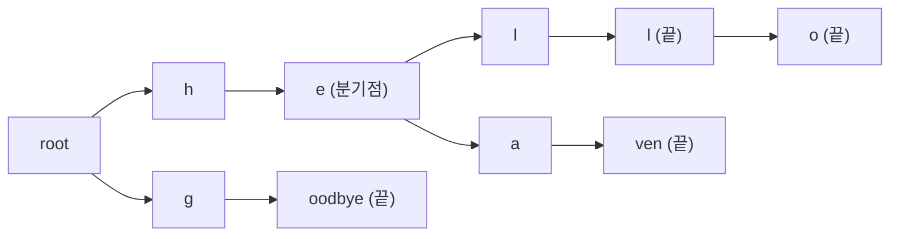

휴대폰에서 영단어를 입력할 때 버튼을 누르는 횟수를 최소화하기 위해 자동완성 기능을 활용하는 문제이다. 이 문제는 Trie(트라이) 자료 구조 또는 재귀적인 접근 방식을 사용하여 효율적으로 해결할 수 있다.

백준 5670번 문제이다. 원문 페이지는 BOJ 서비스 종료로 더 이상 열리지 않아 아래에 문제 규칙을 직접 요약했다.

## 학습 목표

이 글을 읽고 나면 다음을 설명할 수 있어야 한다.

- Trie의 각 노드에서 "버튼을 눌러야 하는 지점"이 정확히 어디인지(자식이 둘 이상이거나 단어가 끝나는 노드)와 그 이유.
- Trie를 만드는 풀이와 Trie 없이 단어 집합을 재귀적으로 쪼개는 풀이가 같은 값을 계산하는 이유, 그리고 메모리 사용 방식의 차이.
- 평균 출력에서 부동소수점 반올림이 어긋나는 상황과 처리 방법.

## 문제 설명

휴대폰에서 길이가 $P$인 영단어를 입력하려면 일반적으로 버튼을 $P$번 눌러야 한다. 그러나 입력 속도를 높이기 위해, 사전에 기반한 자동완성 기능을 사용하는 자판 모듈이 있다. 이 모듈은 다음과 같은 규칙으로 동작한다.

1. **첫 글자는 자동완성되지 않는다.** 사용자는 첫 번째 글자를 반드시 직접 입력해야 한다.
2. **자동입력 조건:** 현재까지 입력된 문자열 $c_1c_2...c_n$이 있을 때, 사전에서 이 문자열로 시작하는 단어들이 모두 다음 글자 $c$를 공유한다면, 모듈은 $c$를 자동으로 입력해준다.

예를 들어, 사전에 "hello", "hell", "heaven", "goodbye"가 있을 때, 사용자가 'h'를 입력하면 모듈은 자동으로 'e'를 입력해준다. 이는 'h'로 시작하는 모든 단어의 다음 글자가 'e'이기 때문이다. 그러나 'he' 다음에는 'l'과 'a'가 올 수 있으므로, 모듈은 다음 입력을 기다린다.

사용자가 'l'을 입력하면, 모듈은 다시 'l'을 자동으로 입력해준다. 여기서 "hell"이 단어의 끝이지만, "hello"는 아직 끝나지 않았으므로, 모듈은 다시 입력을 기다린다. 따라서 "hello"는 h, l, o 세 번(3회), "hell"은 h, l 두 번(2회), "heaven"은 h, a 두 번(2회), "goodbye"는 g 한 번(1회)이므로 평균은 $(3+2+2+1)/4 = 2.00$이다.

문제에서 입력은 여러 개의 테스트 케이스로 이루어져 있다. 각 테스트 케이스는 사전에 속한 단어의 개수 $N$이 주어지며, 이어서 $N$개의 단어가 주어진다. 각 단어를 입력하기 위해 버튼을 눌러야 하는 횟수의 평균을 소수점 둘째 자리까지 반올림하여 출력해야 한다. 원문 페이지가 닫혀 입력 크기와 메모리·시간 제한의 정확한 수치는 이 글에서 확인하지 않았다.

## 접근 방식

### 왜 분기 노드와 단어 끝 노드에서만 입력하는가

사전의 모든 단어를 Trie에 넣으면, 어떤 접두사에 해당하는 노드의 자식 수는 "사전에서 그 접두사 다음에 올 수 있는 글자의 종류 수"와 같다. 자식이 하나뿐이면 다음 글자가 유일하게 정해지므로 모듈이 자동으로 채운다. 자식이 둘 이상이면 어느 쪽인지 사용자가 정해 주어야 하므로 버튼을 눌러야 한다. 또 현재 노드가 어떤 단어의 끝이라면, 자식이 하나뿐이어도 그 단어에서 멈출 수 있는 선택지가 있어 모듈은 자동입력을 하지 않는다. 그래서 "hell" 다음의 'o'는 자식이 하나지만 `is_end`가 참이어서 직접 눌러야 한다. 첫 글자는 루트의 자식 수와 무관하게 항상 직접 입력하므로, 횟수를 1로 시작하고 두 번째 글자부터 노드 조건을 검사한다.



위 그림에서 "e" 노드는 자식이 'l'과 'a' 두 개이므로 여기서 한 번 더 눌러야 하고, "l (끝)" 노드는 단어 "hell"이 끝나는 곳이어서 "hello"를 쓸 때 'o'를 눌러야 한다. 각 단어의 답은 루트에서 그 단어까지 내려가는 경로에서 이런 노드를 지난 횟수에 첫 글자 1회를 더한 값이다.

### Trie 없이 재귀로 푸는 방법

같은 값을 Trie 없이도 구할 수 있다. 현재 위치의 글자로 단어들을 그룹화하고, 한 그룹 안에서 모든 단어가 같은 글자를 공유하는 동안은 자동입력이므로 위치만 앞으로 건너뛴다. 그룹 안의 단어가 갈라지거나 어느 단어가 끝나는 지점에서 한 번 눌렀다고 보고 `depth`를 1 늘린 뒤, 남은 단어들에 대해 같은 과정을 재귀적으로 반복한다. 이 방식은 Trie 노드를 26개 포인터 배열로 잡지 않고 인덱스 리스트만 넘기므로, 노드 수가 많은 입력에서 메모리 사용 패턴이 다르다. 다만 어느 쪽이 얼마나 적게 쓰는지는 문제의 실제 제한과 측정이 필요하며, 이 글은 측정값을 제시하지 않는다. Python에서 26칸 자식 배열을 가진 노드 객체를 대량으로 만들면 객체 오버헤드가 커지기 쉬워, 이 글의 Python 풀이는 Trie 대신 재귀 분할을 택했다(측정값은 없다).

### 복잡도

| 풀이 | 시간 | 공간 | 비고 |
|---|---|---|---|
| C++ Trie | $O(S)$ | $O(S \cdot 26)$ 포인터 (최악) | $S$는 모든 단어 길이의 합. 삽입과 질의가 각각 단어 길이에 비례 |
| Python 재귀 분할 | 최악 $O(S)$에 가까움, 공통 접두사 비교 비용 포함 | 단어 저장 + 인덱스 리스트 | 그룹마다 dict를 만들어 상수 비용이 큼 |

## C++ 코드와 설명

```cpp
// 42jerrykim.github.io에서 더 많은 정보를 확인할 수 있다
#include <iostream>
#include <vector>
#include <string>
#include <cstring>
#include <cstdio>

using namespace std;

// Trie의 노드를 나타내는 구조체
struct TrieNode {
    bool is_end;               // 이 노드가 단어의 끝인지 표시
    int child_count;           // 자식 노드의 수
    TrieNode* children[26];    // 알파벳 소문자에 대한 자식 노드 포인터 배열

    // 생성자: 초기화
    TrieNode() {
        is_end = false;
        child_count = 0;
        memset(children, 0, sizeof(children));
    }
};

// 단어를 Trie에 삽입하는 함수
void insert(TrieNode* root, const string& word) {
    TrieNode* node = root;
    for (char c : word) {
        int idx = c - 'a';  // 알파벳을 인덱스로 변환
        if (!node->children[idx]) {
            node->children[idx] = new TrieNode();  // 자식 노드가 없으면 생성
            node->child_count++;                   // 자식 수 증가
        }
        node = node->children[idx];  // 다음 노드로 이동
    }
    node->is_end = true;  // 단어의 끝 표시
}

// 단어를 입력하는 데 필요한 버튼 횟수를 계산하는 함수
int count_key_presses(TrieNode* root, const string& word) {
    int key_presses = 1;  // 첫 번째 문자는 항상 입력해야 함
    TrieNode* node = root->children[word[0] - 'a'];  // 첫 번째 문자로 이동
    for (size_t i = 1; i < word.length(); ++i) {
        int idx = word[i] - 'a';
        // 현재 노드가 단어의 끝이거나 자식이 둘 이상이면 버튼 입력 필요
        if (node->is_end || node->child_count > 1) {
            key_presses++;
        }
        node = node->children[idx];  // 다음 노드로 이동
    }
    return key_presses;
}

// Trie를 동적 할당 해제하는 함수
void delete_trie(TrieNode* node) {
    if (!node) return;
    for (int i = 0; i < 26; ++i) {
        if (node->children[i]) {
            delete_trie(node->children[i]);  // 자식 노드들을 재귀적으로 삭제
        }
    }
    delete node;  // 현재 노드 삭제
}

int main() {
    ios::sync_with_stdio(false);
    cin.tie(nullptr);

    int N;
    while (cin >> N) {
        vector<string> words(N);
        for (int i = 0; i < N; ++i) {
            cin >> words[i];  // 단어 입력
        }

        TrieNode* root = new TrieNode();  // Trie의 루트 노드 생성

        for (const string& word : words) {
            insert(root, word);  // 단어들을 Trie에 삽입
        }

        int total_presses = 0;
        for (const string& word : words) {
            total_presses += count_key_presses(root, word);  // 각 단어의 버튼 입력 횟수 계산
        }

        double average_presses = (double)total_presses / N + 1e-8;  // 평균 계산 및 부동소수점 보정
        printf("%.2f\n", average_presses);  // 소수점 둘째 자리까지 출력

        delete_trie(root);  // Trie 메모리 해제
    }

    return 0;
}
```

Trie 노드는 `is_end`(단어의 끝 여부), `child_count`(자식 수), 26칸 자식 포인터 배열로 구성된다. `insert`는 새 노드를 만들 때마다 부모의 `child_count`를 올려서, 질의 단계에서 "이 지점이 분기점인가"를 O(1)로 판단하게 한다. `count_key_presses`는 첫 글자 1회에서 시작해 두 번째 글자부터 현재 노드가 단어 끝이거나 자식이 둘 이상일 때만 횟수를 올린다. 총합을 $N$으로 나눈 평균에 `1e-8`을 더하는 것은 정확히 `.xx5`로 끝나는 값이 부동소수점 오차로 내림되는 것을 막기 위한 보정이다. 테스트 케이스마다 `delete_trie`로 노드를 해제한다.

## Python 코드와 설명

```python
# 42jerrykim.github.io에서 더 많은 정보를 확인할 수 있다
import sys
input = sys.stdin
print = sys.stdout.write

import decimal
ctx = decimal.getcontext()
ctx.rounding = decimal.ROUND_HALF_UP

def solve(N, words):
    depths = [0] * N  # 각 단어의 버튼 입력 횟수를 저장할 리스트

    def init(indices, i, depth):
        # indices: 현재 처리 중인 단어들의 인덱스 리스트
        # i: 현재 검사할 문자 위치 (0부터 시작)
        # depth: 현재까지 버튼을 누른 횟수
        wordbook = dict()
        for idx in indices:
            if len(words[idx]) == i:
                depths[idx] = depth  # 단어의 끝에 도달하면 깊이 저장
                continue
            c = words[idx][i]
            if c in wordbook:
                wordbook[c].append(idx)
            else:
                wordbook[c] = [idx]

        for c, subindices in wordbook.items():
            # 공통된 문자를 최대한 건너뛰기 위해 j를 사용
            j = i + 1
            while True:
                # 단어의 길이를 넘어가면 중지
                if any(len(words[idx]) == j for idx in subindices):
                    break
                # 다음 문자가 모두 같은지 확인
                target = words[subindices[0]][j]
                if any(words[idx][j] != target for idx in subindices):
                    break
                j += 1

            # 끝에 도달한 단어는 깊이 저장
            subsub = []
            for idx in subindices:
                if len(words[idx]) == j:
                    depths[idx] = depth + 1
                else:
                    subsub.append(idx)

            # 남은 단어들에 대해 재귀적으로 처리
            if subsub:
                init(subsub, j, depth + 1)

    init(range(N), 0, 0)

    # 평균 버튼 입력 횟수 계산
    return (decimal.Decimal(sum(depths)) / N).quantize(decimal.Decimal('0.01'))

while True:
    try:
        N = int(input.readline().strip())
        words = [input.readline().strip() for _ in range(N)]
        ans = solve(N, words)
        print(f"{ans}\n")
    except (EOFError, ValueError):  # 입력 끝에서 빈 줄 -> int() 실패
        break
```

`solve`는 단어 길이 합을 한 번씩만 훑도록 `init(indices, i, depth)`를 재귀 호출한다. `indices`는 아직 처리 중인 단어들이고 `i`는 검사할 글자 위치, `depth`는 지금까지 누른 횟수다. 같은 위치의 글자로 `wordbook` 딕셔너리에 그룹화한 뒤, 각 그룹에서 모든 단어가 다음 글자를 공유하는 동안 `j`를 늘려 공통 접두사를 한 번에 건너뛴다. 어느 단어가 끝나거나 글자가 갈라지는 위치에서 멈추고, 그 그룹에는 `depth + 1`을 부여한다. 끝에 도달한 단어는 `depths`에 횟수를 저장하고 나머지는 같은 함수를 다시 호출한다. 마지막으로 `decimal`의 `ROUND_HALF_UP`으로 평균을 소수점 둘째 자리까지 반올림한다. 정수 합 `Decimal(sum(depths))`를 바로 `N`으로 나눈 뒤 `quantize`로 맞추므로 float 오차가 끼지 않는다. (`round()`는 컨텍스트와 무관하게 짝수 반올림을 쓰기 때문에 `quantize`를 쓴다.) 입력이 끝나면 `readline()`이 빈 문자열을 돌려주어 `int()`가 `ValueError`를 내므로 이 예외로 반복을 종료한다.

## 결론

시간은 두 풀이 모두 입력 문자 총수에 비례하므로 선택 기준은 메모리와 구현 길이다. 노드 객체를 싸게 만들 수 있는 C++에서는 `child_count`와 `is_end`를 저장하는 Trie가 단순하고, 노드 객체 비용이 큰 Python에서는 Trie 없이 그룹이 갈라지는 지점에서 즉석으로 판단하는 재귀 분할이 대안이 된다.

## 코너 케이스 및 실수 포인트

| 케이스 | 설명 | 처리 방법 |
|---|---|---|
| **단어 1개** | $N=1$이면 첫 글자만 누르고 나머지는 자동완성 | 횟수 1, 출력 `1.00` |
| **다른 단어의 접두사인 단어** | "hell"과 "hello"처럼 자식이 하나여도 `is_end`이면 멈춤 | `is_end` 조건을 반드시 포함 |
| **평균 반올림** | `.xx5` 경계에서 부동소수점 오차로 내림 | `+1e-8` 보정 또는 `decimal` ROUND_HALF_UP |
| **다중 테스트 케이스** | EOF까지 반복 입력 | `while (cin >> N)` / `EOFError` 처리 |
| **합계 크기** | 합계는 입력 문자 총수 이하라 `int`로 충분 | 코드의 `int total_presses` 유지 |

## 참고 자료

- [Trie — Wikipedia](https://en.wikipedia.org/wiki/Trie): 접두사 트리의 정의와 연산 복잡도.
