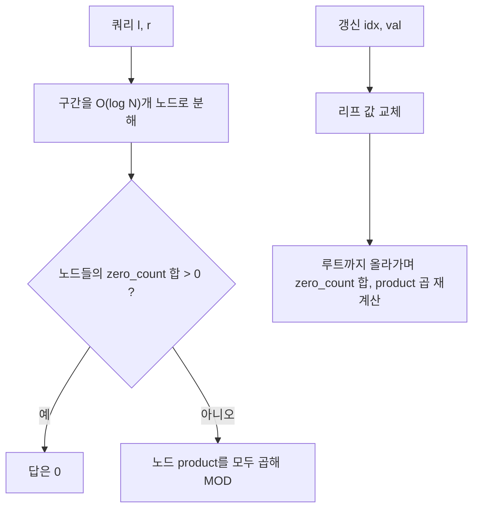

어떤 N개의 수가 주어져 있을 때, 이 수들에 대한 구간 곱을 효율적으로 구하고, 중간에 수의 변경이 빈번히 일어나는 상황을 고려해보자. 예를 들어, 수열이 1, 2, 3, 4, 5로 주어지고, 세 번째 수를 6으로 바꾼 후에 두 번째부터 다섯 번째까지의 곱을 구하면 240이 된다. 여기서 다섯 번째 수를 2로 변경하고, 세 번째부터 다섯 번째까지의 곱을 구하면 48이 된다.

이러한 문제를 해결하기 위해서는 수의 변경과 구간 곱 계산을 효율적으로 처리할 수 있는 자료 구조가 필요하다. 이 글에서는 백준 온라인 저지 11505번 "구간 곱 구하기" 문제를 해결하기 위한 알고리즘과 코드 구현에 대해 알아보겠다.

문제 : [https://www.acmicpc.net/problem/11505](https://www.acmicpc.net/problem/11505)

## 문제 정보

| 항목 | 내용 |
|---|---|
| 플랫폼 | 백준 온라인 저지 11505번 |
| 입력 | 수의 개수 N(1 ≤ N ≤ 1,000,000), 변경 횟수 M, 구간 곱 질의 횟수 K |
| 값 범위 | 각 수는 0 이상 1,000,000 이하 정수 |
| 출력 | 구간 곱을 1,000,000,007로 나눈 나머지 |

## 문제 설명

어떤 N개의 수가 주어져 있다. 이 수들은 수열을 이루며, 수의 개수 N은 1 이상 1,000,000 이하이다. 이때, 다음과 같은 두 가지 쿼리를 처리해야 한다:

1. **수의 변경**: 특정 위치의 수를 다른 수로 변경한다.
2. **구간 곱 계산**: 특정 구간에 있는 수들의 곱을 구한다.

하지만 여기서 중요한 것은 수의 변경과 구간 곱 계산이 매우 빈번하게 일어난다는 것이다. 따라서 단순히 모든 연산을 수행할 때마다 배열을 순회하며 곱을 계산하면 시간 초과가 발생한다.

또한, 모든 연산의 결과는 1,000,000,007로 나눈 나머지를 출력해야 한다. 이는 결과 값이 매우 커질 수 있으므로, 계산 중간에도 모듈러 연산을 적용하여 오버플로우를 방지해야 한다.

**예시**:

- 초기 수열: `1, 2, 3, 4, 5`
- 첫 번째 연산: 세 번째 수를 `6`으로 변경
- 두 번째 연산: 두 번째부터 다섯 번째 수까지의 곱을 구함 ⇒ `2 * 6 * 4 * 5 = 240`
- 세 번째 연산: 다섯 번째 수를 `2`로 변경
- 네 번째 연산: 세 번째부터 다섯 번째 수까지의 곱을 구함 ⇒ `6 * 4 * 2 = 48`

이러한 연산들을 효율적으로 처리하기 위해서는 적절한 자료 구조와 알고리즘이 필요하다.

## 접근 방식

이 문제는 수의 변경과 구간 곱 계산을 효율적으로 처리해야 하므로, <strong>세그먼트 트리(Segment Tree)</strong>를 사용하는 것이 적합하다. 세그먼트 트리는 구간에 대한 정보를 트리 형태로 저장하여, 업데이트와 쿼리를 O(log N)의 시간 복잡도로 처리할 수 있다.

하지만 일반적인 세그먼트 트리에서는 덧셈 연산을 주로 사용하며, **곱셈의 경우에는 0이 포함될 때 주의**해야 한다. 곱셈에서 0이 하나라도 있으면 전체 곱셈 결과가 0이 되므로, 각 노드에서 해당 구간에 0이 존재하는지 여부를 추가로 저장해야 한다.

따라서, 각 세그먼트 트리의 노드는 다음과 같은 정보를 저장한다:

- `zero_count`: 해당 구간에 포함된 0의 개수
- `product`: 해당 구간의 모든 0이 아닌 수들의 곱을 MOD로 나눈 나머지

이를 통해, 쿼리 시에 해당 구간에 0이 하나라도 존재하면 결과는 0이 되며, 그렇지 않다면 곱셈 연산을 수행하면 된다.

이 설계가 맞는 이유는 불변식 하나로 정리된다. 모든 노드에서 `product`는 그 구간의 비영 원소만 곱한 값이고 `zero_count`는 0의 개수다. 부모 노드는 두 자식의 `zero_count`를 더하고 `product`를 곱해 만들 수 있으므로, 리프 하나가 바뀌면 루트까지 경로상의 노드 약 log N개만 다시 계산하면 불변식이 유지된다. 쿼리 구간은 트리에서 O(log N)개의 노드로 분해되고, 그 노드들의 `zero_count` 합이 0보다 크면 구간 곱은 0, 아니면 각 노드의 `product`를 모두 곱한 값이다. 값의 범위가 1,000,000 이하이므로 0이 아닌 수는 소수 1,000,000,007의 배수가 될 수 없고, 비영 원소의 곱이 모듈러 연산 후 우연히 0이 되는 일도 없다.

쿼리가 노드로 분해되는 과정을 조금 더 구체적으로 보자. 구간 [l, r]이 현재 노드의 구간을 완전히 덮으면 그 노드의 값을 바로 쓰고, 전혀 겹치지 않으면 곱셈의 항등원 1을 돌려주며, 일부만 겹치면 양쪽 자식으로 내려간다. 각 깊이에서 "일부만 겹치는" 노드는 최대 두 개뿐이므로 방문하는 노드 수가 O(log N)으로 묶인다. 중간 곱은 최대 (10^9+6)^2 정도라 64비트 정수에 안전하게 들어가며, 그래서 C++ 코드에서 곱셈 직전의 값에 `int64_t`를 쓴다. 32비트 `int`로 곱하면 즉시 넘친다.

### 왜 역원으로 나누는 방법은 안 되는가

전체 곱을 미리 구해 두고 값을 바꿀 때마다 "기존 값의 모듈러 역원"으로 나누는 방법이 떠오를 수 있다. 하지만 0에는 모듈러 역원이 없으므로 기존 값이 0인 위치를 바꾸는 순간 이 방법은 깨진다. 이 문제가 값 0과 변경 쿼리를 함께 주는 이유가 여기에 있고, `zero_count`를 따로 세는 이유이기도 하다. 합 쿼리에 쓰는 펜윅 트리(BIT)도 뺄셈으로 구간을 구하는 구조라 같은 이유로 곱에는 그대로 쓰기 어렵다. 세그먼트 트리는 구간을 나눠 합치기만 하므로 역연산이 필요 없다.



| 연산 | 시간복잡도 | 공간복잡도 |
|---|---|---|
| 구축 | O(N) | O(N) (트리 배열 약 4N) |
| 갱신 | O(log N) | O(log N) 재귀 스택 |
| 구간 곱 쿼리 | O(log N) | O(log N) 재귀 스택 |

## C++ 코드와 설명

먼저, 필요한 헤더를 포함한다.

```cpp
// 출처: https://www.acmicpc.net/problem/11505
#include <cstdint>
#include <iostream>
#include <vector>
#define MOD 1000000007

using namespace std;
```

데이터를 저장할 구조체를 정의한다.

```cpp
struct Node {
    int zero_count;       // 구간 내 0의 개수
    int64_t product;      // 구간 내 0이 아닌 수들의 곱
};
```

전역 변수 및 배열을 선언한다.

```cpp
int N, M, K;
vector<int64_t> arr;      // 초기 수열을 저장할 배열
vector<Node> tree;        // 세그먼트 트리
```

세그먼트 트리를 구축하는 함수이다.

```cpp
void build(int node, int start, int end) {
    if (start == end) {
        // 리프 노드일 경우
        if (arr[start] == 0) {
            tree[node].zero_count = 1;
            tree[node].product = 1; // 곱셈의 항등원
        } else {
            tree[node].zero_count = 0;
            tree[node].product = arr[start] % MOD;
        }
    } else {
        // 내부 노드일 경우
        int mid = (start + end) / 2;
        build(node * 2, start, mid);          // 왼쪽 자식 노드
        build(node * 2 + 1, mid + 1, end);    // 오른쪽 자식 노드

        tree[node].zero_count = tree[node * 2].zero_count + tree[node * 2 + 1].zero_count;

        if (tree[node].zero_count > 0) {
            tree[node].product = 1; // 0이 존재하므로 곱은 0
        } else {
            tree[node].product = (tree[node * 2].product * tree[node * 2 + 1].product) % MOD;
        }
    }
}
```

특정 위치의 값을 변경하는 업데이트 함수이다.

```cpp
void update(int node, int start, int end, int idx, int64_t val) {
    if (start == end) {
        // 리프 노드 업데이트
        arr[idx] = val;
        if (val == 0) {
            tree[node].zero_count = 1;
            tree[node].product = 1;
        } else {
            tree[node].zero_count = 0;
            tree[node].product = val % MOD;
        }
    } else {
        int mid = (start + end) / 2;
        if (idx <= mid) {
            update(node * 2, start, mid, idx, val); // 왼쪽 자식 노드 갱신
        } else {
            update(node * 2 + 1, mid + 1, end, idx, val); // 오른쪽 자식 노드 갱신
        }

        tree[node].zero_count = tree[node * 2].zero_count + tree[node * 2 + 1].zero_count;

        if (tree[node].zero_count > 0) {
            tree[node].product = 1;
        } else {
            tree[node].product = (tree[node * 2].product * tree[node * 2 + 1].product) % MOD;
        }
    }
}
```

구간 곱을 계산하는 쿼리 함수이다.

```cpp
int64_t query(int node, int start, int end, int l, int r) {
    if (r < start || end < l) {
        // 구간이 겹치지 않음
        return 1; // 곱셈의 항등원 반환
    }
    if (l <= start && end <= r) {
        // 구간이 완전히 포함됨
        if (tree[node].zero_count > 0) {
            return 0;
        } else {
            return tree[node].product % MOD;
        }
    }

    int mid = (start + end) / 2;
    int64_t left_product = query(node * 2, start, mid, l, r);
    int64_t right_product = query(node * 2 + 1, mid + 1, end, l, r);

    return (left_product * right_product) % MOD;
}
```

메인 함수에서는 입력을 받고 쿼리를 처리한다.

```cpp
int main() {
    ios::sync_with_stdio(false);
    cin.tie(nullptr);

    cin >> N >> M >> K;
    arr.resize(N + 1);
    tree.resize(4 * N);

    for (int i = 1; i <= N; ++i) {
        cin >> arr[i];
    }

    build(1, 1, N);

    int total_ops = M + K;

    for (int i = 0; i < total_ops; ++i) {
        int a;
        int64_t b, c;
        cin >> a >> b >> c;

        if (a == 1) {
            // 값 변경 연산
            update(1, 1, N, b, c);
        } else if (a == 2) {
            // 구간 곱 계산 연산
            int64_t result = query(1, 1, N, b, c);
            cout << result % MOD << '\n';
        }
    }

    return 0;
}
```

## C 스타일 구현에 대하여

표준 라이브러리 컨테이너를 쓰지 않고 `stdio.h`만으로 구현해도 로직은 위 C++ 코드와 같다. 달라지는 점은 두 가지다. 첫째, `vector` 대신 `long long arr[1000001]`과 `Node tree[4 * 1000000]` 같은 정적 전역 배열을 쓴다. 이 배열은 프로그램 시작 시 한 번 잡히므로 동적 메모리 할당은 일어나지 않는다. 둘째, 입출력을 `cin`/`cout` 대신 `scanf("%lld")`/`printf("%lld\n")`으로 처리하므로 `sync_with_stdio` 설정이 필요 없다. 같은 코드를 한 번 더 싣는 것은 학습 가치가 낮아 생략한다.

## Python 코드와 설명

이제 메모리 초과를 방지하기 위해 `threading` 모듈을 사용하지 않고, 메모리 사용을 최적화한 Python 코드를 작성하겠다.

```python
# 출처: https://www.acmicpc.net/problem/11505
import sys

MOD = 1000000007
input = sys.stdin.readline

def build():
    # 리프 노드 초기화
    for i in range(N):
        idx = size + i
        val = arr[i]
        if val == 0:
            tree_zero[idx] = 1
            tree_prod[idx] = 1
        else:
            tree_zero[idx] = 0
            tree_prod[idx] = val % MOD

    # 내부 노드 초기화
    for idx in range(size - 1, 0, -1):
        left = idx << 1
        right = left | 1
        tree_zero[idx] = tree_zero[left] + tree_zero[right]
        if tree_zero[idx]:
            tree_prod[idx] = 1
        else:
            tree_prod[idx] = (tree_prod[left] * tree_prod[right]) % MOD

def update(pos, val):
    idx = size + pos
    if val == 0:
        tree_zero[idx] = 1
        tree_prod[idx] = 1
    else:
        tree_zero[idx] = 0
        tree_prod[idx] = val % MOD
    idx >>= 1
    while idx:
        left = idx << 1
        right = left | 1
        tree_zero[idx] = tree_zero[left] + tree_zero[right]
        if tree_zero[idx]:
            tree_prod[idx] = 1
        else:
            tree_prod[idx] = (tree_prod[left] * tree_prod[right]) % MOD
        idx >>= 1

def query(l, r):
    l += size
    r += size
    zero_count = 0
    result = 1
    while l <= r:
        if l % 2 == 1:
            zero_count += tree_zero[l]
            if zero_count == 0:
                result = (result * tree_prod[l]) % MOD
            l += 1
        if r % 2 == 0:
            zero_count += tree_zero[r]
            if zero_count == 0:
                result = (result * tree_prod[r]) % MOD
            r -= 1
        l >>= 1
        r >>= 1
    return 0 if zero_count else result % MOD

N, M, K = map(int, input().split())
arr = [int(input()) for _ in range(N)]
size = 1
while size < N:
    size <<= 1

tree_zero = [0] * (size << 1)
tree_prod = [1] * (size << 1)

build()

for _ in range(M + K):
    cmd = ''
    while cmd.strip() == '':
        cmd = input()
    a, b, c = map(int, cmd.strip().split())
    if a == 1:
        # 업데이트 연산
        update(b - 1, c)
    else:
        # 쿼리 연산
        res = query(b - 1, c - 1)
        print(res)
```

입력은 `sys.stdin.readline`으로 받아 대량 입력의 읽기 비용을 줄인다. 일부 테스트 데이터에는 줄 사이에 빈 줄이 섞여 있을 수 있어, 명령 줄을 읽을 때는 공백 줄을 건너뛰도록 `while` 반복으로 감쌌다. 트리는 `tree_zero`와 `tree_prod` 두 개의 평탄한 리스트로 나누어 객체 생성 비용과 메모리를 아낀다.

Python 구현은 재귀 대신 배열 크기를 2의 거듭제곱으로 맞춘 바텀업 방식이다. 리프가 `size + i` 위치에 놓이므로 부모는 인덱스를 1비트 오른쪽으로 밀면 얻고, 쿼리는 `l`이 오른쪽 자식이면 그 노드를 취한 뒤 한 칸 옮기고 `r`이 왼쪽 자식이면 같은 처리를 하는 식으로 양 끝에서 안쪽으로 모인다. 재귀 호출 스택이 없어 깊이 제한과 함수 호출 비용을 모두 피할 수 있다는 점이 N이 최대 100만인 이 문제에서 중요하다.

## 결론

이 문제는 곱셈에 0이라는 역연산 불가능한 값이 있어 합 쿼리용 기법이 통하지 않는다는 점을 짚는다. 0의 개수와 비영 원소의 곱을 노드에 분리해 두면 갱신과 구간 곱이 모두 O(log N)이다.

## 학습 목표 점검

- 구간 곱 쿼리에 누적 곱이나 역원 나눗셈이 통하지 않는 이유를 0의 성질로 설명할 수 있다.
- 노드에 저장할 값과 그 값이 유지되는 불변식을 직접 정의할 수 있다.
- 구간 질의를 O(log N)개 노드로 분해하는 과정과 갱신의 루트까지 재계산 과정을 추적할 수 있다.

## 코너 케이스 및 실수 포인트

실수가 가장 많이 나는 곳은 0을 다루는 두 지점이다. 리프가 0일 때 `product`를 0이 아니라 1로 저장하는 이유는 `zero_count`가 양수인 노드에서는 `product`를 읽지 않으므로 값이 무엇이든 정답에는 영향이 없기 때문이다. 다만 부모 노드가 "비영 원소만의 곱"이라는 불변식을 지키려면 0인 리프가 곱셈의 항등원으로 기여해야 하므로, 일관되게 1을 두는 쪽이 단순하다. 그 위치를 나중에 0이 아닌 값으로 바꾸면 갱신 경로에서 `zero_count`가 줄고 `product`가 새 곱으로 다시 계산된다. 또 하나는 N=1일 때의 트리 크기로, `4 * N` 배열과 `size` 계산 모두 N=1에서 정상 동작하는지 직접 확인해야 한다.

| 케이스 | 설명 | 처리 방법 |
|---|---|---|
| **최소 입력** | N=1 | `4 * N` 배열 크기와 `size` 계산이 정상인지 확인 |
| **오버플로우** | 중간 곱이 최대 (10^9+6)^2로 32비트 초과 | `long long`/`int64_t` 사용 |
