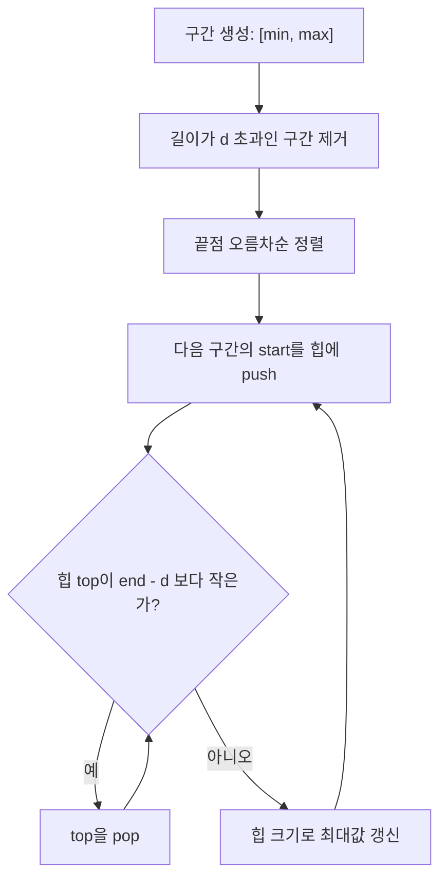

철로 문제는 우선순위 큐와 그리디 알고리즘을 활용하여 효율적으로 해결할 수 있는 문제이다. 수평선 상에 위치한 여러 사람들의 집과 사무실 위치가 주어질 때, 일정한 길이의 철로를 적절히 배치하여 최대한 많은 사람들이 철로를 이용할 수 있도록 하는 것이 목표이다. 이 글에서는 해당 문제를 해결하기 위한 접근 방법과 C++ 및 Python 코드 구현을 상세하게 설명한다.

문제 : [https://www.acmicpc.net/problem/13334](https://www.acmicpc.net/problem/13334)

||
|:---:|
||

## 문제 설명

수평선 위에 집과 사무실이 위치한 **n명의 사람들**이 있다. 각 사람의 집과 사무실은 수평선 상의 특정 지점에 있으며, 이 지점들은 서로 다를 필요는 없다. 즉, 어떤 사람의 집이 다른 사람의 사무실과 같은 위치에 있을 수 있다.

이 사람들의 통근을 돕기 위해 길이가 **d인 철로**를 건설하려 한다. 이 철로는 수평선 상의 어떤 구간이며, 이 구간 위로 기차가 운행된다. 목표는 이 철로 구간에 **집과 사무실 위치가 모두 포함되는 사람들의 수를 최대화**하는 것이다.

예산의 한계로 철로의 길이 **d는 고정된 값**이다. 따라서 우리는 길이 d인 구간을 적절히 선택하여 최대한 많은 사람들이 그 철로를 이용할 수 있도록 해야 한다.

## 문제 정보와 예제

제한 조건은 문제 원문의 시간·메모리 제한과 n, 좌표, d의 범위를 따르며, 이 글에서는 원문을 열람하지 못해 수치를 옮겨 적지 않는다. 입력은 첫 줄에 사람 수 n, 다음 n줄에 각 사람의 집과 사무실 위치, 마지막 줄에 철로 길이 d 순서로 주어진다. 위치는 정수이고 n은 최대 10만 수준이므로 O(n²) 풀이는 시간 안에 끝나지 않는다. 출력은 길이 d 철로에 집과 사무실이 모두 들어가는 사람의 최대 수 하나이다. 백준 사이트가 자동 접근을 막아 제약을 이 글에서 직접 확인하지는 못했으니, 정확한 범위는 문제 원문을 따른다.

아래 예제는 직접 만든 것이며 코드를 실행해 출력을 확인했다.

| 입력 | 출력 |
|---|---|
| 5<br>1 3<br>2 4<br>3 5<br>8 9<br>1 10<br>4 | 3 |

사람별 구간은 [1,3], [2,4], [3,5], [8,9], [1,10]이고 d=4이다. [1,10]은 길이 9라 어떤 철로에도 들어가지 못해 제외된다. 철로를 [1,5]에 놓으면 [1,3], [2,4], [3,5] 세 구간이 완전히 포함되고 [8,9]는 함께 담을 수 없으므로 답은 3이다.

## 접근 방식

이 문제는 각 사람을 구간 [min(집, 사무실), max(집, 사무실)]로 바꾸면 "길이 d인 창에 완전히 들어가는 구간을 최대로 세는" 문제가 된다. 길이가 d보다 긴 구간은 어떤 철로에도 들어가지 못하므로 먼저 버린다. 남은 구간을 끝점 기준으로 오름차순 정렬한 뒤, 끝점을 하나씩 철로의 오른쪽 끝으로 가정하며 훑는다.

이 방식이 최적인 이유는 교환 논증으로 설명된다. 최적 철로가 [L, L+d]라면 그 안에 든 구간 중 끝점이 가장 큰 구간의 끝점 e까지 철로를 오른쪽으로 밀어도(즉 [e-d, e]로 옮겨도) 기존에 들어 있던 구간은 모두 start ≥ L ≥ e-d이고 end ≤ e이므로 여전히 포함된다. 따라서 "어떤 구간의 끝점을 철로의 오른쪽 끝에 맞춘" 후보만 검사해도 최적해를 놓치지 않는다. 끝점 e에서 철로 [e-d, e]에 들어가는 구간은 end ≤ e(정렬로 이미 보장)이면서 start ≥ e-d인 것들이다. 시작점만 최소 힙에 담아 두고 e-d보다 작은 시작점을 꺼내 버리면 힙의 크기가 곧 그 철로가 담는 사람 수가 된다. 끝점이 커질수록 e-d도 커지므로 한 번 버린 시작점은 다시 필요하지 않아 각 구간은 힙에 한 번 들어가고 한 번 나온다.



| 단계 | 시간 | 공간 |
|---|---|---|
| 구간 생성·필터 | O(n) | O(n) |
| 끝점 정렬 | O(n log n) | O(1) 추가 |
| 힙 push·pop (각 구간 1회) | O(n log n) | O(n) |
| 전체 | O(n log n) | O(n) |

대안으로는 좌표를 압축한 뒤 세그먼트 트리로 구간 가산을 하는 방법이 있지만 구현이 길고 상수가 크다. 정렬 후 투 포인터로도 풀 수 있으나 시작점의 순서를 따로 유지해야 해서 힙 풀이가 가장 간결하다. 비슷한 스위핑 기법은 백준 2170번(선 긋기)에서도 쓰인다.

## C++ 코드와 설명

구현할 때 가장 흔한 실수는 구간의 방향을 정규화하지 않는 것이다. 입력에서 집이 사무실보다 오른쪽에 있을 수 있으므로 반드시 작은 값을 시작점으로 잡아야 하며, 그렇지 않으면 `end - d` 비교가 통째로 어긋난다. 또 하나는 힙에서 값을 꺼내는 조건을 시작점 기준으로만 판단한다는 점이다. 끝점은 정렬 덕분에 이미 현재 철로의 오른쪽 끝 이하이므로 다시 확인할 필요가 없고, 시작점만 `end - d` 이상인지 보면 구간 전체가 철로 안에 있음이 보장된다. 아래에 같은 알고리즘을 STL 버전, 표준 라이브러리 없이 힙을 직접 만든 버전, Python 버전의 순서로 싣는다.

```cpp
// 42jerrykim.github.io에서 더 많은 정보를 확인할 수 있다
#include <cstdio>
#include <iostream>
#include <vector>
#include <algorithm>
#include <queue>

using namespace std;

// 집과 사무실 위치를 나타내는 구조체
struct Interval {
    long long start;
    long long end;
};

int main() {
    int n;
    scanf("%d", &n);
    vector<Interval> intervals;

    // 입력 받기
    for (int i = 0; i < n; ++i) {
        long long h, o;
        scanf("%lld %lld", &h, &o);
        long long a = min(h, o);
        long long b = max(h, o);
        intervals.push_back({a, b});
    }

    long long d;
    scanf("%lld", &d);

    // 유효한 인터벌 필터링
    vector<Interval> validIntervals;
    for (auto &interval : intervals) {
        if (interval.end - interval.start <= d) {
            validIntervals.push_back(interval);
        }
    }

    // 끝점을 기준으로 오름차순 정렬
    sort(validIntervals.begin(), validIntervals.end(), [](const Interval &a, const Interval &b) {
        return a.end < b.end;
    });

    // 최소 힙 선언
    priority_queue<long long, vector<long long>, greater<long long>> minHeap;
    int maxCount = 0;

    // 스위핑 수행
    for (auto &interval : validIntervals) {
        minHeap.push(interval.start);
        // 힙에서 유효하지 않은 시작점 제거
        while (!minHeap.empty() && minHeap.top() < interval.end - d) {
            minHeap.pop();
        }
        // 현재 힙 크기가 해당 구간에 포함되는 사람 수
        int currentCount = minHeap.size();
        if (currentCount > maxCount) {
            maxCount = currentCount;
        }
    }

    printf("%d\n", maxCount);
    return 0;
}
```

**코드 설명**

입력 단계에서 각 쌍을 `min`/`max`로 정규화해 `Interval`을 만들고, 길이가 `d` 이하인 것만 `validIntervals`에 모아 끝점 오름차순으로 정렬한다. 핵심은 스위핑 루프의 경계 조건 `minHeap.top() < interval.end - d`이다. 시작점이 정확히 `end - d`인 구간은 철로 끝에 걸쳐 포함되므로 부등호가 `<`여야 하며 `<=`로 쓰면 경계 구간을 잘못 버린다. 힙 크기가 곧 현재 철로가 담는 인원이라 `maxCount`를 갱신하면 끝이다.

## C++ without library 코드와 설명

```cpp
// 42jerrykim.github.io에서 더 많은 정보를 확인할 수 있다
#include <stdio.h>
#include <stdlib.h>

typedef struct {
    long long start;
    long long end;
} Interval;

int compare(const void* a, const void* b) {
    Interval* ia = (Interval*)a;
    Interval* ib = (Interval*)b;
    if (ia->end != ib->end) {
        return ia->end > ib->end ? 1 : -1;
    }
    return 0;
}

typedef struct {
    long long* data;
    int size;
    int capacity;
} MinHeap;

void initHeap(MinHeap* heap, int capacity) {
    heap->data = (long long*)malloc(sizeof(long long) * capacity);
    heap->size = 0;
    heap->capacity = capacity;
}

void swap(long long* a, long long* b) {
    long long temp = *a;
    *a = *b;
    *b = temp;
}

void push(MinHeap* heap, long long value) {
    int idx = heap->size++;
    heap->data[idx] = value;
    while (idx > 0 && heap->data[idx] < heap->data[(idx - 1) / 2]) {
        swap(&heap->data[idx], &heap->data[(idx - 1) / 2]);
        idx = (idx - 1) / 2;
    }
}

long long top(MinHeap* heap) {
    return heap->data[0];
}

void pop(MinHeap* heap) {
    heap->data[0] = heap->data[--heap->size];
    int idx = 0;
    while (1) {
        int left = idx * 2 + 1;
        int right = idx * 2 + 2;
        int smallest = idx;
        if (left < heap->size && heap->data[left] < heap->data[smallest]) {
            smallest = left;
        }
        if (right < heap->size && heap->data[right] < heap->data[smallest]) {
            smallest = right;
        }
        if (smallest == idx) break;
        swap(&heap->data[idx], &heap->data[smallest]);
        idx = smallest;
    }
}

int main() {
    int n;
    scanf("%d", &n);
    Interval* intervals = (Interval*)malloc(sizeof(Interval) * n);
    int i;
    for (i = 0; i < n; ++i) {
        long long h, o;
        scanf("%lld %lld", &h, &o);
        intervals[i].start = h < o ? h : o;
        intervals[i].end = h > o ? h : o;
    }

    long long d;
    scanf("%lld", &d);

    Interval* validIntervals = (Interval*)malloc(sizeof(Interval) * n);
    int validCount = 0;
    for (i = 0; i < n; ++i) {
        if (intervals[i].end - intervals[i].start <= d) {
            validIntervals[validCount++] = intervals[i];
        }
    }

    qsort(validIntervals, validCount, sizeof(Interval), compare);

    MinHeap heap;
    initHeap(&heap, validCount);

    int maxCount = 0;

    for (i = 0; i < validCount; ++i) {
        push(&heap, validIntervals[i].start);
        while (heap.size > 0 && top(&heap) < validIntervals[i].end - d) {
            pop(&heap);
        }
        if (heap.size > maxCount) {
            maxCount = heap.size;
        }
    }

    printf("%d\n", maxCount);

    free(intervals);
    free(validIntervals);
    free(heap.data);
    return 0;
}
```

**코드 설명**

`<algorithm>`·`<queue>` 없이 풀어야 하는 환경을 가정해 최소 힙을 배열로 직접 구현한 버전이다. `push`는 끝에 넣고 부모와 비교하며 올리고, `pop`은 마지막 원소를 루트로 옮긴 뒤 자식 중 작은 쪽과 교환하며 내린다. 정렬은 `qsort`와 끝점 비교 함수가 맡고, 스위핑 로직은 위의 STL 풀이와 같다. `malloc`한 세 배열을 `free`로 모두 반환하는 것도 빠뜨리지 않아야 한다.

## Python 코드와 설명

```python
# 42jerrykim.github.io에서 더 많은 정보를 확인할 수 있다
import sys
import heapq

# 입력을 빠르게 받기 위해 readline 사용
input = sys.stdin.readline

n = int(input())
intervals = []

# 입력 받기
for _ in range(n):
    h, o = map(int, input().split())
    a, b = min(h, o), max(h, o)
    intervals.append((a, b))

d = int(input())

# 유효한 인터벌 필터링
valid_intervals = [(a, b) for a, b in intervals if b - a <= d]

# 끝점을 기준으로 정렬
valid_intervals.sort(key=lambda x: x[1])

min_heap = []
max_count = 0

# 스위핑 수행
for start, end in valid_intervals:
    heapq.heappush(min_heap, start)
    # 힙에서 유효하지 않은 시작점 제거
    while min_heap and min_heap[0] < end - d:
        heapq.heappop(min_heap)
    current_count = len(min_heap)
    if current_count > max_count:
        max_count = current_count

print(max_count)
```

**코드 설명**

`heapq`는 최소 힙만 제공하므로 시작점을 그대로 넣으면 `min_heap[0]`이 가장 작은 시작점이 된다. 필터링은 리스트 컴프리헨션으로, 정렬은 `key=lambda x: x[1]`로 끝점 기준으로 처리한다. 파이썬 정수는 오버플로가 없어 자료형 걱정 없이 `end - d`를 계산할 수 있다.

## 학습 목표 점검

이 글을 읽은 뒤에는 세 가지를 스스로 해낼 수 있어야 한다. 첫째, 철로의 오른쪽 끝을 구간의 끝점에 맞춰도 최적해를 잃지 않는 이유를 교환 논증으로 설명한다. 둘째, 시작점이 정확히 `end - d`인 구간을 포함해야 하는지 판단해 힙 제거 조건을 `<`로 정당화한다. 셋째, 집과 사무실의 순서를 정규화하지 않았을 때 어떤 입력에서 답이 틀어지는지 직접 반례를 만든다. 세 번째 항목은 예를 들어 입력 `8 2`를 그대로 [8,2]로 두고 `end - start <= d`를 계산하면 음수가 되어 길이 필터를 항상 통과해 버리는 상황이다.

## 코너 케이스 및 실수 포인트

| 케이스 | 설명 | 처리 방법 |
|---|---|---|
| **최소 입력** | n=1이고 구간 길이가 d 이하 | 답은 1, 길이가 d 초과면 필터링되어 0 |
| **오버플로우** | 답은 n 이하라 안전하지만 `end - d` 같은 좌표 연산은 int 범위를 넘을 수 있음 | 좌표에 `long long` (C++) 사용 |

## 참고 문헌 및 출처

- 문제 원문: [백준 13334 철로](https://www.acmicpc.net/problem/13334)
