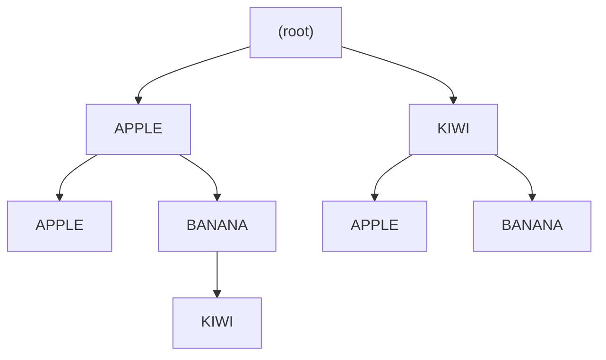

알고리즘 문제 해결에서 계층적 데이터 구조를 다루는 것은 흔한 도전 과제이다. 백준 온라인 저지의 14725번 문제인 <strong>"개미굴"</strong>은 이러한 계층 구조를 표현하고 탐색하기 위해 Trie 자료 구조를 활용하는 좋은 연습 문제이다. 이 글에서는 "개미굴" 문제를 분석하고, Trie를 이용한 해결 방법을 살펴보며, C++, 표준 라이브러리를 사용하지 않은 C++, 그리고 Python으로 구현한 코드를 제시하고자 한다. 이를 통해 Trie 구현과 재귀적 탐색 기법에 대한 이해를 높이고자 한다.

## 문제 소개

문제 : [https://www.acmicpc.net/problem/14725](https://www.acmicpc.net/problem/14725)

## 문제 정보

| 항목 | 내용 |
|---|---|
| 입력 | 로봇 개미 수 N(1 ≤ N ≤ 1,000), 각 개미마다 방 개수 K(1 ≤ K ≤ 15)와 먹이 이름 K개 |
| 먹이 이름 | 알파벳 대문자로 이루어진 길이 15 이하의 문자열 |
| 출력 | 개미굴 전체 구조를 층마다 `--`를 붙여 사전순으로 출력 |

K와 이름 길이의 상한이 15이므로 아래 C 구현의 `char foods[15][16]`(이름 15자 + 널 문자)이 입력 한 줄을 충분히 담는다. 또한 트리 깊이가 최대 15라 재귀 DFS의 스택 오버플로를 걱정할 필요가 없다.

## 이 글을 읽은 후 달성할 목표

- 경로 문자열의 집합을 Trie로 합쳐 공통 접두 경로를 한 번만 저장하는 이유를 설명할 수 있다.
- 자식 정렬을 삽입 시점에 맡기는 방식(`map`)과 출력 직전에 맡기는 방식(`qsort`, `sorted`)의 차이를 비교할 수 있다.
- 삽입과 출력 단계의 시간·공간 복잡도를 직접 유도할 수 있다.

## 문제 설명

개미는 먹이를 저장하기 위해 복잡한 개미굴을 건설한다. 각 개미는 먹이가 있는 방을 따라 개미굴을 내려가며, 더 이상 내려갈 수 없을 때까지 이동한다. 개미는 이동하면서 지나온 방의 먹이 정보를 로봇 개미에게 전달한다.

로봇 개미는 개미들이 지나온 먹이 정보를 받아 개미굴의 구조를 파악하고자 한다. 로봇 개미가 전달하는 정보는 각 층마다 지나온 방의 먹이 이름을 순서대로 나타낸 것이다. 이를 바탕으로 개미굴의 전체 구조를 시각화해야 한다.

개미굴은 다음과 같은 규칙으로 시각화된다:

- 각 층은 `--`로 구분한다.
- 같은 층에 여러 개의 방이 있을 때는 사전 순서대로 출력한다.
- 최상위 굴부터 시작하여 하나의 굴에서 여러 개로 나뉠 때 먹이 종류별로 최대 한 번만 나온다.

**예제 입력:**

```
4
2 KIWI BANANA
2 KIWI APPLE
2 APPLE APPLE
3 APPLE BANANA KIWI
```

**예제 출력:**

```
APPLE
--APPLE
--BANANA
----KIWI
KIWI
--APPLE
--BANANA
```

위 예제에서 로봇 개미들은 각자 지나온 방의 먹이 정보를 전달한다. 우리의 목표는 이 정보를 바탕으로 개미굴의 구조를 시각화하는 것이다.

## 접근 방식

이 문제는 문자열 트리인 **Trie** 자료 구조를 활용하여 해결할 수 있다. Trie는 문자열을 효율적으로 저장하고 탐색하기 위한 트리 구조로, 공통된 접두사를 공유하는 문자열들을 효율적으로 관리할 수 있다.

**구현 전략:**

1. **Trie 구축:**
   - 각 로봇 개미가 전달한 먹이 정보를 Trie에 삽입한다.
   - Trie의 각 노드는 먹이 이름을 키로 가지며, 자식 노드들을 사전 순서대로 저장하기 위해 `map` 또는 `dictionary`를 사용한다.

2. **Trie 탐색 및 출력:**
   - DFS(Depth-First Search)를 사용하여 Trie를 탐색하면서 개미굴을 출력한다.
   - 각 노드의 깊이에 따라 `--`를 반복하여 들여쓰기를 구현한다.
   - 자식 노드들은 사전 순서대로 방문하여 출력 규칙을 만족한다.

3. **주의사항:**
   - 동일한 경로가 중복되지 않도록 Trie에 삽입 시 확인한다.
   - 메모리 및 시간 효율성을 고려하여 자료 구조를 선택한다.

예제 입력 네 줄을 모두 삽입하면 다음 트리가 만들어진다. 루트는 이름이 없는 가상 노드이며, 각 노드의 자식을 사전순으로 방문하면 예제 출력이 그대로 나온다. `KIWI → APPLE`과 `APPLE → APPLE`처럼 층이 달라도 같은 이름이 등장할 수 있으므로, 노드의 정체는 이름이 아니라 루트에서 내려온 경로 전체로 결정된다.



### 대안과의 비교

Trie를 쓰는 근본 이유는 중복 제거와 정렬을 한 구조에서 동시에 해결하기 위해서다. 입력 줄마다 앞부분이 겹치기 때문에, 겹치는 부분을 한 번만 저장하면 출력도 겹침 없이 한 번에 끝난다.

접두 경로를 공유하는 토큰 리스트를 사전순으로 펼치는 문제이므로 Trie 말고도 풀 수 있다. 입력 줄을 토큰 리스트로 보고 전체를 사전순 정렬한 뒤 이전 줄과 처음 달라지는 깊이부터 출력하는 방법은 트리를 만들지 않아 짧지만, 토큰 단위로 비교해야 한다. 줄을 하나의 문자열로 이어 붙여 정렬하면 `A` 다음에 `AB`가 오는 식의 순서 오류가 생길 수 있다. 해시 맵으로 자식을 관리하면 삽입은 평균 O(1)이지만 출력 시 정렬이 따로 필요하다. 입력이 N ≤ 1,000, K ≤ 15로 작아 어느 방식이든 시간 안에 끝나므로, 문제의 계층 표현과 구조가 일치하는 Trie가 가장 읽기 쉽다.

## 복잡도 분석

| 구현 | 삽입 | 출력(DFS) | 공간 |
|---|---|---|---|
| C++ `map` | O(N·K·log C·L) | O(M·L) | O(M·L) |
| C (배열 + `qsort`) | O(N·K·C·L) | O(M·log C·L) | O(M·L) |
| Python `dict` + `sorted` | O(N·K·L) 평균 | O(M·log C·L) | O(M·L) |

N은 개미 수, K는 줄당 토큰 수, M은 서로 다른 노드 수(최대 N·K), C는 한 노드의 자식 수, L은 이름 길이(문자열 비교 비용)이다. C 구현은 자식을 선형 탐색하므로 삽입에서 C 항이 곱해지지만, 최대 연산 수가 수백만 수준이라 제한 안에서 문제되지 않는다.

## C++ 코드와 설명

```cpp
// 출처: https://www.acmicpc.net/problem/14725
// 42jerrykim.github.io에서 더 많은 정보를 확인할 수 있다.
#include <iostream>
#include <map>
#include <vector>
#include <string>
using namespace std;

// Trie의 노드 구조체 정의
struct Node {
    map<string, Node*> children; // 자식 노드들을 사전 순으로 저장
};

// Trie에 먹이 정보를 삽입하는 함수
void insert(Node* root, const vector<string>& foods) {
    Node* current = root;
    for (const string& food : foods) {
        // 자식 노드에 해당 먹이 이름이 없으면 새로 생성
        if (current->children.find(food) == current->children.end()) {
            current->children[food] = new Node();
        }
        // 현재 노드를 자식 노드로 이동
        current = current->children[food];
    }
}

// Trie를 DFS로 탐색하며 개미굴 구조를 출력하는 함수
void dfs(Node* node, int depth) {
    for (const auto& child : node->children) {
        // 현재 깊이에 따라 '--'를 출력하여 들여쓰기 구현
        for (int i = 0; i < depth; ++i) {
            cout << "--";
        }
        // 먹이 이름 출력
        cout << child.first << '\n';
        // 재귀적으로 자식 노드 방문
        dfs(child.second, depth + 1);
    }
}

int main() {
    ios::sync_with_stdio(false);
    cin.tie(nullptr);

    int N; // 로봇 개미의 수
    cin >> N;
    Node* root = new Node(); // Trie의 루트 노드 생성

    for (int i = 0; i < N; ++i) {
        int K; // 먹이 정보의 개수
        cin >> K;
        vector<string> foods(K);
        for (int j = 0; j < K; ++j) {
            cin >> foods[j]; // 먹이 이름 입력
        }
        insert(root, foods); // Trie에 먹이 정보 삽입
    }

    dfs(root, 0); // Trie 탐색 및 출력

    return 0;
}
```

**코드 설명**

`Node`는 자식 이름을 키로 하는 `map<string, Node*>` 하나만 가진다. `map`은 키를 항상 정렬된 상태로 유지하므로 삽입이 끝난 시점에 이미 모든 층의 자식이 사전순이고, 출력 단계에서 별도 정렬이 필요 없다. 이것이 이 구현의 핵심 설계 이유다.

`insert`는 루트에서 시작해 먹이 이름마다 자식을 찾고, 없으면 새 노드를 만든 뒤 그 자식으로 내려간다. 같은 경로가 여러 번 들어와도 이미 있는 노드를 재사용하므로 중복 경로는 자연스럽게 하나로 합쳐진다. `dfs`는 `map` 순서대로 자식을 순회하며 깊이만큼 `--`를 출력하고 재귀로 내려가므로 전위 순회와 출력 규칙이 일치한다. 입출력은 `ios::sync_with_stdio(false)`와 `cin.tie(nullptr)`로 동기화 비용을 줄인다.

## C (표준 라이브러리 최소) 코드와 설명

```c
// 출처: https://www.acmicpc.net/problem/14725
// 42jerrykim.github.io에서 더 많은 정보를 확인할 수 있다.
#include <stdio.h>
#include <stdlib.h>
#include <string.h>

// Trie의 노드 구조체 정의
typedef struct Node {
    char* food; // 현재 노드의 먹이 이름
    struct Node** children; // 자식 노드들
    int childCount; // 자식 노드의 수
    int capacity; // 자식 노드 배열의 용량
} Node;

// 노드 생성 함수
Node* createNode(char* food) {
    Node* node = (Node*)malloc(sizeof(Node));
    node->food = food ? strdup(food) : NULL;
    node->children = NULL;
    node->childCount = 0;
    node->capacity = 0;
    return node;
}

// 자식 노드 추가 함수
void addChild(Node* parent, Node* child) {
    // 자식 노드 배열 확장
    if (parent->childCount == parent->capacity) {
        parent->capacity = parent->capacity ? parent->capacity * 2 : 4;
        parent->children = (Node**)realloc(parent->children, sizeof(Node*) * parent->capacity);
    }
    // 자식 노드 추가
    parent->children[parent->childCount++] = child;
}

// 자식 노드들 정렬 함수
int compare(const void* a, const void* b) {
    Node* nodeA = *(Node**)a;
    Node* nodeB = *(Node**)b;
    return strcmp(nodeA->food, nodeB->food);
}

// Trie에 먹이 정보를 삽입하는 함수
void insert(Node* root, char foods[][16], int k) {
    Node* current = root;
    for (int i = 0; i < k; ++i) {
        int found = 0;
        for (int j = 0; j < current->childCount; ++j) {
            if (strcmp(current->children[j]->food, foods[i]) == 0) {
                current = current->children[j];
                found = 1;
                break;
            }
        }
        if (!found) {
            Node* child = createNode(foods[i]);
            addChild(current, child);
            current = child;
        }
    }
}

// Trie를 DFS로 탐색하며 개미굴 구조를 출력하는 함수
void dfs(Node* node, int depth) {
    // 자식 노드들 정렬
    qsort(node->children, node->childCount, sizeof(Node*), compare);
    for (int i = 0; i < node->childCount; ++i) {
        for (int j = 0; j < depth; ++j) {
            printf("--");
        }
        printf("%s\n", node->children[i]->food);
        dfs(node->children[i], depth + 1);
    }
}

// 메모리 해제 함수
void freeNode(Node* node) {
    for (int i = 0; i < node->childCount; ++i) {
        freeNode(node->children[i]);
    }
    free(node->food);
    free(node->children);
    free(node);
}

int main() {
    int N;
    scanf("%d", &N);
    Node* root = createNode(NULL);

    for (int i = 0; i < N; ++i) {
        int K;
        scanf("%d", &K);
        char foods[15][16];
        for (int j = 0; j < K; ++j) {
            scanf("%s", foods[j]);
        }
        insert(root, foods, K);
    }

    dfs(root, 0);
    freeNode(root);

    return 0;
}
```

**코드 설명**

표준 라이브러리 컨테이너가 없으므로 노드가 자식 포인터 배열과 그 용량을 직접 관리한다. `addChild`는 배열이 가득 차면 용량을 두 배로 늘려(처음에는 4) `realloc`하므로 추가가 평균 O(1)에 처리된다. 이 구현에서는 자식이 정렬 상태를 유지하지 않기 때문에, 삽입은 자식 배열을 선형 탐색해 같은 이름을 찾고 없으면 끝에 붙인다.

정렬은 `dfs` 안에서 각 노드를 방문하는 순간 `qsort`로 한 번에 처리한다. 삽입 중에 정렬을 유지하는 것보다, 모든 입력이 끝난 뒤 노드마다 한 번만 정렬하는 편이 비교 횟수가 적고 코드도 단순하다. `compare`는 노드 이름에 `strcmp`를 적용한다. 마지막에 `freeNode`가 후위 순회로 이름, 자식 배열, 노드 순서로 해제해 누수를 막는다.

## Python 코드와 설명

```python
# 출처: https://www.acmicpc.net/problem/14725
# 42jerrykim.github.io에서 더 많은 정보를 확인할 수 있다.
import sys
sys.setrecursionlimit(10**6)

class Node:
    def __init__(self):
        self.children = {}

def insert(root, foods):
    current = root
    for food in foods:
        if food not in current.children:
            current.children[food] = Node()
        current = current.children[food]

def dfs(node, depth):
    for food in sorted(node.children.keys()):
        print('--' * depth + food)
        dfs(node.children[food], depth + 1)

def main():
    N = int(sys.stdin.readline())
    root = Node()
    for _ in range(N):
        inputs = sys.stdin.readline().split()
        K = int(inputs[0])
        foods = inputs[1:]
        insert(root, foods)
    dfs(root, 0)

if __name__ == "__main__":
    main()
```

**코드 설명**

파이썬은 `dict`로 자식을 관리하므로 삽입은 평균 O(1)이고, 사전순은 `dfs`에서 `sorted(node.children.keys())`로 맞춘다. C 구현과 마찬가지로 정렬을 출력 시점으로 미루는 방식이다. 입력은 `sys.stdin.readline`으로 읽어 `input()`보다 빠르게 처리한다.

트리 깊이가 최대 15이므로 재귀 한도 상향은 이 문제에서는 사실 필요하지 않은 안전장치다. 다만 깊이 제한이 없는 변형 문제에서 같은 코드를 재사용할 때 필요하므로 남겨 두었다.

## 구현별 선택 기준

세 구현은 같은 Trie를 쓰지만 정렬을 치르는 시점이 다르다. `map`은 삽입할 때마다 균형 이진 탐색 트리 규칙으로 자식을 정렬 상태로 유지하므로 코드가 가장 짧고 정렬 호출이 필요 없다. 대신 노드마다 트리 노드 오버헤드가 붙어 메모리가 더 든다. 배열 기반 C 구현은 노드당 메모리가 작고 정렬을 DFS 방문 시점에 한 번만 하지만, 삽입 때 자식 수만큼 `strcmp`를 반복하므로 한 노드의 자식이 많은 입력에서는 `map`보다 느려질 수 있다. 파이썬은 해시 기반이라 삽입이 가장 가볍고, 출력 단계의 `sorted` 호출만 신경 쓰면 된다.

이 문제처럼 삽입이 정렬보다 훨씬 자주 일어나고 출력은 한 번뿐인 구조에서는 "삽입은 싸게, 정렬은 마지막에 한 번"이 일반적으로 유리하다. 반대로 삽입과 출력이 번갈아 일어나는 온라인 문제라면 정렬 상태를 유지하는 `map`이 안전하다. 이때 노드 수 M이 커져도 출력 비용은 O(M·L)로 선형이라는 점을 기억해 두면 구현 선택에 도움이 된다.

## 결론

핵심은 노드를 이름이 아닌 경로로 식별하는 Trie이며, 정렬 비용을 어디서 치르느냐(`map`은 삽입 시, C·Python은 출력 시)가 세 구현의 유일한 구조적 차이다. 입력 제한이 작아 어느 쪽도 충분히 빠르다.

## 코너 케이스 및 실수 포인트

가장 흔한 실수는 노드를 이름으로만 식별하는 것이다. 같은 먹이 이름이 서로 다른 부모 아래에 나올 수 있으므로 자식 맵은 반드시 노드마다 따로 두어야 하며, 전역 해시 맵 하나로 "이미 나온 이름"을 걸러내면 예제의 `KIWI` 두 개 중 하나가 사라진다. 또한 정렬 기준은 층마다 독립적이어서, 위층의 순서가 아래층의 순서에 영향을 주지 않는다는 점을 확인해야 한다.

| 케이스 | 설명 | 처리 방법 |
|---|---|---|
| **K=1** | 한 층짜리 경로만 있는 개미 | 루트의 자식으로만 삽입되며 `--` 없이 출력된다 |
| **공통 접두 경로 중복** | `2 A B`와 `3 A B C`처럼 한 경로가 다른 경로의 접두인 경우 | 같은 노드를 재사용하므로 `A`, `--B`는 한 번만 출력된다 |
| **층이 다른 동일 이름** | `KIWI`가 1층과 2층에 모두 등장 | 이름이 아닌 경로로 노드를 구분해야 하므로 전역 맵으로 이름을 합치면 안 된다 |
| **사전순 비교** | `A`와 `AB`, 길이가 다른 이름 | 줄 전체가 아니라 층마다 자식끼리 `strcmp`/문자열 비교로 정렬한다 |
