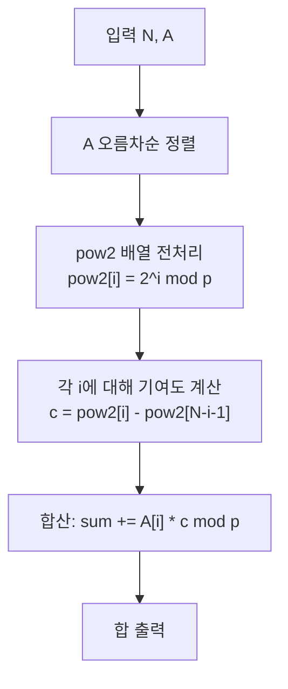

매운맛을 즐기는 주헌이가 새로운 음식점의 모든 매운맛 조합을 시도하면서 느끼는 고통지수의 합을 구하는 문제이다. 이 문제는 큰 수의 조합과 차이를 다루므로 효율적인 알고리즘이 필요하다.

문제 : [https://www.acmicpc.net/problem/15824](https://www.acmicpc.net/problem/15824)


## 문제 설명

주헌이는 매운맛을 좋아하는 사람으로, 음식의 스코빌 지수를 통해 매운맛을 느낀다. 스코빌 지수는 고추류가 가진 매운맛의 원인인 캡사이신의 농도를 수치화한 단위이다. 주헌이가 느끼는 매운 정도는 음식의 절대적인 매운맛이 아니라 메뉴들 간의 상대적인 매운맛 차이에 기반한다.

예를 들어, 스코빌 지수가 `[5, 2, 8]`인 음식들을 먹을 때, 주헌이가 느끼는 매운 정도는 가장 높은 수치인 `8`과 가장 낮은 수치인 `2`의 차이인 `6`이다. 이러한 방식으로 메뉴들의 스코빌 지수가 주어졌을 때, 그 최댓값과 최솟값의 차이를 "주헌고통지수"라고 정의한다.

주헌이는 새로 생긴 매운맛 전문점의 모든 음식 조합을 먹어보려 한다. 이때, 각 조합에서의 주헌고통지수를 모두 합한 값을 구하고자 한다. 단, 같은 조합은 다시 먹지 않으며, 결과는 매우 커질 수 있으므로 `1,000,000,007`로 나눈 나머지를 출력해야 한다.

**입력**

- 첫 줄에 메뉴의 총 개수 `N`이 주어진다. (1 ≤ N ≤ 300,000)
- 두 번째 줄에는 `N`개의 메뉴의 스코빌 지수가 주어진다. 각 스코빌 지수는 `0` 이상 `2^{31} - 1` 이하의 정수이다.

**출력**

- 한 줄에 모든 조합의 주헌고통지수 합을 `1,000,000,007`로 나눈 나머지를 출력한다.

## 접근 방식

이 문제는 모든 부분 집합에 대해 최댓값과 최솟값의 차이를 구해 합산하는 문제다. `N`이 최대 `300,000`이므로 부분 집합이 `2^N`개에 이르러 직접 열거하는 방식은 처음부터 불가능하다. 핵심은 합의 순서를 바꾸는 것이다. "부분 집합마다 최대·최소를 찾는다"는 관점을 "원소마다 몇 개의 부분 집합에서 최대 또는 최소가 되는가"로 뒤집으면, 전체 합이 원소별 기여도의 합으로 분해된다.

먼저 배열을 오름차순으로 정렬한다. 부분 집합에서 최대·최소가 무엇인지는 원소의 값 순서에만 의존하므로 정렬해도 답은 변하지 않는다. 정렬된 배열에서 `i`번째(0부터 시작) 원소가 부분 집합의 최댓값이 되려면 그 원소를 포함하고, 나머지 원소는 자기보다 앞에 있는 `i`개 중에서만 골라야 한다. 앞의 `i`개 각각을 넣을지 말지 정할 수 있으므로 경우의 수는 `2^i`이다. 같은 논리로 `i`번째 원소가 최솟값이 되려면 뒤쪽 `N-i-1`개에서만 고를 수 있어 `2^{N-i-1}`가지이다. 값이 같은 원소가 여러 개일 때는 정렬 후의 인덱스가 앞서는 쪽을 더 작은 것으로 약속하면, 각 부분 집합의 최댓값과 최솟값 담당 원소가 정확히 하나로 정해져 중복 계산이 생기지 않는다. 원소가 하나뿐인 부분 집합은 최대와 최소가 같은 원소이므로 두 기여가 서로 상쇄되어 합에 영향을 주지 않는다.

따라서 정답은 `A[i] × (2^i − 2^{N−i−1})`을 모든 `i`에 대해 더한 값이다. 예를 들어 `[2, 5, 8]`이면 `i=0`은 `2 × (1 − 4) = −6`, `i=1`은 `5 × (2 − 2) = 0`, `i=2`는 `8 × (4 − 1) = 24`로 합이 `18`이다. 부분 집합을 직접 나열하면 `{2,5}=3`, `{2,8}=6`, `{5,8}=3`, `{2,5,8}=6`이고 합이 `18`이어서 일치한다. 구현에서는 `2^i`를 매번 거듭제곱으로 구하지 않고 `pow2[i] = pow2[i-1] × 2 mod 1,000,000,007`로 미리 배열에 채워 두며, 뺄셈이 음수가 될 수 있으므로 모듈러를 더한 뒤 다시 나머지를 취한다.



| 단계 | 시간 복잡도 | 공간 복잡도 |
|---|---|---|
| 정렬 | O(N log N) | O(1)~O(N) |
| `pow2` 전처리 | O(N) | O(N) |
| 기여도 합산 | O(N) | O(1) |
| 전체 | **O(N log N)** | **O(N)** |

## C++ 코드와 설명

```cpp
// 출처: https://www.acmicpc.net/problem/15824
#include <iostream>
#include <vector>
#include <algorithm>
#define MOD 1000000007
typedef long long ll;
using namespace std;

int main() {
    ios::sync_with_stdio(false); // 입출력 속도 향상
    cin.tie(NULL);

    int N;
    cin >> N;
    vector<ll> A(N);
    for(int i = 0; i < N; ++i)
        cin >> A[i]; // 스코빌 지수 입력

    sort(A.begin(), A.end()); // 오름차순 정렬

    vector<ll> pow2(N);
    pow2[0] = 1;
    for(int i = 1; i < N; ++i)
        pow2[i] = (pow2[i - 1] * 2) % MOD; // 2의 거듭제곱 미리 계산

    ll total_sum = 0;
    for(int i = 0; i < N; ++i) {
        ll max_count = pow2[i]; // A[i]가 최대값이 되는 부분 집합 수
        ll min_count = pow2[N - i - 1]; // A[i]가 최소값이 되는 부분 집합 수
        ll contribution = (max_count - min_count + MOD) % MOD; // 기여도 계산
        total_sum = (total_sum + A[i] * contribution) % MOD; // 총 합에 더하기
    }

    cout << total_sum << "\n"; // 결과 출력
    return 0;
}
```

위 코드는 앞서 설명한 공식을 그대로 옮긴 것이다. 입출력은 `ios::sync_with_stdio(false)`와 `cin.tie(NULL)`로 가속하고, `pow2` 배열을 먼저 채운 뒤 각 원소의 `max_count - min_count`를 `contribution`으로 삼아 `A[i]`와 곱해 누적한다. 뺄셈 결과가 음수일 수 있어 `MOD`를 더한 뒤 나머지를 취한다. `A[i]`는 최대 `2^{31} - 1`이고 `contribution`은 `MOD` 미만이므로 곱은 약 `2.1 × 10^18`로 `long long`의 범위(약 `9.2 × 10^18`) 안에 들어간다. 이것이 `A`를 `ll`로 선언한 이유다.

## C++ without library 코드와 설명

```cpp
// 출처: https://www.acmicpc.net/problem/15824
#include <stdio.h>
#include <stdlib.h>
#define MOD 1000000007
typedef long long ll;

int compare(const void* a, const void* b) {
    ll num1 = *(ll*)a;
    ll num2 = *(ll*)b;
    if(num1 > num2) return 1;
    else if(num1 < num2) return -1;
    else return 0;
}

int main() {
    int N;
    scanf("%d", &N);
    ll* A = (ll*)malloc(N * sizeof(ll));
    for(int i = 0; i < N; ++i)
        scanf("%lld", &A[i]); // 스코빌 지수 입력

    qsort(A, N, sizeof(ll), compare); // 오름차순 정렬

    ll* pow2 = (ll*)malloc(N * sizeof(ll));
    pow2[0] = 1;
    for(int i = 1; i < N; ++i)
        pow2[i] = (pow2[i - 1] * 2) % MOD; // 2의 거듭제곱 미리 계산

    ll total_sum = 0;
    for(int i = 0; i < N; ++i) {
        ll max_count = pow2[i]; // A[i]가 최대값이 되는 부분 집합 수
        ll min_count = pow2[N - i - 1]; // A[i]가 최소값이 되는 부분 집합 수
        ll contribution = (max_count - min_count + MOD) % MOD; // 기여도 계산
        total_sum = (total_sum + A[i] % MOD * contribution % MOD) % MOD; // 총 합에 더하기
    }

    printf("%lld\n", total_sum); // 결과 출력

    free(A);
    free(pow2);
    return 0;
}
```

STL 없이 C 표준 라이브러리만 쓰는 버전이며 알고리즘은 같다. 차이는 세 가지이다. 정렬은 `qsort`와 비교 함수 `compare`를 사용하고, 배열은 `malloc`으로 할당했으므로 끝에서 `free`로 해제해야 한다. 또한 곱셈 앞에서 `A[i] % MOD`로 먼저 줄여 중간값을 더 작게 유지한다.

## Python 코드와 설명

```python
# 출처: https://www.acmicpc.net/problem/15824
import sys
input = sys.stdin.readline

MOD = 1000000007

N = int(input())
A = list(map(int, input().split()))
A.sort()  # 오름차순 정렬

pow2 = [1] * N
for i in range(1, N):
    pow2[i] = (pow2[i - 1] * 2) % MOD  # 2의 거듭제곱 계산

total_sum = 0
for i in range(N):
    max_count = pow2[i]  # A[i]가 최대값이 되는 부분 집합 수
    min_count = pow2[N - i - 1]  # A[i]가 최소값이 되는 부분 집합 수
    contribution = (max_count - min_count) % MOD  # 기여도 계산
    total_sum = (total_sum + A[i] * contribution) % MOD  # 총 합에 더하기

print(total_sum)
```

Python 버전도 구조가 같고, `sys.stdin.readline`으로 입력 속도를 높인 점이 다르다. 정수가 임의 정밀도이므로 오버플로우 걱정은 없고, `%` 연산이 항상 음이 아닌 값을 돌려주므로 C++처럼 `MOD`를 더해 보정할 필요도 없다. `N = 300,000`에서 루프가 두 번 돌 뿐이라 시간 제한 안에서 충분히 동작한다.

## 판단 기준과 흔한 오해

부분 집합을 모두 세는 문제에서 "원소별 기여도로 분해할 수 있는가"를 먼저 물어보는 것이 판단의 출발점이다. 합산하려는 값(여기서는 최대−최소)이 부분 집합 내 원소의 순서 통계량에만 의존하고, 정렬하면 각 원소가 그 통계량이 되는 경우의 수가 닫힌 식으로 나온다면 이 방법이 통한다. 반대로 값이 원소들의 합이나 곱처럼 부분 집합 전체에 의존하면 별도의 DP나 생성함수가 필요하다.

흔한 오해가 둘 있다. 첫째는 "정렬하면 원소의 원래 위치가 사라져 답이 달라진다"는 생각인데, 부분 집합은 위치가 아니라 원소의 값 집합으로 정의된 합이므로 정렬이 답에 영향을 주지 않는다. 둘째는 "값이 같은 원소가 있으면 중복 계산된다"는 생각인데, 위에서 본 대로 정렬 후 인덱스를 기준으로 최댓값·최솟값 담당을 하나로 정하면 중복 없이 센다.

## 코너 케이스 및 실수 포인트

| 케이스 | 설명 | 처리 방법 |
|---|---|---|
| **N = 1** | 부분 집합이 원소 하나뿐이라 답이 `0` | `pow2[0] - pow2[0] = 0`이 자연스럽게 나온다 |
| **음수 나머지** | `pow2[i] - pow2[N-i-1]`이 음수가 될 수 있다 | C++은 `+ MOD` 후 `% MOD`, Python은 `%`만으로 충분 |
| **중간곱 오버플로우** | `A[i] × contribution`이 약 `2.1 × 10^18` | C++은 `long long`을 쓰고, 값은 `9.2 × 10^18` 이하에 머문다 |
| **같은 값 반복** | 값이 모두 같으면 답은 `0` | 정렬 후 인덱스 기준으로 기여가 상쇄된다 |

## 이 글을 읽은 후 달성해야 할 목표

이 글을 읽고 나면 다음을 스스로 할 수 있어야 한다. 부분 집합 전체에 대한 합을 원소별 기여도 합으로 바꾸는 이유를 설명한다. 정렬된 배열에서 `i`번째 원소가 최댓값·최솟값이 되는 경우의 수를 각각 `2^i`, `2^{N-i-1}`로 유도한다. 임의의 작은 입력에 대해 손으로 정답을 계산해 브루트포스와 대조한다. 모듈러 뺄셈에서 음수 보정과 `long long` 곱셈 범위를 점검한다.

## 결론

핵심은 합의 순서를 바꾸어 "부분 집합마다"가 아니라 "원소마다" 기여를 세는 데 있고, 정렬과 `2`의 거듭제곱 전처리만으로 `O(N log N)`에 풀린다. 변수 하나로 거듭제곱을 갱신하면 `pow2` 배열 없이도 구현할 수 있어 메모리를 줄일 수 있다.
