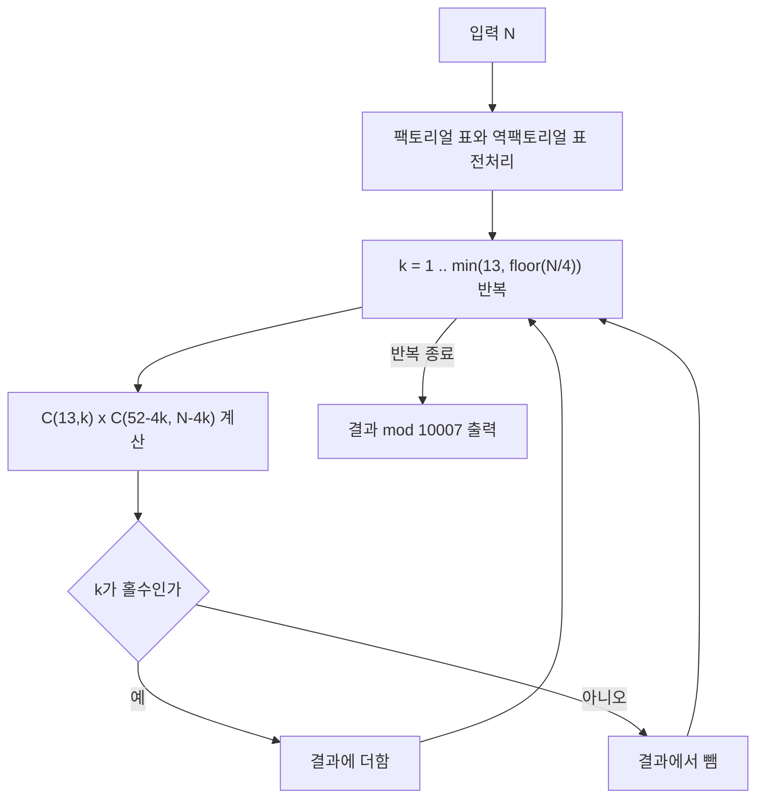

트럼프 카드로 새로운 게임을 만들기로 한 정연이의 이야기로 시작해보자. 이 게임은 딜러와 플레이어가 1:1로 플레이하며, 플레이어는 52장의 트럼프 카드 중 N장을 뽑는다. 만약 뽑은 카드들로 "포카드(four of a kind)" 족보를 만들 수 있다면 플레이어의 승리, 그렇지 않다면 딜러의 승리로 게임이 끝난다. 여기서 포카드는 같은 숫자의 카드 4장을 의미한다.

정연이는 공정한 게임을 위해 N의 값을 결정하고자 한다. 이를 위해 N장의 카드를 뽑았을 때 플레이어가 이길 수 있는 경우의 수를 구하려고 한다. 우리의 목표는 N이 주어졌을 때, 플레이어가 이기는 경우의 수를 10,007로 나눈 나머지를 구하는 것이다.

문제 : 백준 온라인 저지(BOJ) 16565번 N포커 (BOJ 서비스 종료로 원문 링크는 제거했으며, 문제 전문은 아래에 수록했다)


## 문제 설명

52장의 트럼프 카드는 각 4개의 문양(♥, ♠, ◆, ♣)과 13개의 숫자(A, 2, 3, ..., 10, J, Q, K)로 구성되어 있다.

플레이어는 N장의 카드를 뽑는다. 뽑은 카드들 중에서 같은 숫자의 카드 4장이 존재하면 이를 "포카드(four of a kind)"라고 하며, 이 경우 플레이어가 승리한다.

정연이는 N장의 카드를 뽑았을 때 플레이어가 이기는 경우의 수를 알고 싶어한다. 즉, N장의 카드에 하나 이상의 포카드가 포함되어 있는 경우의 수를 구하는 것이다.

단, 결과를 10,007로 나눈 나머지를 출력해야 한다.

입력은 정수 N(1 ≤ N ≤ 52) 하나이고, 출력은 플레이어가 이기는 경우의 수를 10,007로 나눈 나머지다. 예제는 다음과 같다.

```text
입력 4 -> 출력 13
입력 5 -> 출력 624
```

N=4에서는 네 장이 모두 같은 숫자여야 하므로 숫자 13가지가 곧 답이고, N=5에서는 포카드 한 벌에 나머지 48장 중 한 장을 더한 13×48=624가지다.

## 학습 목표

이 글을 읽고 나면 다음을 설명할 수 있어야 한다.

- 합집합의 크기를 구할 때 포함-배제의 원리가 왜 필요한지, 단순 곱셈이 어떤 경우를 중복해서 세는지
- 공식 $\sum_{k}(-1)^{k+1}\binom{13}{k}\binom{52-4k}{N-4k}$가 각 항에서 무엇을 세는지
- 법 10007이 소수이고 52보다 크기 때문에 팩토리얼의 모듈러 역원을 쓸 수 있다는 점

## 접근 방식

이 문제는 **조합론**과 **포함 배제의 원리**를 활용하여 풀 수 있다. 전체 경우의 수는 52장에서 N장을 뽑는 $\binom{52}{N}$이고, 플레이어가 이기는 경우는 N장 중에 포카드가 적어도 하나 있는 경우다. 여러 숫자에서 동시에 포카드가 나올 수도 있다는 점이 이 문제의 핵심 난점이다.

### 흔한 오개념: 단순 곱셈은 중복 계산이다

가장 먼저 떠오르는 풀이는 "포카드로 쓸 숫자를 하나 고르고(13가지), 나머지 $N-4$장을 아무렇게나 고른다($\binom{48}{N-4}$)"이다. 그러나 이 방식은 포카드가 둘 이상인 손패를 여러 번 센다. N=8을 보면 $13\binom{48}{4}=2{,}529{,}540$이지만, 숫자 두 개가 모두 포카드인 손패($\binom{13}{2}=78$가지)는 "A를 먼저 고른 경우"와 "K를 먼저 고른 경우"에서 각각 한 번씩, 총 두 번 세어진다. 실제 정답은 78을 한 번 빼 준 $2{,}529{,}462$이며, 모듈러 10007을 적용하면 7698이다. 포함-배제는 이렇게 겹쳐 세어진 부분을 교대로 더하고 빼서 바로잡는 도구다.

### 포함-배제의 적용

숫자 $r$에 대해 "손패에 숫자 $r$의 카드 4장이 모두 들어 있는 집합"을 $S_r$이라 하면, 구하려는 값은 $|S_1 \cup S_2 \cup \dots \cup S_{13}|$이다. 포함-배제의 공식은 다음과 같다.

\[
|\bigcup_{i=1}^{n} S_i| = \sum_{k=1}^{n} (-1)^{k+1} \left( \sum_{1 \leq i_1 < i_2 < \dots < i_k \leq n} |S_{i_1} \cap S_{i_2} \cap \dots \cap S_{i_k}| \right)
\]

$k$개의 특정 숫자가 모두 포카드인 손패의 수는 그 $4k$장을 고정하고 남은 $52-4k$장 중에서 $N-4k$장을 고르는 $\binom{52-4k}{N-4k}$다. 어떤 $k$개 숫자를 골라도 이 값이 같고, 숫자를 고르는 방법이 $\binom{13}{k}$가지이므로 안쪽 합은 곱으로 묶인다. 결과는 다음과 같다.

\[
\text{결과} = \sum_{k=1}^{13} (-1)^{k+1} \binom{13}{k} \binom{52 - 4k}{N - 4k}
\]

- $\binom{13}{k}$: 포카드를 만들 숫자 $k$개 선택
- $\binom{52 - 4k}{N - 4k}$: 고정한 $4k$장을 제외한 나머지 카드 중에서 $N - 4k$장 선택

$N \geq 4k$이어야 항이 의미를 가지며, $N - 4k \leq 52 - 4k$는 $N \leq 52$면 항상 성립한다. 코드에서는 이 범위를 벗어나는 $k$를 건너뛴다.

### 풀이 흐름



### 다른 접근과의 비교

완전탐색($\binom{52}{N}$개의 손패를 직접 나열)은 N이 조금만 커져도 불가능하다. 숫자별로 몇 장을 뽑았는지를 상태로 하는 동적계획법($dp[\text{숫자}][\text{뽑은 장수}]$)도 가능하지만, 포함-배제 공식은 항이 최대 13개뿐이라 구현이 짧고 빠르다. 여사건(포카드가 하나도 없는 손패)을 세는 방법은 숫자마다 0–3장만 허용하는 계수 곱의 전개가 필요해 이 문제에서는 더 번거롭다.

### 모듈러 이항 계수

답을 10007로 나눈 나머지로 요구하므로 $\binom{n}{r}=\frac{n!}{r!(n-r)!}$의 나눗셈을 곱셈으로 바꿔야 한다. 10007은 소수이고 $n \le 52 < 10007$이라 $n!$이 10007의 배수가 되지 않으므로, 페르마 소정리에 따라 $a^{-1} \equiv a^{10005} \pmod{10007}$이다. 이 역원을 빠른 거듭제곱으로 구해 팩토리얼의 역원 표를 만들어 두면 이항 계수를 상수 시간에 계산할 수 있다.

### 복잡도

| 구분 | 비용 | 설명 |
|---|---|---|
| 전처리 | $O(\text{MAXN} + \log \text{MOD})$ | 팩토리얼 표 52칸과 역원 하나(거듭제곱 약 14회 반복) |
| 질의 | $O(\lfloor N/4 \rfloor)$ | 최대 13개의 항, 항마다 이항 계수 조회 $O(1)$ |
| 공간 | $O(\text{MAXN})$ | 팩토리얼·역팩토리얼 배열 |

N과 MAXN의 상한이 고정(52)이므로 실질적으로 상수 시간이다.

## C++ 코드와 설명

```cpp
#include <iostream>
using namespace std;

const int MOD = 10007;
const int MAXN = 52;

int factorial[MAXN + 1];
int inv_factorial[MAXN + 1];

// 모듈러 거듭제곱 함수: x^y mod MOD 계산
int mod_pow(int x, int y) {
    int result = 1;
    x %= MOD;
    while(y > 0) {
        if(y % 2 == 1)
            result = result * x % MOD;
        x = x * x % MOD;
        y /= 2;
    }
    return result;
}

// 모듈러 역원 계산: n^(-1) mod MOD
int mod_inv(int n) {
    return mod_pow(n, MOD - 2);
}

// 이항 계수 계산: nCr mod MOD
int nCr(int n, int r) {
    if(r < 0 || r > n) return 0;
    return factorial[n] * inv_factorial[r] % MOD * inv_factorial[n - r] % MOD;
}

int main() {
    int N;
    cin >> N;

    // 팩토리얼과 역팩토리얼 미리 계산
    factorial[0] = 1;
    for(int i = 1; i <= MAXN; ++i)
        factorial[i] = factorial[i - 1] * i % MOD;

    inv_factorial[MAXN] = mod_inv(factorial[MAXN]);
    for(int i = MAXN - 1; i >= 0; --i)
        inv_factorial[i] = inv_factorial[i + 1] * (i + 1) % MOD;

    int result = 0;
    int maxK = N / 4;
    if(maxK > 13) maxK = 13; // 최대 13개의 숫자만 존재

    for(int k = 1; k <= maxK; ++k) {
        int sign = (k % 2 == 1) ? 1 : -1; // 포함 배제의 부호 결정
        int comb1 = nCr(13, k); // 포카드로 사용할 숫자 k개 선택
        int remaining_cards = 52 - 4 * k; // 남은 카드 수
        int remaining_draws = N - 4 * k; // 남은 뽑아야 할 카드 수

        if(remaining_draws < 0 || remaining_draws > remaining_cards) continue;

        int comb2 = nCr(remaining_cards, remaining_draws); // 남은 카드에서 선택
        int term = sign * comb1 % MOD * comb2 % MOD;
        if(term < 0) term += MOD; // 음수 처리

        result = (result + term) % MOD;
    }

    cout << result << endl;
    return 0;
}
```

**코드 설명**

코드는 먼저 팩토리얼 표를 만들고, 마지막 값 $52!$의 모듈러 역원을 `mod_pow`로 한 번만 구한 뒤 거꾸로 내려오며 $(i-1)!$의 역원을 $i!$의 역원에 $i$를 곱해 채운다. 역원 계산을 한 번으로 줄이는 것이 이 전처리의 요점이다. 본 계산에서는 $k$를 1부터 $\lfloor N/4 \rfloor$까지 돌리며 홀수 $k$는 더하고 짝수 $k$는 빼는데, C++의 `%`는 음수 피연산자에 대해 음수를 돌려주므로 `term`이 음수면 MOD를 더해 양수로 바꾼 뒤 누적한다. 중간 곱은 `int` 범위 안에서 모듈러를 취하므로 `long long`은 필요하지 않다(가장 큰 중간값은 $10006^2 \approx 10^8$).

C 스타일(`stdio.h`만 사용)로 쓰고 싶다면 위 코드에서 `cin >> N`과 `cout << result`를 각각 `scanf("%d", &N)`와 `printf("%d\n", result)`로 바꾸면 된다. 알고리즘과 나머지 코드는 동일하다.

## Python 코드와 설명

```python
MOD = 10007
MAXN = 52

factorial = [1] * (MAXN + 1)
inv_factorial = [1] * (MAXN + 1)

# 모듈러 거듭제곱 함수
def mod_pow(x, y):
    result = 1
    x %= MOD
    while y > 0:
        if y % 2 == 1:
            result = result * x % MOD
        x = x * x % MOD
        y //= 2
    return result

# 모듈러 역원 계산
def mod_inv(n):
    return mod_pow(n, MOD - 2)

# 이항 계수 계산
def nCr(n, r):
    if r < 0 or r > n:
        return 0
    return factorial[n] * inv_factorial[r] % MOD * inv_factorial[n - r] % MOD

N = int(input())

# 팩토리얼과 역팩토리얼 미리 계산
for i in range(1, MAXN + 1):
    factorial[i] = factorial[i - 1] * i % MOD

inv_factorial[MAXN] = mod_inv(factorial[MAXN])
for i in range(MAXN - 1, -1, -1):
    inv_factorial[i] = inv_factorial[i + 1] * (i + 1) % MOD

result = 0
maxK = N // 4
if maxK > 13:
    maxK = 13

for k in range(1, maxK + 1):
    sign = 1 if k % 2 == 1 else -1  # 포함 배제의 부호 결정
    comb1 = nCr(13, k)  # 포카드로 사용할 숫자 k개 선택
    remaining_cards = 52 - 4 * k  # 남은 카드 수
    remaining_draws = N - 4 * k  # 남은 뽑아야 할 카드 수

    if remaining_draws < 0 or remaining_draws > remaining_cards:
        continue

    comb2 = nCr(remaining_cards, remaining_draws)  # 남은 카드에서 선택
    term = sign * comb1 % MOD * comb2 % MOD
    result = (result + term) % MOD

print(result)
```

**코드 설명**

로직은 C++ 코드와 같고, 팩토리얼 표를 리스트로 만든다는 점만 다르다. Python의 `%`는 법이 양수이면 항상 0 이상의 값을 돌려주므로 음수 보정이 필요 없고, 정수 오버플로우도 없다.

## 결론

이 문제의 핵심은 "포카드가 겹치는 손패를 한 번만 센다"이며, 포함-배제 공식 $\sum_k (-1)^{k+1}\binom{13}{k}\binom{52-4k}{N-4k}$가 이를 항 13개 이내로 해결한다. 모듈러 역원은 10007이 소수라는 조건 덕분에 페르마 소정리로 얻는다. 풀이를 검증할 때는 N=4(답 13), N=5(답 624), N=8(단순 곱셈 2,529,540 대 정답 2,529,462)처럼 겹침이 처음 생기는 경계값을 손으로 확인하면 좋다.

## 참고 자료

- [Inclusion–exclusion principle (Wikipedia)](https://en.wikipedia.org/wiki/Inclusion%E2%80%93exclusion_principle): 포함-배제 공식의 일반형과 증명
- [Fermat's little theorem (Wikipedia)](https://en.wikipedia.org/wiki/Fermat%27s_little_theorem): 소수 법에서의 모듈러 역원
- [Binomial coefficient (Wikipedia)](https://en.wikipedia.org/wiki/Binomial_coefficient): 이항 계수의 정의와 성질

## 코너 케이스 및 실수 포인트

| 케이스 | 설명 | 처리 방법 |
|---|---|---|
| **N < 4** | 포카드를 만들 수 없어 답이 0 | `maxK = N / 4 = 0`이라 반복문이 돌지 않고 0 출력 |
| **N = 8 이상** | 포카드가 둘 이상인 손패가 생겨 중복 계산 발생 | 짝수 $k$ 항을 빼는 부호 처리 확인 |
| **음수 나머지** | C++에서 `-x % MOD`는 음수 | `term < 0`이면 MOD를 더해 보정 |
| **N이 52에 가까움** | $52-4k < N-4k$인 항은 없지만 $N>52$는 입력 범위 밖 | `remaining_draws > remaining_cards`이면 건너뜀 |
