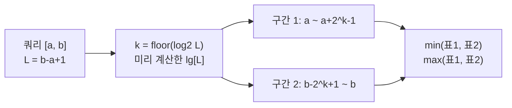

이번 포스팅에서는 백준 온라인 저지의 2357번 문제인 <strong>"최솟값과 최댓값"</strong>을 다룬다. 수열이 한 번 주어진 뒤 바뀌지 않고 구간 질의만 10만 번 들어오는 전형적인 정적 구간 질의(Range Query) 문제이며, 이런 조건에서는 **Sparse Table**이 가장 단순하고 빠른 답이다.

문제 : [https://www.acmicpc.net/problem/2357](https://www.acmicpc.net/problem/2357)

## 문제 설명

N개의 정수로 이루어진 수열과 M개의 쿼리가 주어진다. 각 쿼리는 구간 [a, b]이며, 그 구간에 포함된 정수들의 **최솟값**과 **최댓값**을 한 줄에 출력한다. a번째와 b번째는 입력된 순서를 뜻한다.

- **N (1 ≤ N ≤ 100,000)**: 수열의 원소 개수
- **M (1 ≤ M ≤ 100,000)**: 쿼리의 개수
- **원소의 값**: 1 이상 1,000,000,000 이하의 정수
- **쿼리**: [a, b] 형태이며 a ≤ b

수열이 [75, 30, 100, 38, 50, 51, 52, 20, 81, 5]이고 쿼리가 (1, 10), (3, 5), (6, 9), (8, 10)이면 결과는 각각 (5, 100), (38, 100), (20, 81), (5, 81)이다.

입력은 첫 줄에 N과 M, 이어서 N개 줄에 원소가 한 줄씩, 마지막으로 M개 줄에 쿼리가 주어진다. 예시 수열과 쿼리에 해당하는 입출력은 다음과 같다.

```text
10 4
75
30
100
38
50
51
52
20
81
5
1 10
3 5
6 9
8 10
```

```text
5 100
38 100
20 81
5 81
```

쿼리마다 구간을 처음부터 훑으면 최악의 경우 N×M = 10^10번의 비교가 필요해 시간 초과가 난다. 수열이 변하지 않으므로 전처리로 구간 정보를 미리 만들어 두고 쿼리마다 상수 시간에 답을 꺼내는 것이 목표다.

## 접근 방식

Sparse Table의 핵심은 "길이가 2의 거듭제곱인 구간의 답만 미리 저장한다"는 것이다. 길이 2^k짜리 구간의 최솟값은 길이 2^(k-1)짜리 두 구간(앞쪽 절반과 뒤쪽 절반)의 최솟값 중 작은 쪽이므로, k=0(원소 자신)에서 시작해 k를 키우며 동적 계획법으로 채울 수 있다. 시작 위치 i는 N개, k는 최대 log₂N개이므로 표는 N·log N칸이고, 각 칸을 O(1)에 채우므로 전처리는 O(N log N)이다.

임의의 구간 [a, b]는 길이가 2의 거듭제곱이 아닐 수 있다. 이때 길이 L = b−a+1에 대해 2^k ≤ L인 가장 큰 k를 잡으면, 구간 [a, a+2^k−1]과 구간 [b−2^k+1, b] 두 개가 합쳐서 [a, b] 전체를 덮는다. 두 구간은 가운데에서 겹칠 수 있지만, 최솟값과 최댓값은 같은 원소를 두 번 반영해도 결과가 바뀌지 않는 **멱등(idempotent) 연산**이므로 문제가 없다. 이 겹침 허용 덕분에 쿼리가 구간을 쪼개 이어 붙이는 O(log N) 작업 없이 표 두 칸 조회만으로 끝난다.



예시 수열에서 쿼리 (1, 10)을 따라가 보자. 0-index로 바꾸면 구간은 [0, 9]이고 길이 L=10이므로 k=floor(log₂10)=3, 즉 길이 8짜리 구간 두 개를 쓴다. 앞쪽은 [0, 7]이라 최솟값 20, 최댓값 100이고, 뒤쪽은 [2, 9]라 최솟값 5, 최댓값 100이다. 둘의 min은 5, max는 100으로 정답과 일치하며, 인덱스 2부터 7까지 여섯 원소가 두 구간에 모두 속하지만 결과에는 영향이 없다. 이처럼 겹침이 크더라도 답이 같다는 점이 이 기법이 성립하는 근거다.

floor(log₂L)은 매 쿼리마다 계산하지 않고 `lg[i] = lg[i/2] + 1` 점화식으로 1..N 전체를 한 번에 채워 둔다. 이렇게 하면 쿼리당 비용이 정말 상수가 된다.

### 복잡도

| 항목 | 시간 | 공간 |
|---|---|---|
| 전처리 (min·max 표 2개) | O(N log N) | O(N log N) |
| 쿼리 1회 | O(1) | - |
| 전체 | O(N log N + M) | O(N log N) |

N=100,000이면 k는 0..16이므로 표 하나가 약 170만 칸이고, 두 표를 합쳐도 int 기준 약 14MB 수준이라 메모리 제한 안에 충분히 들어온다.

### 세그먼트 트리와의 선택 기준

같은 문제를 세그먼트 트리로도 풀 수 있다. 세그먼트 트리는 쿼리가 O(log N)이고 공간이 O(N)이지만 값이 갱신되는 상황도 처리한다. Sparse Table은 갱신을 지원하지 않는다. 원소 하나가 바뀌면 그 원소를 포함하는 모든 표 칸을 다시 계산해야 하기 때문이다. 따라서 수열이 고정이고 쿼리가 많으면 Sparse Table, 중간에 값이 바뀌면 세그먼트 트리를 고른다. 또 합이나 XOR처럼 멱등이 아닌 연산은 겹친 구간이 두 번 계산되어 결과가 틀리므로 Sparse Table의 O(1) 쿼리를 그대로 쓸 수 없다.

## C++ 코드와 설명

```cpp
// 42jerrykim.github.io에서 더 많은 정보를 확인할 수 있다
#include <cstdio>
#include <algorithm>
using namespace std;

const int MAXN = 100000; // 수열의 최대 크기
const int MAXK = 17;     // k 최대 16, 여유 1칸 포함

int N, M;
int A[MAXN];                      // 수열을 저장할 배열
int lg[MAXN + 1];               // 로그 값을 저장할 배열
int minTable[MAXN][MAXK + 1];     // 최솟값을 저장할 Sparse Table
int maxTable[MAXN][MAXK + 1];     // 최댓값을 저장할 Sparse Table

int main() {
    scanf("%d %d", &N, &M);       // 수열의 크기 N과 쿼리의 개수 M 입력
    for(int i = 0; i < N; ++i) {
        scanf("%d", &A[i]);       // 수열 입력
    }

    // 로그 값 미리 계산
    lg[1] = 0;
    for(int i = 2; i <= N; ++i) {
        lg[i] = lg[i / 2] + 1;
    }

    // Sparse Table 초기화 (구간 길이 1인 경우)
    for(int i = 0; i < N; ++i) {
        minTable[i][0] = A[i];
        maxTable[i][0] = A[i];
    }

    // Sparse Table 구축
    for(int k = 1; (1 << k) <= N; ++k) {
        for(int i = 0; i + (1 << k) <= N; ++i) {
            minTable[i][k] = min(minTable[i][k - 1], minTable[i + (1 << (k - 1))][k - 1]);
            maxTable[i][k] = max(maxTable[i][k - 1], maxTable[i + (1 << (k - 1))][k - 1]);
        }
    }

    // 쿼리 처리
    for(int q = 0; q < M; ++q) {
        int a, b;
        scanf("%d %d", &a, &b);
        --a; --b; // 인덱스를 0부터 시작하도록 조정
        int length = b - a + 1;
        int k = lg[length]; // 구간의 길이에 따른 k 값
        // 두 부분 구간의 최솟값과 최댓값 비교
        int minVal = min(minTable[a][k], minTable[b - (1 << k) + 1][k]);
        int maxVal = max(maxTable[a][k], maxTable[b - (1 << k) + 1][k]);
        printf("%d %d\n", minVal, maxVal);
    }

    return 0;
}
```

`lg` 배열은 구간 길이에서 k를 바로 찾기 위한 표이며, 표준 라이브러리의 `log2`와 이름이 겹치지 않도록 `lg`라고 이름 붙였다. 표 구축 루프는 `(1 << k) <= N`인 k까지만 돌고, 각 k에서 시작 위치 i는 `i + (1 << k) <= N`이 되도록 제한해 배열 범위를 넘지 않게 한다. 쿼리에서는 입력을 0-index로 바꾼 뒤 k를 구하고, 앞쪽 구간 `[a, a+2^k-1]`은 `table[a][k]`, 뒤쪽 구간 `[b-2^k+1, b]`는 `table[b-(1<<k)+1][k]`로 조회한다. N=1이면 `lg[1] = 0`이고 k 루프가 돌지 않아 원소 자신이 그대로 답이 되므로 별도 분기가 필요 없다.

## C++ without library 코드와 설명

```cpp
// 42jerrykim.github.io에서 더 많은 정보를 확인할 수 있다
#include <stdio.h>

#define MAXN 100000
#define MAXK 17 // k 최대 16, 여유 1칸 포함

int N, M;
int A[MAXN];
int lg[MAXN + 1];
int minTable[MAXN][MAXK + 1];
int maxTable[MAXN][MAXK + 1];

int min(int a, int b) { return a < b ? a : b; }
int max(int a, int b) { return a > b ? a : b; }

int main() {
    scanf("%d %d", &N, &M);
    for(int i = 0; i < N; ++i) {
        scanf("%d", &A[i]);
    }

    // 로그 값 미리 계산
    lg[1] = 0;
    for(int i = 2; i <= N; ++i) {
        lg[i] = lg[i / 2] + 1;
    }

    // Sparse Table 초기화
    for(int i = 0; i < N; ++i) {
        minTable[i][0] = A[i];
        maxTable[i][0] = A[i];
    }

    // Sparse Table 구축
    for(int k = 1; (1 << k) <= N; ++k) {
        for(int i = 0; i + (1 << k) <= N; ++i) {
            minTable[i][k] = min(minTable[i][k - 1], minTable[i + (1 << (k - 1))][k - 1]);
            maxTable[i][k] = max(maxTable[i][k - 1], maxTable[i + (1 << (k - 1))][k - 1]);
        }
    }

    // 쿼리 처리
    for(int q = 0; q < M; ++q) {
        int a, b;
        scanf("%d %d", &a, &b);
        --a; --b;
        int length = b - a + 1;
        int k = lg[length];
        int minVal = min(minTable[a][k], minTable[b - (1 << k) + 1][k]);
        int maxVal = max(maxTable[a][k], maxTable[b - (1 << k) + 1][k]);
        printf("%d %d\n", minVal, maxVal);
    }

    return 0;
}
```

`<algorithm>` 없이 `min`·`max`를 직접 정의했을 뿐 알고리즘은 위와 같다. `<stdio.h>`만 포함하면 되므로 컴파일러가 `lg`나 `min`·`max` 이름과 충돌하는 헤더를 끌어오지 않는다.

## Python 코드와 설명

```python
# 42jerrykim.github.io에서 더 많은 정보를 확인할 수 있다
import sys

input = sys.stdin.readline

N, M = map(int, input().split())
A = [int(input()) for _ in range(N)]

lg = [0] * (N + 1)
for i in range(2, N + 1):
    lg[i] = lg[i // 2] + 1

K = lg[N] + 1
minTable = [[0] * K for _ in range(N)]
maxTable = [[0] * K for _ in range(N)]

for i in range(N):
    minTable[i][0] = A[i]
    maxTable[i][0] = A[i]

for k in range(1, K):
    for i in range(N - (1 << k) + 1):
        minTable[i][k] = min(minTable[i][k - 1], minTable[i + (1 << (k - 1))][k - 1])
        maxTable[i][k] = max(maxTable[i][k - 1], maxTable[i + (1 << (k - 1))][k - 1])

for _ in range(M):
    a, b = map(int, input().split())
    a -= 1; b -= 1
    length = b - a + 1
    k = lg[length]
    minVal = min(minTable[a][k], minTable[b - (1 << k) + 1][k])
    maxVal = max(maxTable[a][k], maxTable[b - (1 << k) + 1][k])
    print(f"{minVal} {maxVal}")
```

Python은 표를 리스트의 리스트로 만들고 `K = lg[N] + 1`로 열 개수를 정확히 잡는다. 아래 시간 이야기는 직접 측정한 값이 아니라 연산 횟수에 근거한 추정이다. 입력이 한 줄에 원소 하나씩 주어지므로 `sys.stdin.readline`으로 읽는다. 표 구축은 순수 Python 이중 반복이라 C++보다 느리지만, N log N이 약 170만 번이라 시간 제한 안에 들어올 가능성이 높다. 출력이 10만 줄이므로 `print`를 쿼리마다 호출하는 대신 결과를 리스트에 모아 한 번에 `sys.stdout.write`로 내보내면 더 안전하다.

## 정리

핵심 아이디어는 길이 2^k 구간의 답만 저장하고, 쿼리는 겹치는 두 구간으로 덮는 것이다. 이 방식은 min·max·gcd처럼 멱등인 연산에서만 O(1) 쿼리를 보장하므로, 연산이 멱등인지와 수열이 고정인지를 먼저 확인하는 것이 선택 기준이다.

## 코너 케이스 및 실수 포인트

| 케이스 | 설명 | 처리 방법 |
|---|---|---|
| **최소 입력** | N=1 | `lg[1] = 0`이고 k 루프가 돌지 않아 원소 자체가 답이다. |
| **전체 구간 쿼리** | a=1, b=N | 두 구간이 겹쳐도 멱등이라 정답이며 인덱스 `b-(1<<k)+1`이 0 이상임을 확인한다. |
| **값의 범위** | 원소 ≤ 10^9 | 결과가 원소 그대로이고 합산이 없으므로 `int`로 충분하다. |
| **인덱스 변환** | 입력은 1-index | 쿼리 읽자마자 `--a; --b` 처리한다. |
| **로그 표 크기** | `lg`는 N까지 필요 | 배열 크기를 `MAXN + 1`로 잡는다. |

## 이 글을 읽은 후 달성해야 할 목표

Sparse Table이 길이 2^k 구간만 저장하는 이유와 쿼리에서 두 구간을 겹쳐 쓸 수 있는 조건(연산의 멱등성)을 직접 설명할 수 있어야 한다. 또한 수열이 고정인지, 값이 갱신되는지, 연산이 멱등인지에 따라 Sparse Table과 세그먼트 트리 중 하나를 고를 수 있어야 한다.

## 참고 문헌 및 출처

- [백준 2357번 문제](https://www.acmicpc.net/problem/2357)
- [Sparse Table - CP-Algorithms](https://cp-algorithms.com/data_structures/sparse-table.html)
- [Range minimum query - Wikipedia](https://en.wikipedia.org/wiki/Range_minimum_query)
