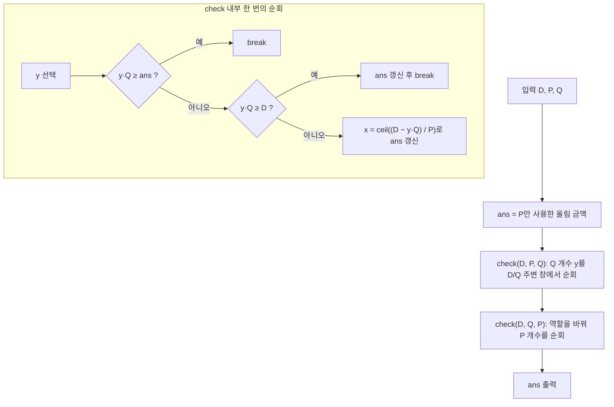

이번 포스팅에서는 백준 온라인 저지의 **1214번 문제 쿨한 물건 구매**를 다루어 보겠습니다. 이 문제는 제한된 종류의 지폐를 사용하여 특정 금액 이상의 최소 지불 금액을 구하는 문제로, 효율적인 알고리즘 설계와 수학적 사고가 필요한 흥미로운 문제입니다.

문제를 해결하면서 **최적화 기법**과 **수학적 아이디어**를 활용하여 시간 복잡도를 줄이는 방법에 대해 알아보겠습니다.

## 문제 : [https://www.acmicpc.net/problem/1214](https://www.acmicpc.net/problem/1214)

## 문제 설명

구사과는 지폐를 오직 두 종류만 가지고 있습니다. 바로 **P원 지폐**와 **Q원 지폐**입니다. 이 두 종류의 지폐를 구사과는 **무한히 많이** 가지고 있습니다.

오늘 구사과가 구매하려고 하는 물건의 가격은 **D원**입니다. 구사과가 이 물건을 구매하기 위해서 지불해야 하는 금액의 **최솟값**은 얼마일까요?

물건을 구매하기 위해서는 **물건의 가격보다 크거나 같은 금액**을 지불해야 합니다.

즉, 구사과는 P원 지폐와 Q원 지폐를 조합하여 D원 이상이 되는 최소의 금액을 만들어야 합니다. 이때, 각 지폐의 개수는 제한이 없으므로, 가능한 모든 조합 중에서 지불해야 하는 금액의 최솟값을 구하는 것이 문제의 목표입니다.

**입력**

첫째 줄에 **D**, **P**, **Q**가 주어집니다. 모두 \(10^9\)보다 작거나 같은 자연수입니다.

**출력**

첫째 줄에 물건을 구매하기 위해 구사과가 지불해야 하는 금액의 **최솟값**을 출력합니다.

**예제 입력 1**

```
17 7 13
```

**예제 출력 1**

```
20
```

20 = 7 × 1 + 13 × 1

**예제 입력 2**

```
21 7 13
```

**예제 출력 2**

```
21
```

21 = 7 × 3 + 13 × 0

**예제 입력 3**

```
17 7 9
```

**예제 출력 3**

```
18
```

18 = 7 × 0 + 9 × 2

**예제 입력 4**

```
37 9 17
```

**예제 출력 4**

```
43
```

43 = 9 × 1 + 17 × 2

## 접근 방식

D, P, Q가 모두 최대 10^9이므로 P 지폐 개수 x와 Q 지폐 개수 y를 둘 다 훑는 완전탐색은 불가능합니다. 구하는 값은 `P·x + Q·y ≥ D`를 만족하는 음이 아닌 정수 쌍 중 `P·x + Q·y`의 최솟값입니다. 한 변수를 고정하면 다른 변수는 올림 나눗셈 `⌈(D − Q·y) / P⌉`로 바로 정해지므로, 사실상 y 하나만 탐색하면 됩니다. 문제는 y의 후보 범위를 어떻게 줄이느냐입니다.

### 개수 상한 논증

P ≤ Q라고 하고 최적해에서 Q 지폐를 y장 쓴다고 합시다. 만약 y ≥ P라면 Q 지폐 P장(= P·Q원)을 P 지폐 Q장(= Q·P원)으로 바꿔도 금액이 같으므로, 같은 금액을 내는 해 중에는 항상 Q 지폐가 P장 미만인 해가 존재합니다. 즉 큰 지폐의 개수는 `0 ≤ y ≤ P − 1`로 제한해도 최솟값을 놓치지 않습니다. 큰 지폐가 D를 넘는 경우를 대비해 `y = ⌈D / Q⌉`까지 필요하므로, 실제로 보아야 할 y는 `0 … min(P − 1, ⌈D / Q⌉)`입니다.

### 왜 ±1,000,000 창으로 충분한가

이 글의 코드는 위 상한을 직접 쓰지 않고 `D / Q` 주변 ±10^6 구간만 훑습니다. 역할을 바꿔 두 번 호출하기 때문에 다음 두 경우로 나누어 정당성을 확인할 수 있습니다. 큰 지폐를 Q, 작은 지폐를 P라 하겠습니다.

- **Q > 10^6인 경우**: `D / Q < 1,000`이므로 `max(0, D/Q − 10^6)`은 0이고, 창은 `0 … D/Q + 10^6`입니다. 필요한 y의 범위 `0 … ⌈D/Q⌉`가 통째로 포함됩니다. 큰 지폐를 순회하는 호출만으로 끝납니다.
- **Q ≤ 10^6인 경우**: 큰 지폐 개수가 P 미만인 해가 존재하므로, 작은 지폐 개수 x는 `⌈D/P⌉`보다 많아야 Q장만큼 모자라고 최대로도 `⌈D/P⌉`입니다. 따라서 최적 x는 `D/P − Q … D/P + 1` 안에 있고, 이는 작은 지폐를 순회하는 호출의 창 `D/P ± 10^6`에 포함됩니다.

두 호출의 순회 대상이 서로 바뀌므로, 어느 지폐가 큰 쪽이든 최적해가 두 창 중 하나에는 반드시 들어갑니다. 이 논증은 10^6이라는 숫자 자체가 아니라 "한쪽 지폐 단가가 창 반경 이하이거나, 아니면 `D/단가`가 창 안에 들어온다"는 사실에 기대고 있으며, 반경 10^6은 D, P, Q ≤ 10^9 범위에서 이 조건이 성립하는 가장 단순한 선택입니다.

### 조기 종료

순회 중 `y·Q`가 이미 구한 최솟값 `ans` 이상이면 y가 커질수록 금액이 더 커지기만 하므로 반복을 끝냅니다. `y·Q ≥ D`가 되는 첫 y에서도 P 지폐가 필요 없으므로 그 금액을 후보로 올리고 끝냅니다.



시간 복잡도는 한 번의 `check`가 최대 2·10^6 + 1회 순회하므로 두 번 합쳐 약 4×10^6회 연산입니다. 곱셈 `y·Q`는 y ≤ 10^9 + 10^6, Q ≤ 10^9이어도 약 10^18이라 `long long` 범위(약 9.2×10^18) 안에 있습니다.

| 항목 | 값 | 비고 |
|---|---|---|
| 시간 복잡도 | O(10^6) | 창 반경 상수 × 2회 호출 |
| 공간 복잡도 | O(1) | 변수 몇 개뿐 |
| 오버플로 | 최대 약 10^18 | 64비트 정수 필요 |

### 한계와 대안

창 크기 10^6은 이 입력 상한에 맞춘 상수라서 D, P, Q 범위가 10^12처럼 커지면 같은 논증이 성립하지 않습니다. 이때는 순회할 y를 `min(P − 1, ⌈D/Q⌉)`로 직접 제한하되, P·Q의 크기에 따라 √ 단위로 나누는 방식이나 확장 유클리드 호제법으로 `P·x + Q·y`의 도달 가능 값을 다루는 풀이로 넘어가야 합니다. 또 흔한 실수는 큰 지폐만 순회하면서 "작은 지폐는 한 장 이상 필요 없다"고 가정하는 것인데, 예제 4(`37 9 17`)에서 최적해 `9×1 + 17×2 = 43`처럼 양쪽을 모두 쓰는 경우를 놓칩니다.

## C++ 코드와 설명

`check(D, P, Q, ans)`는 Q 지폐 개수 y를 창 안에서 순회하며 부족분을 P 지폐로 올림해 채우고 `ans`를 갱신합니다. `main`은 P만 쓴 올림 금액으로 `ans`를 초기화한 뒤 P와 Q를 바꿔 두 번 호출합니다. 초기값이 있으므로 한 종류만 쓰는 경우도 자동으로 후보에 들어갑니다.

```cpp
// 42jerrykim.github.io에서 더 많은 정보를 확인할 수 있다.
#include <iostream>
#include <algorithm>

using namespace std;

typedef long long ll;

void check(ll D, ll P, ll Q, ll &ans) {
    ll y_start = max(0LL, D / Q - 1000000); // y의 시작 범위 설정
    ll y_end = D / Q + 1000000; // y의 끝 범위 설정

    for (ll y = y_start; y <= y_end; ++y) {
        ll total_Q = y * Q;
        if (total_Q >= ans) break; // 현재 최소 금액보다 크면 종료
        if (total_Q >= D) {
            ans = min(ans, total_Q); // 최소 금액 갱신
            break;
        }
        ll rem = D - total_Q;
        ll x = (rem + P - 1) / P; // 필요한 P 지폐의 개수
        ll total_amount = total_Q + x * P;
        if (total_amount >= ans) continue;
        ans = total_amount; // 최소 금액 갱신
    }
}

int main() {
    ll D, P, Q;
    cin >> D >> P >> Q;

    ll ans = ((D + P - 1) / P) * P; // P만 사용했을 때의 최소 금액

    check(D, P, Q, ans); // 첫 번째 조합 탐색
    check(D, Q, P, ans); // 지폐를 바꿔서 두 번째 조합 탐색

    cout << ans << endl;

    return 0;
}
```

## C++ without library 코드와 설명

위와 같은 로직을 `stdio.h`만으로 옮긴 버전입니다. `ans`를 포인터로 넘겨 갱신하며, `max`/`min` 대신 직접 비교합니다. 입출력은 `scanf`/`printf`라 별도의 동기화 설정이 필요 없습니다.

```cpp
// 42jerrykim.github.io에서 더 많은 정보를 확인할 수 있다.
#include <stdio.h>

typedef long long ll;

void check(ll D, ll P, ll Q, ll *ans) {
    ll y_start = D / Q - 1000000;
    if (y_start < 0) y_start = 0;
    ll y_end = D / Q + 1000000;

    for (ll y = y_start; y <= y_end; ++y) {
        ll total_Q = y * Q;
        if (total_Q >= *ans) break;
        if (total_Q >= D) {
            if (total_Q < *ans) *ans = total_Q;
            break;
        }
        ll rem = D - total_Q;
        ll x = (rem + P - 1) / P;
        ll total_amount = total_Q + x * P;
        if (total_amount >= *ans) continue;
        *ans = total_amount;
    }
}

int main() {
    ll D, P, Q;
    scanf("%lld %lld %lld", &D, &P, &Q);

    ll ans = ((D + P - 1) / P) * P;

    check(D, P, Q, &ans);
    check(D, Q, P, &ans);

    printf("%lld\n", ans);

    return 0;
}
```

## Python 코드와 설명

파이썬은 정수 오버플로가 없어 `ll` 같은 타입 지정이 필요 없지만, 약 4×10^6회 순회하는 순수 루프이므로 C++보다 느립니다. `check`가 갱신된 `ans`를 반환하는 구조로 바꿔 부수효과를 없앴습니다.

```python
# 42jerrykim.github.io에서 더 많은 정보를 확인할 수 있다.
import sys

def check(D, P, Q, ans):
    y_start = max(0, D // Q - 1000000)
    y_end = D // Q + 1000000

    for y in range(y_start, y_end + 1):
        total_Q = y * Q
        if total_Q >= ans:
            break
        if total_Q >= D:
            ans = min(ans, total_Q)
            break
        rem = D - total_Q
        x = (rem + P - 1) // P
        total_amount = total_Q + x * P
        if total_amount >= ans:
            continue
        ans = total_amount
    return ans

def min_total_amount(D, P, Q):
    ans = ((D + P - 1) // P) * P  # P만 사용했을 때의 최소 금액

    ans = check(D, P, Q, ans)
    ans = check(D, Q, P, ans)

    return ans

if __name__ == "__main__":
    D_str, P_str, Q_str = sys.stdin.readline().split()
    D = int(D_str)
    P = int(P_str)
    Q = int(Q_str)
    print(min_total_amount(D, P, Q))
```

## 학습 성과 목표

- 한 변수를 고정하고 다른 변수를 올림 나눗셈으로 결정해 이중 탐색을 단일 탐색으로 줄이는 방법을 설명할 수 있다.
- "큰 지폐 P장은 작은 지폐 Q장으로 교환 가능"이라는 교환 논증으로 탐색 범위 상한을 유도할 수 있다.
- 탐색 창의 크기를 입력 상한과 연결해 정당화하고, 상한이 바뀔 때 어떤 가정이 깨지는지 짚을 수 있다.

## 코너 케이스 및 실수 포인트

| 케이스 | 설명 | 처리 방법 |
|---|---|---|
| **D가 P 또는 Q보다 작음** | 지폐 한 장으로 충분 | 초기 `ans`와 `y=0`/`y·Q ≥ D` 분기가 처리 |
| **P = Q** | 두 지폐가 같아 한 종류와 동일 | 올림 금액이 그대로 답 |
| **한쪽 지폐가 매우 큼 (10^9)** | `D/Q`가 0 또는 1 | 창이 0부터 시작해 정상 처리 |
| **오버플로우** | `y·Q`가 약 10^18까지 도달 | `long long` (C++) 사용, Python은 무관 |
| **단일 순회만 사용** | 한 지폐만 순회하면 양쪽 사용 해를 놓침 | `check`를 역할 바꿔 두 번 호출 |
