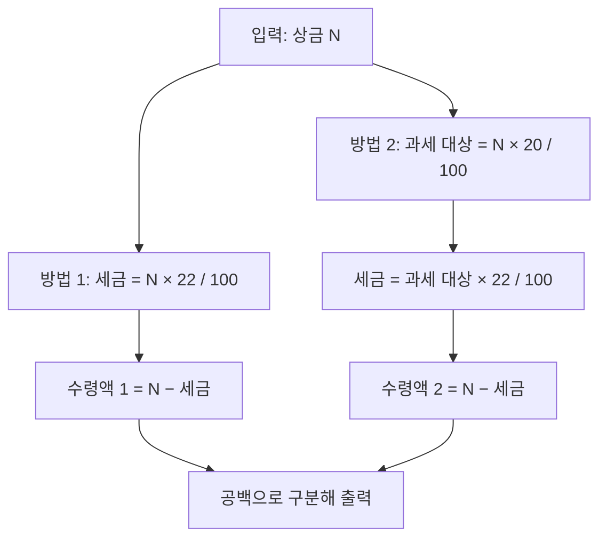

선린인터넷고등학교의 한 학생이 프로그래밍 대회에서 거액의 상금을 수상하게 되었다. 그러나 상금의 전부를 수령할 수 있는 것은 아니며, 일부는 세금으로 납부해야 한다. 일반적으로 상금의 22%를 제세공과금으로 납부하지만, 필요 경비를 인정받는 경우 세금 부담이 줄어들 수 있다. 이번 문제에서는 두 가지 경우에 대해 실제로 수령하게 되는 금액을 계산해보자.

문제 : [https://www.acmicpc.net/problem/20492](https://www.acmicpc.net/problem/20492)

## 문제 설명

선린인터넷고등학교의 한 학생은 프로그래밍 대회에 참가하여 큰 상금을 받는 영광을 누리게 되었다. 그러나 상금은 세금을 납부한 후에야 실제로 수령할 수 있다. 일반적으로 대회에서 상금을 받으면 전체 금액의 22%를 제세공과금으로 국가에 납부해야 하며, 나머지 금액을 수령하게 된다.

하지만 세법에서는 상금의 80%를 필요 경비로 인정받을 수 있는 조항이 있다. 이 경우, 전체 상금의 80%는 필요 경비로 처리되어 과세 대상에서 제외되고, 나머지 20%에 대해서만 세금을 부과한다. 이때도 세율은 동일하게 22%이다. 따라서 실제로 납부해야 할 세금은 전체 상금의 20% 중 22%에 해당하는 금액이 된다.

예를 들어, 상금이 10,000,000원이라면, 첫 번째 방법으로는 22%인 2,200,000원을 세금으로 납부하여 7,800,000원을 수령하게 된다. 두 번째 방법으로는 상금의 20%인 2,000,000원에 대해서만 세금을 부과하므로, 2,000,000원의 22%인 440,000원을 세금으로 납부하여 9,560,000원을 수령하게 된다.

입력으로 상금의 총액 N이 주어질 때, 위 두 가지 방법에 따라 학생이 실제로 수령하게 되는 금액을 각각 계산하여 출력하는 프로그램을 작성하시오.

**입력 조건:**

- N은 1,000 이상 10,000,000 이하의 1,000의 배수인 정수이다.

**출력 형식:**

- 첫 번째 방법으로 수령하는 금액과 두 번째 방법으로 수령하는 금액을 공백으로 구분하여 한 줄에 출력한다.

## 접근 방식

이 문제는 간단한 수학 계산 문제로, 주어진 상금에 대해 두 가지 세금 계산 방식을 적용하여 실제 수령액을 계산하면 된다.

첫 번째 경우는 전체 상금의 22%를 세금으로 납부하는 것이다. 따라서 실제 수령액은 전체 상금에서 22%를 뺀 금액이 된다.

두 번째 경우는 상금의 80%를 필요 경비로 인정받는 것이다. 이때 과세 대상은 나머지 20%이며, 이 20%에 대해 22%의 세금을 납부한다. 따라서 실제 수령액은 전체 상금에서 (상금의 20%에 대한 22% 세금)을 뺀 금액이 된다.

두 식을 정리하면 첫 번째는 $0.78N$, 두 번째는 $(1 - 0.2 \cdot 0.22)N = 0.956N$이다. 입력이 1,000의 배수이므로 `N * 22 / 100`, `N * 20 / 100`, 그 결과에 22를 곱해 100으로 나누는 단계가 모두 나머지 없이 나누어떨어진다. 예를 들어 $N = 1000$이면 `N * 20 / 100 = 200`, `200 * 22 / 100 = 44`로 정확하다. 그래서 정수 나눗셈의 절삭 순서나 부동소수점 오차를 걱정할 필요가 없고, 반대로 `N`이 1,000의 배수라는 조건이 없다면 곱셈과 나눗셈의 순서에 따라 결과가 달라질 수 있다는 점이 이 문제의 숨은 전제다.



## 입출력 예제

본문에 나온 상금 10,000,000원의 계산 결과가 곧 예제다.

```text
입력: 10000000
출력: 7800000 9560000
```

최솟값 경계인 $N = 1000$을 직접 계산하면 첫 번째는 $1000 - 220 = 780$, 두 번째는 $1000 - 44 = 956$이므로 출력은 `780 956`이다.

## 복잡도 분석

| 항목 | 복잡도 | 비고 |
|---|---|---|
| **시간 복잡도** | $O(1)$ | 곱셈·나눗셈·뺄셈 몇 번이 전부 |
| **공간 복잡도** | $O(1)$ | 변수 3개 |

## C++ 코드와 설명

```cpp
// 42jerrykim.github.io에서 더 많은 정보를 확인할 수 있다
#include <iostream>
using namespace std;

int main() {
    long long N;
    cin >> N;

    // 첫 번째 경우: 전체 상금의 22%를 세금으로 납부
    long long case1 = N - N * 22 / 100;

    // 두 번째 경우: 상금의 80%를 필요 경비로 인정받고 나머지 20% 중 22%를 세금으로 납부
    long long case2 = N - (N * 20 / 100) * 22 / 100;

    cout << case1 << " " << case2 << endl;

    return 0;
}
```

### 코드 설명

`N`은 최대 10,000,000이고 가장 큰 중간값 `N * 22`도 220,000,000이라 `int`(약 2.1×10⁹)로 충분하지만, 여유를 위해 `long long`을 쓴다. 첫 번째 수령액은 `N - N * 22 / 100`으로, 두 번째는 먼저 `N * 20 / 100`으로 과세 대상 금액을 구한 뒤 그 22%를 `N`에서 빼서 계산한다. 마지막으로 두 값을 공백으로 구분해 출력한다.

## C++ without library 코드와 설명

```cpp
// 42jerrykim.github.io에서 더 많은 정보를 확인할 수 있다
#include <stdio.h>

int main() {
    long long N;
    scanf("%lld", &N);

    // 첫 번째 경우 계산
    long long case1 = N - N * 22 / 100;

    // 두 번째 경우 계산
    long long case2 = N - (N * 20 / 100) * 22 / 100;

    printf("%lld %lld\n", case1, case2);

    return 0;
}
```

### 코드 설명

앞의 코드와 계산식은 같고, `cin`/`cout` 대신 `stdio.h`의 `scanf("%lld")`와 `printf("%lld %lld\n")`로 입출력만 바꿨다. `long long`을 읽고 쓰므로 서식 지정자도 `%lld`여야 한다.

## Python 코드와 설명

```python
# 42jerrykim.github.io에서 더 많은 정보를 확인할 수 있다
N = int(input())

# 첫 번째 경우 계산
case1 = N - N * 22 // 100

# 두 번째 경우 계산
case2 = N - (N * 20 // 100) * 22 // 100

print(f"{case1} {case2}")
```

### 코드 설명

`//`는 정수 나눗셈이며 `*`와 `//`는 우선순위가 같아 왼쪽부터 계산되므로 `N * 22 // 100`은 `(N * 22) // 100`이다. 파이썬 정수는 크기 제한이 없어 오버플로를 고려할 필요가 없다.

## 결론

이 문제는 특별한 알고리즘 없이 두 가지 세금 공식을 정수 연산으로 옮기는 구현 문제다. 핵심은 필요경비 80%를 뺀 20%에만 같은 22% 세율을 적용한다는 점이다. 이 글을 읽고 나면 두 수령액을 $0.78N$, $0.956N$으로 환원하고, 곱셈을 먼저 하고 나눗셈을 나중에 해야 하는 이유를 설명할 수 있어야 한다.

## 코너 케이스 및 실수 포인트

| 케이스 | 설명 | 처리 방법 |
|---|---|---|
| **최소 입력** | N=1000 | 출력 `780 956`, 계산이 정확히 떨어짐을 확인 |
| **최대 입력** | N=10,000,000 | 중간값 `N*22`=2.2×10⁸로 `int` 범위 이내, 출력 `7800000 9560000` |
| **연산 순서** | `N / 100 * 22`처럼 나눗셈 먼저 | 1,000의 배수라 결과는 같지만 일반 입력에서는 절삭 오차 위험, 곱셈 먼저 권장 |
| **세율 착각** | 두 번째 방법에서 80%를 세금으로 계산 | 80%는 필요경비, 과세 대상은 나머지 20% |
