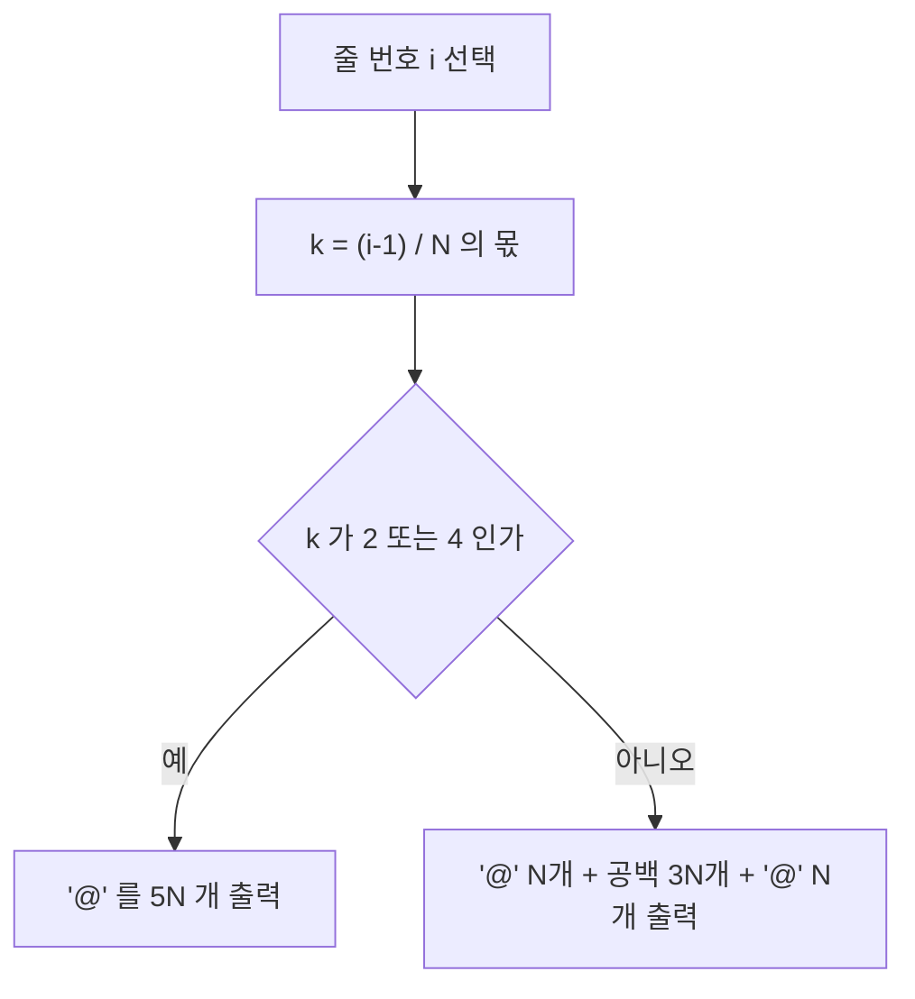

오늘은 백준 온라인 저지의 23808번 문제인 "골뱅이 찍기 - ㅂ"을 풀어보려고 한다. 이 문제는 특정한 패턴을 출력하는 구현 문제로, 주어진 조건에 따라 정확한 형태의 출력을 만드는 것이 핵심이다.

문제 : [https://www.acmicpc.net/problem/23808](https://www.acmicpc.net/problem/23808)

## 문제 설명

서준이는 아빠로부터 골뱅이가 들어 있는 상자를 생일 선물로 받았다. 상자 안에는 ㅂ자 모양의 골뱅이가 들어있다. ㅂ자 모양은 가로 및 세로로 각각 5개의 셀로 구성되어 있다. 상자에는 정사각형 모양의 셀의 크기를 나타내는 숫자 하나가 적혀있다.

셀의 크기 \( N \)이 주어지면 예제 출력과 같은 방식으로 골뱅이 모양을 출력하시오.

**입력**

첫째 줄에 정수 \( N \) (\( 1 \leq N \leq 100 \))이 주어진다.

**출력**

셀의 크기가 \( N \)인 골뱅이를 출력한다.

**예제 입력 1**

```
1
```

**예제 출력 1**

```
@   @
@   @
@@@@@
@   @
@@@@@
```

**예제 입력 2**

```
3
```

**예제 출력 2**

```
@@@         @@@
@@@         @@@
@@@         @@@
@@@         @@@
@@@         @@@
@@@         @@@
@@@@@@@@@@@@@@@
@@@@@@@@@@@@@@@
@@@@@@@@@@@@@@@
@@@         @@@
@@@         @@@
@@@         @@@
@@@@@@@@@@@@@@@
@@@@@@@@@@@@@@@
@@@@@@@@@@@@@@@
```

## 접근 방식

출력해야 하는 모양은 한글 자음 'ㅂ'을 '@' 문자로 그린 형태이다. 전체 패턴은 5개의 블록으로 구성되고, 각 블록은 높이가 \( N \)인 줄들로 이루어진다. 한 줄의 너비는 항상 \( 5N \)이므로 전체 출력은 \( 5N \times 5N \) 격자다. 블록은 모양에 따라 두 종류로 나뉜다. 좌우에 \( N \)칸씩 '@'를 두고 가운데 \( 3N \)칸을 공백으로 비우는 "세로 줄" 블록, 그리고 \( 5N \)칸 전부를 '@'로 채우는 "가로 줄" 블록이다.

| 블록 | 줄 범위 | 패턴 |
|---|---|---|
| 1 | \( 1 \) ~ \( N \) | 세로 줄 |
| 2 | \( N+1 \) ~ \( 2N \) | 세로 줄 |
| 3 | \( 2N+1 \) ~ \( 3N \) | 가로 줄 |
| 4 | \( 3N+1 \) ~ \( 4N \) | 세로 줄 |
| 5 | \( 4N+1 \) ~ \( 5N \) | 가로 줄 |

이 표에서 핵심 관찰은 줄 번호 \( i \)(1부터 시작)가 속한 블록 번호가 \( \lfloor (i-1)/N \rfloor \)(0부터 시작)로 한 번에 정해진다는 점이다. 이 값이 0, 1, 3이면 세로 줄, 2, 4이면 가로 줄이다. 따라서 범위 비교를 세 번 이어 붙이는 대신, 몫 하나를 구해 "2 또는 4인가"만 판정해도 된다. 아래 코드는 범위 비교를 그대로 드러내는 방식과 몫을 쓰는 방식을 모두 보여 주며, 두 방식은 같은 출력을 만든다.



복잡도는 출력 크기가 결정한다. 출력 문자 수 자체가 \( 25N^2 \)이므로 어떤 풀이도 이보다 빠를 수 없고, 한 줄을 만들 때 임시 문자열 하나만 쓰므로 추가 공간은 상수다.

| 항목 | 값 | 근거 |
|---|---|---|
| 시간복잡도 | \( O(N^2) \) | \( 5N \)줄 × 줄당 \( 5N \)문자 |
| 공간복잡도 | \( O(N) \) | 한 줄 문자열 길이 \( 5N \) (줄 단위 출력 시) |

\( N = 100 \)이면 \( 500 \times 500 = 250{,}000 \)문자이므로 입출력 방식과 무관하게 시간 제한에 여유가 있다. 다만 문자마다 출력 함수를 호출하는 방식은 줄 단위 출력보다 호출 횟수가 \( 5N \)배 많다는 차이가 있다.

## C++ 코드와 설명

```cpp
// 42jerrykim.github.io에서 더 많은 정보를 확인할 수 있다
#include <iostream>
#include <string>
using namespace std;

int main() {
    int N;
    cin >> N;

    for (int i = 1; i <= 5 * N; ++i) {
        if (i <= 2 * N || (i > 3 * N && i <= 4 * N)) {
            // 블록 1, 2, 4: 세로 줄
            cout << string(N, '@') << string(3 * N, ' ') << string(N, '@') << '\n';
        } else {
            // 블록 3, 5: 가로 줄
            cout << string(5 * N, '@') << '\n';
        }
    }
    return 0;
}
```

`string(count, ch)` 생성자가 같은 문자를 `count`번 반복한 문자열을 만들므로, 한 줄을 세 조각의 이어 붙임으로 표현한다. 줄 번호를 1부터 세기 때문에 블록 경계는 \( \le \)와 \( > \)의 조합으로 정확히 \( N \)의 배수에서 끊어진다.

## C++ without library 코드와 설명

```cpp
// 42jerrykim.github.io에서 더 많은 정보를 확인할 수 있다
#include <stdio.h>

int main() {
    int N;
    scanf("%d", &N);

    for (int i = 0; i < 5 * N; ++i) {
        int k = i / N;  // 0부터 센 블록 번호
        if (k == 2 || k == 4) {
            for (int j = 0; j < 5 * N; ++j) putchar('@');
        } else {
            for (int j = 0; j < N; ++j) putchar('@');
            for (int j = 0; j < 3 * N; ++j) putchar(' ');
            for (int j = 0; j < N; ++j) putchar('@');
        }
        putchar('\n');
    }
    return 0;
}
```

표준 라이브러리 문자열 없이 `putchar`만 쓰는 버전이며, 줄 번호를 0부터 세어 `i / N`이 곧 블록 번호가 되게 했다. 1부터 세는 앞선 코드와 달리 `(i-1)`을 빼는 보정이 필요 없다는 점이 이 방식의 장점이고, 줄당 문자 수만큼 함수 호출이 일어난다는 점이 단점이다.

## Python 코드와 설명

```python
# 42jerrykim.github.io에서 더 많은 정보를 확인할 수 있다
N = int(input())

vertical = '@' * N + ' ' * (3 * N) + '@' * N
horizontal = '@' * (5 * N)

for i in range(5 * N):
    k = i // N
    print(horizontal if k in (2, 4) else vertical)
```

두 종류의 줄은 \( N \)이 정해지면 변하지 않으므로 반복문 밖에서 한 번만 만들어 재사용한다. 이렇게 하면 줄마다 문자열을 다시 만드는 비용이 사라진다. 세 언어 모두 판정 규칙은 같고 줄 번호를 세는 기준(0부터 또는 1부터)과 문자열 생성 도구만 다르다.

## 흔한 실수와 판단 기준

가장 흔한 실수는 블록 경계의 off-by-one이다. 줄 번호를 1부터 세면서 `i / N`을 그대로 쓰면 \( i = N \)이 블록 1이 아니라 2로 계산되어 첫 블록이 한 줄 짧아진다. 반대로 0부터 세면서 `i <= N` 같은 비교를 쓰면 한 줄이 남는다. 줄 번호의 기준을 하나로 고정하고 그에 맞는 식을 쓰는 것이 안전하다. 두 번째 실수는 가운데 공백 개수다. 공백은 \( 3N \)칸이고 \( 2N \)이나 \( N \)이 아니다. 예제 2에서 첫 줄의 길이가 \( 5N = 15 \)인지 세어 보면 바로 검증된다. 세 번째로, 줄 끝에 불필요한 공백을 더하지 않아야 한다. 이 문제의 세로 줄은 오른쪽 '@'로 끝나므로 후행 공백이 생기지 않는다.

범위 비교와 몫 방식 중 선택은 취향의 문제가 아니라 확장성의 문제다. 블록이 5개뿐이면 두 방식 모두 읽기 쉽지만, 블록 수나 패턴 종류가 늘면 범위 비교는 조건이 선형으로 불어난다. 몫을 키로 삼으면 "블록 번호 → 패턴" 대응만 바꾸면 되므로 변형 문제에 유리하다.

## 코너 케이스

| 케이스 | 설명 | 처리 방법 |
|---|---|---|
| **N=1 (최소 입력)** | 총 5줄, 모든 블록이 한 줄 | 예제 1과 출력이 일치하는지 확인 |
| **N=100 (최대 입력)** | 500줄 × 500문자 | 줄 단위 출력으로 호출 수를 줄임 |
| **블록 경계** | \( i = N, N+1, 3N, 3N+1 \) | 줄 번호 기준(0/1 시작)을 하나로 통일 |
| **공백 개수** | 가운데 \( 3N \)칸 | 예제 2의 줄 길이 15로 검증 |

## 결론

이 문제는 별도의 알고리즘 없이 구조를 관찰하는 구현 문제다. 줄 번호를 \( N \)으로 나눈 몫이 패턴을 결정한다는 한 가지 관찰이 있으면 조건문이 한 줄로 줄고, 후행 공백이나 경계 오류 같은 실수도 줄어든다. 패턴 출력 문제를 만나면 반복 단위(여기서는 높이 \( N \)의 블록)를 먼저 찾고, 단위 번호에서 모양을 고르는 규칙을 세운 뒤 코드로 옮기는 순서가 안정적이다. 이 글을 읽고 나면 블록 구조를 표로 정리하는 법, 0 기준과 1 기준 인덱싱의 경계 차이, 출력 크기에서 시간복잡도 하한을 읽는 법을 설명할 수 있어야 한다.
