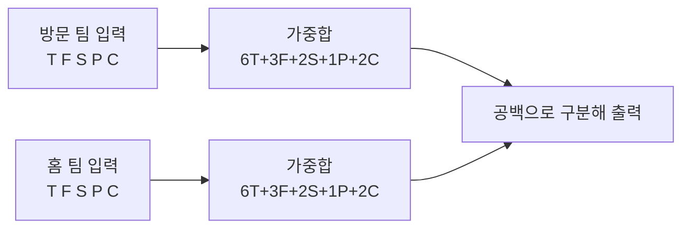

이번 글에서는 백준 온라인 저지의 24736번 문제인 "Football Scoring"을 풀어보도록 하겠다. 이 문제는 미식축구의 득점 방식을 이해하고, 주어진 박스 스코어를 기반으로 각 팀의 총점을 계산하는 간단한 구현 문제이다.

문제 : [https://www.acmicpc.net/problem/24736](https://www.acmicpc.net/problem/24736)

## 문제 설명

미국 프로 미식축구에서는 다섯 가지 방법으로 점수를 얻을 수 있다:

1. **터치다운(Touchdown)** - 6점
2. **필드골(Field Goal)** - 3점
3. **세이프티(Safety)** - 2점
4. **터치다운 후 추가 점수**
   - 1점 (필드골 또는 세이프티) - 일반적으로 <strong>"포인트 애프터(Point after)"</strong>라고 부른다.
   - 2점 (터치다운) - 일반적으로 <strong>"투 포인트 컨버전(Two-point conversion)"</strong>이라고 부른다.

득점 방식의 배경은 [Wikipedia의 미식축구 용어집](https://en.wikipedia.org/wiki/Glossary_of_American_football)과 [NFL Operations의 용어 사전](https://operations.nfl.com/learn-the-game/nfl-basics/terms-glossary/)에서 확인할 수 있다.

두 팀의 박스 스코어(Box score)가 주어졌을 때, 각 팀의 총점을 계산하는 프로그램을 작성해야 한다.

**입력**

- 두 줄로 구성되며, 각 줄에는 다섯 개의 0 이상인 정수 T, F, S, P, C가 공백으로 구분되어 주어진다.
  - T: 터치다운 횟수 (0 ≤ T ≤ 10)
  - F: 필드골 횟수 (0 ≤ F ≤ 10)
  - S: 세이프티 횟수 (0 ≤ S ≤ 10)
  - P: 포인트 애프터 횟수
  - C: 투 포인트 컨버전 횟수
- (0 ≤ (P+C) ≤ T)
- 첫 번째 줄은 **방문 팀**의 박스 스코어, 두 번째 줄은 **홈 팀**의 박스 스코어이다.

**출력**

- 한 줄에 방문 팀과 홈 팀의 총점을 공백으로 구분하여 출력한다.

**예제 입력**

```
1 3 0 0 1
3 1 1 1 1
```

**예제 출력**

```
17 26
```

## 접근 방식

이 문제의 본질은 두 팀 각각에 대해 "득점 종류별 횟수"를 "종류별 점수"와 곱해 더하는 가중합이다. 득점 종류가 다섯 개로 고정되어 있고 각 점수가 터치다운 6점, 필드골 3점, 세이프티 2점, 포인트 애프터 1점, 투 포인트 컨버전 2점으로 정해져 있으므로, 입력에서 얻은 다섯 정수에 같은 순서의 상수 벡터 (6, 3, 2, 1, 2)를 내적하면 총점이 나온다. 별도의 상태나 조건 분기가 없어서 입력 순서만 틀리지 않으면 풀리는 문제다.

```
총점 = T×6 + F×3 + S×2 + P×1 + C×2
```

입력 제약 중 `P + C ≤ T`는 계산에는 쓰이지 않지만 의미가 있다. 포인트 애프터와 투 포인트 컨버전은 모두 터치다운 직후에만 시도할 수 있는 추가 득점이므로, 터치다운 한 번당 둘 중 많아야 하나만 성립한다. 따라서 이 조건은 "추가 득점 횟수가 터치다운 횟수를 넘을 수 없다"는 현실의 규칙을 그대로 옮긴 것이고, 입력 검증 코드를 따로 둘 필요가 없다는 보증이기도 하다. 반대로 같은 이유로, 이 조건을 어기는 입력이 들어오면 문제 쪽 데이터가 잘못된 것이지 풀이가 처리할 대상이 아니다.

예제로 검산하면 방문 팀 `1 3 0 0 1`은 6 + 9 + 0 + 0 + 2 = 17점, 홈 팀 `3 1 1 1 1`은 18 + 3 + 2 + 1 + 2 = 26점이어서 예제 출력 `17 26`과 일치한다.



복잡도는 입력이 정수 10개로 고정되어 있어 입력 크기와 무관한 상수다. 추가 공간도 정수 변수 몇 개뿐이다.

| 항목 | 값 | 근거 |
|---|---|---|
| 시간복잡도 | O(1) | 곱셈·덧셈 각 10회 이내, 입력 크기에 무관 |
| 공간복잡도 | O(1) | 정수 변수만 사용 |

아래 세 구현은 모두 팀마다 계산식을 한 번씩 펼쳐 쓴다. 팀이 둘뿐이라 이 방식이 가장 읽기 쉽다. 팀 수가 늘거나 득점 종류가 바뀌는 문제였다면 점수를 배열 `{6, 3, 2, 1, 2}`에 두고 루프로 내적을 계산하는 쪽이 중복을 줄이지만, 여기서는 변수와 식이 한눈에 대응되는 것이 더 중요하다고 판단했다.

## C++ 코드와 설명

C++에서는 `cin`을 쓴 기본 구현을 먼저 보인다. 입력이 정수 10개라 `endl`이 성능에 미치는 영향은 없다.

```cpp
// 42jerrykim.github.io에서 더 많은 정보를 확인할 수 있다
#include <iostream>
using namespace std;

int main() {
    // 방문 팀의 박스 스코어 입력
    int T1, F1, S1, P1, C1;
    cin >> T1 >> F1 >> S1 >> P1 >> C1;

    // 홈 팀의 박스 스코어 입력
    int T2, F2, S2, P2, C2;
    cin >> T2 >> F2 >> S2 >> P2 >> C2;

    // 방문 팀의 총점 계산
    int score1 = T1 * 6      // 터치다운 점수
               + F1 * 3      // 필드골 점수
               + S1 * 2      // 세이프티 점수
               + P1 * 1      // 포인트 애프터 점수
               + C1 * 2;     // 투 포인트 컨버전 점수

    // 홈 팀의 총점 계산
    int score2 = T2 * 6      // 터치다운 점수
               + F2 * 3      // 필드골 점수
               + S2 * 2      // 세이프티 점수
               + P2 * 1      // 포인트 애프터 점수
               + C2 * 2;     // 투 포인트 컨버전 점수

    // 결과 출력
    cout << score1 << " " << score2 << endl;

    return 0;
}
```

코드는 방문 팀 다섯 정수, 홈 팀 다섯 정수를 차례로 읽고, 앞서 본 가중합을 팀마다 한 번씩 계산해 공백 하나로 구분해 출력한다. 입력 순서가 곧 변수 이름과 점수 배율의 대응이므로, 변수명에 팀 번호를 붙여 두 팀의 값이 섞이지 않게 했다.

## C++ without library 코드와 설명

```cpp
// 42jerrykim.github.io에서 더 많은 정보를 확인할 수 있다
#include <stdio.h>

int main() {
    // 변수 선언
    int T1, F1, S1, P1, C1; // 방문 팀
    int T2, F2, S2, P2, C2; // 홈 팀
    int score1, score2;

    // 방문 팀의 박스 스코어 입력
    scanf("%d %d %d %d %d", &T1, &F1, &S1, &P1, &C1);

    // 홈 팀의 박스 스코어 입력
    scanf("%d %d %d %d %d", &T2, &F2, &S2, &P2, &C2);

    // 방문 팀의 총점 계산
    score1 = T1 * 6      // 터치다운 점수
           + F1 * 3      // 필드골 점수
           + S1 * 2      // 세이프티 점수
           + P1 * 1      // 포인트 애프터 점수
           + C1 * 2;     // 투 포인트 컨버전 점수

    // 홈 팀의 총점 계산
    score2 = T2 * 6      // 터치다운 점수
           + F2 * 3      // 필드골 점수
           + S2 * 2      // 세이프티 점수
           + P2 * 1      // 포인트 애프터 점수
           + C2 * 2;     // 투 포인트 컨버전 점수

    // 결과 출력
    printf("%d %d\n", score1, score2);

    return 0;
}
```

계산 로직은 위와 같고 입출력만 `scanf`/`printf`로 바꾼 버전이다. `stdio.h`만 사용하므로 C++ 스트림 객체를 쓰지 않아도 되고, 포맷 문자열 `%d`가 정수 읽기·쓰기를 모두 담당한다.

## Python 코드와 설명

```python
# 42jerrykim.github.io에서 더 많은 정보를 확인할 수 있다
# 방문 팀의 박스 스코어 입력
T1, F1, S1, P1, C1 = map(int, input().split())

# 홈 팀의 박스 스코어 입력
T2, F2, S2, P2, C2 = map(int, input().split())

# 방문 팀의 총점 계산
score1 = T1 * 6      # 터치다운 점수
score1 += F1 * 3     # 필드골 점수
score1 += S1 * 2     # 세이프티 점수
score1 += P1 * 1     # 포인트 애프터 점수
score1 += C1 * 2     # 투 포인트 컨버전 점수

# 홈 팀의 총점 계산
score2 = T2 * 6      # 터치다운 점수
score2 += F2 * 3     # 필드골 점수
score2 += S2 * 2     # 세이프티 점수
score2 += P2 * 1     # 포인트 애프터 점수
score2 += C2 * 2     # 투 포인트 컨버전 점수

# 결과 출력
print(f"{score1} {score2}")
```

Python 버전은 한 줄을 `input().split()`으로 쪼개 `map(int, ...)`로 정수 다섯 개에 한 번에 언패킹한다. 점수는 `+=`로 항을 하나씩 누적해 C++ 버전의 식과 항이 일대일로 대응되게 했다. 파이썬 정수는 크기 제한이 없지만, 이 문제의 최대 점수는 아래 표처럼 작다.

## 결론

이 문제에서 실수가 생기는 지점은 계산식이 아니라 입력 해석이다. 첫 줄이 방문 팀, 둘째 줄이 홈 팀이고, 다섯 수의 순서가 T, F, S, P, C라는 점만 지키면 풀이는 가중합 하나로 끝난다. 포인트 애프터(1점)와 투 포인트 컨버전(2점)을 헷갈려 배율을 바꾸거나, 두 팀의 결과를 바꿔 출력하는 것이 전형적인 오답 원인이다. 예제 하나만 손으로 검산해도 이 두 가지는 모두 걸러진다.

## 코너 케이스 및 실수 포인트

| 케이스 | 설명 | 처리 방법 |
|---|---|---|
| **모두 0인 팀** | `0 0 0 0 0`이면 총점은 0 | 별도 분기 없이 가중합이 0을 출력 |
| **추가 득점 최대치** | `P + C = T`일 때 모든 터치다운 뒤에 추가 득점 성공 | 식 그대로 계산, 예: `T=10, C=10`이면 60 + 20 = 80 |
| **최대 점수** | `T=F=S=10`, `P+C=10`일 때 최대 점수는 `C=10` 기준 60+30+20+20 = 130 | `int`로 충분, `long long` 불필요 |
| **팀 순서** | 첫 줄 방문 팀, 둘째 줄 홈 팀 | 출력도 방문 팀 점수가 먼저 |
| **P와 C 배율 혼동** | 포인트 애프터 1점, 투 포인트 컨버전 2점 | 변수명과 주석으로 대응 명시 |
