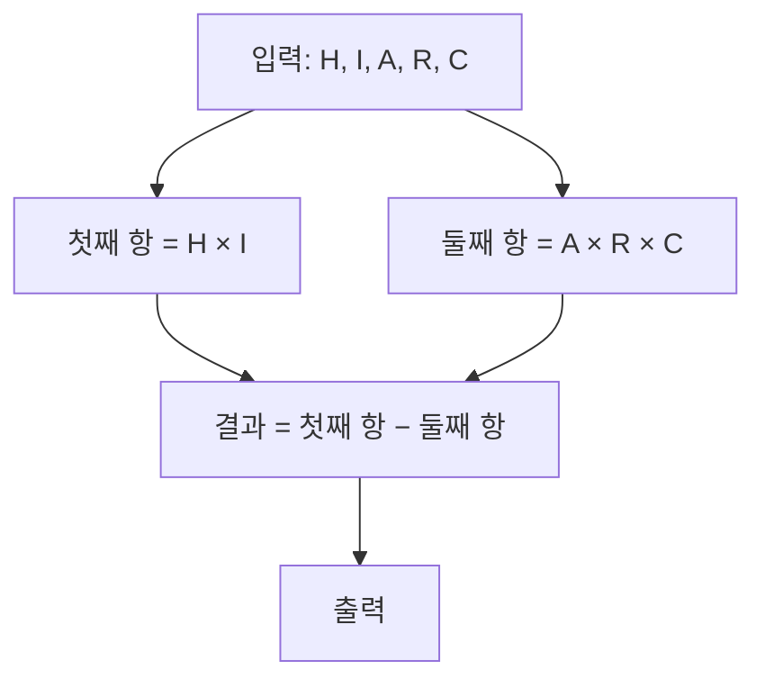

이번 포스팅에서는 백준 온라인 저지의 28444번 문제인 "HI-ARC=?"를 다루어 보겠습니다. 이 문제는 간단한 수식을 구현하는 문제로, 기본적인 산술 연산과 입력 처리 능력을 확인할 수 있습니다.

문제 : [https://www.acmicpc.net/problem/28444](https://www.acmicpc.net/problem/28444)

## 문제 설명

HI-ARC 학회는 일상 속의 문장들을 수식으로 표현하는 것을 즐기는 특이한 문화를 가지고 있습니다. 그중에서도 최근에 개발한 HI-ARC 수식은 아래와 같은 규칙을 따릅니다:

1. **첫 번째 항**은 **H**와 **I**의 곱입니다.
2. **두 번째 항**은 **A**, **R**, **C**의 곱입니다.
3. **결과값**은 **첫 번째 항에서 두 번째 항을 뺀 값**입니다.

이를 수식으로 표현하면 다음과 같습니다:

\[
\text{결과값} = (H \times I) - (A \times R \times C)
\]

각각의 문자에 해당하는 숫자들이 입력으로 주어졌을 때, 이 수식을 계산하여 결과값을 출력하는 것이 문제의 목표입니다.

### 입력

- 첫째 줄에 **H**, **I**, **A**, **R**, **C**가 공백으로 구분되어 순서대로 주어집니다.
- 각 값은 다음 범위를 만족합니다:
  - \(0 \leq H, I, A, R, C \leq 100\)
  - 모든 값은 정수입니다.

### 출력

- 계산된 결과값을 출력합니다.

### 예제 입력 1

```
4 6 1 2 3
```

### 예제 출력 1

```
18
```

#### 예제 설명

- **첫 번째 항**: \(4 \times 6 = 24\)
- **두 번째 항**: \(1 \times 2 \times 3 = 6\)
- **결과값**: \(24 - 6 = 18\)

## 접근 방식

이 문제는 식 (H×I)−(A×R×C)를 그대로 계산하면 끝나는 구현 문제라서 별도의 알고리즘이나 자료구조가 필요 없습니다. 입력은 공백으로 구분된 정수 다섯 개이므로 순서대로 읽어 H×I에서 A×R×C를 빼고 출력하면 됩니다. 곱셈이 뺄셈보다 먼저 계산되므로 괄호를 따로 신경 쓰지 않아도 되지만, 읽기 쉽도록 항별로 변수에 나눠 담아 두면 예제 4 6 1 2 3에서 24와 6을 각각 확인할 수 있어 디버깅이 편합니다.

값의 범위를 먼저 따져 보면 자료형 선택이 분명해집니다. 모든 입력이 0 이상 100 이하이므로 첫째 항은 0 이상 10,000 이하이고, 둘째 항은 A×R×C로 0 이상 1,000,000 이하입니다. 따라서 결과는 −1,000,000 이상 10,000 이하이며 32비트 `int`의 표현 범위(약 ±2.1×10⁹)에 충분히 들어갑니다. `long long`은 필요하지 않고, 음수가 나올 수 있다는 점만 출력 단계에서 기억하면 됩니다.



시간·공간 복잡도는 곱셈 세 번과 뺄셈 한 번이 전부이므로 입력 크기와 무관하게 모두 O(1)입니다. 문제 페이지의 시간·메모리 제한은 직접 확인하지 못했지만, 연산량이 상수라서 제한에 걸릴 여지가 없습니다.

| 항목 | 값 |
|---|---|
| 첫째 항 H×I 범위 | 0 ~ 10,000 |
| 둘째 항 A×R×C 범위 | 0 ~ 1,000,000 |
| 결과 범위 | −1,000,000 ~ 10,000 |
| 시간 복잡도 | O(1) |
| 공간 복잡도 | O(1) |

## C++ 코드

`std::cin`으로 다섯 정수를 읽고, 두 항을 각각 변수에 저장한 뒤 차를 출력합니다. 입력이 다섯 개뿐이라 `ios::sync_with_stdio(false)` 같은 입출력 최적화는 필요하지 않습니다.

```cpp
// 42jerrykim.github.io에서 더 많은 정보를 확인할 수 있다
#include <iostream> // 입출력을 위한 헤더 파일 사용

int main() {
    int H, I, A, R, C; // 다섯 개의 정수 변수를 선언
    std::cin >> H >> I >> A >> R >> C; // 입력받기

    int first_term = H * I; // 첫 번째 항 계산
    int second_term = A * R * C; // 두 번째 항 계산

    int result = first_term - second_term; // 결과값 계산

    std::cout << result << std::endl; // 결과값 출력

    return 0; // 프로그램 종료
}
```

## C++ without library 코드

같은 계산을 C 표준 입출력으로 쓴 버전입니다. `scanf`의 `%d`는 공백과 개행을 모두 구분자로 취급하므로 서식 문자열의 공백 개수가 입력과 정확히 맞지 않아도 정상적으로 읽힙니다.

```cpp
// 42jerrykim.github.io에서 더 많은 정보를 확인할 수 있다
#include <stdio.h>  // C 표준 입출력을 위한 헤더 파일

int main() {
    int H, I, A, R, C; // 다섯 개의 정수 변수 선언
    scanf("%d %d %d %d %d", &H, &I, &A, &R, &C); // 입력받기

    int first_term = H * I; // 첫 번째 항 계산
    int second_term = A * R * C; // 두 번째 항 계산

    int result = first_term - second_term; // 결과값 계산

    printf("%d\n", result); // 결과값 출력

    return 0; // 프로그램 종료
}
```

## Python 코드

Python의 정수는 임의 정밀도라 오버플로우를 걱정할 필요가 없고, `input().split()`으로 쪼갠 문자열을 `map(int, ...)`로 한 번에 정수로 바꿔 다섯 변수에 풀어 담습니다.

```python
# 42jerrykim.github.io에서 더 많은 정보를 확인할 수 있다
# 입력받은 문자열을 공백 기준으로 분리하고 정수로 변환
H, I, A, R, C = map(int, input().split())

# 첫 번째 항 계산
first_term = H * I

# 두 번째 항 계산
second_term = A * R * C

# 결과값 계산
result = first_term - second_term

# 결과값 출력
print(result)
```

## 정리

이 문제는 수식을 코드로 옮기는 연습이므로 세 언어 풀이의 뼈대는 같고 입출력 문법만 다릅니다. 이 글을 읽고 나면 입력 범위로부터 중간값과 결과의 최솟값·최댓값을 계산해 자료형을 정할 수 있고, 연산 순서와 부호 때문에 생기는 실수를 코너 케이스 표로 점검할 수 있어야 합니다.

## 코너 케이스 및 실수 포인트

| 케이스 | 입력 → 출력 | 확인할 점 |
|---|---|---|
| 모두 0 | `0 0 0 0 0` → `0` | 결과가 0이어도 정상 출력 |
| 둘째 항이 더 큼 | `0 0 100 100 100` → `-1000000` | 결과가 음수일 수 있음, 부호 출력 확인 |
| 첫째 항이 최대 | `100 100 0 0 0` → `10000` | 둘째 항이 0이면 곱셈이 전부 0 |
| 곱셈 순서 실수 | `4 6 1 2 3` → `18` | (H×I−A)×R×C처럼 묶으면 틀림 |
| 오버플로우 | 최대 절댓값 1,000,000 | `int`로 충분하며 `long long` 불필요 |

## 참고 자료

- [백준 28444번 문제](https://www.acmicpc.net/problem/28444)
- [cppreference: std::basic_istream::operator>>](https://en.cppreference.com/w/cpp/io/basic_istream/operator_gtgt)
- [cppreference: scanf](https://en.cppreference.com/w/c/io/fscanf)
- [Python 문서: 내장 함수 map](https://docs.python.org/3/library/functions.html#map)
