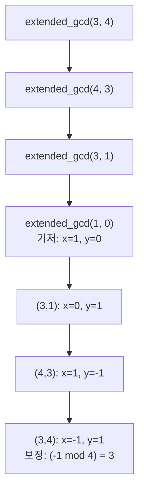

대학에서 수학을 전공하지 않는 학생들에게 정수론은 종종 어려운 과목으로 다가온다. 지민이는 정수론을 싫어하여 강의 시간에 졸다가 혁주로부터 숙제를 듣게 되었다. 혁주는 지민이에게 두 자연수 \( a \)와 \( m \)이 서로소일 때, \( a \)의 법 \( m \)에 대한 잉여역수 \( a^* \)를 구하는 문제를 내주었다. 이 글에서는 백준 온라인 저지의 문제 번호 15995번 "잉여역수 구하기"를 통해 잉여역수를 구하는 방법과 이를 구현하는 다양한 방안을 살펴보겠다.

문제 : [https://www.acmicpc.net/problem/15995](https://www.acmicpc.net/problem/15995)

## 문제 설명

두 자연수 \( a \)와 \( m \)이 서로소일 때, \( a \)의 법 \( m \)에 대한 잉여역수 \( a^* \)는 다음을 만족하는 자연수 \( x \)를 의미한다.

\[
a \times x \equiv 1 \ (\text{mod} \ m)
\]

즉, \( a \times x \)를 \( m \)으로 나눈 나머지가 1이 되는 최소의 자연수 \( x \)를 찾는 문제이다. 예를 들어, \( a = 3 \)이고 \( m = 4 \)일 때, \( 3 \times 3 = 9 \equiv 1 \ (\text{mod} \ 4) \)이므로, 잉여역수는 3이 된다. 이 문제에서는 주어진 \( a \)와 \( m \)에 대해 잉여역수 \( a^* \)를 출력해야 한다. \( a \)와 \( m \)은 서로소이며, 잉여역수는 항상 존재한다는 점이 보장된다.

## 제한 조건과 입출력

입력은 서로소인 두 자연수 \( a \)와 \( m \)이 한 줄에 주어지고, 출력은 잉여역수 하나다. 입력 범위는 문제 페이지에서 확인하고, 아래 구현은 `long long`으로 받아 32비트 범위의 곱셈 오버플로우를 피한다. 예제는 `3 4`에 대해 `3`을 출력한다.

## 접근 방식

잉여역수를 구하는 대표적인 방법은 **확장 유클리드 알고리즘**을 사용하는 것이다. 확장 유클리드 알고리즘을 통해 두 수 \( a \)와 \( m \)의 최대공약수(GCD)를 구함과 동시에, 베주 정리에 의해 잉여역수 \( a^* \)를 찾을 수 있다. 확장 유클리드 알고리즘은 재귀적으로 \( a \)와 \( m \)의 GCD를 구하면서, 동시에 \( x \)와 \( y \)를 찾아 \( a \times x + m \times y = \text{GCD}(a, m) \)를 만족시킨다. 여기서 \( \text{GCD}(a, m) = 1 \)이므로, \( x \)가 잉여역수가 된다. 이때 \( x \)가 음수일 수 있으므로, \( m \)을 더해 양수의 최소값을 구하면 된다.

베주 항등식이 왜 역원을 주는지는 한 줄로 확인된다. \( a \times x + m \times y = 1 \)의 양변을 \( m \)으로 나눈 나머지를 보면 \( m \times y \)가 사라지고 \( a \times x \equiv 1 \ (\text{mod} \ m) \)만 남는다. 재귀 단계의 점화식 \( x = y_1,\ y = x_1 - \lfloor a/b \rfloor \times y_1 \)은 \( b \times x_1 + (a \bmod b) \times y_1 = g \)에 \( a \bmod b = a - \lfloor a/b \rfloor b \)를 대입해 \( a \)와 \( b \)의 계수로 다시 묶은 결과다. 예제 `3 4`로 손추적하면 호출은 \( (3,4) \to (4,3) \to (3,1) \to (1,0) \)으로 내려가고, 기저에서 \( (x,y) = (1,0) \)이다. 올라오면서 \( (3,1) \)에서 \( (0,1) \), \( (4,3) \)에서 \( (1,-1) \), \( (3,4) \)에서 \( (-1,1) \)이 되어 \( 3 \times (-1) + 4 \times 1 = 1 \)이 성립한다. \( x = -1 \)을 \( m = 4 \)로 보정하면 3이고, 이는 문제 설명의 예와 일치한다.



확장 유클리드는 \( m \)이 소수가 아니어도 동작한다는 점이 판단 기준이다. \( m \)이 소수일 때는 페르마 소정리로 \( a^{-1} \equiv a^{m-2} \ (\text{mod} \ m) \)이므로 빠른 거듭제곱으로도 구할 수 있지만, 합성수 \( m \)에서는 이 식이 성립하지 않는다. 이 문제는 \( m \)이 소수라는 보장이 없고 \( a \)와 \( m \)이 서로소라는 조건만 있으므로 확장 유클리드가 안전한 선택이다. 파이썬 3.8 이상에서는 `pow(a, -1, m)`이 같은 일을 하며, 서로소가 아니면 `ValueError`를 낸다.

| 항목 | 값 | 근거 |
|---|---|---|
| 시간 복잡도 | \( O(\log m) \) | 유클리드 호출 깊이는 입력의 로그에 비례한다 (Lamé 정리) |
| 공간 복잡도 | \( O(\log m) \) | 재귀 호출 스택의 깊이와 같다 |

## C++ 코드와 설명

```cpp
// 42jerrykim.github.io에서 더 많은 정보를 확인할 수 있다
#include <bits/stdc++.h>
using namespace std;

// 확장 유클리드 알고리즘을 통해 GCD와 베주 계수를 구하는 함수
long long extended_gcd_func(long long a, long long b, long long &x, long long &y){
    if(b == 0){
        x = 1;
        y = 0;
        return a;
    }
    long long x1, y1;
    long long gcd = extended_gcd_func(b, a % b, x1, y1);
    x = y1;
    y = x1 - (a / b) * y1;
    return gcd;
}

int main(){
    ios::sync_with_stdio(false);
    cin.tie(0);
    
    long long a, m;
    cin >> a >> m;
    
    long long x, y;
    long long gcd = extended_gcd_func(a, m, x, y);
    
    // gcd가 1이 아니면 잉여역수가 존재하지 않음
    // 하지만 문제 조건에서 서로소이므로 항상 잉여역수가 존재
    // 잉여역수가 음수일 수 있으므로 m을 더해 양수로 만듦
    long long inv = (x % m + m) % m;
    cout << inv;
}
```

### 코드 설명

1. **확장 유클리드 알고리즘 함수 (`extended_gcd_func`)**:
    - 재귀적으로 \( \text{GCD}(a, b) \)를 구하면서, 베주 계수 \( x \)와 \( y \)를 찾아낸다.
    - 재귀의 기저 사례는 \( b = 0 \)일 때로, 이때 \( x = 1 \)과 \( y = 0 \)을 반환한다.
    - 재귀 호출을 통해 이전 단계의 \( x \)와 \( y \) 값을 받아와 현재 단계의 \( x \)와 \( y \)를 계산한다.

2. **메인 함수 (`main`)**:
    - 입력으로 두 자연수 \( a \)와 \( m \)을 받는다.
    - `extended_gcd_func`를 호출하여 \( \text{GCD}(a, m) \)와 \( x \), \( y \)를 구한다.
    - 문제 조건에서 \( a \)와 \( m \)은 서로소이므로 \( \text{GCD}(a, m) = 1 \)이며, 따라서 \( x \)는 잉여역수가 된다.
    - \( x \)가 음수일 경우를 대비하여 \( m \)을 더한 후 \( m \)으로 나눈 나머지를 취해 최소의 자연수 잉여역수를 구한다.
    - 최종적으로 잉여역수를 출력한다.

## Python 코드와 설명

```python
# 42jerrykim.github.io에서 더 많은 정보를 확인할 수 있다
def extended_gcd(a, b):
    if b == 0:
        return a, 1, 0
    else:
        gcd, x1, y1 = extended_gcd(b, a % b)
        x = y1
        y = x1 - (a // b) * y1
        return gcd, x, y

def modular_inverse(a, m):
    gcd, x, y = extended_gcd(a, m)
    if gcd != 1:
        # 잉여역수가 존재하지 않음 (문제 조건상 발생하지 않음)
        return None
    else:
        # x가 음수일 수 있으므로 m을 더해 양수로 만듦
        return x % m

# 입력 받기
a, m = map(int, input().split())

# 잉여역수 구하기
inv = modular_inverse(a, m)

# 결과 출력
print(inv)
```

### 코드 설명

C++ 구현과 재귀 구조는 같다. 차이는 두 가지다. 파이썬의 `%`는 제수 \( m \)이 양수이면 항상 0 이상의 값을 돌려주므로 `x % m`만으로 보정이 끝나고, 서로소가 아닌 입력에는 `None`을 반환해 호출 쪽이 실패를 구분하게 했다.

## 결론

핵심은 \( a x + m y = 1 \)의 계수 \( x \)를 \( m \)으로 보정하면 곧바로 역원이 된다는 점이다. 재귀 깊이가 \( O(\log m) \)이므로 스택 오버플로우 걱정은 사실상 없지만, 재귀 호출이 부담스러우면 \( (x_0, y_0, x_1, y_1) \)을 갱신하는 반복문 형태로 바꿀 수 있다. Python에서는 아래 한 줄이 같은 결과를 낸다.

```python
# 42jerrykim.github.io에서 더 많은 정보를 확인할 수 있다
a, m = map(int, input().split())
print(pow(a, -1, m))
```

## 코너 케이스 및 실수 포인트

| 케이스 | 설명 | 처리 방법 |
|---|---|---|
| **음수 계수** | 예제 `3 4`에서 \( x = -1 \)이 나옴 | `(x % m + m) % m`으로 보정 (C++), Python은 `x % m`이 이미 비음수 |
| **a ≥ m** | 첫 호출에서 \( a \bmod m \)을 한 번 거치며 정상 동작 | 별도 처리 불필요, 필요하면 `a %= m`을 먼저 적용 |
| **a = 1** | 역원은 항상 1 | 확장 유클리드 결과가 \( x = 1 \)이 되는지 확인 |
| **서로소 아님** | 이 문제에서는 보장되지만 일반적으로는 역원 없음 | `gcd != 1`이면 실패 처리 |

## 학습 정리

이 글을 읽은 뒤에는 베주 항등식으로 잉여역수가 존재하고 계산되는 이유를 설명할 수 있어야 하고, 합성수 \( m \)에서 페르마 소정리 방식을 쓸 수 없는 까닭을 말할 수 있어야 한다. 또한 재귀형 확장 유클리드를 반복문으로 바꾸는 방향도 알고 있어야 한다.

## 참고 자료

- [Extended Euclidean algorithm – Wikipedia](https://en.wikipedia.org/wiki/Extended_Euclidean_algorithm)
- [Python 문서: pow()](https://docs.python.org/3/library/functions.html#pow)
