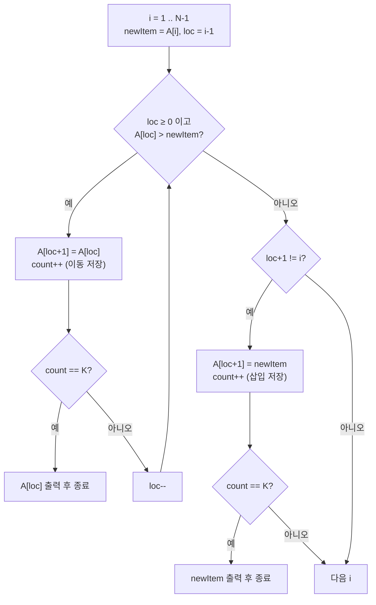

정렬 알고리즘은 컴퓨터 과학에서 가장 기본적이고 중요한 개념 중 하나이다. 특히, 삽입 정렬은 이해하기 쉽고 직관적인 알고리즘으로, 다양한 상황에서 응용될 수 있다. 이번 글에서는 백준의 "알고리즘 수업 - 삽입 정렬 1" 문제를 통해 삽입 정렬의 동작 방식을 자세히 살펴보고, 주어진 문제를 효과적으로 해결하는 방법을 알아보고자 한다.

문제 : [https://www.acmicpc.net/problem/24051](https://www.acmicpc.net/problem/24051)

## 문제 정보

| 항목 | 내용 |
|---|---|
| 문제 | 백준 24051번, 알고리즘 수업 - 삽입 정렬 1 |
| 입력 | 첫 줄에 배열 크기 N과 저장 횟수 K, 둘째 줄에 서로 다른 양의 정수 N개 |
| 출력 | K번째로 저장되는 수, 저장이 K번 미만이면 -1 |
| 제한 조건 | 시간·메모리 제한과 N, K의 범위는 위 링크의 원문을 따른다 |

```text
입력 예제          출력 예제
5 7                5
4 5 1 3 2
```

## 문제 설명

백준 문제 24051번 "알고리즘 수업 - 삽입 정렬 1"은 N개의 서로 다른 양의 정수가 저장된 배열 A가 주어진다. 이 배열을 삽입 정렬을 사용하여 오름차순으로 정렬할 때, 배열 A에 K번째로 저장되는 수를 구하는 문제이다.

삽입 정렬의 기본적인 동작은 배열의 두 번째 원소부터 시작하여 현재 원소를 적절한 위치에 삽입함으로써 정렬을 진행하는 것이다. 문제에서 요구하는 것은 삽입 정렬 과정에서 배열에 저장되는 모든 연산 중 K번째로 저장되는 값을 찾는 것이다. 만약 저장 횟수가 K보다 작으면 -1을 출력해야 한다.

예를 들어, 배열 A가 [4, 5, 1, 3, 2]이고 K가 7이라면, 삽입 정렬 과정을 따라가며 저장되는 값을 세어 K번째 저장된 값을 출력해야 한다. 이 경우, K번째 저장된 값은 5이다. 반면, K가 저장 횟수보다 큰 경우에는 -1을 출력해야 한다.

## 학습 목표

이 글을 읽고 나면 삽입 정렬에서 "저장"이 정확히 어떤 대입을 가리키는지 구분하고, 정렬을 끝까지 돌리지 않고도 K번째 저장 시점에 곧바로 값을 꺼내 종료하는 시뮬레이션을 구현할 수 있어야 한다. 또한 저장 횟수의 상한을 유도해 카운터 자료형을 근거 있게 고를 수 있어야 한다.

## 접근 방식

이 문제는 정렬 결과가 아니라 정렬 과정에서 배열에 값이 쓰이는 순서를 묻는다. 그래서 삽입 정렬을 문제에서 제시한 의사코드 그대로 따라가며 배열에 대입이 일어날 때마다 카운터를 올리고, 카운터가 K에 닿는 순간 방금 쓰인 값을 출력한 뒤 종료하면 된다. 삽입 정렬 자체가 O(N²)이므로 시뮬레이션 비용도 같은 차수이고, 별도의 자료구조는 필요 없다. 정확한 N·K의 범위와 시간·메모리 제한은 문제 원문에서 확인해야 하며, 이 글은 그 수치를 단정하지 않는다.

헷갈리기 쉬운 지점은 무엇이 저장으로 세어지는가이다. 현재 원소 `newItem`을 임시 변수에 빼 둔 뒤, 자신보다 큰 원소를 한 칸씩 오른쪽으로 밀 때마다 `A[loc + 1] = A[loc]` 대입이 한 번 일어나며 이것이 저장 한 번이다. 밀기가 끝나 빈자리를 찾으면 `A[loc + 1] = newItem`으로 임시 변수의 값을 꽂는데, 이것도 저장 한 번이다. 다만 `newItem`이 이미 제자리에 있어 한 칸도 밀지 않았다면 `loc + 1 == i`이고 의사코드는 이 대입을 수행하지 않으므로, 코드의 `loc + 1 != i` 조건이 이 경우를 저장에서 제외한다. 이동만 세고 삽입을 빼먹거나, 제자리 삽입까지 세어 버리는 것이 가장 흔한 오답 원인이다. 출력할 값도 구분해야 한다. 이동 저장이면 방금 덮어쓴 값 `A[loc]`(밀려난 원소)이고, 삽입 저장이면 `newItem`이다.



예제 `A = [4, 5, 1, 3, 2]`, `K = 7`을 따라가면 저장 순서가 다음과 같다. i=1에서는 5가 4보다 크므로 아무것도 밀지 않고 제자리 삽입이라 저장이 없다. i=2에서 1을 삽입하면 5, 4가 차례로 밀리고(1, 2번째 저장) 1이 맨 앞에 꽂힌다(3번째). i=3에서 3을 삽입하면 5, 4가 밀리고(4, 5번째) 3이 꽂힌다(6번째). i=4에서 2를 삽입할 때 첫 이동으로 5가 쓰이는 것이 7번째 저장이므로 답은 5이다.

| 저장 번호 | 종류 | 대입 | 저장된 값 |
|---:|---|---|---:|
| 1 | 이동 | `A[2] = 5` (i=2) | 5 |
| 2 | 이동 | `A[1] = 4` (i=2) | 4 |
| 3 | 삽입 | `A[0] = 1` (i=2) | 1 |
| 4 | 이동 | `A[3] = 5` (i=3) | 5 |
| 5 | 이동 | `A[2] = 4` (i=3) | 4 |
| 6 | 삽입 | `A[1] = 3` (i=3) | 3 |
| 7 | 이동 | `A[4] = 5` (i=4) | 5 |

표의 인덱스는 코드와 같은 0-기반이다.

### 복잡도 분석

| 항목 | 값 | 근거 |
|---|---|---|
| 시간 복잡도 | O(N²) | 이동은 역순 정렬 입력에서 최대, 총 N(N-1)/2번이다 |
| 공간 복잡도 | O(1) | 입력 배열을 제자리에서 수정하고 `newItem`, `loc`, `count`만 추가한다 |
| 저장 횟수 상한 | N(N-1)/2 + (N-1) | 이동 최대 N(N-1)/2에 삽입 최대 N-1을 더한 값이다 |

K가 저장 횟수 상한보다 크면 정렬이 끝나도 카운터가 K에 닿지 않으므로 -1이 된다. 또 이미 정렬된 입력에서는 이동도 삽입도 없어 저장이 0번이고, 이 경우 어떤 K ≥ 1에 대해서도 답은 -1이다.

## C++ 코드와 설명

```cpp
// 42jerrykim.github.io에서 더 많은 정보를 확인할 수 있다.
#include <bits/stdc++.h>
using namespace std;

int main(){
    ios::sync_with_stdio(false);
    cin.tie(NULL);
    
    int N;
    long long K;
    cin >> N >> K;
    
    // 배열 A의 원소를 입력받는다.
    vector<int> A(N);
    for(auto &x : A) cin >> x;
    
    long long count = 0; // 저장 연산의 횟수를 세기 위한 카운터
    
    // 삽입 정렬을 수행한다.
    for(int i = 1; i < N; i++){
        int newItem = A[i]; // 현재 삽입할 원소
        int loc = i - 1; // 삽입할 위치를 찾기 위한 인덱스
        
        // newItem보다 큰 원소를 오른쪽으로 이동시킨다.
        while(loc >= 0 && A[loc] > newItem){
            A[loc + 1] = A[loc]; // 원소를 오른쪽으로 이동
            count++; // 저장 연산 카운트
            if(count == K){
                cout << A[loc];
                return 0;
            }
            loc--;
        }
        
        // newItem을 적절한 위치에 삽입한다.
        if(loc + 1 != i){
            A[loc + 1] = newItem;
            count++; // 저장 연산 카운트
            if(count == K){
                cout << newItem;
                return 0;
            }
        }
    }
    
    // 저장 횟수가 K보다 작으면 -1을 출력
    cout << "-1";
}
```

### 코드 해설

핵심 로직은 위 접근 방식의 순서도와 일대일로 대응한다. 두 `if (count == K)` 검사가 이동 저장 직후와 삽입 저장 직후에 하나씩 있고, 각각 `A[loc]`과 `newItem`을 출력한다. `vector`와 `bits/stdc++.h`를 쓰므로 메모리 해제를 신경 쓸 필요가 없다.

## C++ without library 코드와 설명

```cpp
// 42jerrykim.github.io에서 더 많은 정보를 확인할 수 있다.
#include <iostream>
using namespace std;

int main(){
    ios::sync_with_stdio(false);
    cin.tie(NULL);
    
    int N;
    long long K;
    cin >> N >> K;
    
    // 배열 동적 할당
    int* A = new int[N];
    for(int i = 0; i < N; i++) cin >> A[i];
    
    long long count = 0; // 저장 연산의 횟수를 세기 위한 카운터
    
    // 삽입 정렬을 수행한다.
    for(int i = 1; i < N; i++){
        int newItem = A[i]; // 현재 삽입할 원소
        int loc = i - 1; // 삽입할 위치를 찾기 위한 인덱스
        
        // newItem보다 큰 원소를 오른쪽으로 이동시킨다.
        while(loc >= 0 && A[loc] > newItem){
            A[loc + 1] = A[loc]; // 원소를 오른쪽으로 이동
            count++; // 저장 연산 카운트
            if(count == K){
                cout << A[loc];
                delete[] A;
                return 0;
            }
            loc--;
        }
        
        // newItem을 적절한 위치에 삽입한다.
        if(loc + 1 != i){
            A[loc + 1] = newItem;
            count++; // 저장 연산 카운트
            if(count == K){
                cout << newItem;
                delete[] A;
                return 0;
            }
        }
    }
    
    // 저장 횟수가 K보다 작으면 -1을 출력
    cout << "-1";
    delete[] A;
}
```

### 코드 해설

로직은 앞의 코드와 같고 달라지는 것은 메모리 관리뿐이다. `new int[N]`으로 잡은 배열은 조기 종료하는 두 `return 0` 경로와 마지막 출력 경로 모두에서 `delete[]`로 해제해야 하며, 한 경로라도 빠지면 누수가 된다. 채점 환경에서는 프로세스 종료 시 회수되지만, 해제 경로를 빠짐없이 적는 습관을 보여 주려는 변형이다.

## Python 코드와 설명

```python
# 42jerrykim.github.io에서 더 많은 정보를 확인할 수 있다.
import sys

def main():
    input = sys.stdin.read
    data = input().split()
    
    N = int(data[0])
    K = int(data[1])
    A = list(map(int, data[2:2+N]))
    
    count = 0 # 저장 연산의 횟수를 세기 위한 카운터
    
    # 삽입 정렬을 수행한다.
    for i in range(1, N):
        newItem = A[i] # 현재 삽입할 원소
        loc = i - 1 # 삽입할 위치를 찾기 위한 인덱스
        
        # newItem보다 큰 원소를 오른쪽으로 이동시킨다.
        while loc >= 0 and A[loc] > newItem:
            A[loc + 1] = A[loc] # 원소를 오른쪽으로 이동
            count += 1 # 저장 연산 카운트
            if count == K:
                print(A[loc])
                return
            loc -= 1
        
        # newItem을 적절한 위치에 삽입한다.
        if loc + 1 != i:
            A[loc + 1] = newItem
            count += 1 # 저장 연산 카운트
            if count == K:
                print(newItem)
                return
    
    # 저장 횟수가 K보다 작으면 -1을 출력
    print(-1)

if __name__ == "__main__":
    main()
```

### 코드 해설

로직은 C++ 코드와 같다. 차이는 입력 처리에 있다. `sys.stdin.read().split()`으로 입력 전체를 한 번에 토큰 리스트로 읽고 앞의 두 값을 N, K로, 이어지는 N개를 배열로 쓴다. 조기 종료는 `main()` 안에서 `return`으로 처리한다. Python의 정수는 임의 정밀도라 K의 오버플로우를 걱정할 필요가 없다.

## 결론

이 문제는 삽입 정렬 구현보다 저장의 정의를 읽는 문제였다. 정렬 과정의 이동 횟수가 입력의 역전 쌍 개수와 같다는 성질 때문에, 거의 정렬된 입력에서는 카운터가 K에 닿지 못하고 -1이 되기 쉽다.

## 코너 케이스 및 실수 포인트

| 케이스 | 설명 | 처리 방법 |
|---|---|---|
| **최소 입력** | N=1이면 반복문이 돌지 않아 저장 0번 | 카운터가 K에 닿지 못하므로 -1 출력 |
| **제자리 삽입** | `loc + 1 == i`이면 삽입 대입을 세지 않음 | `loc + 1 != i` 조건 유지 |
| **카운터 자료형** | 저장 횟수는 최대 N(N-1)/2 + N-1이므로 N이 커지면 `int` 범위를 넘을 수 있음 | 카운터와 K를 `long long`으로 선언 |

## 참고 문헌 및 출처

- [백준 24051번 알고리즘 수업 - 삽입 정렬 1](https://www.acmicpc.net/problem/24051)
