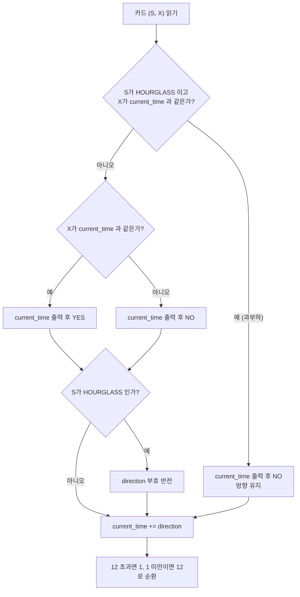

우주 어딘가에는 시간을 셈으로써 시간이 흐르도록 만들어 주는 존재들이 있습니다. 영겁의 시간을 살아온 그들은 더 재미있게 시간을 세기 위해 시간을 세는 게임을 만들어 냈답니다. 그게 바로 《크레이지 타임》이죠! 이 게임에서는 플레이어들이 시간 카드를 이용해 시각을 외치며 다양한 법칙을 따르면서 진행됩니다. 이번 포스팅에서는 이 《크레이지 타임》 게임의 문제를 해결하는 방법에 대해 알아보겠습니다.

문제 : [https://www.acmicpc.net/problem/27161](https://www.acmicpc.net/problem/27161)

## 문제 정보

| 항목 | 내용 |
|---|---|
| 문제 | 백준 27161번, 크레이지 타임 |
| 입력 | 첫 줄에 펼쳐질 카드 수 N, 이어서 N줄에 시계 종류(`CLOCK`, `WATCH`, `HOURGLASS` 중 하나)와 카드에 적힌 시각 X |
| 출력 | 카드마다 한 줄, 그 차례에 외치는 시각과 손바닥을 내리쳐야 하면 `YES`, 아니면 `NO` |
| 제한 조건 | 시간·메모리 제한과 N의 범위는 위 링크의 원문을 따른다 |

```text
입력 예제          출력 예제
5                  1 YES
CLOCK 1            2 NO
HOURGLASS 5        1 NO
HOURGLASS 1        12 YES
WATCH 12           11 NO
WATCH 3
```

위 예제는 규칙을 따라가며 직접 구성한 것이며, 원문의 공식 예제와 다를 수 있다. 아래 코드를 따라 손으로 추적한 출력이다.

## 문제 설명

《크레이지 타임》 게임은 시간 카드를 사용하여 시각을 외치는 게임입니다. 게임을 시작하기 전에 시간 카드를 잘 섞은 후 플레이어들에게 최대한 비슷한 수량의 카드를 나눠줍니다. 각 시간 카드는 앞면과 뒷면이 있으며, 앞면에는 시계 그림과 시각이 적혀 있습니다. 시계의 종류는 벽시계(CLOCK), 손목시계(WATCH), 모래시계(HOURGLASS)로 총 세 가지가 있습니다. 플레이어들은 자신의 카드 더미를 뒷면이 보이도록 쌓아둡니다.

게임은 다음과 같은 규칙으로 진행됩니다:

1. 플레이어는 자신의 차례가 되면 개인 더미의 가장 윗장 카드를 펼치며 이번 순서의 시각을 외칩니다. 첫 번째 플레이어는 "1시"로 시작합니다.
2. 시계 방향으로 차례가 돌아가며, 특별한 방해 요소가 없다면 이전에 외친 시각에 1시간을 더해 다음 시각을 외칩니다. 예를 들어, 이전에 "12시"를 외쳤다면 다음 플레이어는 "1시"를 외칩니다.
3. 펼쳐진 카드에 따라 특별한 규칙이 적용될 수 있습니다:
    - **시간 역행의 법칙**: 모래시계 카드를 펼치면 시간이 거꾸로 흐르기 시작합니다. "2시", "1시", "12시" 순으로 외쳐야 합니다. 모래시계 카드를 펼칠 때마다 시간의 흐름이 반전됩니다.
    - **동기화의 법칙**: 플레이어가 외친 시각과 카드에 적힌 시각이 일치하면 모든 플레이어는 게임판 중앙을 손바닥으로 내리쳐야 합니다.
4. **과부하의 원칙**: 한 카드가 동시에 두 개 이상의 법칙을 발동시키면, 어떤 법칙도 적용되지 않습니다.

게임 중 잘못된 시각을 외치거나 손바닥을 가장 늦게 내리친 플레이어는 벌점 토큰을 받습니다. 벌점 토큰을 받은 후 게임은 초기화되며, 벌점을 받은 플레이어가 "1시"를 외치며 게임을 재개합니다. 

이번 문제에서는 카드들이 주어질 때, 각 차례의 플레이어가 외쳐야 하는 시각과 해야 하는 행동을 출력하는 프로그램을 작성해야 합니다. 

## 학습 목표

이 글을 읽고 나면 규칙이 여러 개 얽힌 시뮬레이션 문제를 "상태 변수 + 판정 순서"로 환원하는 방법을 설명할 수 있어야 한다. 구체적으로는 방향 변수 하나로 시간 역행을 표현하고, 과부하가 발동할 때 방향 반전과 YES 판정이 함께 취소되는 이유를 상태 전이로 설명하며, 12와 1 사이의 순환 경계를 양방향으로 처리하는 코드를 작성할 수 있어야 한다.

## 접근 방식

이 문제는 카드를 순서대로 읽으며 규칙을 그대로 적용하는 시뮬레이션이다. 유지해야 할 상태는 현재 외칠 시각 `current_time`과 시간이 흐르는 방향 `direction`(앞으로 +1, 뒤로 -1) 두 개뿐이다. 카드 하나를 처리할 때 모든 카드는 같은 순서를 밟는다. 먼저 이번 카드가 모래시계인지, 카드의 시각이 지금 외칠 시각과 같은지를 판정한다. 그다음 두 조건이 동시에 참인지 보아 과부하 여부를 정하고, 마지막으로 방향에 따라 시각을 한 칸 옮긴다.

핵심은 과부하가 "아무 법칙도 적용하지 않는다"는 점이다. 모래시계 카드가 시각과도 일치하면 시간 역행과 동기화가 동시에 발동하므로 두 법칙이 모두 취소된다. 따라서 출력은 `NO`이고 방향도 바뀌지 않는다. 반면 시각은 법칙과 무관하게 매 차례 한 칸 흐르므로, 과부하 카드 뒤에도 현재 방향대로 시각이 갱신된다. 흔한 실수는 모래시계가 일치하는 경우에도 방향을 뒤집는 것과, 방향을 뒤집은 뒤 그 새 방향으로 시각을 갱신하는 순서를 거꾸로 두는 것이다. 이 문제에서 모래시계를 펼친 차례에 외치는 시각은 반전 이전의 값이고, 반전된 방향은 다음 차례의 시각부터 반영된다.



위 흐름에서 `E`에서 `G`로 이어지는 경로는 YES이면서 모래시계인 경우가 없다는 점에 주의해야 한다. 그 조합은 `B`에서 이미 과부하로 빠지므로, `G`의 "예"는 시각이 일치하지 않는 모래시계에서만 일어난다.

### 복잡도 분석

| 항목 | 값 | 근거 |
|---|---|---|
| 시간 복잡도 | O(N) | 카드마다 상수 개의 비교와 대입만 수행한다 |
| 공간 복잡도 | O(1) | 카드를 저장하지 않고 `current_time`, `direction`만 유지한다 |

## C++ 코드와 설명

```cpp
// 42jerrykim.github.io에서 더 많은 정보를 확인할 수 있다.
#include <bits/stdc++.h>
using namespace std;

int main(){
    ios::sync_with_stdio(false);
    cin.tie(0);
    
    int N;
    cin >> N;
    
    // 초기 시각과 방향 설정
    int current_time = 1;
    int direction = 1; // 1: 앞으로, -1: 뒤로
    
    for(int i=0;i<N;i++){
        string S;
        int X;
        cin >> S >> X;
        
        bool isHOURGLASS = (S == "HOURGLASS");
        bool isSYNC = (X == current_time);
        
        // 과부하 체크: 두 개 이상의 법칙이 발동하면 아무 것도 하지 않음
        if(isHOURGLASS && isSYNC){
            // 아무 것도 하지 않음
            cout << current_time << " NO\n";
        }
        else{
            // 동기화의 법칙 적용 여부 확인
            if(isSYNC){
                cout << current_time << " YES\n";
            }
            else{
                cout << current_time << " NO\n";
            }
            
            // 시간 역행의 법칙 적용
            if(isHOURGLASS){
                direction *= -1;
            }
        }
        
        // 시각 업데이트
        current_time += direction;
        if(current_time > 12){
            current_time = 1;
        }
        if(current_time < 1){
            current_time = 12;
        }
    }
}
```

### 코드 해설

`isHOURGLASS`와 `isSYNC` 두 불리언이 세 법칙의 발동 여부를 모두 담는다. 둘이 함께 참인 분기가 과부하이며 출력만 하고 방향은 건드리지 않는다. 그 외의 분기에서는 `isSYNC`에 따라 `YES`/`NO`를 출력하고, 모래시계라면 `direction`의 부호를 뒤집는다. 출력이 반전보다 먼저이므로 모래시계 차례에 외치는 시각은 반전 전의 값이다. 시각 갱신은 모든 분기가 끝난 뒤 한 곳에서 수행하고, 범위를 벗어난 값은 `if` 분기로 12와 1 사이에서 순환시킨다. 방향이 ±1이라 한 번에 한 칸만 벗어나므로 나머지 연산 대신 분기로 충분하다.

## Python 코드와 설명

```python
# 42jerrykim.github.io에서 더 많은 정보를 확인할 수 있다.
def main():
    import sys
    input = sys.stdin.readline
    
    N = int(input())
    current_time = 1
    direction = 1  # 1: forward, -1: backward
    
    for _ in range(N):
        S, X = input().split()
        X = int(X)
        
        isHOURGLASS = (S == "HOURGLASS")
        isSYNC = (X == current_time)
        
        if isHOURGLASS and isSYNC:
            # Overload: No action
            print(f"{current_time} NO")
        else:
            if isSYNC:
                print(f"{current_time} YES")
            else:
                print(f"{current_time} NO")
            
            if isHOURGLASS:
                direction *= -1
        
        # Update current_time
        current_time += direction
        if current_time > 12:
            current_time = 1
        elif current_time < 1:
            current_time = 12

if __name__ == "__main__":
    main()
```

### 코드 해설

Python 코드는 C++과 판정 순서가 같고, 다른 점은 입력과 출력 방식뿐이다. `sys.stdin.readline`으로 입력을 읽고 `print`에 f-string을 써서 한 줄씩 출력한다. 시각 범위 보정에서 `if`/`elif`를 쓴 것은 한 번의 갱신으로 12 초과와 1 미만이 동시에 일어날 수 없기 때문이며, C++의 두 `if`와 결과가 같다.

## 결론

이 문제에서 얻을 일반 교훈은 판정과 갱신을 분리하는 것이다. 규칙이 여러 개 얽혀 있어도 "이번 카드가 어떤 법칙을 발동하는가"를 먼저 판정하고, 상태 갱신은 법칙과 무관한 부분(시각 이동)과 법칙에 종속된 부분(방향 반전)으로 나누어 순서를 고정하면 된다. 이 구분을 지키면 반전과 순환 경계에서 생기는 오답 대부분을 피할 수 있다.

## 코너 케이스 및 실수 포인트

| 케이스 | 설명 | 처리 방법 |
|---|---|---|
| **최소 입력** | N=1이면 카드 한 장만 처리하고 시각은 1에서 시작 | 첫 차례의 외침은 항상 `1` |
| **과부하** | 모래시계이면서 카드 시각이 현재 시각과 같음 | `NO`를 출력하고 방향을 유지, 시각은 갱신 |
| **연속 모래시계** | 방향이 두 번 뒤집혀 원래 방향으로 복귀 | `direction *= -1`을 매번 적용 |
| **앞으로 순환** | 12 다음은 1 | `current_time > 12`이면 1로 설정 |
| **뒤로 순환** | 1 다음은 12 (모래시계 반전 후) | `current_time < 1`이면 12로 설정 |

## 참고 문헌 및 출처

- [백준 27161번 크레이지 타임](https://www.acmicpc.net/problem/27161)
