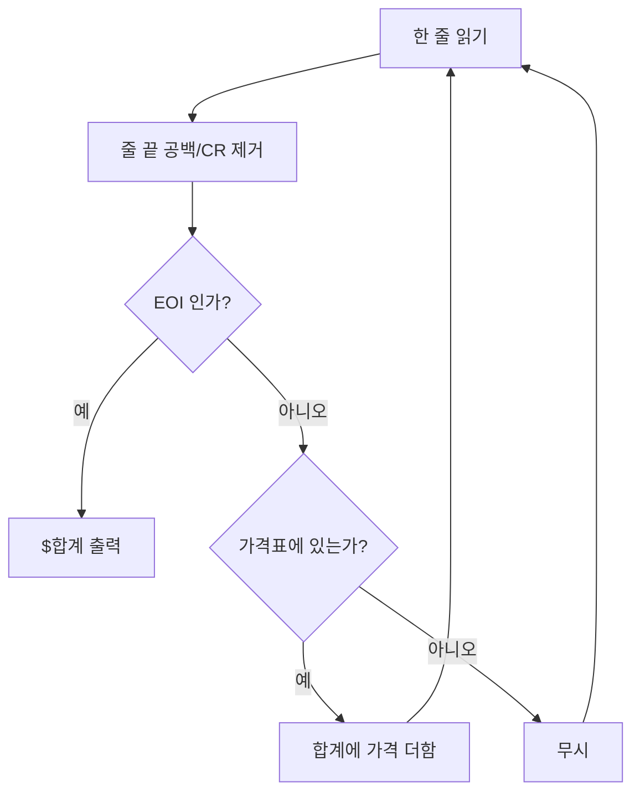

이번 포스트에서는 백준 온라인 저지 5342번 "Billing"을 C++과 Python으로 푼다. 문제 자체는 고정된 가격표에서 품목 이름으로 값을 찾아 더하는 구현 문제라 알고리즘적 난이도는 낮다. 대신 "이름 → 가격" 조회 구조를 고르는 기준, 부동소수점으로 금액을 합산해도 `%.2f` 출력이 안전한 이유, 그리고 줄 단위 입력을 받을 때 생기는 함정을 확인하는 데 좋은 연습 문제다.

문제 : [https://www.acmicpc.net/problem/5342](https://www.acmicpc.net/problem/5342)

## 학습 목표

이 글을 읽고 나면 다음을 설명할 수 있다.

- 고정된 키 집합에서 값을 찾는 문제에 해시 맵과 선형 탐색이 각각 언제 적합한지 판단한다.
- 소수 둘째 자리 금액을 `double`로 누적해도 `%.2f` 출력이 틀리지 않는 조건을 설명한다.
- `getline`과 `scanf("%s")`, `input()`의 입력 처리 차이와 버퍼 크기·줄바꿈 문자 함정을 짚는다.

## 문제 설명

회계 부서는 지난 학기 동안 구매한 사무용품 비용을 청구하려 한다. 품목별 가격은 아래 표로 고정되어 있고, 입력으로는 구매한 품목 이름이 한 줄에 하나씩 주어진다. 입력의 끝은 "EOI"라는 문자열이며, 프로그램은 모든 품목 비용의 합을 달러 기호("$")로 시작해 소수점 아래 두 자리까지 출력한다.

| Item      | Cost  |
|-----------|-------|
| Paper     | 57.99 |
| Printer   | 120.50|
| Planners  | 31.25 |
| Binders   | 22.50 |
| Calendar  | 10.95 |
| Notebooks | 11.20 |
| Ink       | 66.95 |

### 예제 입력 1

```
Binders
Calendar
Ink
Notebooks
Binders
Ink
EOI
```

### 예제 출력 1

```
$201.05
```

Binders 2개(45.00), Calendar(10.95), Notebooks(11.20), Ink 2개(133.90)를 더하면 201.05가 된다.

## 접근 방식

이 문제의 핵심은 이름으로 가격을 찾는 조회 구조다. 품목은 7개로 고정되어 있으므로 해시 맵(`unordered_map`, `dict`)을 써도 되고 배열을 선형 탐색해도 된다. 해시 맵은 평균 O(1)에 조회하지만 품목이 7개뿐이라 선형 탐색(최대 7번 비교)과 줄당 비교 횟수가 7번 이하로 상수에 묶이므로 차이는 사실상 없다. 그래도 해시 맵은 "이름에서 값으로 가는 매핑"이라는 의도를 코드에 그대로 드러내기 때문에 읽기 쉬운 쪽을 기본 풀이로 삼는다.

입력은 EOI를 만날 때까지 한 줄씩 읽는다. 읽은 이름이 가격표에 있으면 합계에 더하고, 없으면 무시한다. 문제 설명상 표에 없는 품목이 들어오는 경우는 명시되지 않으므로 무시하는 쪽이 가장 안전한 가정이다. 입력 처리 흐름은 아래 그림과 같다.



시간 복잡도는 입력 줄 수를 N이라 할 때 줄마다 조회 한 번이므로 O(N)이고, 가격표 크기 7은 상수라 공간 복잡도는 O(1)이다.

| 풀이 | 줄당 조회 | 시간 | 추가 공간 |
|---|---|---|---|
| `unordered_map` / `dict` | 평균 O(1) | O(N) | O(1) (키 7개) |
| 구조체 배열 선형 탐색 | 최대 7회 비교 | O(N) | O(1) |
| 정수 센트 + 해시 맵 | 평균 O(1) | O(N) | O(1) |

### 부동소수점 합산은 안전한가

금액을 `double`로 더하면 오차가 걱정되지만 이 문제에서는 안전하다. 모든 가격은 센트(0.01) 단위의 정수배라서 참값의 합도 센트 단위 정수배이고, 출력은 센트 단위로 반올림한다. 즉 참값은 항상 반올림 경계(0.005의 홀수배)에서 0.005만큼 떨어져 있다. `double`의 상대 오차는 약 1e-16이고 덧셈 한 번의 절대 오차는 합계 크기에 비례하므로, 합계가 수만 달러 규모까지 가더라도 누적 오차는 1e-9 아래에 머문다. 이는 경계까지의 거리 0.005보다 수백만 배 작으므로 `%.2f`가 올바른 센트를 출력한다. 다만 합계가 매우 커지거나 경계에 걸리는 연산(나눗셈, 세율 곱 등)이 섞이면 이 논증은 성립하지 않는다. 이를 구조적으로 없애는 정수 센트 풀이는 뒤의 절에서 코드로 다룬다.

## C++ 코드와 설명

`unordered_map`으로 가격표를 만들고 `getline`으로 한 줄씩 읽는 풀이다.

```cpp
// 42jerrykim.github.io에서 더 많은 정보를 확인할 수 있다
#include <bits/stdc++.h>
using namespace std;

int main(){
    // 품목 이름 -> 가격 매핑
    unordered_map<string, double> items = {
        {"Paper", 57.99},
        {"Printer", 120.50},
        {"Planners", 31.25},
        {"Binders", 22.50},
        {"Calendar", 10.95},
        {"Notebooks", 11.20},
        {"Ink", 66.95}
    };

    double total = 0.0;
    string line;

    while(getline(cin, line)){
        // Windows 줄바꿈(\r\n) 입력이면 \r이 남아 매칭에 실패하므로 제거
        if(!line.empty() && line.back() == '\r') line.pop_back();
        if(line == "EOI") break;
        auto it = items.find(line);
        if(it != items.end()) total += it->second;  // 표에 없는 품목은 무시
    }

    printf("$%.2lf\n", total);
    return 0;
}
```

`getline`은 줄 끝의 개행까지만 소비하고 앞뒤 공백은 그대로 둔다. 따라서 채점 데이터가 `\r\n` 줄바꿈이면 `"Ink\r"`가 맵의 `"Ink"`와 일치하지 않아 조용히 0원으로 처리된다. 위 코드는 이를 막기 위해 마지막 문자가 `\r`이면 제거한다. 가격표 조회는 `find`로 존재 여부를 먼저 확인하므로 `operator[]`처럼 없는 키가 맵에 삽입되는 부작용이 없다.

## C++ 표준 컨테이너 없이 푸는 코드

`<bits/stdc++.h>`나 STL 컨테이너 없이 C 표준 헤더(`stdio.h`, `string.h`, `stdlib.h`)와 구조체 배열만으로도 풀 수 있다.

```cpp
// 42jerrykim.github.io에서 더 많은 정보를 확인할 수 있다
#include <stdio.h>
#include <string.h>
#include <stdlib.h>

typedef struct Item {
    char name[20];
    double cost;
} Item;

int main(){
    Item items[] = {
        {"Paper", 57.99},
        {"Printer", 120.50},
        {"Planners", 31.25},
        {"Binders", 22.50},
        {"Calendar", 10.95},
        {"Notebooks", 11.20},
        {"Ink", 66.95}
    };
    int itemCount = sizeof(items)/sizeof(items[0]);

    double total = 0.0;
    char line[30];

    // %29s: 버퍼(30바이트)보다 긴 토큰이 와도 널 문자 자리를 남기고 잘라 읽는다
    while(scanf("%29s", line) != EOF){
        if(strcmp(line, "EOI") == 0) break;
        for(int i=0; i<itemCount; i++){
            if(strcmp(line, items[i].name) == 0){
                total += items[i].cost;
                break;
            }
        }
    }

    printf("$%.2lf\n", total);
    return 0;
}
```

이 코드는 품목마다 `strcmp`로 최대 7번 비교하는 선형 탐색이다. 품목 수가 상수이므로 해시 맵 풀이와 점근 복잡도가 같고, 해시 계산과 메모리 할당이 없어 오히려 상수 비용은 작다. `scanf("%s")`는 공백으로 토큰을 끊기 때문에 `\r`을 포함한 공백 문자를 자동으로 건너뛰어, 앞의 `getline` 풀이에서 필요했던 `\r` 처리가 따로 필요 없다. 품목 이름에 공백이 없는 이 문제에서는 두 방식의 결과가 같지만, 이름에 공백이 들어가는 문제에서는 `scanf("%s")`가 이름을 둘로 쪼개므로 `getline`을 써야 한다. 또 `%s`처럼 폭 제한 없이 읽으면 `line[30]`보다 긴 입력에서 버퍼 오버플로가 나므로 `%29s`로 폭을 제한했다.

## Python 코드와 설명

```python
# 42jerrykim.github.io에서 더 많은 정보를 확인할 수 있다
import sys

items = {
    "Paper": 57.99,
    "Printer": 120.50,
    "Planners": 31.25,
    "Binders": 22.50,
    "Calendar": 10.95,
    "Notebooks": 11.20,
    "Ink": 66.95,
}

total = 0.0
for raw in sys.stdin:
    line = raw.strip()          # 앞뒤 공백과 \r\n 제거
    if line == "EOI":
        break
    total += items.get(line, 0.0)  # 없는 품목은 0으로 처리(무시)

print(f"${total:.2f}")
```

Python은 `strip()`으로 `\r`을 포함한 앞뒤 공백을 한 번에 제거하므로 줄바꿈 문제가 자연스럽게 해결된다. `for raw in sys.stdin`은 입력이 끝나면 반복이 스스로 종료하므로, EOI 없이 입력이 끝나는 경우에도 `EOFError` 예외 처리 없이 안전하다. `dict.get(line, 0.0)`은 없는 키에 기본값을 돌려줘 별도의 존재 확인 분기를 없앤다. `f"{total:.2f}"`는 C의 `%.2f`와 같이 센트 단위로 반올림해 출력한다.

## 정수 센트로 푸는 대안과 흔한 오개념

"금액에 `double`을 쓰면 항상 틀린다"는 말은 절반만 맞다. `0.1 + 0.2 != 0.3`처럼 이진 부동소수점이 십진 소수를 정확히 표현하지 못하는 것은 사실이지만([IEEE 754](https://en.wikipedia.org/wiki/IEEE_754)의 표현 방식 때문이며, 자세한 오차 분석은 Goldberg의 [What Every Computer Scientist Should Know About Floating-Point Arithmetic](https://docs.oracle.com/cd/E19957-01/806-3568/ncg_goldberg.html)에 있다. 예를 들어 `0.1`을 반복문으로 10번 더하면 `1.0`이 아니라 `0.9999999999999999`가 된다), 이 문제처럼 덧셈만 하고 마지막에 센트 단위로 반올림하면 오차가 반올림 경계에 닿지 않아 결과가 틀리지 않는다. 위험한 것은 누적 오차 자체보다 `==` 비교, 곱셈·나눗셈이 섞인 계산, 반올림 경계에 걸리는 값이다. 이런 위험을 구조적으로 없애려면 가격을 정수 센트로 바꿔 합산한다.

```cpp
// 42jerrykim.github.io에서 더 많은 정보를 확인할 수 있다
#include <bits/stdc++.h>
using namespace std;

int main(){
    // 가격을 센트 단위 정수로 보관
    unordered_map<string, long long> cents = {
        {"Paper", 5799}, {"Printer", 12050}, {"Planners", 3125},
        {"Binders", 2250}, {"Calendar", 1095}, {"Notebooks", 1120}, {"Ink", 6695}
    };
    long long total = 0;
    string line;
    while(getline(cin, line)){
        if(!line.empty() && line.back() == '\r') line.pop_back();
        if(line == "EOI") break;
        auto it = cents.find(line);
        if(it != cents.end()) total += it->second;
    }
    // 정수 나눗셈과 나머지로 달러·센트를 분리해 출력
    printf("$%lld.%02lld\n", total / 100, total % 100);
    return 0;
}
```

이 풀이는 합산에 오차가 없고 출력도 정수 연산뿐이다. 대신 가격표를 센트로 환산해 옮길 때 입력 실수가 생기기 쉬우므로, 문제처럼 가격표가 작고 덧셈만 있을 때는 `double` 풀이로 충분하다.

## 코너 케이스 및 실수 포인트

| 케이스 | 설명 | 처리 방법 |
|---|---|---|
| **EOI만 입력** | 구매 품목이 없는 경우 | 합계 0이므로 `$0.00` 출력 |
| **표에 없는 품목** | 문제에 정의되지 않은 이름 | 무시(맵 `find`/`dict.get` 사용, `operator[]`는 키를 삽입하므로 지양) |
| **줄 끝 `\r`** | CRLF 입력에서 `getline`이 `\r`을 남김 | `\r` 제거 또는 `scanf`·`strip()` 사용 |
| **대소문자** | `ink`처럼 표와 대소문자가 다른 입력 | 문제는 정확한 철자를 전제하므로 그대로 비교 |
| **버퍼 폭** | `scanf("%s")`에 긴 토큰 | `%29s`로 폭 제한 |
