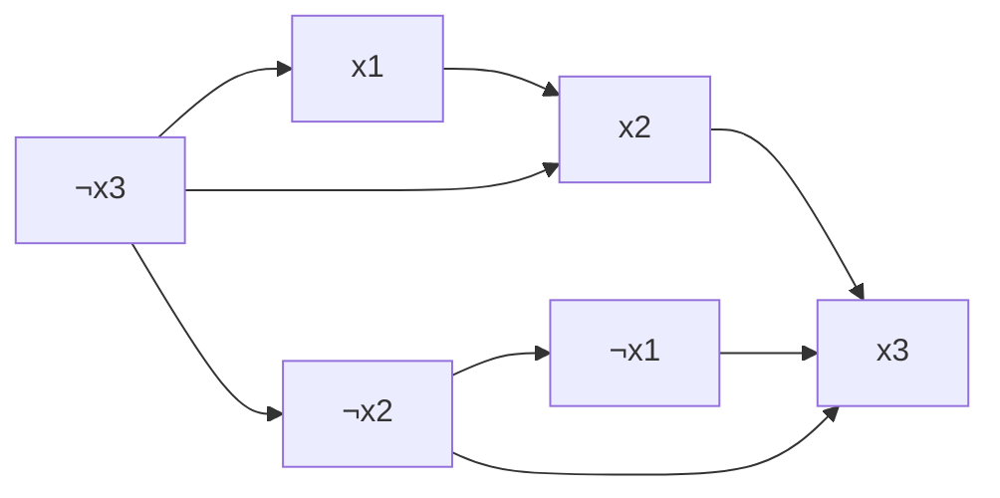

오늘은 백준 온라인 저지의 11281번 문제인 "2-SAT - 4"를 다뤄보겠다. 이 문제는 2-SAT 문제로, 논리 회로 및 그래프 이론의 지식을 요구한다.

문제 : [https://www.acmicpc.net/problem/11281](https://www.acmicpc.net/problem/11281)

## 문제 설명

2-SAT 문제는 \(N\)개의 불리언 변수 \(x_1, x_2, \ldots, x_N\)가 있을 때, 주어진 2-CNF(Conjunctive Normal Form) 식을 참으로 만드는 변수의 값을 찾는 문제이다. 2-CNF 식은 여러 개의 절(clause)의 논리곱(\(\land\))으로 구성되며, 각 절은 두 개의 리터럴(변수 또는 그 부정)의 논리합(\(\lor\))으로 이루어진다.

예를 들어, 다음과 같은 식을 생각해보자:

\[
(\lnot x_1 \lor x_2) \land (\lnot x_2 \lor x_3) \land (x_1 \lor x_3) \land (x_3 \lor x_2)
\]

여기서 \(\lnot\)는 NOT을, \(\lor\)는 OR을, \(\land\)는 AND를 의미한다. 이 식을 참으로 만들기 위해 각 변수에 적절한 값을 할당해야 한다.

문제는 변수의 개수 \(N\)과 절의 개수 \(M\), 그리고 각 절에 포함된 변수들이 주어졌을 때, 전체 식을 참으로 만들 수 있는지 판단하고, 가능하다면 변수들의 값을 구하는 것이다.

예를 들어, \(N = 3\), \(M = 4\)인 경우 위의 식을 참으로 만들기 위해 \(x_1 = \text{False}\), \(x_2 = \text{False}\), \(x_3 = \text{True}\)로 설정할 수 있다. 하지만 \(N = 1\), \(M = 2\), \(f = (x_1 \lor x_1) \land (\lnot x_1 \lor \lnot x_1)\)인 경우에는 \(x_1\)에 어떤 값을 할당하더라도 식을 참으로 만들 수 없다.

## 접근 방식

이 문제는 선형 시간에 풀 수 있는 2-SAT이며, 핵심 아이디어는 <strong>임플리케이션 그래프(Implication Graph)</strong>를 만들고 <strong>강한 연결 요소(Strongly Connected Components, SCC)</strong>를 구하는 것이다. 절 \((A \lor B)\)는 "A가 거짓이면 B가 참이어야 하고, B가 거짓이면 A가 참이어야 한다"와 같은 말이므로 \(\lnot A \rightarrow B\)와 \(\lnot B \rightarrow A\) 두 간선으로 바꿀 수 있다. 각 변수 \(x_i\)와 그 부정 \(\lnot x_i\)를 노드로 두면 노드는 \(2N\)개, 간선은 \(2M\)개가 된다.

앞의 예시 식에 이 변환을 적용하면 다음 그래프가 나온다. 절 \((\lnot x_1 \lor x_2)\)는 \(x_1 \rightarrow x_2\)와 \(\lnot x_2 \rightarrow \lnot x_1\)이 되는 식이다.



화살표 \(u \rightarrow v\)는 "u가 참이면 v도 참이어야 한다"는 뜻이므로, 같은 SCC에 속한 노드는 서로 도달할 수 있어 항상 같은 진리값을 가져야 한다. 따라서 \(x_i\)와 \(\lnot x_i\)가 같은 SCC에 있으면 \(x_i\)가 참이든 거짓이든 자기 부정이 함께 참이 되어야 하므로 모순이고, 식은 만족할 수 없다. 반대로 어떤 변수도 이런 모순이 없다면 항상 만족하는 할당이 존재한다.

SCC는 Kosaraju 알고리즘으로 구한다. 원래 그래프에서 DFS를 돌려 종료 순서를 기록하고, 종료가 늦은 노드부터 역그래프에서 DFS를 돌리면 SCC가 원래 그래프의 위상 순서대로 번호 0, 1, 2, …를 받는다. 값은 이 번호로 정한다. \(x_i\)에서 \(\lnot x_i\)로 가는 경로가 있다면 \(x_i\)를 참으로 둘 수 없으므로, 위상 순서에서 \(x_i\)가 \(\lnot x_i\)보다 앞서는 경우에는 \(x_i\)를 거짓으로 둔다. 즉 위상 순서에서 뒤쪽에 있는 쪽(SCC 번호가 큰 쪽)을 참으로 고르면, 참으로 고른 노드에서 나가는 간선은 모두 더 뒤쪽 노드(역시 참)로만 향하므로 어떤 임플리케이션도 깨지지 않는다. 코드의 `scc_id[x] > scc_id[¬x]`가 바로 이 규칙이다.

### 복잡도 분석

| 항목 | 복잡도 | 비고 |
|---|---|---|
| 시간 | \(O(N + M)\) | DFS 2회 |
| 공간 | \(O(N + M)\) | 그래프·역그래프 |

노드 \(2N\)개와 간선 \(2M\)개에 대해 DFS를 정방향·역방향으로 각각 한 번씩 수행하므로 시간 복잡도는 \(O(N + M)\)이다. 각 노드와 간선을 상수 번만 방문하기 때문이다. 공간 복잡도도 인접 리스트 두 벌(그래프와 역그래프)과 방문·SCC 배열을 합쳐 \(O(N + M)\)이다. Tarjan 알고리즘은 역그래프 없이 DFS 한 번으로 SCC를 구하므로 메모리가 조금 적지만, 번호가 위상 순서의 역순으로 매겨져 비교 방향이 반대가 된다. 이 글은 번호 부여 규칙이 단순한 Kosaraju를 쓴다.

### 문제 정보

| 항목 | 내용 |
|---|---|
| 문제 | [백준 11281번: 2-SAT - 4](https://www.acmicpc.net/problem/11281) |
| 입력 범위 | 변수 \(N\), 절 \(M\) 모두 최대 10000 (코드의 `MAX_N`의 근거) |
| 출력 | 만족 불가면 `0`, 가능하면 `1`과 변수 값 |

### 입출력 예제

입력은 첫 줄에 \(N\)과 \(M\), 이어서 \(M\)개 줄에 절을 이루는 두 리터럴이 주어지며, 양수 \(k\)는 \(x_k\), 음수 \(-k\)는 \(\lnot x_k\)를 뜻한다. 앞의 예시 식은 다음과 같이 입력된다.

```text
3 4
-1 2
-2 3
1 3
3 2
```

이 식은 만족 가능하므로 첫 줄에 `1`을 출력하고, 둘째 줄에 변수의 값을 공백으로 구분해 출력한다. 앞에서 확인한 대로 \(x_1 = 0, x_2 = 0, x_3 = 1\)이 하나의 해이다. 반대로 \((x_1 \lor x_1) \land (\lnot x_1 \lor \lnot x_1)\)처럼 모순인 식에서는 `0`만 출력한다.

## C++ 코드와 설명

```cpp
// 42jerrykim.github.io에서 더 많은 정보를 확인할 수 있다
#include <iostream>
#include <vector>
#include <algorithm>

using namespace std;

const int MAX_N = 10000;

int N, M;
vector<int> adj[MAX_N * 2];       // 임플리케이션 그래프
vector<int> adj_rev[MAX_N * 2];   // 역 그래프
vector<int> order;                // 노드 방문 순서
int scc_id[MAX_N * 2];            // 각 노드의 SCC ID
bool visited[MAX_N * 2];

// 변수 번호를 인덱스로 변환
int var(int x) {
    return x > 0 ? (x - 1) * 2 : (-x - 1) * 2 + 1;
}

// 1차 DFS: 노드 방문 순서 기록
void dfs1(int u) {
    visited[u] = true;
    for (int v : adj[u]) {
        if (!visited[v]) dfs1(v);
    }
    order.push_back(u);
}

// 2차 DFS: SCC 구성
void dfs2(int u, int id) {
    scc_id[u] = id;
    for (int v : adj_rev[u]) {
        if (scc_id[v] == -1) dfs2(v, id);
    }
}

int main() {
    ios::sync_with_stdio(false);
    cin.tie(nullptr);

    cin >> N >> M;

    // 그래프 구성
    for (int i = 0; i < M; ++i) {
        int a, b;
        cin >> a >> b;
        int u = var(a);
        int v = var(b);
        // \lnot a -> b
        adj[u ^ 1].push_back(v);
        adj_rev[v].push_back(u ^ 1);
        // \lnot b -> a
        adj[v ^ 1].push_back(u);
        adj_rev[u].push_back(v ^ 1);
    }

    // 1차 DFS 수행
    for (int i = 0; i < N * 2; ++i) {
        if (!visited[i]) dfs1(i);
    }

    // SCC 초기화
    fill(scc_id, scc_id + N * 2, -1);

    // 2차 DFS 수행
    int id = 0;
    for (int i = N * 2 - 1; i >= 0; --i) {
        int u = order[i];
        if (scc_id[u] == -1) dfs2(u, id++);
    }

    // 모순 검사
    for (int i = 0; i < N; ++i) {
        if (scc_id[i * 2] == scc_id[i * 2 + 1]) {
            cout << 0 << '\n';
            return 0;
        }
    }

    // 변수 값 결정
    vector<int> result(N);
    for (int i = 0; i < N; ++i) {
        result[i] = scc_id[i * 2] > scc_id[i * 2 + 1] ? 1 : 0;
    }

    // 결과 출력
    cout << 1 << '\n';
    for (int i = 0; i < N; ++i) {
        cout << result[i] << ' ';
    }
    cout << '\n';

    return 0;
}
```

### C++ 코드 설명

그래프는 변수마다 두 노드를 쓰는 \(2N\)개 노드로 표현하며, `var()`가 입력 리터럴을 노드 인덱스로 바꾼다. 양수 리터럴은 짝수 인덱스, 부정은 홀수 인덱스를 받으므로 `u ^ 1`이 곧 부정 노드이다. 이 덕분에 한 절을 읽을 때마다 `adj[u ^ 1]`과 `adj[v ^ 1]`에 간선 두 개를 추가하는 것으로 임플리케이션 변환이 끝난다.

SCC는 `dfs1()`으로 종료 순서를 `order`에 모은 뒤, 그 역순으로 `dfs2()`를 역그래프에서 실행해 구한다. 이후 모든 변수에서 `scc_id[i * 2] == scc_id[i * 2 + 1]`이면 `0`을 출력하고 끝낸다. 모순이 없다면 `1`을 출력하고 앞서 정리한 규칙대로 SCC 번호가 큰 쪽을 참으로 하여 값을 출력한다.

## Python 코드와 설명

```python
# 42jerrykim.github.io에서 더 많은 정보를 확인할 수 있다
import sys
sys.setrecursionlimit(1000000)

N, M = map(int, sys.stdin.readline().split())
adj = [[] for _ in range(N * 2)]
adj_rev = [[] for _ in range(N * 2)]

def var(x):
    return (abs(x) - 1) * 2 + (0 if x > 0 else 1)

for _ in range(M):
    a, b = map(int, sys.stdin.readline().split())
    u = var(a)
    v = var(b)
    adj[u ^ 1].append(v)
    adj[v ^ 1].append(u)
    adj_rev[v].append(u ^ 1)
    adj_rev[u].append(v ^ 1)

visited = [False] * (N * 2)
order = []

def dfs1(u):
    visited[u] = True
    for v in adj[u]:
        if not visited[v]:
            dfs1(v)
    order.append(u)

def dfs2(u, label):
    scc_id[u] = label
    for v in adj_rev[u]:
        if scc_id[v] == -1:
            dfs2(v, label)

for i in range(N * 2):
    if not visited[i]:
        dfs1(i)

scc_id = [-1] * (N * 2)
label = 0
for u in reversed(order):
    if scc_id[u] == -1:
        dfs2(u, label)
        label += 1

for i in range(N):
    if scc_id[i * 2] == scc_id[i * 2 + 1]:
        print(0)
        sys.exit(0)

result = [0] * N
for i in range(N):
    result[i] = 1 if scc_id[i * 2] > scc_id[i * 2 + 1] else 0

print(1)
print(' '.join(map(str, result)))
```

### Python 코드 설명

구조는 C++와 같고 입력을 `sys.stdin.readline`으로 읽는다는 점만 다르다. 가장 조심할 부분은 재귀 깊이이다. DFS 깊이는 최악의 경우 노드 수인 \(2N\)까지 갈 수 있어 \(N = 10000\)이면 20000에 이르는데, `sys.setrecursionlimit`만 올리면 파이썬 인터프리터의 호출 스택이 먼저 넘쳐 런타임 에러가 날 수 있다. 제출할 때는 `threading.stack_size`로 스레드 스택을 키운 뒤 그 스레드에서 실행하거나, DFS를 명시적 스택을 쓰는 반복형으로 바꾸는 쪽이 안전하다.

## 정리

이 문제의 학습 포인트는 두 가지이다. 첫째, 2-CNF 절을 \(\lnot A \rightarrow B\) 형태의 간선 두 개로 바꾸면 논리 문제가 그래프 도달성 문제가 된다. 둘째, SCC 번호가 위상 순서를 따른다는 성질 덕분에 "번호가 큰 쪽을 참으로 한다"는 한 줄 규칙으로 해를 구성할 수 있다.

## 코너 케이스 및 실수 포인트

| 케이스 | 설명 | 처리 방법 |
|---|---|---|
| **같은 변수가 한 절에 반복** | \((x_1 \lor x_1)\)은 \(\lnot x_1 \rightarrow x_1\) 간선 두 개가 되어 \(x_1\)을 참으로 강제한다 | `var()` 변환이 같은 노드를 두 번 쓰는 경우도 그대로 동작하는지 확인 |
| **N=1 모순** | \((x_1 \lor x_1) \land (\lnot x_1 \lor \lnot x_1)\)은 \(x_1\)과 \(\lnot x_1\)이 같은 SCC | `0` 출력 후 즉시 종료 |
| **중복 절** | 같은 절이 여러 번 들어와도 간선만 중복될 뿐 결과는 같다 | 중복 제거 불필요 |
| **리터럴 인덱스 매핑 실수** | 음수 리터럴을 홀수 인덱스로 보내지 않으면 `u ^ 1` 부정 관계가 깨진다 | `var()`의 양수·음수 분기와 0-기반 변환(`x - 1`)을 점검 |
| **SCC 번호 방향 혼동** | Kosaraju는 위상 순서, Tarjan은 역위상 순서로 번호가 매겨진다 | 사용하는 알고리즘에 맞게 비교 방향 결정 |
| **재귀 깊이** | DFS 깊이가 최대 \(2N\)이다 | Python은 스레드 스택 확대 또는 반복형 DFS |

## 평가 기준

이 글을 읽고 나면 2-SAT 절을 임플리케이션 간선으로 변환하고, 같은 SCC에 변수와 그 부정이 있을 때 불만족인 이유를 설명할 수 있어야 한다. 또한 SCC 번호의 방향에 따라 변수의 값을 정하는 규칙을 스스로 유도하고, 구현 언어에 따른 재귀 깊이 문제에 대응할 수 있어야 한다.

## 참고 문헌

- [백준 11281번: 2-SAT - 4](https://www.acmicpc.net/problem/11281)
- Aspvall, B., Plass, M. F., Tarjan, R. E. (1979). "A linear-time algorithm for testing the truth of certain quantified boolean formulas". Information Processing Letters 8(3), 121–123.
- [Strongly connected component (Wikipedia)](https://en.wikipedia.org/wiki/Strongly_connected_component)
- [2-satisfiability (Wikipedia)](https://en.wikipedia.org/wiki/2-satisfiability)
