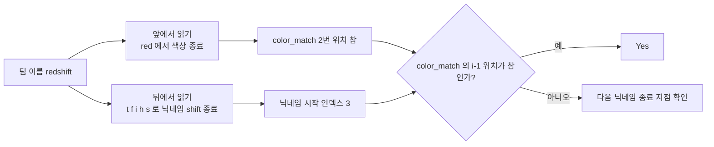

알고리즘 문제를 풀다 보면 다양한 자료 구조와 알고리즘을 접하게 된다. 오늘은 백준 온라인 저지의 19585번 문제인 **전설**을 풀어보면서 Trie 자료 구조와 문자열 처리에 대해 알아보겠다.

문제 : [https://www.acmicpc.net/problem/19585](https://www.acmicpc.net/problem/19585)

## 학습 목표

이 글을 읽고 나면 다음을 설명할 수 있다.

- 문자열을 "앞부분 + 뒷부분"으로 나누는 모든 지점을 Trie 두 방향 탐색으로 한 번에 검사하는 이유를 설명한다.
- 가장 긴 색상 이름만 매칭하면 틀리는 이유를 반례로 보이고, 모든 접두사 종료 지점을 기록해야 함을 안다.
- 정적 Trie 배열의 노드 수 상한과 메모리를 직접 계산한다.
- 해시 집합 방식과 Trie 방식을 입력 규모에 따라 비교한다.

## 문제 설명

서강대학교 ICPC 팀에는 팀 이름을 **색상 이름**과 **닉네임**의 순서로 지으면 대회에서 수상할 수 있다는 전설이 있다. 예를 들어, "redshift"나 "bluejoker" 같은 이름이다. 색상 이름의 목록과 닉네임의 목록이 주어졌을 때, 주어진 팀 이름들이 다음 대회에서 수상할 수 있을지, 즉 팀 이름이 색상 이름과 닉네임의 조합으로 이루어져 있는지를 판단해야 한다.

- **입력**:
  - 색상 이름의 개수 `C`와 닉네임의 개수 `N`이 주어진다. (1 ≤ C, N ≤ 4,000)
  - 다음 `C`개의 줄에는 중복되지 않는 색상 이름들이 주어진다.
  - 다음 `N`개의 줄에는 중복되지 않는 닉네임들이 주어진다.
  - 그 다음 팀 이름의 개수 `Q`가 주어진다. (1 ≤ Q ≤ 20,000)
  - 다음 `Q`개의 줄에는 팀 이름들이 주어진다.
  - 모든 이름은 알파벳 소문자로만 이루어져 있다. 색상 이름과 닉네임의 길이는 각각 1,000자 이하이고, 팀 이름의 길이는 2,000자 이하이다.

- **출력**:
  - 각 팀 이름에 대해 해당 팀이 전설에 따라 수상할 수 있다면 "Yes", 그렇지 않다면 "No"를 출력한다.


## 접근 방식

팀 이름 `s`가 유효하려면 `s = 색상 + 닉네임`이 되는 분할 지점 `k`(1 ≤ k ≤ |s|-1)가 하나라도 있어야 한다. 이때 `s[0..k)`는 색상 이름이고 `s[k..|s|)`는 닉네임이어야 한다. 질의마다 모든 `k`에 대해 두 부분 문자열을 해시 집합에서 찾으면 문자열 해시 계산만으로 O(L²)이 들고, 최대 길이 L=2,000, 질의 20,000개에서는 시간이 모자란다. 그래서 문자 하나를 읽을 때마다 상태가 한 칸씩 이동하는 **Trie**로 모든 분할 후보를 질의당 O(L)에 훑는다.

핵심은 접두사 쪽과 접미사 쪽을 서로 반대 방향에서 읽는다는 점이다. 색상 이름은 정방향으로 Trie에 넣는다. 닉네임은 **뒤집어서** 넣는다. 그러면 팀 이름의 끝에서 앞으로 읽어 오는 경로가 닉네임 Trie의 루트에서 내려가는 경로와 같아진다. 구현에서는 두 집합을 한 배열 `trie`에 함께 넣고, 노드가 "색상의 끝"인지 "뒤집은 닉네임의 끝"인지는 `is_color_end`, `is_nick_end` 두 플래그로 구분한다. 같은 문자열 경로는 같은 노드이고, 플래그는 실제로 삽입된 단어의 끝에만 켜지므로 두 집합이 섞여도 판정은 틀리지 않는다. Python 풀이는 같은 아이디어를 Trie 두 개로 분리해 구현한다.

질의 하나는 두 단계로 처리한다. 먼저 `s`를 앞에서부터 읽어 가며 색상 Trie 안에서 색상이 끝나는 모든 위치 `i`(색상이 `s[0..i]`로 끝남)를 `color_match[i]`에 기록한다. 그다음 `s`를 뒤에서부터 읽어 가며 닉네임이 끝나는 위치 `i`(닉네임이 `s[i..]`로 시작함)에서 `color_match[i-1]`이 참인지 확인한다. 참이면 `s[0..i-1]`이 색상이고 `s[i..]`가 닉네임이므로 "Yes"다. 접미사 루프가 `i ≥ 1`까지만 도는 것은 색상이 최소 한 글자라는 조건을 반영한다.



### 손으로 따라가 보기

색상이 `{red, blue}`, 닉네임이 `{shift, joker}`이고 팀 이름이 `redshift`라고 하자. 앞에서 읽으면 `r`, `e`, `d`를 지나며 세 번째 글자 `d`에서 `red`가 색상으로 끝나므로 `color_match[2]`가 켜진다. 이후 `s`는 색상 Trie에 간선이 없어 접두사 탐색은 거기서 멈춘다. 이제 뒤에서 읽으면 `t`, `f`, `i`, `h`, `s`를 따라 내려가 인덱스 3에서 역방향 `shift`가 닉네임으로 끝난다. 이 지점에서 `color_match[3-1]`, 즉 `color_match[2]`가 참이므로 `red + shift`로 나뉜다는 뜻이고 답은 "Yes"다. 반대로 `redjoke`라면 뒤에서 읽는 경로 `e`, `k`가 닉네임 Trie에서 곧바로 끊겨 닉네임 종료 지점을 만나지 못하고 "No"가 된다. 분할 지점을 직접 찾지 않았는데도 두 방향의 종료 표시가 같은 경계에서 맞물리는지만 보면 충분하다는 것이 이 풀이의 요점이다.

### 흔한 오개념: 가장 긴 색상만 보면 안 된다

색상이 `{a, ab}`, 닉네임이 `{bc}`이고 팀 이름이 `abc`라고 하자. 정답은 `a + bc`라서 "Yes"다. 하지만 앞에서 읽다가 가장 긴 색상 `ab`만 붙잡으면 남는 `c`가 닉네임이 아니어서 "No"가 나온다. 같은 이유로 가장 짧은 닉네임만 보는 것도 틀린다. 그래서 접두사 쪽은 색상이 끝나는 **모든** 위치를 `color_match`에 남기고, 접미사 쪽은 닉네임이 끝나는 모든 위치에서 대조해야 한다.

### 복잡도와 메모리

전체 입력 길이는 색상 C개와 닉네임 N개가 각각 최대 1,000자이므로 삽입 비용이 O(Σ길이) ≤ 8×10⁶이다. 질의는 팀 이름 길이를 L(≤2,000)이라 할 때 접두사 루프와 접미사 루프가 각각 최대 L번이라 O(L)이고, 전체로는 20,000 × 2,000 = 4×10⁷ 정도다. 공간은 Trie 노드 수에 비례한다. 노드는 루트를 제외하고 색상과 닉네임 글자 수의 합 이하만큼 생기므로 최대 (4,000 + 4,000) × 1,000 = 8,000,000개이고, 루트 포함 8,000,001개다. 그래서 아래 C++ 코드는 `MAXN`을 8,000,002로 잡았다. `int trie[MAXN][26]`은 노드당 104바이트라 약 832MB이므로 문제의 메모리 한도 안에 들어가는지는 제출 전에 문제 페이지에서 확인해야 한다. 한도가 빡빡하면 노드에 문자 맵을 쓰는 Python식 구조나 `unordered_set` 방식이 대안이다.

한 번의 질의가 길이 L에 선형이므로 질의 수가 많은 이 문제에서는 Trie가 자연스럽다. 반대로 질의가 몇 개뿐이거나 이름이 짧다면 구현이 간단한 해시 집합 방식이 더 읽기 쉽고, 메모리가 가장 큰 제약이면 롤링 해시를 곁들인 해시 집합이 유리하다. 아래 표는 이 판단 기준을 정리한 것이다.

| 방식 | 질의당 시간 | 공간 | 적합한 경우 |
|---|---|---|---|
| Trie 두 방향 탐색 | O(L) | O(Σ길이 × 26) 정적 배열 | 질의가 많고 메모리가 넉넉할 때 |
| 해시 집합 + 모든 분할 | O(L²) 문자열 해시 (롤링 해시면 O(L)) | O(Σ길이) | 길이가 짧거나 메모리가 빡빡할 때 |

## C++ 코드와 설명

```cpp
#include <iostream>
#include <cstring>
#include <bitset>
using namespace std;

const int MAXN = 8000002; // Trie의 최대 노드 수(루트 포함 8,000,001)
int trie[MAXN][26];       // 알파벳 소문자에 대한 Trie
bool is_color_end[MAXN];  // 색상 이름의 종료 지점 표시
bool is_nick_end[MAXN];   // 닉네임의 종료 지점 표시
int node_count = 1;       // Trie의 노드 개수

// 색상 이름을 Trie에 삽입
void insert_color(const char* str) {
    int len = strlen(str);
    int node = 0;
    for (int i = 0; i < len; ++i) {
        int c = str[i] - 'a';
        if (!trie[node][c])
            trie[node][c] = node_count++;
        node = trie[node][c];
    }
    is_color_end[node] = true;
}

// 닉네임을 역순으로 Trie에 삽입
void insert_nick(const char* str) {
    int len = strlen(str);
    int node = 0;
    for (int i = len - 1; i >= 0; --i) {
        int c = str[i] - 'a';
        if (!trie[node][c])
            trie[node][c] = node_count++;
        node = trie[node][c];
    }
    is_nick_end[node] = true;
}

int main() {
    ios::sync_with_stdio(false);
    cin.tie(nullptr);

    int C, N;
    cin >> C >> N;

    char word[2001];
    // 색상 이름 입력 및 Trie 구성
    for (int i = 0; i < C; ++i) {
        cin >> word;
        insert_color(word);
    }

    // 닉네임 입력 및 Trie 구성
    for (int i = 0; i < N; ++i) {
        cin >> word;
        insert_nick(word);
    }

    int Q;
    cin >> Q;

    while (Q--) {
        cin >> word;
        int len = strlen(word);

        bitset<2000> color_match; // 색상 이름과 매칭되는 접두사의 위치 기록
        int node = 0;
        // 접두사 검사
        for (int i = 0; i < len; ++i) {
            int c = word[i] - 'a';
            if (!trie[node][c])
                break;
            node = trie[node][c];
            if (is_color_end[node])
                color_match.set(i);
        }

        bool found = false;
        node = 0;
        // 접미사 검사
        for (int i = len - 1; i >= 1; --i) {
            int c = word[i] - 'a';
            if (!trie[node][c])
                break;
            node = trie[node][c];
            if (is_nick_end[node] && color_match.test(i - 1)) {
                found = true;
                break;
            }
        }

        cout << (found ? "Yes\n" : "No\n");
    }

    return 0;
}
```

### 코드 설명

`trie[node][c]`는 `node`에서 문자 `c`로 가는 간선이 가리키는 노드 번호이고, 0이면 간선이 없다는 뜻이다. 루트가 0번이라 "0 = 없음" 표기와 충돌하지 않는다. 색상 이름은 `insert_color`가 글자를 앞에서부터 따라가며 없는 노드를 만들고 마지막 노드에 `is_color_end`를 켠다. 닉네임은 `insert_nick`이 같은 일을 글자를 **뒤에서부터** 하고 `is_nick_end`를 켠다.

질의에서는 먼저 팀 이름을 앞에서 읽으며 `is_color_end`가 켜진 노드를 지날 때마다 `color_match`의 해당 비트를 세운다. 간선이 끊기면 더 긴 색상은 없으므로 즉시 멈춘다. 이어서 이름을 뒤에서 읽으며 `is_nick_end` 노드를 지날 때 `color_match.test(i - 1)`로 바로 앞 글자에서 색상이 끝났는지 확인하고, 하나라도 맞으면 "Yes"다.

## C++ without library 코드와 설명

```cpp
#include <stdio.h>
#include <string.h>

#define MAXN 8000002

int trie[MAXN][26];
char is_color_end[MAXN];
char is_nick_end[MAXN];
int node_count = 1;

void insert_color(char* str) {
    int len = strlen(str);
    int node = 0;
    for (int i = 0; i < len; ++i) {
        int c = str[i] - 'a';
        if (!trie[node][c])
            trie[node][c] = node_count++;
        node = trie[node][c];
    }
    is_color_end[node] = 1;
}

void insert_nick(char* str) {
    int len = strlen(str);
    int node = 0;
    for (int i = len - 1; i >= 0; --i) {
        int c = str[i] - 'a';
        if (!trie[node][c])
            trie[node][c] = node_count++;
        node = trie[node][c];
    }
    is_nick_end[node] = 1;
}

char word[2001];
char color_match[2000];

int main() {
    int C, N;
    scanf("%d %d", &C, &N);

    for (int i = 0; i < C; ++i) {
        scanf("%s", word);
        insert_color(word);
    }

    for (int i = 0; i < N; ++i) {
        scanf("%s", word);
        insert_nick(word);
    }

    int Q;
    scanf("%d", &Q);

    while (Q--) {
        scanf("%s", word);
        int len = strlen(word);
        memset(color_match, 0, len);

        int node = 0;
        // 접두사 검사
        for (int i = 0; i < len; ++i) {
            int c = word[i] - 'a';
            if (!trie[node][c])
                break;
            node = trie[node][c];
            if (is_color_end[node])
                color_match[i] = 1;
        }

        int found = 0;
        node = 0;
        // 접미사 검사
        for (int i = len - 1; i >= 1; --i) {
            int c = word[i] - 'a';
            if (!trie[node][c])
                break;
            node = trie[node][c];
            if (is_nick_end[node] && color_match[i - 1]) {
                found = 1;
                break;
            }
        }

        printf(found ? "Yes\n" : "No\n");
    }

    return 0;
}
```

### 코드 설명

표준 라이브러리의 `bitset`과 스트림 대신 `char` 배열 `color_match`와 `scanf`/`printf`를 쓴 같은 알고리즘이다. 질의마다 `memset`으로 `color_match`를 `len` 바이트만큼 비우므로 초기화 비용도 O(L)에 머문다.

## Python 코드와 설명

```python
import sys

def main():
    input_data = sys.stdin.read().split()
    index = 0
    C = int(input_data[index])
    index += 1
    N = int(input_data[index])
    index += 1

    color_trie = [{}]
    is_color_end = [False]

    nick_trie = [{}]
    is_nick_end = [False]

    def insert(trie, is_end, word, reverse=False):
        node = 0
        iterable = reversed(word) if reverse else word
        for c in iterable:
            if c not in trie[node]:
                trie.append({})
                is_end.append(False)
                trie[node][c] = len(trie) - 1
            node = trie[node][c]
        is_end[node] = True

    # 색상 이름 입력 및 Trie 구성
    for _ in range(C):
        word = input_data[index]
        index += 1
        insert(color_trie, is_color_end, word)

    # 닉네임 입력 및 Trie 구성
    for _ in range(N):
        word = input_data[index]
        index += 1
        insert(nick_trie, is_nick_end, word, reverse=True)

    Q = int(input_data[index])
    index += 1

    for _ in range(Q):
        word = input_data[index]
        index += 1
        len_word = len(word)
        color_match = [False] * len_word
        node = 0

        # 접두사 검사 (색상 이름)
        for i, c in enumerate(word):
            if c not in color_trie[node]:
                break
            node = color_trie[node][c]
            if is_color_end[node]:
                color_match[i] = True

        # 접미사 검사 (닉네임)
        found = False
        node = 0
        for i in range(len_word - 1, 0, -1):
            c = word[i]
            if c not in nick_trie[node]:
                break
            node = nick_trie[node][c]
            if is_nick_end[node] and color_match[i - 1]:
                found = True
                break

        print("Yes" if found else "No")

if __name__ == "__main__":
    main()
```

### 코드 설명

입력은 `sys.stdin.read().split()`로 한 번에 읽고 `index`로 순서대로 꺼낸다. 입력 줄이 최대 28,000줄이라 줄마다 `input()`을 부르는 것보다 호출 횟수가 줄어든다. Trie는 노드마다 `{문자: 다음 노드 번호}` 딕셔너리를 두고, `insert`의 `reverse=True`로 닉네임을 뒤집어 넣는다. C++ 코드와 달리 색상 Trie와 닉네임 Trie를 따로 두며, 딕셔너리는 존재하는 간선만 저장하므로 정적 배열처럼 노드마다 26칸을 잡지 않아 메모리 걱정이 적다. 대신 노드 수가 최대 수백만이면 딕셔너리 객체 오버헤드와 속도가 부담이라, 이 문제에서 Python 풀이가 시간 제한 안에 드는지는 제출해 확인해야 한다.

## 결론

이 풀이는 질의가 많고 이름이 긴 입력에서 분할 지점을 하나씩 해시로 검사하는 비용을 Trie의 선형 탐색으로 바꾼 것이다. 실전에서는 메모리 한도가 먼저 방식을 정한다. 한도가 넉넉하면 정적 배열 Trie를, 빠듯하면 해시 집합이나 딕셔너리 Trie를 고르면 된다. Trie의 정의와 성질은 [Wikipedia의 Trie 항목](https://en.wikipedia.org/wiki/Trie)에 정리되어 있다.

## 코너 케이스 및 실수 포인트

| 케이스 | 설명 | 처리 방법 |
|---|---|---|
| 접두사가 여럿 | 앞서 본 `{a, ab}` / `bc` / `abc` 반례 | 가장 긴 색상만 보지 않고 모든 종료 위치를 `color_match`에 기록 |
| 색상만 또는 닉네임만 | `red`처럼 색상 하나로만 이루어진 이름 | 접미사 루프를 `i ≥ 1`로 제한하고 `color_match[i-1]`을 함께 확인 |
| 길이 1 이름 | 한 글자 팀 이름은 둘로 나눌 수 없음 | 접미사 루프가 돌지 않아 "No" |
| 한쪽만 일치 | 닉네임은 맞지만 앞부분이 색상이 아님 | 접미사 종료와 `color_match[i-1]`이 모두 참일 때만 "Yes" |
| 최대 노드 수 | 모든 이름이 서로 다른 글자로 시작해 노드를 공유하지 못함 | 루트 포함 8,000,001개 → `MAXN` 8,000,002 |
