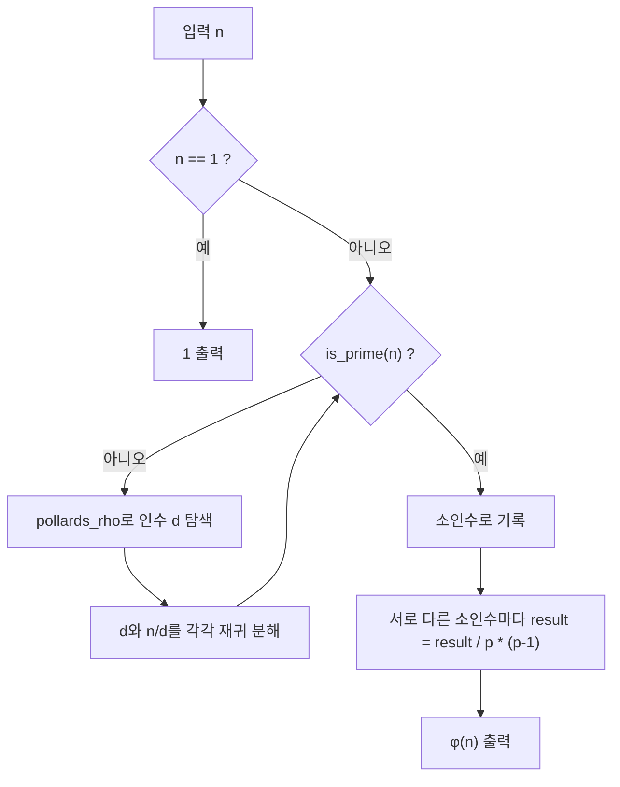

이번 포스팅에서는 백준 온라인 저지의 11689번 문제인 <strong>"GCD(n, k) = 1"</strong>을 다룬다. 이 문제는 큰 수 범위에서 서로소의 개수를 구해야 하므로, 효율적인 알고리즘과 수학적 지식을 활용하는 것이 핵심이다. 오일러 피 함수(Euler's Totient Function)와 소인수분해 알고리즘을 적용하여 문제를 해결해보자.

문제 : [https://www.acmicpc.net/problem/11689](https://www.acmicpc.net/problem/11689)

## 문제 정보

| 항목 | 내용 |
|---|---|
| 문제 번호 | 백준 11689번 |
| 입력 | 자연수 \( n \) 하나, \( 1 \le n \le 10^{12} \) |
| 출력 | \( 1 \le k \le n \)에서 \( \gcd(n, k) = 1 \)인 \( k \)의 개수 |
| 핵심 | 오일러 피 함수 \( \phi(n) \), 소인수분해 |

## 문제 설명

자연수 \( n \)이 주어졌을 때, \( 1 \leq k \leq n \) 범위에서 \( \gcd(n, k) = 1 \)을 만족하는 자연수 \( k \)의 개수를 구하는 문제이다.

예를 들어, \( n = 5 \)인 경우를 살펴보자.

- \( k = 1 \): \(\gcd(5, 1) = 1\)
- \( k = 2 \): \(\gcd(5, 2) = 1\)
- \( k = 3 \): \(\gcd(5, 3) = 1\)
- \( k = 4 \): \(\gcd(5, 4) = 1\)
- \( k = 5 \): \(\gcd(5, 5) = 5\)

따라서 \( \gcd(5, k) = 1 \)을 만족하는 \( k \)는 총 4개이다.

하지만 \( n \)의 범위가 최대 \( 10^{12} \)까지 주어지므로, 모든 \( k \)에 대해 \( \gcd(n, k) \)를 직접 계산하는 것은 비효율적이다. 이에 따라 효율적인 알고리즘을 사용하여 문제를 해결해야 한다.

## 입출력 예제

```text
입력: 5
출력: 4
```

```text
입력: 12
출력: 4
```

12와 서로소인 k는 1, 5, 7, 11이므로 \( \phi(12) = 12 \cdot \tfrac12 \cdot \tfrac23 = 4 \)이다.

## 접근 방식

이 문제는 <strong>오일러 피 함수(Euler's Totient Function)</strong>를 활용하여 해결할 수 있다. 오일러 피 함수 \( \phi(n) \)는 \( n \) 이하의 양의 정수 중에서 \( n \)과 서로소인 수의 개수를 나타낸다. 즉, 이 문제에서 구하려는 값과 일치한다.

오일러 피 함수는 다음과 같이 계산할 수 있다:

\[
\phi(n) = n \times \prod_{p \in P} \left(1 - \frac{1}{p}\right)
\]

여기서 \( P \)는 \( n \)의 서로 다른 소인수의 집합이다.

이 공식이 맞는 이유는 포함-배제 원리로 설명된다. \( n \) 이하의 수 중 소인수 \( p \)의 배수는 정확히 \( n/p \)개이므로, 이를 제외하면 \( n(1 - 1/p) \)가 남는다. 서로 다른 소수 \( p, q \)의 배수 집합은 \( pq \)의 배수 집합과 교집합이 되므로 두 번 제외한 부분을 한 번 되돌려 주어야 하고, 이 보정이 곱 \( (1-1/p)(1-1/q) \)로 한꺼번에 표현된다. 같은 소수가 여러 번 곱해진 경우(예: \( 12 = 2^2 \times 3 \))에도 배수 개수는 소인수의 중복도와 무관하므로 서로 다른 소인수만 한 번씩 반영하면 된다. 따라서 문제는 \( n \)의 서로 다른 소인수를 구하는 일로 환원된다.

### 소인수분해 방식 선택

\( n \le 10^{12} \)에서는 먼저 가장 단순한 시행 나눗셈을 고려해야 한다. \( n \)이 합성수라면 \( \sqrt{n} \le 10^6 \) 이하에 소인수가 반드시 존재하므로, 2부터 \( \sqrt{n} \)까지 나누어 보면 최대 약 \( 10^6 \)번의 나눗셈으로 끝난다. 이는 1초 제한에서 충분히 통과하는 규모이며, 실제로 이 문제의 가장 간결한 풀이는 시행 나눗셈이다. 따라서 아래의 Pollard's Rho와 Miller-Rabin 조합은 이 문제에 필수가 아니라, \( n \)이 \( 10^{18} \)까지 커져 \( \sqrt{n} = 10^9 \)이 되면 시행 나눗셈이 불가능해지는 상황을 대비한 확장 풀이로 읽어야 한다.

| 방식 | 시간복잡도 | 공간복잡도 | \( n \le 10^{12} \) | \( n \le 10^{18} \) | 비고 |
|---|---|---|---|---|---|
| 시행 나눗셈 | \( O(\sqrt{n}) \) | \( O(1) \) | 약 \( 10^6 \)회, 충분 | 약 \( 10^9 \)회, 부족 | 구현이 가장 단순 |
| Pollard's Rho + Miller-Rabin | 기대 \( O(n^{1/4}) \)(곱셈·gcd 비용 제외) | \( O(\log n) \) | 약 \( 10^3 \)단계 | 약 \( 3 \times 10^4 \)단계 | 확률적, 구현이 복잡 |

Pollard's Rho는 \( x \mapsto x^2 + c \bmod n \) 수열이 어떤 소인수 \( p \) 기준으로 먼저 순환한다는 생일 역설 성질을 이용하며, 기대 \( O(\sqrt{p}) \)단계에 인수를 찾는다. \( p \le \sqrt{n} \)이므로 \( O(n^{1/4}) \)가 나온다. 이 방식은 1975년 Pollard가 제안했고, 소수 판정에 쓰는 Miller-Rabin은 Miller(1976)가 결정적 형태로, Rabin(1980)이 확률적 형태로 정리했다. 증인 집합 \{2, 3, 5, 7, 11, 13, 17\}은 \( n < 3.4 \times 10^{14} \)에서 결정적으로 정확하므로 \( 10^{12} \) 범위에서는 오판이 없다.

알고리즘 전체는 다음 흐름으로 동작한다.



이 두 알고리즘을 조합하여 \( n \)을 소인수분해하고, 오일러 피 함수를 계산한다.

## C++ 코드와 설명

```cpp
#include <iostream>
#include <map>
#include <random>

typedef unsigned long long ull;

using namespace std;

// 최대공약수를 구하는 함수
ull gcd(ull a, ull b) {
    while (b) {
        ull t = a % b;
        a = b;
        b = t;
    }
    return a;
}

// (a * b) % mod를 계산하는 함수 (오버플로우 방지)
ull mulmod(ull a, ull b, ull mod) {
    return (__uint128_t)a * b % mod;
}

// (a ^ b) % mod를 계산하는 함수 (빠른 거듭제곱)
ull powmod(ull a, ull b, ull mod) {
    ull result = 1;
    a %= mod;
    while (b) {
        if (b & 1)
            result = mulmod(result, a, mod);
        a = mulmod(a, a, mod);
        b >>= 1;
    }
    return result;
}

// Miller-Rabin 소수 판정 알고리즘
bool is_prime(ull n) {
    if (n < 2)
        return false;
    ull d = n - 1;
    ull s = 0;
    while ((d & 1) == 0) {
        d >>= 1;
        ++s;
    }
    ull witnesses[] = {2, 3, 5, 7, 11, 13, 17};
    for (ull a : witnesses) {
        if (a >= n)
            continue;
        ull x = powmod(a, d, n);
        if (x == 1 || x == n - 1)
            continue;
        bool continue_loop = false;
        for (ull r = 1; r < s; ++r) {
            x = mulmod(x, x, n);
            if (x == n - 1) {
                continue_loop = true;
                break;
            }
        }
        if (continue_loop)
            continue;
        return false;
    }
    return true;
}

// Pollard's Rho 알고리즘을 사용한 소인수분해
ull pollards_rho(ull n) {
    if (n % 2 == 0)
        return 2;
    std::mt19937_64 rnd(random_device{}());
    ull c = rnd() % (n - 1) + 1;
    ull x = rnd() % (n - 1) + 1;
    ull y = x;
    ull d = 1;
    while (d == 1) {
        x = (mulmod(x, x, n) + c) % n;
        y = (mulmod(y, y, n) + c) % n;
        y = (mulmod(y, y, n) + c) % n;
        d = gcd((x > y) ? x - y : y - x, n);
        if (d == n)
            return pollards_rho(n);
    }
    if (is_prime(d))
        return d;
    else
        return pollards_rho(d);
}

// 소인수분해 결과를 저장하는 함수
void factorize(ull n, map<ull, int> &factors) {
    if (n == 1)
        return;
    if (is_prime(n)) {
        factors[n]++;
        return;
    }
    ull d = pollards_rho(n);
    factorize(d, factors);
    factorize(n / d, factors);
}

int main() {
    ull n;
    cin >> n;
    if (n == 1) {
        cout << 1 << endl;
        return 0;
    }
    map<ull, int> factors;
    factorize(n, factors);

    ull result = n;
    // 오일러 피 함수 계산
    for (auto &p : factors) {
        result = result / p.first * (p.first - 1);
    }
    cout << result << endl;
    return 0;
}
```

### 코드 설명

`main`은 \( n = 1 \)이면 곧바로 1을 출력하고, 그 외에는 `factorize`로 소인수를 `map`에 모은 뒤 `result = result / p * (p - 1)`을 소인수마다 적용한다. 나눗셈을 곱셈보다 먼저 하는 것이 핵심이다. \( p \)는 \( n \)의 약수이므로 `result / p`는 항상 정확히 나누어떨어지고, 중간값이 \( n \)을 넘지 않아 오버플로우가 생기지 않는다. `factorize`는 \( n \)이 소수이면 맵에 더하고, 아니면 `pollards_rho`로 찾은 인수 \( d \)와 \( n/d \)를 각각 다시 분해한다. 재귀 깊이는 소인수 개수 이하이므로 \( 10^{12} \)에서 40을 넘지 않는다.

보조 함수들의 역할은 다음과 같이 이어진다. `mulmod`는 64비트 두 수의 곱이 `ull` 범위를 넘을 수 있어 `__uint128_t`(GCC/Clang 확장이므로 MSVC에서는 별도 구현이 필요하다)로 곱한 뒤 나머지를 취하고, `powmod`가 이를 이용해 빠른 거듭제곱을 수행한다. `is_prime`은 \( n - 1 = 2^s d \)로 분해한 뒤 증인마다 \( a^d \)와 이후 제곱 수열이 \( 1 \) 또는 \( n-1 \)에 도달하는지 확인하며, `pollards_rho`는 Floyd 순환 탐색으로 거북이 \( x \)와 토끼 \( y \)의 차이와 \( n \)의 `gcd`가 1이 아닌 순간을 인수로 삼는다. `d == n`이면 실패이므로 새 난수로 다시 시도한다.

## Python 코드와 설명

```python
import sys
import random

def main():
    n = int(sys.stdin.readline())
    original_n = n  # 결과 계산을 위해 원본 n 저장
    if n == 1:
        print(1)
        return

    factors = {}

    def gcd(a, b):
        while b:
            a, b = b, a % b
        return a

    def mulmod(a, b, mod):
        return (a * b) % mod

    def powmod(a, b, mod):
        result = 1
        a %= mod
        while b:
            if b & 1:
                result = mulmod(result, a, mod)
            a = mulmod(a, a, mod)
            b >>= 1
        return result

    def is_prime(n):
        if n < 2:
            return False
        for p in [2, 3, 5, 7, 11, 13]:
            if n % p == 0:
                return n == p
        d = n - 1
        s = 0
        while d % 2 == 0:
            d >>= 1
            s += 1
        for a in [2, 3, 5, 7, 11, 13]:
            x = powmod(a, d, n)
            if x == 1 or x == n - 1:
                continue
            for _ in range(s - 1):
                x = mulmod(x, x, n)
                if x == n - 1:
                    break
            else:
                return False
        return True

    def pollards_rho(n):
        if n % 2 == 0:
            return 2
        if is_prime(n):
            return n
        while True:
            c = random.randrange(1, n)
            f = lambda x: (mulmod(x, x, n) + c) % n
            x, y, d = 2, 2, 1
            while d == 1:
                x = f(x)
                y = f(f(y))
                d = gcd(abs(x - y), n)
            if d != n:
                return d

    # 재귀를 반복문으로 변경하여 소인수분해 수행
    stack = [n]
    while stack:
        num = stack.pop()
        if num == 1:
            continue
        if is_prime(num):
            factors[num] = factors.get(num, 0) + 1
            continue
        factor = pollards_rho(num)
        if factor == num:
            # 소인수분해 실패 시 소수로 간주
            factors[num] = factors.get(num, 0) + 1
            continue
        stack.append(factor)
        stack.append(num // factor)

    result = original_n
    for p in factors:
        result = result // p * (p - 1)
    print(result)

if __name__ == "__main__":
    main()
```

### 코드 설명

Python 풀이는 C++ 구조를 그대로 따르되 `stack`을 사용한 반복문으로 소인수분해를 수행한다. 스택에 \( n \)을 넣고, 꺼낸 수가 소수이면 `factors`에 기록하며, 합성수이면 `pollards_rho`로 인수를 찾아 `factor`와 `num // factor`를 다시 스택에 넣는다. Python의 정수는 임의 정밀도이므로 `mulmod`가 `(a * b) % mod` 한 줄로 충분하고 오버플로우를 걱정할 필요가 없다. 대신 기본 재귀 한도(1000)가 있어 반복문으로 바꾸어 두면 호출 깊이와 무관하게 안전하다. 이 문제에서는 깊이가 40 이하이므로 메모리나 한도 문제가 실제로 생기지는 않으며, 반복문 변환은 취향과 안전 여백의 문제다.

Python의 `is_prime`은 작은 소수 6개로 먼저 나누어 걸러낸 뒤 같은 6개 증인으로 Miller-Rabin을 수행한다. 이 증인 집합은 \( n < 3.4 \times 10^{12} \) 근방(\{2,3,5,7,11,13\}의 결정적 상한)까지 정확하므로 \( 10^{12} \) 범위에서는 안전하다. 최종 결과는 C++과 마찬가지로 `result // p * (p - 1)` 순서로 계산한다.

## 결론

이 문제의 본질은 \( \phi(n) \) 공식을 포함-배제로 이해하고, \( n \)의 서로 다른 소인수만 구하면 된다는 환원을 알아보는 데 있다. \( n \le 10^{12} \)에서는 \( \sqrt{n} \le 10^6 \)이므로 시행 나눗셈이 가장 간결한 정답이며, Pollard's Rho와 Miller-Rabin은 \( n \)이 \( 10^{18} \)급으로 커질 때를 위한 확장이다. 이 확장 구현에서 `mulmod`의 오버플로우 처리와 `result / p * (p - 1)`의 연산 순서가 구현상의 핵심 주의점이었다.

## 학습 목표 점검

- \( \phi(n) = n \prod (1 - 1/p) \)가 성립하는 이유를 포함-배제로 설명할 수 있다.
- \( n \)의 크기에 따라 시행 나눗셈과 Pollard's Rho 중 무엇을 고를지 \( \sqrt{n} \)과 연산 횟수로 판단할 수 있다.
- 흔한 실수인 부동소수점 사용(`n * (1 - 1.0/p)`는 정밀도 손실)과 중복 소인수를 여러 번 반영하는 오류를 피할 수 있다.

## 코너 케이스 및 실수 포인트

이 풀이에서 직접 검증해 볼 만한 입력과 기대 출력은 다음과 같다.

| 입력 \( n \) | 기대 출력 | 확인할 점 |
|---|---|---|
| 1 | 1 | 소인수가 없으므로 `n == 1` 분기에서 먼저 처리해야 한다 |
| 소수 (예: 999999999989) | \( n - 1 \) | `is_prime`이 참이면 Rho를 호출하지 않는다 |
| \( 2^{39} \) | \( 2^{38} \) | 같은 소인수가 반복되어도 한 번만 반영한다 |
| \( p \cdot q \) (서로 다른 두 소수) | \( (p-1)(q-1) \) | Rho가 \( n \) 자신을 반환하면 새 난수로 재시도한다 |
| \( 10^{12} \) | 400000000000 | \( 2, 5 \)만 반영되어 \( 10^{12} \cdot \tfrac12 \cdot \tfrac45 \)가 된다 |

흔한 실수는 두 가지다. 첫째, `n * (1.0 - 1.0 / p)`처럼 부동소수점으로 계산하면 \( 10^{12} \) 규모에서 정밀도가 손실되어 답이 틀린다. 둘째, `result * (p - 1) / p` 순서로 곱셈을 먼저 하면 `unsigned long long` 범위를 넘을 수 있으므로 나눗셈을 먼저 해야 한다.

## 참고 문헌 및 출처

- [백준 11689번 문제](https://www.acmicpc.net/problem/11689)
- [Pollard's rho algorithm - Wikipedia](https://en.wikipedia.org/wiki/Pollard%27s_rho_algorithm)
- [Miller–Rabin primality test - Wikipedia](https://en.wikipedia.org/wiki/Miller%E2%80%93Rabin_primality_test)
- [Euler's totient function - Wikipedia](https://en.wikipedia.org/wiki/Euler%27s_totient_function)
