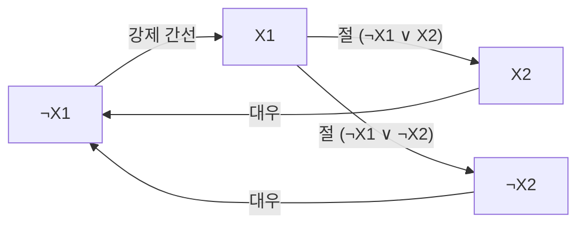

최근 알고리즘 문제 해결에 있어서 논리적 추론과 그래프 이론을 결합한 문제들이 많이 출제되고 있다. 특히 2-SAT 문제는 논리식의 만족 가능성을 판단하는 중요한 문제 유형 중 하나이다. 이번 포스팅에서는 백준 온라인 저지의 3648번 문제인 "아이돌"을 다루어 보려고 한다. 이 문제는 2-SAT와 강한 연결 요소(SCC)를 활용하여 해결할 수 있으며, 효율적인 알고리즘 설계를 통해 문제를 풀어볼 것이다.

문제 : [https://www.acmicpc.net/problem/3648](https://www.acmicpc.net/problem/3648)

## 문제 설명

아이돌 선발 대회에서 참가자들은 심사위원들의 투표를 통해 다음 라운드로 진출할 수 있다. 각 심사위원은 두 개의 투표를 하는데, 특정 참가자의 진출을 찬성하거나 반대하는 투표를 할 수 있다. 투표 결과에 따라 참가자들은 다음 라운드로 진출하게 되는데, 몇 명이 진출할지는 미리 정해져 있지 않다. 만약 모든 참가자가 훌륭하다면 모두 진출할 수도 있고, 반대로 모두 떨어질 수도 있다.

참가자 중 한 명인 카를은 자신의 프로그래밍 실력을 심사위원들이 인정해주지 않을 것을 걱정하여 해킹을 통해 자신이 다음 라운드에 진출하도록 시스템을 조작하려 한다. 하지만 모든 심사위원들은 자신의 두 투표 중 적어도 하나는 최종 결과와 일치하길 기대한다. 만약 심사위원의 두 투표 모두 결과와 모순된다면, 의심을 품고 조사에 들어갈 것이다.

카를은 자신이 진출하면서도 심사위원들의 의심을 사지 않도록 결과를 조작하려 한다. 이를 위해, 심사위원들의 투표 정보를 바탕으로 어떤 참가자들이 다음 라운드로 진출해야 하는지를 결정해야 한다.

**입력**

- 여러 개의 테스트 케이스로 이루어져 있으며, 각 테스트 케이스는 다음과 같다:
  - 첫 번째 줄에 참가자 수 \( n \) (\( 2 \leq n < 1000 \))와 심사위원 수 \( m \) (\( 1 \leq m < 2000 \))이 주어진다.
  - 다음 \( m \)개의 줄에는 각 심사위원의 투표가 주어진다. 각 줄은 두 개의 정수 \( a \)와 \( b \)로 이루어져 있으며, \( |a| \neq |b| \)이다. \( a \)나 \( b \)가 양수이면 해당 참가자의 진출을 찬성하는 투표이며, 음수이면 반대하는 투표이다.

- 참가자는 \( 1 \)부터 \( n \)까지 번호가 매겨져 있으며, 카를은 참가자 \( 1 \)번이다.

**출력**

- 각 테스트 케이스마다 카를이 심사위원들의 의심을 사지 않으면서 다음 라운드로 진출할 수 있으면 "yes"를, 그렇지 않으면 "no"를 출력한다.

## 접근 방식

이 문제는 **2-SAT** 문제로 모델링할 수 있다. 각 참가자에 대해 변수 \( X_i \)를 정의하고, 참가자가 다음 라운드에 진출하면 \( X_i \)를 참, 그렇지 않으면 거짓으로 나타낸다. 심사위원들의 투표는 다음과 같은 제약 조건으로 표현할 수 있다.

- 각 심사위원은 두 개의 투표를 한다. 그 중 **적어도 하나**는 결과와 일치해야 한다.
- 심사위원의 첫 번째 투표를 \( A \), 두 번째 투표를 \( B \)라고 할 때, 다음과 같은 절을 얻을 수 있다: \( A \lor B \)

여기서 \( A \)와 \( B \)는 각각 참가자의 진출(찬성 투표, \( X_i \)) 또는 탈락(반대 투표, \( \lnot X_i \))에 대한 리터럴이다.

또한, **카를(참가자 1번)은 반드시 진출해야 하므로 \( X_1 \)은 참이어야 한다**.


이 문제에서 제약은 "투표 두 개 중 적어도 하나가 결과와 일치한다"는 형태, 즉 리터럴 두 개의 논리합 하나뿐이다. 이런 절(clause)만으로 이루어진 논리식이 2-CNF이고, 변수 수 $V$와 절 수 $C$에 대해 $O(V + C)$ 시간에 만족 가능 여부를 판정할 수 있다. 절의 리터럴이 세 개로 늘어난 3-SAT는 NP-완전이므로, 이 문제가 다항 시간에 풀리는 이유는 절의 크기가 2로 제한된다는 구조에 있다.

## 2-SAT 모델링과 정당성

절 $(A \lor B)$는 $\lnot A \to B$와 $\lnot B \to A$ 두 개의 함의(implication)와 논리적으로 동치다. $A$가 거짓이면 $B$가 참이어야 하고, $B$가 거짓이면 $A$가 참이어야 하기 때문이다. 변수마다 $X_i$와 $\lnot X_i$ 두 노드를 만들고 절마다 이 두 간선을 추가한 그래프가 임플리케이션 그래프다. 절 하나가 대칭인 간선 두 개를 만들므로 그래프는 항상 "간선 $u \to v$가 있으면 $\lnot v \to \lnot u$도 있다"는 대칭성을 가진다.

만족 가능성은 이 그래프의 SCC 구조로 결정된다. $X_i$와 $\lnot X_i$가 같은 SCC에 있으면 $X_i \to \lnot X_i$이면서 $\lnot X_i \to X_i$이므로 $X_i$가 참이어도 거짓이어도 모순이 생겨 만족 불가능하다. 반대로 어떤 변수도 이런 모순을 갖지 않으면, SCC를 압축한 DAG를 위상 정렬해 역순으로 참을 배정하는 방식으로 실제 해를 만들 수 있다. 대칭성 덕분에 한 SCC를 참으로 정하면 그 부정을 담은 SCC는 자동으로 거짓이 되어 배정이 일관된다. 이 판정법은 Aspvall, Plass, Tarjan이 1979년에 선형 시간 알고리즘으로 제시했다. 이 문제는 해 자체가 아니라 존재 여부만 묻기 때문에 위상 순서 배정은 구현하지 않고 같은 SCC 검사만 한다.

카를이 반드시 진출해야 한다는 조건 $X_1$은 단항 절 $(X_1 \lor X_1)$로 볼 수 있고, 이는 간선 $\lnot X_1 \to X_1$ 하나로 표현된다. $X_1$을 거짓으로 가정하면 곧바로 $X_1$이 참이어야 하는 상황이 되므로 $X_1$을 거짓으로 둘 수 없게 강제된다. 예를 들어 $n=2$이고 투표가 `-1 2`, `-1 -2`라면 절은 $(\lnot X_1 \lor X_2)$와 $(\lnot X_1 \lor \lnot X_2)$이고, $X_1$이 참이면 $X_2$가 참이면서 동시에 거짓이어야 하므로 답은 `no`다. 이 구조는 아래 그래프에서 $X_1$에서 $X_2$와 $\lnot X_2$로 모두 갈 수 있고, 두 노드에서 다시 $\lnot X_1$으로 돌아오는 순환이 생기는 것으로 나타난다.



위 그래프에서 $X_1$, $X_2$, $\lnot X_2$, $\lnot X_1$은 모두 하나의 순환에 속하므로 $X_1$과 $\lnot X_1$이 같은 SCC에 놓이고, 판정은 `no`가 된다.

## C++ 코드와 설명

Kosaraju 알고리즘은 정방향 그래프에서 DFS를 돌려 종료 순서를 기록한 뒤, 그 역순으로 역방향 그래프를 DFS하며 SCC를 묶는다. 역방향 DFS에서 한 번에 도달하는 노드 집합이 하나의 SCC가 된다. 노드 번호는 `var` 함수로 정한다. 변수 $x$가 양수이면 $(x-1) \cdot 2$번, 음수이면 거기에 1을 더한 번호를 쓰므로, 한 변수의 참 노드와 거짓 노드는 항상 짝수·홀수로 인접한다. 입력의 심사위원 투표 $(a, b)$마다 `var(-a) → var(b)`와 `var(-b) → var(a)` 두 간선을 정방향·역방향 그래프에 함께 넣고, 마지막에 `var(-1) → var(1)` 강제 간선을 넣는다. 테스트 케이스가 여러 개이므로 매번 사용한 노드 범위를 초기화하는 것이 중요하다.

```cpp
#include <iostream>
#include <vector>
#include <stack>
#include <algorithm>
#include <cstdlib>

using namespace std;

const int MAXN = 2000; // 최대 참가자 수의 두 배

int n, m; // 참가자 수, 심사위원 수
vector<int> adj[MAXN * 2]; // 임플리케이션 그래프
vector<int> radj[MAXN * 2]; // 역방향 그래프
vector<int> sccId(MAXN * 2, -1); // 각 노드의 SCC ID
vector<bool> visited(MAXN * 2, false);
vector<int> order;
int id = 0;

// 변수의 인덱스를 얻는 함수
int var(int x) {
    return (abs(x) - 1) * 2 + (x < 0);
}

// 임플리케이션 그래프의 DFS
void dfs(int u) {
    visited[u] = true;
    for (int v : adj[u]) {
        if (!visited[v])
            dfs(v);
    }
    order.push_back(u);
}

// 역방향 그래프의 DFS
void reverseDfs(int u, int label) {
    sccId[u] = label;
    for (int v : radj[u]) {
        if (sccId[v] == -1)
            reverseDfs(v, label);
    }
}

int main() {
    while (cin >> n >> m) {
        // 초기화
        for (int i = 0; i < n * 2; ++i) {
            adj[i].clear();
            radj[i].clear();
            sccId[i] = -1;
            visited[i] = false;
        }
        id = 0;
        order.clear();
        
        // 심사위원들의 투표 입력
        for (int i = 0; i < m; ++i) {
            int a, b;
            cin >> a >> b;
            adj[var(-a)].push_back(var(b));
            radj[var(b)].push_back(var(-a));
            adj[var(-b)].push_back(var(a));
            radj[var(a)].push_back(var(-b));
        }
        
        // 카를은 반드시 진출해야 하므로 X1은 참
        adj[var(-1)].push_back(var(1));
        radj[var(1)].push_back(var(-1));
        
        // 1차 DFS로 완료 순서 저장
        for (int i = 0; i < n * 2; ++i) {
            if (!visited[i])
                dfs(i);
        }
        
        // 2차 DFS로 SCC 찾기
        int label = 0;
        for (int i = n * 2 - 1; i >= 0; --i) {
            int u = order[i];
            if (sccId[u] == -1)
                reverseDfs(u, label++);
        }
        
        // 모순 확인
        bool isPossible = true;
        for (int i = 0; i < n; ++i) {
            if (sccId[i * 2] == sccId[i * 2 + 1]) {
                isPossible = false;
                break;
            }
        }
        
        if (isPossible)
            cout << "yes" << endl;
        else
            cout << "no" << endl;
    }
    return 0;
}
```

최종 판정은 모든 변수 $i$에 대해 `sccId[i*2] == sccId[i*2+1]`인 경우가 하나라도 있는지 검사하는 한 단계로 끝난다. 재귀 DFS의 깊이는 최대 노드 수인 $2n < 2000$이므로 C++에서 스택 오버플로 걱정은 없다.

## C++ without library 코드와 설명

위 코드는 `vector`로 인접 리스트를 만든다. C 라이브러리만으로 같은 일을 하려면 `int adj[N][N]` 같은 2차원 배열을 떠올리기 쉽지만, 노드가 최대 2000개이면 정방향과 역방향 합쳐 약 32MB(4바이트 × 2000 × 2000 × 2)가 되어 낭비다. 간선은 많아야 $2m+1 < 4000$개뿐이므로, 노드별 첫 간선을 가리키는 `head` 배열과 간선별 다음 간선을 가리키는 `nxt` 배열로 구성하는 연결 리스트형 인접 리스트(forward star)가 훨씬 적합하다. 메모리가 간선 수에 비례해 수십 KB 수준으로 줄어든다.

```cpp
#include <stdio.h>
#include <stdlib.h>
#define MAXV 2000      /* 노드 수: 2n < 2000 */
#define MAXE 4100      /* 정방향 간선 수: 2m + 1 < 4000 */

int n, m;
int head[MAXV], nxt[MAXE], to[MAXE], ecnt;
int rhead[MAXV], rnxt[MAXE], rto[MAXE], recnt;
int sccId[MAXV], visited[MAXV];
int order[MAXV], top;

int var(int x) {
    return (abs(x) - 1) * 2 + (x < 0);
}

void addEdge(int u, int v) {
    to[ecnt] = v; nxt[ecnt] = head[u]; head[u] = ecnt++;
    rto[recnt] = u; rnxt[recnt] = rhead[v]; rhead[v] = recnt++;
}

void dfs(int u) {
    visited[u] = 1;
    for (int e = head[u]; e != -1; e = nxt[e])
        if (!visited[to[e]]) dfs(to[e]);
    order[top++] = u;
}

void reverseDfs(int u, int label) {
    sccId[u] = label;
    for (int e = rhead[u]; e != -1; e = rnxt[e])
        if (sccId[rto[e]] == -1) reverseDfs(rto[e], label);
}

int main() {
    while (scanf("%d %d", &n, &m) == 2) {
        for (int i = 0; i < n * 2; ++i) {
            head[i] = rhead[i] = -1;
            sccId[i] = -1;
            visited[i] = 0;
        }
        ecnt = recnt = top = 0;
        for (int i = 0; i < m; ++i) {
            int a, b;
            scanf("%d %d", &a, &b);
            addEdge(var(-a), var(b));
            addEdge(var(-b), var(a));
        }
        addEdge(var(-1), var(1));
        for (int i = 0; i < n * 2; ++i)
            if (!visited[i]) dfs(i);
        int label = 0;
        while (top > 0) {
            int u = order[--top];
            if (sccId[u] == -1) reverseDfs(u, label++);
        }
        int ok = 1;
        for (int i = 0; i < n; ++i)
            if (sccId[i * 2] == sccId[i * 2 + 1]) { ok = 0; break; }
        puts(ok ? "yes" : "no");
    }
    return 0;
}
```

`addEdge` 한 번이 정방향과 역방향 간선을 동시에 추가하므로 두 그래프의 간선 번호가 항상 짝을 이룬다. 로직은 C++ 버전과 동일하고, `scanf`가 두 값을 읽는 동안만 반복하도록 `== 2` 조건을 사용했다.

## Python 코드와 설명

Python 구현도 구조는 같다. 다만 Python의 기본 재귀 한도(1000)는 노드 수 2n이 최대 2000 가까이 되는 깊은 체인에서 부족하므로 `sys.setrecursionlimit`을 올린다. 입력이 여러 테스트 케이스이므로 `readline`이 빈 문자열을 돌려주면(EOF) 종료한다.

```python
import sys
sys.setrecursionlimit(1000000)

MAXN = 2000

def var(x):
    return (abs(x) - 1) * 2 + (x < 0)

def dfs(u):
    visited[u] = True
    for v in adj[u]:
        if not visited[v]:
            dfs(v)
    order.append(u)

def reverse_dfs(u, label):
    scc_id[u] = label
    for v in radj[u]:
        if scc_id[v] == -1:
            reverse_dfs(v, label)

while True:
    try:
        line = ''
        while line.strip() == '':
            line = sys.stdin.readline()
            if not line:
                exit()
        n, m = map(int, line.strip().split())
        adj = [[] for _ in range(n * 2)]
        radj = [[] for _ in range(n * 2)]
        visited = [False] * (n * 2)
        scc_id = [-1] * (n * 2)
        order = []
        for _ in range(m):
            a, b = map(int, sys.stdin.readline().split())
            adj[var(-a)].append(var(b))
            radj[var(b)].append(var(-a))
            adj[var(-b)].append(var(a))
            radj[var(a)].append(var(-b))
        adj[var(-1)].append(var(1))
        radj[var(1)].append(var(-1))
        for i in range(n * 2):
            if not visited[i]:
                dfs(i)
        label = 0
        for u in reversed(order):
            if scc_id[u] == -1:
                reverse_dfs(u, label)
                label += 1
        is_possible = True
        for i in range(n):
            if scc_id[i * 2] == scc_id[i * 2 + 1]:
                is_possible = False
                break
        print("yes" if is_possible else "no")
    except EOFError:
        break
```

Python은 재귀 호출 비용이 커서 입력이 클수록 느려지지만, 이 문제의 노드·간선 규모는 작아 한도를 올린 재귀 DFS로 충분하다. 더 큰 그래프에서는 스택을 직접 관리하는 반복형 DFS로 바꾸는 편이 안전하다.

## 복잡도 분석

노드는 $2n$개, 간선은 $2m+1$개다. Kosaraju의 두 번의 DFS와 SCC 검사는 각각 $O(n + m)$이므로 한 테스트 케이스의 시간 복잡도는 $O(n + m)$이다. 공간 복잡도도 정방향·역방향 그래프를 합쳐 $O(n + m)$이다. 여러 테스트 케이스를 처리해도 케이스마다 초기화 비용이 $O(n)$이라 총 비용은 입력 크기에 선형이다.

| 구성 요소 | 시간 | 공간 |
|---|---|---|
| 그래프 구성 | $O(m)$ | $O(n + m)$ |
| 1차·2차 DFS | $O(n + m)$ | 재귀 깊이 $O(n)$ |
| 모순 검사 | $O(n)$ | $O(1)$ |

## 입출력 예제

다음 입력은 세 개의 테스트 케이스이며, 위의 정당성 논의와 같은 규칙으로 직접 판정한 결과와 일치한다.

```text
3 3
-1 2
-2 -3
3 1
2 2
-1 2
-1 -2
2 2
1 2
1 -2
```

```text
yes
no
yes
```

첫 번째 케이스는 $X_1$이 참이고 $X_2$가 참, $X_3$이 거짓이면 세 절이 모두 만족된다. 두 번째 케이스는 앞서 그래프로 본 모순이고, 세 번째는 $X_1$이 참이면 $X_2$ 값과 무관하게 두 절이 모두 만족되므로 `yes`다.

## 코너 케이스 및 실수 포인트

| 케이스 | 설명 | 처리 방법 |
|---|---|---|
| **여러 테스트 케이스** | 이전 케이스의 간선·방문 기록이 남아 다음 판정을 오염시킴 | 매 케이스 시작 시 `2n` 범위의 인접 정보·방문·SCC 번호를 초기화 |
| **카를 강제 간선 누락** | $X_1$ 강제를 빼먹으면 카를이 탈락하는 해도 `yes`로 판정됨 | `var(-1) → var(1)` 간선을 반드시 추가 |
| **역방향 그래프 불일치** | 정방향에만 간선을 넣고 역방향을 빼먹으면 SCC가 쪼개져 오답 | 간선 추가 시 정·역방향을 한 함수에서 함께 처리 |
| **EOF 처리** | 테스트 케이스 수가 주어지지 않아 입력 끝까지 읽어야 함 | `scanf`/`cin`의 반환값 또는 `readline`의 빈 문자열로 종료 |

## 결론

Kosaraju 대신 Tarjan 알고리즘을 쓰면 역방향 그래프를 만들지 않고 DFS 한 번으로 SCC를 구하므로 메모리와 코드가 줄어든다. 또 Tarjan은 SCC 번호가 위상 정렬의 역순으로 매겨지기 때문에, 존재 여부뿐 아니라 실제 진출 명단(해)을 구해야 하는 변형 문제에서는 `sccId[x] < sccId[¬x]`이면 $x$를 참으로 배정하는 식으로 바로 이어 쓸 수 있다.

## 이 글을 읽은 후 달성해야 할 목표

- 절 $(A \lor B)$를 두 개의 함의 간선으로 바꾸고 그래프의 대칭성을 설명할 수 있다.
- 같은 SCC에 $X$와 $\lnot X$가 있으면 왜 불가능한지, 없으면 왜 충분한지 논증할 수 있다.
- 단항 조건(특정 변수의 값 강제)을 간선 하나로 표현할 수 있다.
- Kosaraju 알고리즘을 구현하고 $O(n + m)$ 복잡도를 설명할 수 있다.

## 참고 문헌 및 출처

- B. Aspvall, M. F. Plass, R. E. Tarjan, "A linear-time algorithm for testing the truth of certain quantified boolean formulas", Information Processing Letters 8(3), 1979.
- [CP-Algorithms, 2-SAT](https://cp-algorithms.com/graph/2SAT.html)
- [백준 3648번 문제](https://www.acmicpc.net/problem/3648)
