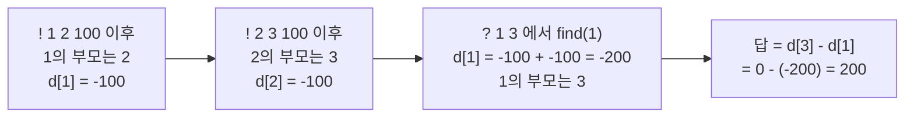

이번 포스팅에서는 백준 온라인 저지의 3830번 문제인 <strong>"교수님은 기다리지 않는다"</strong>를 다루어 보겠습니다. 이 문제는 **가중치가 있는 Union-Find(Disjoint Set Union)** 자료구조를 활용하여 해결할 수 있으며, 효율적인 자료구조 활용과 알고리즘 최적화에 대한 이해를 높일 수 있는 좋은 문제입니다.

문제 : [https://www.acmicpc.net/problem/3830](https://www.acmicpc.net/problem/3830)

## 문제 설명

상근이는 매일 아침 실험실로 출근하여 샘플의 무게를 재는 일을 합니다. 그는 두 샘플을 선택한 후 저울을 이용해 그 무게 차이를 측정합니다.

교수님의 관심을 끌기 위해 매일 아침부터 열심히 무게를 재지만, 가끔 교수님이 실험실에 들어와서 특정 두 샘플의 무게 차이를 물어보기도 합니다. 이때 상근이는 지금까지 측정한 결과를 바탕으로 대답할 수도 있고, 그렇지 못할 수도 있습니다.

상근이는 실험실에서 첫날부터 모든 결과를 공책에 기록해 왔지만, 너무 많은 양의 데이터로 인해 교수님의 질문에 신속하게 대답하기가 어렵습니다. 이러한 상근이를 돕기 위해 프로그램을 작성하고자 합니다.

**입력**

- 여러 개의 테스트 케이스로 이루어져 있습니다.
- 각 테스트 케이스의 첫째 줄에는 샘플의 종류의 개수 `N`(2 ≤ N ≤ 100,000)과 상근이가 실험실에서 한 일의 수 `M`(1 ≤ M ≤ 100,000)이 주어집니다.
- 다음 `M`개의 줄에는 상근이가 실험실에서 한 일이 주어집니다.
  - 상근이가 무게를 쟀다면, `! a b w`의 형식으로 주어집니다. 이는 `b`가 `a`보다 `w`그램 무겁다는 뜻입니다. (`a ≠ b`, `w`는 1,000,000을 넘지 않는 음이 아닌 정수)
  - 교수님의 질문은 `? a b`의 형식으로 주어집니다. 이는 `b`가 `a`보다 얼마나 무거운지를 묻는 것입니다.
- 마지막 줄에는 `0`이 두 개 주어집니다.

**출력**

- 교수님의 질문(`? a b`)이 입력될 때마다, 지금까지의 측정 결과를 바탕으로 `a`와 `b`의 무게 차이를 계산할 수 있다면, `b`가 `a`보다 얼마나 무거운지를 출력합니다.
- 무게의 차이의 절댓값이 1,000,000을 넘지 않습니다.
- 계산할 수 없다면 `"UNKNOWN"`을 출력합니다.

**예제 입력**

```
2 2
! 1 2 1
? 1 2
2 2
! 1 2 1
? 2 1
4 7
! 1 2 100
? 2 3
! 2 3 100
? 2 3
? 1 3
! 4 3 150
? 4 1
0 0
```

**예제 출력**

```
1
-1
UNKNOWN
100
200
-50
```

## 학습 목표

이 글을 읽고 나면 다음을 할 수 있습니다.

- 일반 Union-Find에 "부모와의 무게 차이"를 얹어 상대 관계를 관리하는 가중치 DSU의 불변식을 설명한다.
- `unite`의 갱신 식 `weightDiff[rootA] = weightDiff[b] - weightDiff[a] - w`를 직접 유도한다.
- 경로 압축만 쓸 때의 복잡도와 재귀 `find`의 깊이 위험을 구분해 말한다.

## 접근 방식

일반적인 Union-Find는 "두 원소가 같은 집합인가"만 답합니다. 이 문제는 같은 집합 안에서 두 원소의 무게 차이까지 물으므로, 각 원소에 값을 하나 더 저장해야 합니다. 절대 무게는 알 수 없지만 같은 집합 안의 상대 차이는 알 수 있다는 점이 핵심입니다. 집합마다 루트를 기준점으로 삼으면 모든 원소의 무게를 "루트보다 얼마나 무거운가"로 표현할 수 있습니다.

### 불변식

`find`가 끝난 시점에서 `weightDiff[x]`는 `x`의 무게에서 루트의 무게를 뺀 값, 즉 `w(x) - w(root)`입니다. 경로 압축 전에는 `x`의 직속 부모를 기준으로 한 차이이고, 압축하면서 부모가 루트로 바뀌므로 부모 쪽 값을 더해 주면 기준이 루트로 올라갑니다. 그래서 `find`의 `weightDiff[x] += weightDiff[orig_parent]`가 성립합니다. 질의 `? a b`의 답은 같은 루트를 기준으로 한 두 값의 차 `weightDiff[b] - weightDiff[a]`가 되어, 루트의 절대 무게는 상쇄됩니다.

### Union 식 유도

`! a b w`는 `w(b) - w(a) = w`를 뜻합니다. 두 `find` 뒤에 `w(a) = weightDiff[a] + w(rootA)`, `w(b) = weightDiff[b] + w(rootB)`가 성립하므로 이를 대입하면 `w(rootA) - w(rootB) = weightDiff[b] - weightDiff[a] - w`가 됩니다. `rootA`를 `rootB` 밑에 붙이면 `weightDiff[rootA]`가 바로 이 값이므로 코드의 한 줄이 나옵니다. 부호를 헷갈리기 쉬운 지점이라 `a`와 `b`의 위치를 바꿔 쓰지 않도록 주의해야 합니다.



위 그림은 예제의 세 번째 테스트 케이스를 따라간 것입니다. 경로 압축이 일어나는 순간을 풀어 보면, `? 1 3`에서 `find(1)`은 먼저 `find(2)`를 호출해 2의 부모가 이미 루트 3임을 확인하고 돌아옵니다. 그 뒤 1의 값에 `orig_parent`였던 2의 값(-100)을 더하므로 `d[1]`은 "2 기준 -100"에서 "3 기준 -200"으로 바뀌고, 1의 부모도 2에서 3으로 바뀝니다. 즉 압축은 부모 포인터와 기준점을 동시에 루트로 옮기는 연산이며, 이 때문에 이후 질의는 한 단계만에 답을 냅니다. 이어지는 `! 4 3 150`에서는 `d[4] = d[3] - d[4] - 150 = -150`이 되고, `? 4 1`은 `d[1] - d[4] = -200 - (-150) = -50`으로 예제 출력과 일치합니다.

### 복잡도

| 항목 | 값 | 근거 |
|---|---|---|
| 시간 | 질의·병합당 상각 O(log N), 전체 O((N+M) log N) | 경로 압축만 사용, union by rank 없음 |
| 시간(rank 추가 시) | 상각 O(α(N)) | 경로 압축 + union by rank |
| 공간 | O(N) | `parent`, `weightDiff` 두 배열 |

이 풀이는 union by rank를 쓰지 않으므로 상각 O(log N) 경계를 따르고, rank까지 쓰면 역아커만 함수 α(N)이 됩니다. 이 두 경계의 증명은 [Wikipedia의 Disjoint-set data structure 항목](https://en.wikipedia.org/wiki/Disjoint-set_data_structure)과 그 참고문헌(Tarjan, Cormen 등의 알고리즘 교재)에 정리되어 있습니다. 입출력 최적화(`sync_with_stdio`, `scanf`)는 상수 시간을 줄일 뿐 점근 복잡도와는 무관합니다.

### 흔한 오해

가장 흔한 실수는 `weightDiff`를 "항상 직속 부모와의 차이"로만 읽는 것입니다. 이 값은 `find` 직후에만 루트 기준이 되며, `find`를 거치지 않고 `weightDiff[a]`를 바로 읽으면 압축 전의 값이라 틀린 답이 나옵니다. 그래서 질의와 `unite` 모두 `find`를 먼저 호출합니다. 두 번째 실수는 `unite`에서 `a`와 `b`의 부호를 뒤집는 것으로, 유도한 식에서 `w`는 `w(b) - w(a)`라는 점을 기준으로 확인하면 됩니다.

## C++ 코드와 설명

```cpp
// 42jerrykim.github.io에서 더 많은 정보를 확인할 수 있다
#include <iostream>
#include <string>
using namespace std;

const int MAX_N = 100005;

int parent[MAX_N];          // 각 노드의 부모를 저장하는 배열
long long weightDiff[MAX_N]; // 부모 노드와의 무게 차이를 저장하는 배열

// 초기화 함수
void init(int n) {
    for (int i = 1; i <= n; ++i) {
        parent[i] = i;
        weightDiff[i] = 0;
    }
}

// Find 함수: 경로 압축과 무게 차이 누적
int find(int x) {
    if (parent[x] != x) {
        int orig_parent = parent[x];
        parent[x] = find(parent[x]);
        weightDiff[x] += weightDiff[orig_parent];
    }
    return parent[x];
}

// Union 함수: 두 집합을 합치고 무게 차이를 갱신
void unite(int a, int b, long long w) {
    int rootA = find(a);
    int rootB = find(b);
    if (rootA == rootB) return; // 이미 같은 집합인 경우

    // 부모를 rootB로 설정하고, 무게 차이를 갱신
    weightDiff[rootA] = weightDiff[b] - weightDiff[a] - w;
    parent[rootA] = rootB;
}

int main() {
    ios::sync_with_stdio(false);
    cin.tie(nullptr);

    while (true) {
        int N, M;
        cin >> N >> M;
        if (N == 0 && M == 0) break;
        init(N);

        for (int i = 0; i < M; ++i) {
            string cmd;
            cin >> cmd;
            if (cmd == "!") {
                int a, b;
                long long w;
                cin >> a >> b >> w;
                unite(a, b, w);
            } else if (cmd == "?") {
                int a, b;
                cin >> a >> b;
                if (find(a) != find(b)) {
                    cout << "UNKNOWN\n";
                } else {
                    cout << weightDiff[b] - weightDiff[a] << "\n";
                }
            }
        }
    }

    return 0;
}
```

`parent`는 각 노드의 부모를, `weightDiff`는 부모와의 무게 차이를 담습니다. `find`는 재귀로 루트까지 올라가며 경로를 압축하고 위 불변식대로 차이를 누적하며, `unite`는 두 루트를 찾아 앞서 유도한 식으로 `rootA`를 `rootB` 밑에 붙입니다. 질의에서는 두 노드의 루트가 같을 때만 차이를 출력하고, 다르면 `UNKNOWN`입니다. 누적 값은 최대 약 10^5 × 10^6 = 10^11까지 커질 수 있어 `weightDiff`는 `long long`이어야 합니다.

## C++ without library 코드와 설명

```cpp
// 42jerrykim.github.io에서 더 많은 정보를 확인할 수 있다
#include <stdio.h>

#define MAX_N 100005

int parent[MAX_N];
long long weightDiff[MAX_N];

void init(int n) {
    int i;
    for (i = 1; i <= n; ++i) {
        parent[i] = i;
        weightDiff[i] = 0;
    }
}

int find(int x) {
    if (parent[x] != x) {
        int orig_parent = parent[x];
        parent[x] = find(parent[x]);
        weightDiff[x] += weightDiff[orig_parent];
    }
    return parent[x];
}

void unite(int a, int b, long long w) {
    int rootA = find(a);
    int rootB = find(b);
    if (rootA == rootB) return;

    weightDiff[rootA] = weightDiff[b] - weightDiff[a] - w;
    parent[rootA] = rootB;
}

int main() {
    while (1) {
        int N, M;
        if (scanf("%d %d", &N, &M) != 2) break;
        if (N == 0 && M == 0) break;
        init(N);

        int i;
        for (i = 0; i < M; ++i) {
            char cmd[2];
            scanf("%s", cmd);
            if (cmd[0] == '!') {
                int a, b;
                long long w;
                scanf("%d %d %lld", &a, &b, &w);
                unite(a, b, w);
            } else if (cmd[0] == '?') {
                int a, b;
                scanf("%d %d", &a, &b);
                if (find(a) != find(b)) {
                    printf("UNKNOWN\n");
                } else {
                    printf("%lld\n", weightDiff[b] - weightDiff[a]);
                }
            }
        }
    }

    return 0;
}
```

앞의 코드와 로직은 같고 입출력만 `scanf`/`printf`로 바꾼 버전입니다. 명령 문자는 `cmd[0]`만 비교하므로 문자열 비교 함수가 필요 없고, 그래서 `string.h`도 사실상 쓰이지 않습니다.

## Python 코드와 설명

```python
# 42jerrykim.github.io에서 더 많은 정보를 확인할 수 있다
import sys
sys.setrecursionlimit(1000000)

def input():
    return sys.stdin.readline()

parent = {}
weightDiff = {}

def init(N):
    for i in range(1, N+1):
        parent[i] = i
        weightDiff[i] = 0

def find(x):
    if parent[x] != x:
        orig_parent = parent[x]
        parent[x] = find(parent[x])
        weightDiff[x] += weightDiff[orig_parent]
    return parent[x]

def unite(a, b, w):
    rootA = find(a)
    rootB = find(b)
    if rootA == rootB:
        return
    weightDiff[rootA] = weightDiff[b] - weightDiff[a] - w
    parent[rootA] = rootB

while True:
    line = input()
    if not line:
        break
    N, M = map(int, line.strip().split())
    if N == 0 and M == 0:
        break
    init(N)
    for _ in range(M):
        cmd = input().strip().split()
        if cmd[0] == '!':
            a, b, w = int(cmd[1]), int(cmd[2]), int(cmd[3])
            unite(a, b, w)
        elif cmd[0] == '?':
            a, b = int(cmd[1]), int(cmd[2])
            if find(a) != find(b):
                print("UNKNOWN")
            else:
                print(weightDiff[b] - weightDiff[a])
```

Python 버전은 같은 로직을 딕셔너리로 옮겼습니다. 재귀 `find`의 깊이가 최대 10^5까지 갈 수 있어 `sys.setrecursionlimit`을 올렸지만, 이것만으로는 인터프리터 스택이 부족해 비정상 종료할 수 있으므로 제출 환경에서 깊은 체인 입력으로 확인이 필요합니다(안전하게 가려면 `find`를 반복문으로 바꾸거나 `threading.stack_size`를 늘립니다).

## 결론

가중치 Union-Find는 "집합 소속"에 "루트 대비 상대값"을 얹은 것이며, 불변식 `weightDiff[x] = w(x) - w(root)`만 지키면 `find`와 `unite`의 부호가 모두 따라옵니다.

한계와 대안은 앞의 복잡도 표와 아래 코너 케이스 표에 정리했습니다(union by size/rank 추가, 반복형 `find`). 모순되는 측정이 들어올 수 있는 변형 문제라면 같은 집합 내 `unite`에서 기존 차이와 새 `w`를 비교하는 검사를 추가해야 하지만, 이 문제는 입력의 일관성을 보장합니다.

## 코너 케이스 및 실수 포인트

| 케이스 | 설명 | 처리 방법 |
|---|---|---|
| **최소 입력** | N=2, M=1 (제약상 최소) | 반복문 범위·초기화 확인 |
| **오버플로우** | 최종 답은 10^6 이하이나 누적 `weightDiff` 중간값은 최대 약 10^11 | `long long` (C++) 사용 |
| **재귀 깊이** | 한 줄로 이어진 체인에서 `find` 깊이 10^5 | 반복형 `find` 또는 스택 확장 |
| **여러 테스트 케이스** | 케이스마다 배열 재초기화 필요 | `init(N)` 호출 확인 |

## 참고 문헌 및 출처

- 문제: [BOJ 3830 교수님은 기다리지 않는다](https://www.acmicpc.net/problem/3830)
- [Disjoint-set data structure, Wikipedia](https://en.wikipedia.org/wiki/Disjoint-set_data_structure)
- R. E. Tarjan, J. van Leeuwen, "Worst-case analysis of set union algorithms", Journal of the ACM 31(2), 1984, pp. 245–281.
- T. H. Cormen et al., Introduction to Algorithms, "Data Structures for Disjoint Sets" 장.
