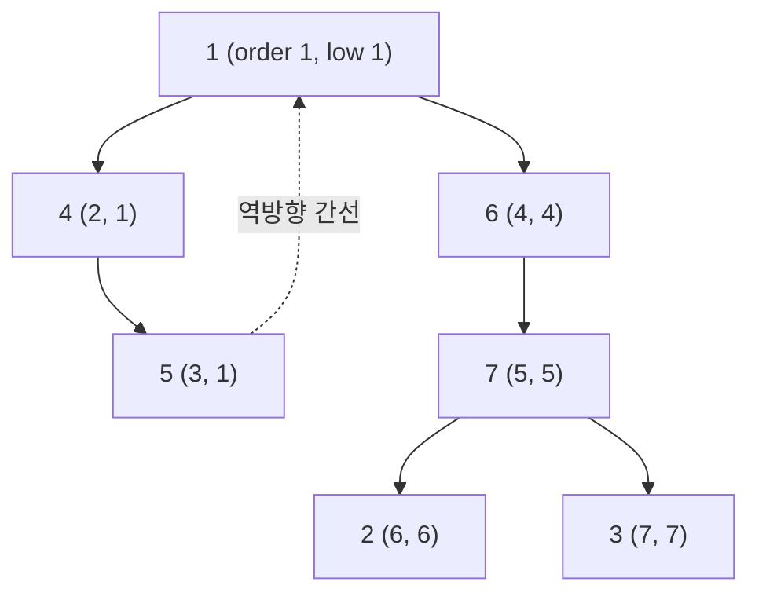

## 도입

그래프 이론에서 **단절점**은 네트워크의 연결성을 분석하는 핵심 개념이다. 한 정점이 사라졌을 때 나머지가 둘 이상으로 갈라진다면 그 정점은 통신망·의존성 그래프에서 단일 장애점이 된다. 이번 글에서는 백준 <strong>11266번 "단절점"</strong>을 풀면서, Tarjan의 DFS 기반 알고리즘이 왜 정확한지까지 따져 본다.

문제 : [https://www.acmicpc.net/problem/11266](https://www.acmicpc.net/problem/11266)

이 글을 읽고 나면 다음을 할 수 있다.

- `order`와 `low`가 각각 무엇을 뜻하는지 DFS 트리 위에서 설명한다.
- 루트와 비루트의 단절점 판정 조건이 왜 다른지 근거와 함께 설명한다.
- 비연결 그래프·다중 간선·고립 정점에서도 틀리지 않는 구현을 작성한다.

## 문제 설명

그래프가 주어졌을 때, **단절점**을 모두 구해 출력하는 프로그램을 작성하시오.

단절점이란 그 정점을 제거했을 때, 그래프가 두 개 또는 그 이상으로 나누어지는 정점을 말한다. 즉, 제거했을 때 그래프의 <strong>연결 요소(Connected Component)</strong>의 개수가 증가하는 정점을 의미한다.

**입력**은 다음과 같다. 첫째 줄에 두 정수 V(1≤V≤10,000), E(1≤E≤100,000)가 주어진다. 이는 그래프가 V개의 정점과 E개의 간선으로 이루어져 있다는 의미이다. 다음 E개의 줄에는 간선에 대한 정보를 나타내는 두 정수 A, B가 주어진다. 이는 A번 정점과 B번 정점이 연결되어 있다는 의미이며, 방향은 양방향이다.

입력으로 주어지는 그래프는 **연결 그래프가 아닐 수도 있다**. 정점은 1부터 V까지 번호가 매겨져 있다.

**출력**은 첫째 줄에 단절점의 개수를 출력한다. 둘째 줄에는 단절점의 번호를 공백으로 구분해 **오름차순**으로 출력한다.

**예제 입력:**

```
7 7
1 4
4 5
5 1
1 6
6 7
2 7
7 3
```

**예제 출력:**

```
3
1 6 7
```

위의 예제에서 단절점의 개수는 3이며, 단절점은 1, 6, 7번 정점이다.


## 접근 방식

가장 단순한 방법은 정점을 하나씩 지우고 연결 요소 수를 다시 세는 것이다. 정점마다 O(V + E)가 들어 전체 O(V(V + E))가 되는데, V=10,000, E=100,000이면 약 11억 번의 연산이라 제한 시간 안에 풀기 어렵다. 그래서 DFS 한 번의 정보만으로 모든 정점을 판정하는 Tarjan의 방식이 필요하다.

단절점은 DFS 트리의 구조로 판정할 수 있다. 무방향 그래프를 DFS하면 모든 간선은 트리 간선이거나, 조상과 후손을 잇는 역방향 간선이 된다(무방향 그래프에는 서로 다른 가지를 잇는 교차 간선이 생기지 않는다). 이 성질이 알고리즘 전체의 토대다. 어떤 정점 v의 서브트리에 속한 정점들이 서브트리 바깥으로 나가려면 반드시 역방향 간선을 통해 v의 조상으로 올라가야 한다.

여기서 두 값을 정의한다. `order[u]`는 DFS가 u를 처음 방문한 순번이다. `low[v]`는 v의 서브트리에서 트리 간선을 아래로 따라가다가 역방향 간선을 최대 한 번 써서 도달할 수 있는 정점의 최소 `order`다. 구현에서는 자기 자신의 `order`로 시작해, 방문한 이웃의 `order`와 자식의 `low`를 `min`으로 합쳐 구한다.

**비루트 정점 u의 판정.** 자식 v의 서브트리가 u 위쪽(u의 진짜 조상)으로 가는 우회로를 갖는다면 `low[v] < order[u]`이다. 우회로가 없다면 `low[v] ≥ order[u]`이고, 이때 u를 지우면 v의 서브트리는 나머지 그래프와 완전히 끊긴다. 따라서 자식 하나라도 `low[v] ≥ order[u]`이면 u는 단절점이며, 이는 필요충분조건이다. 등호가 들어가는 이유는 서브트리가 u 자신으로 돌아오는 역방향 간선(`low[v] = order[u]`)은 u를 지우면 함께 사라지므로 우회로가 아니기 때문이다. 단절선은 u 자신으로의 복귀도 우회로로 치지 않고 간선을 지우는 문제이므로 `low[v] > order[u]`를 쓴다는 점이 다르다.

**루트의 판정.** 루트는 조상이 없으므로 `low[v] ≥ order[root]`가 모든 자식에서 항상 참이다. 이 조건을 그대로 쓰면 자식이 하나뿐인 루트도 단절점으로 잘못 판정한다. 루트를 지웠을 때 갈라지는지는 DFS 트리의 자식 수로 결정된다. 서로 다른 두 자식 서브트리는 역방향 간선으로 이어질 수 없으므로(이어졌다면 DFS가 한 자식 안에서 다른 쪽을 이미 방문했을 것이다), 자식이 2개 이상일 때만 루트가 단절점이다.

**흔한 오개념.** 첫째, 부모 간선을 건너뛰는 처리는 `low`를 계산할 때 부모로 되돌아가는 트리 간선을 역방향 간선으로 착각하지 않게 하는 것이다. 단절점에서는 다중 간선이 있어도 부모를 건너뛰는 처리가 결과를 바꾸지 않는다. 둘째, 입력이 연결 그래프라는 보장이 없으므로 모든 정점에서 DFS를 시도해야 하며, 컴포넌트마다 루트 규칙이 따로 적용된다. 셋째, `low[v] ≥ order[u]`의 `u`는 자식이 아니라 현재 정점이다.

예제의 7개 정점을 정점 1에서 시작해 인접 리스트 입력 순서로 탐색하면 다음과 같다.

| 정점 | order | low | 판정 근거 |
|---:|---:|---:|---|
| 1 | 1 | 1 | 루트, 자식이 4와 6 두 개 → 단절점 |
| 4 | 2 | 1 | 자식 5의 low=1 < 2 → 아님 |
| 5 | 3 | 1 | 역방향 간선 5→1 |
| 6 | 4 | 4 | 자식 7의 low=5 ≥ 4 → 단절점 |
| 7 | 5 | 5 | 자식 2의 low=6, 자식 3의 low=7이 모두 ≥ 5 → 단절점 |
| 2 | 6 | 6 | 리프 |
| 3 | 7 | 7 | 리프 |



점선이 역방향 간선이다. 1-4-5 삼각형은 역방향 간선 덕분에 4와 5가 1 위로 우회할 수 있어 단절점이 아니고, 6-7 이후는 위로 가는 간선이 없어 6과 7이 단절점이 된다.

## 복잡도

DFS는 정점마다 한 번씩만 재귀 호출되고, 각 무방향 간선은 두 끝점의 인접 리스트에서 한 번씩 검사된다. 그래서 `low` 갱신과 판정을 위한 추가 비용은 상수이며, 전체 시간은 간선 수에 비례하는 선형이다. 공간은 그래프 저장과 재귀 스택이 지배한다.

| 항목 | 값 | 이유 |
|---|---|---|
| 시간 | O(V + E) | 모든 정점을 한 번 방문하고 모든 간선을 양방향으로 한 번씩 본다 |
| 공간 | O(V + E) | 인접 리스트가 O(V + E), `order`·`is_cut`·재귀 스택이 O(V) |

제약은 V ≤ 10,000, E ≤ 100,000이므로 연산량은 수십만 수준이다. 재귀 깊이는 최악에 V(약 1만)까지 가므로 C++에서는 기본 스택으로 충분하다.


## C++ 코드

표준 라이브러리를 쓰는 기본 구현이다. 간선을 양방향으로 저장하므로 부모는 `v == parent`로 건너뛰고, 이미 방문한 이웃은 `order[v]`로, 자식은 반환된 `low`로 `ret`을 갱신한다. 비루트는 `low >= order[u]`, 루트는 자식 수 2 이상으로 판정한다. 출력은 `is_cut`을 1번부터 V번까지 훑어 모으므로 별도 정렬 없이도 오름차순이 되지만, 의도를 분명히 하려고 `sort`를 한 번 더 호출했다.

```cpp
// 출처: 직접 작성. Tarjan의 DFS 기반 단절점 알고리즘(order/low) 구현
#include <cstdio>
#include <vector>
#include <algorithm>
using namespace std;

const int MAX_V = 10001;

vector<int> adj[MAX_V]; // 그래프의 인접 리스트
int V, E;
int order[MAX_V];       // 각 정점의 DFS 방문 순서
bool is_cut[MAX_V];     // 단절점 여부
int cnt;                // DFS 방문 순서 카운터

// DFS 함수: 현재 정점 u와 부모 정점 parent를 인자로 받음
int dfs(int u, int parent) {
    order[u] = ++cnt; // 현재 정점의 방문 순서 기록
    int ret = order[u]; // 반환값 초기화
    int child = 0; // 자식의 수

    for (int v : adj[u]) { // 인접한 정점들에 대해
        if (v == parent) continue; // 부모 정점이면 패스
        if (order[v]) { // 이미 방문한 정점이면
            ret = min(ret, order[v]); // 최소 방문 순서 갱신
        } else { // 방문하지 않은 정점이면
            child++;
            int low = dfs(v, u); // 자식 정점의 DFS 수행
            ret = min(ret, low); // 최소 방문 순서 갱신
            if (parent != -1 && low >= order[u]) {
                is_cut[u] = true; // 단절점 조건 만족
            }
        }
    }

    if (parent == -1 && child >= 2) {
        is_cut[u] = true; // 루트 정점의 단절점 여부 결정
    }

    return ret; // 현재 정점에서의 최소 방문 순서 반환
}

int main() {
    scanf("%d %d", &V, &E);

    for (int i = 0; i < E; ++i) {
        int A, B;
        scanf("%d %d", &A, &B);
        adj[A].push_back(B);
        adj[B].push_back(A);
    }

    for (int i = 1; i <= V; ++i) {
        if (!order[i]) { // 방문하지 않은 정점에 대해 DFS 수행
            dfs(i, -1);
        }
    }

    vector<int> result;
    for (int i = 1; i <= V; ++i) {
        if (is_cut[i]) {
            result.push_back(i);
        }
    }

    sort(result.begin(), result.end()); // 단절점을 오름차순으로 정렬

    printf("%d\n", (int)result.size());
    for (int v : result) {
        printf("%d ", v);
    }
    printf("\n");

    return 0;
}
```

## C 코드 (표준 라이브러리 최소 사용)

`stdio.h`만 쓸 수 있는 환경을 가정한 버전이다. `vector` 대신 `adj`·`next`·`head` 세 배열로 연결 리스트형 인접 리스트를 정적으로 구현하고, `min`과 정렬도 직접 작성했다. DFS 로직은 C++ 코드와 같으며, 간선 수가 최대 10만이라 정적 배열 크기(양방향 2배)가 충분하다. 삽입 정렬은 V가 최대 1만이어도 `is_cut` 순회 결과가 이미 오름차순이라 사실상 선형 시간에 끝난다.

```c
/* 출처: 직접 작성. 표준 라이브러리 최소 사용 버전(정적 인접 리스트 + 삽입 정렬) */
#include <stdio.h>

#define MAX_V 10001
#define MAX_E 100001

int adj[2 * MAX_E];      // 인접 리스트 배열
int next[2 * MAX_E];     // 다음 인접한 정점의 인덱스
int head[MAX_V];         // 각 정점의 인접 리스트 시작 인덱스
int adj_idx = 0;         // 인접 리스트 배열의 현재 인덱스

int V, E;
int order[MAX_V];        // 방문 순서
int cnt = 0;
int is_cut[MAX_V];       // 단절점 여부 (1이면 단절점)

void add_edge(int u, int v) {
    adj[adj_idx] = v;          // 인접한 정점 저장
    next[adj_idx] = head[u];   // 현재 head[u]를 다음으로 설정
    head[u] = adj_idx;         // head[u] 갱신
    adj_idx++;
}

int min(int a, int b) {
    return a < b ? a : b;
}

// DFS 함수
int dfs(int u, int parent) {
    order[u] = ++cnt;      // 방문 순서 기록
    int ret = order[u];    // 반환값 초기화
    int child = 0;         // 자식 노드의 수

    for (int i = head[u]; i != -1; i = next[i]) {
        int v = adj[i];
        if (v == parent) continue; // 부모 노드이면 패스
        if (order[v]) {
            ret = min(ret, order[v]); // 이미 방문한 노드이면 최소값 갱신
        } else {
            child++;
            int low = dfs(v, u);
            ret = min(ret, low);    // 최소값 갱신
            if (parent != -1 && low >= order[u]) {
                is_cut[u] = 1;      // 단절점 조건 만족
            }
        }
    }

    if (parent == -1 && child >= 2) {
        is_cut[u] = 1; // 루트 노드의 단절점 여부 결정
    }

    return ret;
}

// 단순 삽입 정렬 함수
void insertion_sort(int arr[], int n) {
    int i, j, key;
    for (i = 1; i < n; i++) {
        key = arr[i];
        j = i -1;
        while (j >= 0 && arr[j] > key) {
            arr[j+1] = arr[j];
            j = j -1;
        }
        arr[j+1] = key;
    }
}

int main() {
    scanf("%d %d", &V, &E);

    // head 배열 초기화
    for (int i = 1; i <= V; i++) {
        head[i] = -1;
    }

    // 간선 입력 및 인접 리스트 구성
    for (int i = 0; i < E; ++i) {
        int A, B;
        scanf("%d %d", &A, &B);
        add_edge(A, B);
        add_edge(B, A);
    }

    // DFS를 통한 단절점 찾기
    for (int i = 1; i <= V; ++i) {
        if (!order[i]) {
            dfs(i, -1);
        }
    }

    int result[MAX_V];
    int res_cnt = 0;

    // 단절점 수집
    for (int i = 1; i <= V; ++i) {
        if (is_cut[i]) {
            result[res_cnt++] = i;
        }
    }

    // 단절점 정렬
    insertion_sort(result, res_cnt);

    // 결과 출력
    printf("%d\n", res_cnt);
    for (int i = 0; i < res_cnt; ++i) {
        printf("%d ", result[i]);
    }
    printf("\n");

    return 0;
}
```

## Python 코드

C++ 코드와 로직이 같다. 재귀 한도를 `sys.setrecursionlimit(10 ** 7)`로 올려야 깊이 1만 수준의 DFS가 `RecursionError` 없이 돈다. 다만 한도를 크게 잡는 것은 인터프리터 한도만 푸는 것이고 실제 호출 스택 메모리는 별도로 쓰이므로, 제출 환경에서 메모리·스택 문제가 나면 반복형 DFS로 바꾸는 것이 안전하다. 출력은 `range(1, V + 1)`을 인덱스 순으로 훑어 만든 리스트라 정렬 없이도 오름차순이다.

```python
# 출처: 직접 작성. 위 C++ 코드와 동일한 로직의 Python 구현
import sys
sys.setrecursionlimit(10 ** 7)
input = sys.stdin.readline

V, E = map(int, input().split())
adj = [[] for _ in range(V + 1)]
for _ in range(E):
    A, B = map(int, input().split())
    adj[A].append(B)
    adj[B].append(A)

order = [0] * (V + 1)
is_cut = [False] * (V + 1)
cnt = 0

def dfs(u, parent):
    global cnt
    cnt += 1
    order[u] = cnt
    ret = order[u]
    child = 0

    for v in adj[u]:
        if v == parent:
            continue
        if order[v]:
            ret = min(ret, order[v])
        else:
            child += 1
            low = dfs(v, u)
            ret = min(ret, low)
            if parent != -1 and low >= order[u]:
                is_cut[u] = True
    if parent == -1 and child >= 2:
        is_cut[u] = True
    return ret

for i in range(1, V + 1):
    if not order[i]:
        dfs(i, -1)

result = [i for i in range(1, V + 1) if is_cut[i]]
print(len(result))
print(' '.join(map(str, result)))
```

## 코너 케이스 및 실수 포인트

| 케이스 | 왜 문제가 되는가 | 처리 방법 |
|---|---|---|
| 비연결 그래프 | 한 번의 DFS로는 일부 컴포넌트를 놓친다 | 1부터 V까지 `order`가 0인 정점마다 DFS를 시작하고, 시작 정점을 루트로 취급한다 |
| 루트의 자식 수 | 자식이 1개인 루트를 `low >= order` 조건으로 판정하면 단절점으로 오판한다 | 루트는 DFS 트리 자식 수가 2 이상일 때만 단절점으로 한다 |
| 고립 정점 | 자식이 없어 어떤 조건도 만족하지 않는다 | 단절점이 아니며 별도 처리 없이 통과한다 |
| 다중 간선 | 같은 정점쌍이 여러 번 나올 수 있다 | 단절점 판정은 영향을 받지 않는다(부모 건너뛰기는 단절선 문제에서만 중요하다) |
| V=1 | 간선이 없거나 자기 자신뿐이다 | 단절점 0개이므로 첫 줄에 0, 둘째 줄은 빈 줄이 출력된다 |
| 단절선과의 혼동 | 등호 유무가 다르다 | 단절점은 `low[v] >= order[u]`, 단절선은 `low[v] > order[u]`다 |

## 결론

단절점은 "서브트리가 조상 쪽으로 우회할 수 없는가"라는 한 가지 질문으로 판정되고, 그 답이 `low[v] >= order[u]`와 루트의 자식 수 2 이상이라는 두 조건으로 나뉜다. 구현 자체는 DFS 한 번으로 O(V + E)에 끝나지만, 루트 예외와 비연결 그래프 처리에서 실수가 잦다. 같은 `order`/`low` 체계는 단절선과 이중 연결 요소 문제로 그대로 이어지므로, 다음에는 단절선 문제(BOJ 11400)에서 비교해 보면 좋다.

## 참고 자료

- [백준 11266번: 단절점](https://www.acmicpc.net/problem/11266)
- R. E. Tarjan, "Depth-First Search and Linear Graph Algorithms", SIAM Journal on Computing 1(2), 1972.
- [Wikipedia: Biconnected component](https://en.wikipedia.org/wiki/Biconnected_component)
