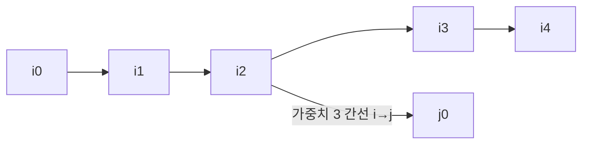

안녕하세요! 오늘은 백준 온라인 저지의 1533번 문제인 "길의 개수"를 함께 살펴보도록 하겠습니다.

문제 : [https://www.acmicpc.net/problem/1533](https://www.acmicpc.net/problem/1533)

## 문제 설명

세준이는 친구 정문이를 공항에서 데리러 가기로 했습니다. 그런데 정문이의 비행기가 연착되어 세준이는 공항까지 정확히 \( T \)분이 걸리는 경로를 찾아서 드라이브를 하려고 합니다. 도시에는 \( N \)개의 교차점이 있으며, 각 교차점 사이에는 길이 존재할 수 있습니다. 길은 이동하는 데 1분에서 5분까지 소요될 수 있으며, 길의 정보는 인접 행렬로 주어집니다.

세준이는 현재 위치 \( S \)에서 출발하여 \( T \)분 후에 공항 위치 \( E \)에 도착하는 경로의 개수를 구하고 싶습니다. 이때 가능한 경로의 수를 1,000,003으로 나눈 나머지를 출력해야 합니다.

## 접근 방식

이 문제는 가중치가 1–5인 방향 그래프에서 정확히 \( T \)분에 도착하는 경로의 수를 세는 문제입니다. 가중치가 모두 1이라면 인접 행렬 \( A \)를 \( T \)제곱한 행렬의 \( (S, E) \) 원소가 곧 길이 \( T \)인 경로의 수입니다. 행렬곱 \( (A^2)_{ij} = \sum_k A_{ik}A_{kj} \)가 "한 칸 가서 다시 한 칸 가는" 경우의 수를 합하는 연산이기 때문입니다. 문제는 가중치가 1이 아닌 간선이 있다는 점이고, 이 때문에 인접 행렬을 그대로 거듭제곱하면 간선 하나를 지나는 데 걸리는 시간이 제각각이 되어 \( T \)분이라는 조건을 표현할 수 없습니다.

해법은 **정점 분할**입니다. 정점 \( i \)를 체인 \( i_0 \to i_1 \to i_2 \to i_3 \to i_4 \)로 쪼개 정점당 5칸을 만들고, 체인의 각 이동은 정확히 1분이 걸리도록 합니다. 가중치 \( w \)인 간선 \( i \to j \)는 \( i_{w-1} \)에서 \( j_0 \)로 가는 가중치 1 간선으로 바꿉니다. 그러면 \( i_0 \)에서 시작해 \( i_{w-1} \)까지 \( w-1 \)번 체인을 따라 내려간 뒤 한 번 더 이동해 \( j_0 \)에 도착하므로 총 \( w \)분이 걸립니다. 가중치의 최댓값이 5이므로 5칸이면 모든 간선을 표현하기에 충분합니다.



이렇게 만든 확장 그래프는 모든 간선의 가중치가 1이고 정점이 \( 5N \)개이므로, \( 5N \times 5N \) 행렬 \( M \)을 \( T \)제곱하면 \( M^T \)의 \( (S\cdot5,\ E\cdot5) \) 원소가 답이 됩니다. 원래 그래프의 경로는 정점 \( i_0 \)에서 시작해 정점 \( j_0 \)에서 끝나는 확장 그래프 경로와 일대일로 대응하고, 한 경로가 쓰는 확장 간선의 수가 원래 경로의 총 소요 시간과 같기 때문입니다. 중간에 \( i_1 \)~\( i_4 \)에 머무는 경로는 \( T \)분이 끝나는 시점에 체인 안에 있게 되므로 \( E_0 \)에서 끝나는 경로만 세는 조건에 걸러집니다.

복잡도는 행렬곱이 \( O((5N)^3) \)이고 거듭제곱에 \( O(\log T) \)번의 곱셈이 필요하므로 전체 \( O((5N)^3 \log T) \)입니다. \( N \le 10 \), \( T \le 10^9 \)이면 \( 50^3 \approx 1.25 \times 10^5 \)에 곱셈 약 60회(제곱 30회와 누적 곱 최대 30회)를 곱해도 약 \( 7.5 \times 10^6 \)번의 연산이므로 여유롭습니다. 첫 번째 시도처럼 상태를 시간 축으로 \( T \)겹 펼치는 DP는 \( O(T N^2) \)이라 \( T=10^9 \)에서는 불가능하며, 이것이 행렬 거듭제곱을 쓰는 이유입니다.

| 방법 | 시간 복잡도 | 가중치 1–5 처리 | 비고 |
|---|---|---|---|
| 시간축 DP | \( O(T N^2) \) | 가능 | \( T=10^9 \)에서 시간 초과 |
| 인접 행렬 거듭제곱 | \( O(N^3 \log T) \) | 불가 | 가중치가 모두 1일 때만 정답 |
| 정점 분할 + 행렬 거듭제곱 | \( O((5N)^3 \log T) \) | 가능 | 이 글의 방법 |

흔한 오해는 "가중치가 큰 간선은 행렬의 값을 가중치로 두면 된다"는 생각입니다. 행렬 원소는 경로의 개수를 세는 값이지 시간을 나타내는 값이 아니므로, 가중치 3을 원소 값 3으로 넣으면 "경로 3개"라는 전혀 다른 의미가 됩니다. 시간은 반드시 이동 횟수(행렬의 거듭제곱 지수)로 표현해야 하고, 그래서 정점 분할이 필요합니다.

학습 목표는 다음과 같습니다. 이 글을 읽고 나면 (1) 인접 행렬의 거듭제곱이 길이 \( k \)인 경로 수를 세는 이유를 설명하고, (2) 가중치가 있는 간선을 정점 분할로 가중치 1 간선으로 바꾸는 방법을 적용하며, (3) 시간축 DP와 행렬 거듭제곱의 복잡도를 비교해 선택할 수 있어야 합니다. 행렬 거듭제곱의 일반 이론은 [위키백과 Exponentiation by squaring](https://en.wikipedia.org/wiki/Exponentiation_by_squaring)에서 확인할 수 있습니다.

## C++ 코드와 설명

아래는 위 정점 분할 방법을 그대로 옮긴 C++ 코드입니다. 행렬곱에서 값이 0인 원소를 건너뛰어 희소한 전이 행렬의 곱셈을 줄입니다.

```cpp
// 문제: https://www.acmicpc.net/problem/1533
#include <iostream>
#include <vector>
#include <string>

using namespace std;

const int MOD = 1000003;

typedef vector<vector<int>> Matrix;

int N, S, E;
long long T;
Matrix adj;

Matrix multiply(const Matrix &a, const Matrix &b) {
    int n = a.size();
    Matrix result(n, vector<int>(n, 0));
    for(int i=0; i<n; ++i) {
        for(int k=0; k<n; ++k) {
            if(a[i][k]) {
                for(int j=0; j<n; ++j) {
                    result[i][j] = (result[i][j] + (long long)a[i][k] * b[k][j]) % MOD;
                }
            }
        }
    }
    return result;
}

Matrix power(Matrix base, long long exp) {
    int n = base.size();
    Matrix result(n, vector<int>(n, 0));
    for(int i=0; i<n; ++i) result[i][i] = 1; // 단위 행렬로 초기화
    while(exp > 0) {
        if(exp % 2 == 1) result = multiply(result, base);
        base = multiply(base, base);
        exp /= 2;
    }
    return result;
}

int main() {
    cin >> N >> S >> E >> T;
    S--; E--; // 인덱스를 0부터 시작하도록 조정
    adj.resize(N * 5, vector<int>(N * 5, 0)); // 확장된 상태 전이 행렬

    // 원래의 인접 행렬 입력
    for(int i=0; i<N; ++i) {
        string s;
        cin >> s;
        for(int j=0; j<N; ++j) {
            int val = s[j] - '0';
            if(val > 0) {
                // 간선 가중치에 따라 상태 전이 설정
                int from = i * 5;
                int to = j * 5;
                for(int k=0; k<val-1; ++k) {
                    adj[from + k][from + k + 1] = 1;
                }
                adj[from + val - 1][to] = 1;
            }
        }
    }

    // 행렬 거듭제곱을 이용하여 T분 후의 상태 계산
    Matrix result = power(adj, T);

    // 시작점에서 도착점으로의 경로 수 계산
    int ans = result[S * 5][E * 5] % MOD;
    cout << ans << endl;

    return 0;
}
```

### 코드 설명

입력부는 \( N \), \( S \), \( E \), \( T \)를 읽고 \( S \), \( E \)를 0부터 시작하는 인덱스로 바꾼 뒤, \( 5N \times 5N \) 크기의 전이 행렬 `adj`를 0으로 초기화합니다. 이어 각 행을 문자열로 읽어 `s[j] - '0'`이 가중치 \( w \)이면 간선이 있는 것으로 보고, 정점 `i`의 체인 칸 `i*5+k`에서 `i*5+k+1`로 가는 간선을 \( w-1 \)개 이어 줍니다. 마지막으로 `i*5+w-1`에서 도착 정점의 첫 칸 `j*5`로 가는 간선을 하나 놓습니다. 예를 들어 가중치가 3인 간선은 `i0→i1→i2→j0`의 세 걸음이 되어 3분이 걸립니다.

`power`는 단위 행렬로 시작해 지수를 이진수로 훑으며 지수의 비트가 1일 때 결과에 현재 `base`를 곱하고, 매 단계 `base`를 제곱하는 이진 거듭제곱입니다. 곱셈마다 `% MOD`를 적용하므로 값이 1,000,003 미만으로 유지되고, 곱셈 중간값만 `long long`으로 캐스팅하면 오버플로우가 없습니다. 출력은 `result[S*5][E*5]`, 즉 시작 정점의 첫 칸에서 도착 정점의 첫 칸으로 정확히 \( T \)걸음에 도달하는 경로의 수입니다.

## C++ without library 코드와 설명

`stdio.h`와 `stdlib.h`만을 사용하여 동일한 로직을 구현한 코드입니다.

```c
// 문제: https://www.acmicpc.net/problem/1533
#include <stdio.h>
#include <stdlib.h>

#define MOD 1000003

typedef struct {
    int n;
    int **data;
} Matrix;

Matrix* create_matrix(int n) {
    Matrix* m = (Matrix*)malloc(sizeof(Matrix));
    m->n = n;
    m->data = (int**)malloc(sizeof(int*) * n);
    for(int i=0; i<n; ++i) {
        m->data[i] = (int*)calloc(n, sizeof(int));
    }
    return m;
}

void free_matrix(Matrix* m) {
    for(int i=0; i<m->n; ++i) {
        free(m->data[i]);
    }
    free(m->data);
    free(m);
}

Matrix* multiply(Matrix* a, Matrix* b) {
    int n = a->n;
    Matrix* result = create_matrix(n);
    for(int i=0; i<n; ++i) {
        for(int k=0; k<n; ++k) {
            if(a->data[i][k]) {
                for(int j=0; j<n; ++j) {
                    result->data[i][j] = (result->data[i][j] + (long long)a->data[i][k] * b->data[k][j]) % MOD;
                }
            }
        }
    }
    return result;
}

Matrix* power(Matrix* base, long long exp) {
    int n = base->n;
    Matrix* result = create_matrix(n);
    for(int i=0; i<n; ++i) result->data[i][i] = 1;
    while(exp > 0) {
        if(exp % 2 == 1) {
            Matrix* temp = multiply(result, base);
            free_matrix(result);
            result = temp;
        }
        Matrix* temp = multiply(base, base);
        free_matrix(base);
        base = temp;
        exp /= 2;
    }
    free_matrix(base);
    return result;
}

int main() {
    int N, S, E;
    long long T;
    scanf("%d %d %d %lld", &N, &S, &E, &T);
    S--; E--;
    int size = N * 5;
    Matrix* adj = create_matrix(size);
    for(int i=0; i<N; ++i) {
        char s[11];
        scanf("%s", s);
        for(int j=0; j<N; ++j) {
            int val = s[j] - '0';
            if(val > 0) {
                int from = i * 5;
                int to = j * 5;
                for(int k=0; k<val-1; ++k) {
                    adj->data[from + k][from + k + 1] = 1;
                }
                adj->data[from + val - 1][to] = 1;
            }
        }
    }
    Matrix* result = power(adj, T);
    int ans = result->data[S * 5][E * 5] % MOD;
    printf("%d\n", ans);
    free_matrix(result);
    return 0;
}
```

### 코드 설명

C 코드는 C++ 버전과 로직이 같고, 차이는 `vector` 대신 `malloc`/`calloc`으로 행렬을 만들고 `power`가 쓰고 난 행렬을 `free_matrix`로 직접 해제한다는 점입니다.

## Python 코드와 설명

Python을 사용하여 동일한 로직을 구현한 코드입니다.

```python
# 문제: https://www.acmicpc.net/problem/1533
MOD = 1000003

def multiply(a, b):
    n = len(a)
    result = [[0]*n for _ in range(n)]
    for i in range(n):
        for k in range(n):
            if a[i][k]:
                for j in range(n):
                    result[i][j] = (result[i][j] + a[i][k] * b[k][j]) % MOD
    return result

def power(base, exp):
    n = len(base)
    result = [[int(i==j) for j in range(n)] for i in range(n)]
    while exp > 0:
        if exp % 2 == 1:
            result = multiply(result, base)
        base = multiply(base, base)
        exp //= 2
    return result

N, S, E, T = map(int, input().split())
S -= 1
E -= 1
size = N * 5
adj = [[0]*size for _ in range(size)]
for i in range(N):
    s = input()
    for j in range(N):
        val = int(s[j])
        if val > 0:
            from_idx = i * 5
            to_idx = j * 5
            for k in range(val - 1):
                adj[from_idx + k][from_idx + k + 1] = 1
            adj[from_idx + val - 1][to_idx] = 1

result = power(adj, T)
ans = result[S * 5][E * 5] % MOD
print(ans)
```

### 코드 설명

Python 코드도 C++과 같은 로직이며, 정수 오버플로우가 없어 `long long` 캐스팅이 필요 없다는 점만 다릅니다. 다만 순수 Python의 삼중 반복문은 느려 \( 50^3 \times 60 \)번 연산에 수 초가 걸릴 수 있습니다.

## 결론

간선 가중치가 작은 정수로 제한된 경로 개수 문제는 정점을 체인으로 분할해 모든 간선을 가중치 1로 만들면 행렬 거듭제곱으로 풀 수 있습니다. 정점당 5칸이라는 크기는 가중치의 최댓값에서 오며, 최종 답은 \( M^T \)의 \( (S\cdot5,\ E\cdot5) \) 원소입니다.

## 코너 케이스 및 실수 포인트

| 케이스 | 설명 | 처리 방법 |
|---|---|---|
| **N=1** | 행렬 크기가 5×5이고 자기 자신으로의 간선만 가능 | 입력 행의 길이가 1인지 확인, `S=E`이면 단위 행렬과 구분 |
| **S=E, T=1** | 자기 루프(가중치 1)가 있으면 답 1 | 정점 분할에서 `adj[from][to]`로 직접 연결되는지 확인 |
| **간선 0** | 해당 위치 문자가 `'0'`이면 간선 없음 | `val > 0` 조건으로 건너뛰기 |
| **가중치 5** | 체인 끝 칸(`from+4`)에서 `to`로 이동 | 체인 길이가 5칸이면 충분하므로 배열 범위 초과 없음 |
| **정수 오버플로우** | 출력은 1,000,003 미만이라 `int`로 충분하지만 곱셈 중간값은 약 \( 10^{12} \) | 곱셈 전에 `long long`으로 캐스팅, \( T \le 10^9 \)이므로 `T`도 `long long` |
