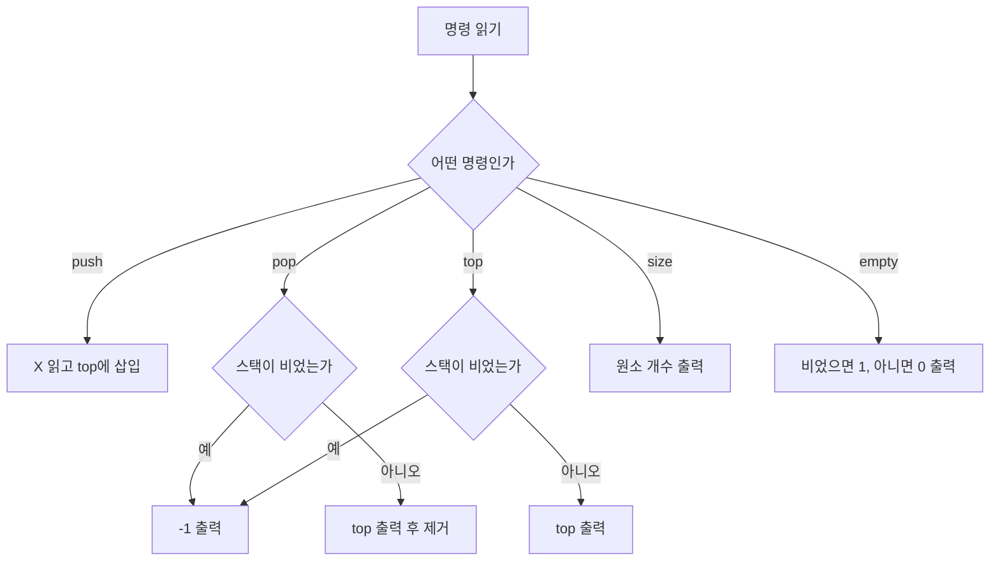

스택은 컴퓨터 과학에서 매우 기본적이면서도 중요한 자료 구조 중 하나이다. 백준 온라인 저지의 10828번 문제는 이러한 스택의 구현과 관련된 문제로, 다양한 명령을 효율적으로 처리해야 한다. 이번 글에서는 이 문제를 상세히 분석하고, C++과 Python으로 구현하는 방법을 소개한다.

문제 : [https://www.acmicpc.net/problem/10828](https://www.acmicpc.net/problem/10828)

## 문제 설명

백준 10828번 문제는 정수를 저장할 수 있는 스택을 구현하고, 주어진 명령을 처리하는 프로그램을 작성하는 것이다. 스택은 LIFO(Last In, First Out) 구조로, 가장 나중에 삽입된 요소가 먼저 제거되는 특성을 가진다. 문제에서 요구하는 명령은 총 다섯 가지로, `push X`, `pop`, `size`, `empty`, `top`이 있다.

- `push X`: 정수 X를 스택에 넣는 연산이다.
- `pop`: 스택에서 가장 위에 있는 정수를 빼고, 그 수를 출력한다. 스택이 비어있으면 -1을 출력한다.
- `size`: 스택에 들어있는 정수의 개수를 출력한다.
- `empty`: 스택이 비어있으면 1, 아니면 0을 출력한다.
- `top`: 스택의 가장 위에 있는 정수를 출력한다. 스택이 비어있으면 -1을 출력한다.

입력으로는 첫 번째 줄에 명령의 수 N(1 ≤ N ≤ 10,000)이 주어지고, 그 다음 N개의 줄에 각 명령이 주어진다. `push X`의 X는 1 이상 100,000 이하의 정수이다. 시간 제한은 0.5초, 메모리 제한은 256MB이다. 출력은 각 명령에 대해 요구되는 결과를 한 줄씩 출력하면 된다(`push`는 출력이 없다).

예를 들어, 다음과 같은 입력이 주어졌을 때:

```
14
push 1
push 2
top
size
empty
pop
pop
pop
size
empty
pop
push 3
empty
top
```

출력은 다음과 같이 된다:

```
2
2
0
2
1
-1
0
1
-1
0
3
```

## 접근 방식

이 문제는 기본적인 스택 자료 구조의 구현과 명령 처리를 요구한다. 스택의 모든 연산은 한쪽 끝(top)에서만 일어나므로, 끝에서 삽입·삭제가 상수 시간에 가능한 자료 구조라면 무엇이든 스택이 될 수 있다. 후보는 세 가지다. `std::vector`는 `push_back`/`pop_back`이 amortized O(1)이고 메모리가 연속이라 캐시 효율이 좋으며 크기 관리를 알아서 해 준다. 직접 관리하는 배열은 N이 최대 10,000이라 `push`가 N번을 넘을 수 없으므로 크기 N짜리 배열이면 충분하고, 재할당 비용이 아예 없다. 연결 리스트는 노드마다 할당이 필요해 이 문제 규모에서는 이득이 없다. 이 글은 가장 짧고 안전한 `std::vector`를 기본으로, 포인터와 배열의 동작을 눈으로 확인할 수 있는 직접 구현을 두 번째로, Python 리스트를 세 번째로 소개한다.

입출력 최적화가 필요한 이유는 시간 제한 0.5초 때문이다. N이 10,000이면 연산 수 자체는 작지만, `endl`로 매 줄 flush를 하거나 동기화된 `cin`/`cout`을 쓰면 입출력 호출이 지배적인 비용이 된다. C++에서는 `std::ios::sync_with_stdio(false)`로 C 표준 입출력과의 동기화를 끊고, `std::cin.tie(NULL)`로 `cin` 읽기 전에 `cout`을 flush하는 묶음을 풀어 준다. 출력에는 `"\n"`을 쓰고 `std::endl`은 피한다.

명령 처리의 핵심은 파싱과 상태 관리를 분리하는 것이다. 명령 문자열을 먼저 읽어 분기하고, `push`일 때만 정수 X를 추가로 읽는다. 아래 흐름도는 한 명령이 처리되는 경로를 보여 준다.



예제 입력을 이 흐름대로 따라가면 스택 상태와 출력은 다음과 같이 변한다.

| 명령 | 처리 후 스택(왼쪽이 바닥) | 출력 |
|---|---|---|
| `push 1` | [1] | 없음 |
| `push 2` | [1, 2] | 없음 |
| `top` | [1, 2] | 2 |
| `size` | [1, 2] | 2 |
| `empty` | [1, 2] | 0 |
| `pop` | [1] | 2 |
| `pop` | [] | 1 |
| `pop` | [] | -1 |
| `size` | [] | 0 |
| `empty` | [] | 1 |
| `pop` | [] | -1 |
| `push 3` | [3] | 없음 |
| `empty` | [3] | 0 |
| `top` | [3] | 3 |

## C++ 코드와 설명

```cpp
#include <iostream>
#include <vector>
#include <string>

int main() {
    // 빠른 입출력 설정
    std::ios::sync_with_stdio(false);
    std::cin.tie(NULL);
    
    int N;
    std::cin >> N;
    
    std::vector<int> stack; // 스택을 벡터로 구현
    std::string command;
    int X;
    
    for(int i = 0; i < N; ++i){
        std::cin >> command; // 명령어 입력
        if(command == "push"){
            std::cin >> X; // push 명령어의 경우 추가로 정수 X 입력
            stack.push_back(X); // 스택에 X 삽입
        }
        else if(command == "pop"){
            if(stack.empty()){
                std::cout << "-1\n"; // 스택이 비어있으면 -1 출력
            }
            else{
                std::cout << stack.back() << "\n"; // 스택의 가장 위 요소 출력
                stack.pop_back(); // 스택에서 제거
            }
        }
        else if(command == "size"){
            std::cout << stack.size() << "\n"; // 스택의 크기 출력
        }
        else if(command == "empty"){
            std::cout << (stack.empty() ? "1" : "0") << "\n"; // 스택이 비어있는지 여부 출력
        }
        else if(command == "top"){
            if(stack.empty()){
                std::cout << "-1\n"; // 스택이 비어있으면 -1 출력
            }
            else{
                std::cout << stack.back() << "\n"; // 스택의 가장 위 요소 출력
            }
        }
    }
    
    return 0;
}
```

`std::ios::sync_with_stdio(false)`는 `cin`/`cout`이 C의 `stdin`/`stdout`과 버퍼를 공유하지 않도록 만들어 입출력 속도를 높인다. 대신 이 호출 이후에는 `scanf`/`printf`와 `cin`/`cout`을 섞어 쓰면 출력 순서가 뒤섞일 수 있으므로 한쪽만 써야 한다. `std::cin.tie(NULL)`은 `cin`으로 읽기 전에 `cout`을 자동으로 flush하는 묶음을 풀어, 대화형이 아닌 채점 환경에서 불필요한 flush를 없앤다.

스택은 `std::vector<int>` 하나로 충분하다. `push_back`과 `pop_back`이 각각 push와 pop에 대응하고, `back()`이 top, `empty()`와 `size()`가 나머지 두 명령에 대응한다. 주의할 점은 `back()`과 `pop_back()`을 빈 벡터에 호출하면 정의되지 않은 동작이라는 것이다. 그래서 코드는 `pop`과 `top`에서 항상 `empty()`를 먼저 검사해 문제의 요구대로 -1을 출력한다. 반복문은 N번 명령 문자열을 읽어 분기하며, `push`일 때만 정수를 추가로 읽는다.

## C++ without library 코드와 설명

```cpp
#include <iostream>
#include <cstring>
#include <cstdlib>
#include <string>

struct Stack {
    int* arr; // 스택을 저장할 배열
    int top;
    int capacity;
    
    Stack(int size) {
        arr = (int*)malloc(sizeof(int) * size); // int 10,000개 수준이라 할당 실패는 고려하지 않는다
        top = -1;
        capacity = size;
    }
    
    void push(int x) {
        // push 횟수는 N을 넘지 않으므로 capacity = N이면 넘칠 일이 없다
        arr[++top] = x;
    }
    
    int pop(){
        if(top == -1){
            return -1;
        }
        return arr[top--];
    }
    
    int size(){
        return top + 1;
    }
    
    int empty(){
        return top == -1 ? 1 : 0;
    }
    
    int getTop(){
        if(top == -1){
            return -1;
        }
        return arr[top];
    }
};

int main(){
    std::ios::sync_with_stdio(false);
    std::cin.tie(NULL);
    
    int N;
    std::cin >> N;
    
    Stack stack(N); // 스택의 최대 크기를 N으로 설정
    std::string command;
    int X;
    
    for(int i = 0; i < N; ++i){
        std::cin >> command;
        if(command == "push"){
            std::cin >> X;
            stack.push(X);
        }
        else if(command == "pop"){
            std::cout << stack.pop() << "\n";
        }
        else if(command == "size"){
            std::cout << stack.size() << "\n";
        }
        else if(command == "empty"){
            std::cout << stack.empty() << "\n";
        }
        else if(command == "top"){
            std::cout << stack.getTop() << "\n";
        }
    }
    
    free(stack.arr); // 할당한 메모리 해제
    return 0;
}
```

이 구현은 `std::vector`가 내부에서 하는 일을 가장 단순한 형태로 풀어 쓴 것이다. 구조체는 배열 포인터 `arr`, 현재 top 인덱스 `top`, 최대 크기 `capacity`를 가진다. `top`을 -1로 초기화해 "비어 있음"을 표현하면 `push`는 `arr[++top] = x`, `pop`은 `arr[top--]`라는 한 줄로 끝나고, `size`는 `top + 1`, `empty`는 `top == -1`로 판정된다. 크기를 N으로 잡는 근거는 `push`가 N번보다 많이 일어날 수 없다는 점이며, 이 때문에 재할당 로직이 필요 없다. 반대로 말하면 이 구현은 "명령 수로 스택 크기의 상한이 정해지는" 이 문제의 특성에 기대고 있어서, 일반적인 스택으로 쓰려면 용량 초과 시 확장하는 로직이 있어야 한다.

`malloc`으로 할당한 메모리는 `free`로 직접 해제해야 한다. 이 프로그램은 종료 직전이라 해제하지 않아도 운영체제가 회수하지만, 소유권을 명시하는 습관을 보이기 위해 `free(stack.arr)`를 남겨 두었다. 실무 코드라면 `std::unique_ptr<int[]>`나 `std::vector`로 해제를 자동화하는 편이 안전하다.

## Python 코드와 설명

```python
import sys

def main():
    input = sys.stdin.read
    data = input().split()
    
    N = int(data[0])
    stack = []
    idx = 1
    output = []
    
    for _ in range(N):
        command = data[idx]
        if command == "push":
            idx += 1
            X = int(data[idx])
            stack.append(X)
        elif command == "pop":
            if stack:
                output.append(str(stack.pop()))
            else:
                output.append("-1")
        elif command == "size":
            output.append(str(len(stack)))
        elif command == "empty":
            output.append("1" if not stack else "0")
        elif command == "top":
            if stack:
                output.append(str(stack[-1]))
            else:
                output.append("-1")
        idx += 1
    
    print('\n'.join(output))

if __name__ == "__main__":
    main()
```

Python 풀이의 요점은 입력 방식이다. `sys.stdin.read().split()`으로 모든 입력을 한 번에 읽어 토큰 리스트로 만들면, 줄마다 `input()`을 호출하는 것보다 호출 횟수가 크게 줄어든다. 명령은 토큰 순서대로 소비하고, `push`일 때만 인덱스를 하나 더 전진시켜 X를 읽는다. 스택은 리스트 `stack`이며 `append`가 push, `pop()`이 pop, `stack[-1]`이 top에 대응한다. 빈 리스트에 `pop()`이나 `stack[-1]`을 쓰면 `IndexError`가 나므로 `if stack:`으로 먼저 검사한다.

출력은 문자열을 리스트 `output`에 모았다가 `'\n'.join(output)`으로 한 번에 내보낸다. `print`를 명령마다 호출하면 호출 비용이 누적되기 때문이다.

## 복잡도 분석

| 구현 | 시간 복잡도 | 공간 복잡도 | 비고 |
|---|---|---|---|
| `std::vector` | 연산당 amortized O(1), 전체 O(N) | O(N) | 용량이 모자라면 재할당하지만 용량이 배로 늘어 평균 비용이 상수 |
| 직접 배열 | 연산당 O(1), 전체 O(N) | O(N) | 크기를 N으로 고정해 재할당 없음 |
| Python 리스트 | 연산당 amortized O(1), 전체 O(N) | O(N) | `append`/`pop`이 끝에서만 일어남 |

모든 명령이 한 번씩 상수 시간에 처리되므로 전체 시간은 O(N)이고, 최악에는 N개를 전부 `push`하므로 공간도 O(N)이다. `vector`의 `push_back`이 "amortized" O(1)인 이유는 용량을 가득 채웠을 때만 O(현재 크기) 재할당이 일어나고, 용량이 기하급수적으로 늘어 그 비용이 여러 번의 삽입에 분산되기 때문이다(증가 배율은 구현 정의).

## 자주 하는 실수

- **`sync_with_stdio(false)` 이후 `scanf`/`printf` 혼용**: 버퍼가 분리되어 입출력 순서가 어긋날 수 있다. 한 가지 입출력 계열만 쓴다.
- **`endl` 사용**: 줄바꿈과 동시에 flush하므로 줄마다 호출하면 느려진다. `"\n"`을 쓴다.
- **빈 스택에서 `back()`/`pop_back()` 호출**: 정의되지 않은 동작이다. 문제가 요구하는 -1 출력 분기를 반드시 먼저 검사한다.
- **`push`의 출력 오해**: `push`는 아무것도 출력하지 않는다. 출력 줄 수는 `push`가 아닌 명령의 개수와 같다.

## 코너 케이스

| 케이스 | 설명 | 처리 방법 |
|---|---|---|
| 빈 스택의 `pop`/`top` | 삽입 전에 바로 호출 | `empty()` 검사 후 -1 출력 |
| 전부 `pop` 한 뒤 다시 `pop` | 마지막 원소를 빼 비운 직후의 `pop` | 같은 빈 스택 분기가 처리 |
| `empty` 직후 `push` | 상태가 비었다가 다시 채워짐 | `top` 인덱스(또는 벡터 크기)만 갱신하면 됨 |
| N개 모두 `push` | 직접 배열 구현에서 최대 사용량 | 크기를 N으로 잡으면 넘치지 않음 |

## 결론과 학습 목표

스택 문제의 본질은 "top에서만 일어나는 연산"을 상수 시간에 처리하는 것이고, 10828번에서는 여기에 입출력 비용 관리가 더해진다. 이 글을 읽은 뒤에는 다음을 할 수 있어야 한다.

- `vector`, 직접 배열, Python 리스트로 스택을 구현하고 각 방식의 시간·공간 복잡도를 설명한다.
- `sync_with_stdio`와 `cin.tie`가 하는 일, 그리고 `scanf`/`printf` 혼용이 위험한 이유를 설명한다.
- 빈 스택 접근처럼 정의되지 않은 동작을 일으키는 입력을 식별해 방어한다.

## 참고 문헌

- [BOJ 10828번 스택](https://www.acmicpc.net/problem/10828)
- [cppreference: std::vector](https://en.cppreference.com/w/cpp/container/vector)
- [cppreference: std::ios_base::sync_with_stdio](https://en.cppreference.com/w/cpp/io/ios_base/sync_with_stdio)
- [cppreference: std::basic_ios::tie](https://en.cppreference.com/w/cpp/io/basic_ios/tie)

