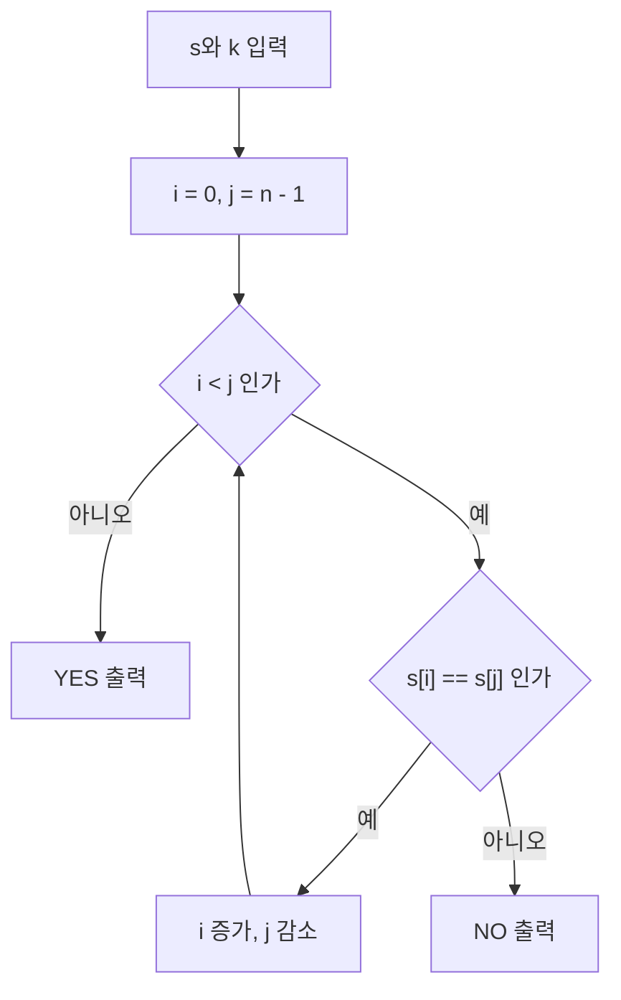

백준 16189번은 \( k \)가 최대 \( 10^{18} \)이라 반복 문자열을 직접 만들 수 없어 보이지만, 실제로는 \( k \)가 답에 전혀 영향을 주지 않는 문제이다. 이 글에서는 그 사실을 증명하고, 같은 논리가 어떤 변형에서 깨지는지까지 살펴본다.

## 문제 정보

**문제 링크**: [https://www.acmicpc.net/problem/16189](https://www.acmicpc.net/problem/16189)

**문제 요약**: 소문자 문자열 \( s \)와 정수 \( k \)가 주어진다. \( s \)를 \( k \)번 이어 붙인 문자열 \( t \)가 회문(앞뒤 어느 쪽에서 읽어도 같은 문자열)이면 `YES`, 아니면 `NO`를 출력한다. 첫 줄에 \( s \), 둘째 줄에 \( k \)가 주어진다.

**제한 조건**:
- 시간 제한: 1초
- 메모리 제한: 1024MB
- \( 1 \le |s| \le 250{,}000 \), \( 1 \le k \le 10^{18} \)

## 입출력 예제

**입력 1**

```text
abc
3
```

**출력 1**

```text
NO
```

**입력 2**

```text
abba
1
```

**출력 2**

```text
YES
```

## 접근 방식

\( t \)의 길이는 \( |s| \times k \)로 최대 \( 2.5 \times 10^{23} \)이다. 메모리에 담을 수 없을 뿐 아니라 길이 값 자체가 64비트 정수 범위를 넘는다. 따라서 \( t \)를 만들지 않고 \( s \)의 성질만으로 판정해야 하며, 결론은 "\( t \)가 회문인 것과 \( s \)가 회문인 것은 동치"이다.

### 필요충분 증명

\( n = |s| \)라 하자. **필요성**은 \( t \)의 양 끝 블록을 보면 된다. \( t \)가 회문이면 모든 \( 0 \le i < n \)에 대해 \( t[i] = t[nk-1-i] \)이다. 왼쪽 \( t[i] \)는 첫 번째 블록의 \( s[i] \)이고, 오른쪽 \( t[nk-1-i] \)는 마지막 블록의 \( s[n-1-i] \)이다. 그러므로 \( s[i] = s[n-1-i] \)가 성립해 \( s \)도 회문이다.

**충분성**은 뒤집기의 성질에서 나온다. 같은 블록을 이어 붙인 문자열을 뒤집으면 뒤집은 블록을 같은 횟수만큼 이어 붙인 것이 되므로 \( \text{rev}(s^k) = \text{rev}(s)^k \)이다. \( s \)가 회문이면 \( \text{rev}(s) = s \)이므로 \( \text{rev}(t) = t \)이다. 두 방향 모두 \( k \ge 1 \)이면 성립하므로 \( k \)의 크기나 홀짝은 판정에 들어오지 않는다.

필요성 증명이 보는 위치를 \( s = \texttt{abc} \), \( k = 3 \)에 대입하면 다음과 같다. 첫 블록과 마지막 블록의 비교만으로 이미 불일치가 드러난다.

| \( i \) | 첫 블록의 \( t[i] \) | 마지막 블록의 \( t[8-i] \) | 일치 |
|---:|:---:|:---:|:---:|
| 0 | a | c | 아니오 |
| 1 | b | b | 예 |
| 2 | c | a | 아니오 |

### 판정 흐름

구현은 \( s \)의 양 끝에서 안쪽으로 좁혀 오는 투 포인터 비교이며, 불일치를 만나는 즉시 끝낸다.



### 흔한 오개념

"\( k \)가 짝수면 접힌 모양이 생겨 회문이 될 수 있다"는 생각은 틀렸다. \( s = \texttt{ab} \), \( k = 2 \)의 결과는 `abab`이고 뒤집으면 `baba`이다. 짝수 대칭이 생기려면 \( s \)와 뒤집은 \( s \)를 번갈아 붙여야 하는데, 이 문제는 같은 \( s \)만 반복한다.

"문자열 문제이고 길이가 크니 KMP, 해싱, Manacher 같은 기법이 필요하다"는 생각도 이 문제에는 맞지 않는다. 판정 대상은 길이 25만의 \( s \) 하나이고, 문자열 전체의 회문 여부는 한 번의 선형 비교로 끝난다. Manacher는 모든 부분 회문의 반지름을 구할 때 쓰는 도구이다.

### 적용 범위와 한계

이 단순화는 \( t \)가 \( s \)의 **온전한 반복**이라는 조건에 의존한다. 조건이 바뀌면 증명의 "마지막 블록" 단계가 성립하지 않는다.

| 문제 형태 | \( s \)만 검사해도 되는가 | 이유 |
|---|:---:|---|
| \( s \)를 \( k \)번 반복한 전체 | 예 | 위 필요충분 증명 |
| 반복 문자열의 앞 \( L \)글자(\( L \)이 \( n \)의 배수가 아님) | 아니오 | \( s = \texttt{ab} \), \( L = 3 \)이면 `aba`로, \( s \)가 회문이 아닌데도 회문 |
| \( t \)의 회문 부분 문자열 개수·최장 길이 | 아니오 | 블록 경계를 넘는 회문을 따로 분석해야 함 |

## 복잡도 분석

최악의 경우는 \( s \)가 실제로 회문이라 절반을 끝까지 비교할 때이며, 그래도 비교 횟수는 12만 5천 번이다.

| 항목 | C++ | Python | 비고 |
|---|---|---|---|
| 시간 복잡도 | \( O(n) \) | \( O(n) \) | \( k \)와 무관 |
| 입력 저장 공간 | \( O(n) \) | \( O(n) \) | 문자열 \( s \) |
| 추가 공간 | \( O(1) \) | \( O(n) \) | Python의 `s[::-1]`은 복사본 생성 |

## 구현 코드

### C++

`std::equal`에 앞쪽 절반과 역방향 반복자를 넘기면 투 포인터 비교를 한 줄로 쓸 수 있다. \( k \)의 최댓값 \( 10^{18} \)은 `long long`의 상한(약 \( 9.2 \times 10^{18} \)) 안에 들어가며, 읽기만 하고 사용하지 않는다.

```cpp
// 42jerrykim.github.io에서 더 많은 정보를 확인할 수 있다
#include <algorithm>
#include <iostream>
#include <string>

int main() {
    std::ios::sync_with_stdio(false);
    std::cin.tie(nullptr);

    std::string s;
    long long k;
    std::cin >> s >> k;

    bool ok = std::equal(s.begin(), s.begin() + s.size() / 2, s.rbegin());
    std::cout << (ok ? "YES" : "NO") << '\n';
}
```

### Python

Python은 슬라이스로 뒤집은 문자열을 만들어 원본과 비교한다. 둘째 줄의 \( k \)는 판정에 필요 없으므로 첫 줄만 읽는다.

```python
# 42jerrykim.github.io에서 더 많은 정보를 확인할 수 있다
import sys

s = sys.stdin.readline().strip()
print("YES" if s == s[::-1] else "NO")
```

## 코너 케이스 및 실수 포인트

| 케이스 | 예 | 기대 결과와 확인할 점 |
|---|---|---|
| 길이 1 | `z`, \( k = 10^{18} \) | `YES`. 비교할 쌍이 0개 |
| \( k = 1 \) | `abca`, 1 | `NO`. \( t = s \) |
| 가운데만 다름 | `abca`, 2 | `NO`. 양 끝이 같아도 안쪽 쌍까지 확인 |
| 거대한 \( k \) | `aba`, \( 10^{18} \) | `YES`. \( t \)를 생성하거나 \( k \)번 순회하면 안 됨 |
| C 스타일 배열 | 길이 250,000 | 널 문자를 포함해 250,001칸 이상 필요 |

## 이 글을 읽은 후 달성할 목표

- \( t \)의 첫 블록과 마지막 블록을 비교해 필요성을, 뒤집기 성질로 충분성을 설명할 수 있다.
- \( k \)가 답에 영향을 주지 않는 이유를 반례 `abab`와 함께 설명할 수 있다.
- 반복 문자열의 접두사처럼 \( s \)만 검사하면 안 되는 변형을 구분할 수 있다.

## 참고 문헌 및 출처

- [백준 16189번 Repetitive Palindrome](https://www.acmicpc.net/problem/16189)
- [cppreference: std::equal](https://en.cppreference.com/w/cpp/algorithm/equal)
- [Python 문서: Common Sequence Operations](https://docs.python.org/3/library/stdtypes.html#common-sequence-operations)
