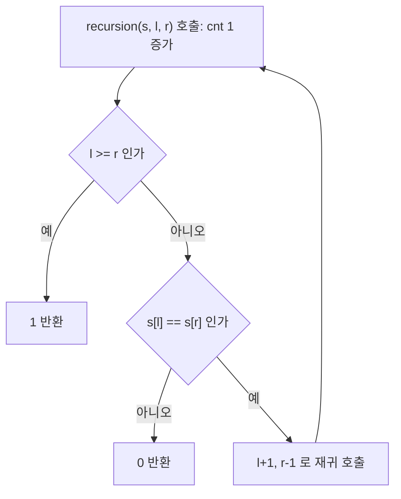

팰린드롬 판별은 재귀를 처음 연습하기에 좋은 문제다. 백준 25501번 '재귀의 귀재'는 여기에 "재귀 함수가 몇 번 호출되었는가"라는 질문을 더해, 답만 맞히는 것이 아니라 호출 흐름을 정확히 따라갈 수 있는지를 확인한다. 이 글에서는 양 끝 인덱스를 좁혀 가는 재귀의 동작과 호출 횟수가 정해지는 규칙을 설명하고, 같은 일을 반복문으로 할 때와 비교한다.

## 문제 정보

**문제 링크**: [https://www.acmicpc.net/problem/25501](https://www.acmicpc.net/problem/25501)

**문제 요약**: 테스트케이스마다 문자열 S가 주어진다. 정해진 재귀 방식으로 S가 팰린드롬인지 판별해 반환값(팰린드롬이면 1, 아니면 0)과 그 과정에서 `recursion` 함수가 호출된 횟수를 한 줄에 출력한다. 팰린드롬은 "ABBA"처럼 앞에서 읽으나 뒤에서 읽으나 같은 [문자열](https://en.wikipedia.org/wiki/Palindrome)이다.

**제한 조건**:

- 시간 제한 2초, 메모리 제한 1024MB
- 테스트케이스 수: $1 \le T \le 1{,}000$
- 문자열 길이: $1 \le |S| \le 1{,}000$, 알파벳 대문자로만 구성

## 입출력 예제

**입력**:

```text
5
AAA
ABBA
ABABA
ABCA
PALINDROME
```

**출력**:

```text
1 2
1 3
1 3
0 2
0 1
```

## 접근 방식 및 로직 설계

핵심은 `recursion(s, l, r)`의 의미를 "구간 `s[l..r]`이 팰린드롬인가"로 고정하는 것이다. 이 호출이 이루어졌다는 것은 구간 바깥의 문자 쌍이 모두 일치했다는 뜻이며, 이 불변식 때문에 안쪽 구간만 확인하면 전체의 답이 된다. 구간이 한 글자이거나 비면(`l >= r`) 더 비교할 쌍이 없으므로 1을 반환하고, 양 끝 문자가 다르면 바로 0을 반환한다. 둘 다 아니면 `l + 1`, `r - 1`로 구간을 좁혀 자신을 다시 호출한다.



호출 횟수는 함수에 들어온 직후에 센다. 따라서 아무 비교 없이 1을 반환하는 마지막 기저 호출도 1회로 포함된다. 길이 n인 팰린드롬은 안쪽으로 한 쌍씩 좁혀지므로 $\lfloor n/2 \rfloor + 1$번 호출되고, 팰린드롬이 아니면 처음 어긋나는 쌍의 위치가 k(0부터 셈)일 때 k+1번에서 멈춘다. 예를 들어 "ABCA"는 첫 호출에서 A와 A가 일치하고, 두 번째 호출에서 B와 C가 달라 `0 2`가 된다.

## 복잡도 분석

한 번의 호출은 비교 한 번과 인덱스 계산만 하므로 전체 비용은 호출 횟수에 비례한다. 호출은 최대 $\lfloor n/2 \rfloor + 1$번이고, 각 호출의 스택 프레임이 반환 전까지 남아 있으므로 추가 공간도 같은 크기로 늘어난다. 문자열은 복사하지 않고 참조(C에서는 포인터)로 넘긴다.

| 항목 | 복잡도 (테스트케이스당) | 비고 |
|---|---|---|
| 시간 | $O(n)$ | 최대 501번 호출 ($n = 1000$) |
| 추가 공간 | $O(n)$ | 재귀 호출 스택 |

## 구현 코드

세 구현은 같은 로직이며, 공통으로 지켜야 할 점은 두 가지다. 호출 횟수를 담는 `cnt`를 테스트케이스마다 0으로 되돌리는 것, 그리고 출력할 때 반환값을 먼저 구한 뒤 `cnt`를 읽는 것이다. 아래 코드처럼 결과를 변수에 먼저 담아 두면 평가 순서에 신경 쓸 필요가 없다.

### C++

C++에서는 문자열을 `const string&`로 받아 호출마다 복사가 일어나지 않게 한다.

```cpp
// 42jerrykim.github.io에서 더 많은 정보를 확인할 수 있다
#include <iostream>
#include <string>
using namespace std;

int cnt;

int recursion(const string &s, int l, int r) {
    cnt++;
    if (l >= r) return 1;
    if (s[l] != s[r]) return 0;
    return recursion(s, l + 1, r - 1);
}

int isPalindrome(const string &s) {
    return recursion(s, 0, static_cast<int>(s.size()) - 1);
}

int main() {
    ios::sync_with_stdio(false);
    cin.tie(nullptr);

    int T;
    cin >> T;
    while (T--) {
        string S;
        cin >> S;
        cnt = 0;
        int result = isPalindrome(S);
        cout << result << " " << cnt << "\n";
    }
}
```

### C

C 표준 라이브러리만 쓰는 버전이다. 길이 상한이 1000이므로 널 문자까지 1001칸을 잡고, `%1000s`로 버퍼 넘침을 막는다.

```c
// 42jerrykim.github.io에서 더 많은 정보를 확인할 수 있다
#include <stdio.h>
#include <string.h>

int cnt;

int recursion(const char *s, int l, int r) {
    cnt++;
    if (l >= r) return 1;
    if (s[l] != s[r]) return 0;
    return recursion(s, l + 1, r - 1);
}

int isPalindrome(const char *s) {
    return recursion(s, 0, (int)strlen(s) - 1);
}

int main(void) {
    int T;
    if (scanf("%d", &T) != 1) return 0;
    while (T--) {
        char S[1001];
        if (scanf("%1000s", S) != 1) break;
        cnt = 0;
        int result = isPalindrome(S);
        printf("%d %d\n", result, cnt);
    }
    return 0;
}
```

### Python

CPython의 기본 재귀 한도는 보통 1000이고, 이 문제의 재귀 깊이는 약 501이므로 [`sys.setrecursionlimit`](https://docs.python.org/3/library/sys.html#sys.setrecursionlimit)을 호출하지 않아도 된다. 전역 변수 `cnt`는 함수 안에서 값을 바꾸므로 `global` 선언이 필요하다.

```python
# 42jerrykim.github.io에서 더 많은 정보를 확인할 수 있다
import sys

cnt = 0


def recursion(s, l, r):
    global cnt
    cnt += 1
    if l >= r:
        return 1
    if s[l] != s[r]:
        return 0
    return recursion(s, l + 1, r - 1)


def is_palindrome(s):
    return recursion(s, 0, len(s) - 1)


def main():
    global cnt
    data = sys.stdin.read().split()
    for word in data[1:int(data[0]) + 1]:
        cnt = 0
        result = is_palindrome(word)
        print(result, cnt)


if __name__ == "__main__":
    main()
```

## 재귀와 반복문, 무엇을 고를까

판별 결과만 필요하다면 두 인덱스를 `while`로 좁히는 투 포인터 방식이 더 낫다. 시간은 똑같이 $O(n)$이지만 호출 스택을 쓰지 않아 추가 공간이 $O(1)$이다. 재귀 호출이 함수의 마지막 동작인 [꼬리 호출](https://en.wikipedia.org/wiki/Tail_call) 형태라서 C·C++ 컴파일러는 이를 반복문으로 바꿔 주기도 하지만, 언어 표준이 보장하는 최적화는 아니며 CPython은 하지 않는다.

이 문제에서는 요구하는 출력 자체가 재귀 호출 횟수이므로 재귀로 쓰는 편이 문제의 정의와 그대로 대응한다. 반복문으로도 "일치한 쌍의 수 + 1"을 계산해 같은 값을 낼 수 있지만, 입력이 훨씬 길어 깊이가 문제되는 상황이 아니라면 바꿀 이유는 크지 않다.

| 상황 | 선택 | 이유 |
|---|---|---|
| 이 문제(길이 1,000 이하)처럼 깊이가 작고 호출 횟수가 요구사항 | 재귀 | 정의와 코드가 일대일로 대응 |
| Python에서 길이가 약 2,000 이상일 수 있는 입력 | 반복문 | 깊이가 약 n/2라 기본 한도 1000에서 `RecursionError` 가능 |
| C·C++에서 길이 상한을 알 수 없는 입력 | 반복문 | 한계가 스택 크기와 컴파일러 최적화에 따라 달라짐 |

## 코너 케이스 및 실수 포인트

흔한 오해 중 하나는 "재귀 단계에서 `s[1:-1]`처럼 잘라 넘겨도 비용이 같다"는 것이다. Python의 슬라이싱은 새 문자열을 만들기 때문에 호출마다 복사가 일어나 전체 시간이 $O(n^2)$이 될 수 있다. 인덱스만 넘기면 이 비용이 없다.

| 케이스 | 설명 | 처리 방법 |
|---|---|---|
| 길이 1 | 첫 호출에서 `l >= r` | `1 1` 출력 |
| 첫 쌍부터 불일치 | 첫 호출에서 종료 | `0 1` 출력 |
| 짝수 길이 | 마지막에 `l > r`이 됨 | 조건을 `l == r`이 아닌 `l >= r`로 작성 |
| 테스트케이스 반복 | `cnt`가 누적됨 | 매번 0으로 초기화 |

## 이 글을 읽은 후 목표

이 문제에서 익힐 것은 재귀 함수의 인자가 무엇을 뜻하는지 먼저 정하고, 그 정의로부터 반환값과 호출 횟수를 따라가는 방법이다. 여기에 같은 판별을 반복문으로 옮겼을 때 달라지는 비용까지 설명할 수 있으면 충분하다.

- `recursion(s, l, r)`의 의미를 불변식으로 설명할 수 있다.
- 임의의 대문자 문자열에 대해 코드를 실행하지 않고 반환값과 호출 횟수를 구할 수 있다.
- 같은 판별을 반복문으로 바꾸고, 공간 복잡도 차이를 설명할 수 있다.

## 참고 문헌 및 출처

- [백준 25501번: 재귀의 귀재](https://www.acmicpc.net/problem/25501)
- [Python 문서: sys.setrecursionlimit](https://docs.python.org/3/library/sys.html#sys.setrecursionlimit)
- [Wikipedia: Palindrome](https://en.wikipedia.org/wiki/Palindrome)
- [Wikipedia: Tail call](https://en.wikipedia.org/wiki/Tail_call)
