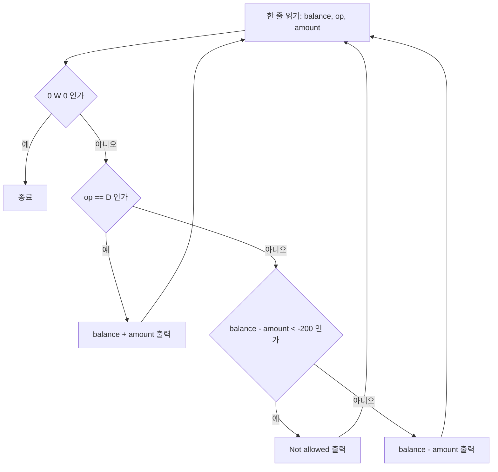

백준 2975번 'Transactions'는 ATM의 입금과 출금을 한 건씩 계산하는 시뮬레이션 문제다. 계산 자체는 덧셈과 뺄셈이 전부이므로, 실수는 대부분 "정확히 -200은 허용되는가"와 "각 줄이 서로 이어지는가"라는 문제 해석에서 나온다. 이 글에서는 이 두 가지를 먼저 확정한 뒤 C++·C·Python 구현을 정리한다.

## 문제 정보

**문제 링크**: [https://www.acmicpc.net/problem/2975](https://www.acmicpc.net/problem/2975)

**문제 요약**: 한 줄에 시작 잔액, 거래 종류(`W` 출금, `D` 입금), 금액이 주어진다. 거래 후의 새 잔액을 출력하되, 출금 때문에 잔액이 -200 아래로 내려가게 되면 `Not allowed`를 출력한다. 입력은 `0 W 0` 줄에서 끝난다.

**제한 조건**:

- 시간 제한 1초, 메모리 제한 128MB
- 시작 잔액: -200 이상 10,000 이하의 정수
- 금액: 5 이상 400 이하의 정수

## 입출력 예제

**입력**:

```text
10000 W 10
-200 D 300
50 W 300
0 W 0
```

**출력**:

```text
9990
100
Not allowed
```

첫 줄은 10,000에서 10을 빼고, 둘째 줄은 -200에 300을 더한다. 셋째 줄은 50에서 300을 빼면 -250이 되어 한도를 넘으므로 거절된다. 둘째 줄의 시작 잔액이 첫 줄의 결과(9990)가 아니라 -200이라는 점에 주목한다.

## 접근 방식 및 로직 설계

각 줄은 **자기 시작 잔액을 직접 들고 있는 독립된 거래**다. 앞 거래의 결과를 변수에 누적해 다음 줄에 이어 쓰면 안 되며, 거절된 거래가 다음 줄에 영향을 주지도 않는다. 따라서 상태를 저장할 필요 없이 한 줄을 읽고, 계산하고, 출력하는 일을 반복하면 된다.

경계 조건은 "-200 **아래로** 내려가면 거절"이다. 출금 후 잔액 `balance - amount`가 -200보다 작을 때(`< -200`)만 거절하고, 정확히 -200이면 허용해 `-200`을 출력한다. 비교 연산자를 `<=`로 쓰면 예제는 모두 통과하지만 경계값 입력에서 틀린다. 예를 들어 `0 W 200`의 답은 `-200`이고, `0 W 201`의 답은 `Not allowed`다. 입금은 잔액을 늘리기만 하므로 한도 검사가 필요 없다.

종료 줄 `0 W 0`은 거래로 처리하지 않는다. 실제 거래의 금액은 5 이상이므로 금액이 0인 줄은 종료 줄뿐이지만, 조건을 문제 그대로 옮겨 세 값을 모두 비교하는 편이 읽기 쉽다.



## 복잡도 분석

종료 줄을 제외한 거래 수를 T라고 하면 한 줄당 비교와 산술 연산이 상수 번 일어난다. 이전 거래를 보관하지 않으므로 T가 커져도 추가 메모리는 늘지 않는다.

| 항목 | 복잡도 | 비고 |
|---|---|---|
| 시간 | $O(T)$ | 줄마다 상수 시간 |
| 추가 공간 | $O(1)$ | 현재 줄의 값 세 개만 보관 |

값의 범위도 작다. 결과는 가장 클 때 10,000 + 400 = 10,400이고, 가장 작을 때의 중간값은 -200 - 400 = -600이므로 32비트 `int`로 충분하다.

## 구현 코드

세 구현의 판정 순서는 위 흐름도와 같다. 문제의 거래 종류는 `W`와 `D` 두 가지뿐이므로, `D`가 아니면 출금으로 처리한다.

### C++

`cin`의 `>>` 연산자는 공백과 줄바꿈을 건너뛰므로 정수, 문자, 정수를 차례로 읽으면 한 줄이 그대로 분해된다.

```cpp
// 42jerrykim.github.io에서 더 많은 정보를 확인할 수 있다
#include <iostream>
using namespace std;

int main() {
    ios::sync_with_stdio(false);
    cin.tie(nullptr);

    int balance, amount;
    char op;
    while (cin >> balance >> op >> amount) {
        if (balance == 0 && op == 'W' && amount == 0) break;

        if (op == 'D') {
            cout << balance + amount << '\n';
        } else if (balance - amount < -200) {
            cout << "Not allowed\n";
        } else {
            cout << balance - amount << '\n';
        }
    }
    return 0;
}
```

### C

C의 `scanf`에서 `%c`는 앞의 공백을 건너뛰지 않으므로 형식 문자열의 `%c` 앞에 공백을 둔다. 반환값은 `EOF`가 아닌지가 아니라 3개를 모두 읽었는지(`== 3`)로 검사해야, 형식이 어긋난 입력에서 반복이 멈추지 않는 일을 막을 수 있다.

```c
// 42jerrykim.github.io에서 더 많은 정보를 확인할 수 있다
#include <stdio.h>

int main(void) {
    int balance, amount;
    char op;
    while (scanf("%d %c %d", &balance, &op, &amount) == 3) {
        if (balance == 0 && op == 'W' && amount == 0) break;

        if (op == 'D') {
            printf("%d\n", balance + amount);
        } else if (balance - amount < -200) {
            printf("Not allowed\n");
        } else {
            printf("%d\n", balance - amount);
        }
    }
    return 0;
}
```

### Python

입력 줄 수가 미리 주어지지 않으므로 `sys.stdin`을 줄 단위로 순회하다가 종료 줄에서 빠져나온다. 거래 종류는 문자열 그대로 두고 두 숫자만 정수로 바꾼다.

```python
# 42jerrykim.github.io에서 더 많은 정보를 확인할 수 있다
import sys


def main():
    for line in sys.stdin:
        balance, op, amount = line.split()
        balance, amount = int(balance), int(amount)
        if balance == 0 and op == "W" and amount == 0:
            break

        if op == "D":
            print(balance + amount)
        elif balance - amount < -200:
            print("Not allowed")
        else:
            print(balance - amount)


if __name__ == "__main__":
    main()
```

## 코너 케이스 및 실수 포인트

예제에는 결과가 정확히 -200이 되는 출금이 없으므로 아래 입력은 직접 넣어 확인한다.

| 입력 | 기대 출력 | 확인하는 것 |
|---|---|---|
| `0 W 200` | `-200` | 한도와 같은 값은 허용 |
| `0 W 201` | `Not allowed` | 한도를 1이라도 넘으면 거절 |
| `-200 W 5` | `Not allowed` | 이미 한도에 있는 계좌의 출금 |
| `-200 D 5` | `-195` | 입금에는 한도 검사가 없음 |
| `0 D 5` | `5` | 시작 잔액이 0이어도 종료 줄이 아님 |

## 판단 기준과 한계

이 풀이처럼 상태 없이 줄 단위로 처리하는 방식은 거래가 서로 독립일 때만 맞다. 한 계좌에 거래가 연속으로 쌓이는 형태로 문제가 바뀌면 잔액 변수를 반복문 밖에 두고, 거절된 거래에서는 값을 갱신하지 않아야 한다. 또 이 코드는 입력 형식이 문제의 약속을 지킨다고 가정한다. 실제 금융 시스템이라면 알 수 없는 거래 종류나 음수 금액을 검증하고, 동시 출금이 한도를 함께 통과하지 않도록 갱신을 원자적으로 처리해야 한다.

## 이 글을 읽은 후 달성해야 할 목표

- 각 입력 줄이 독립된 거래인지 누적 거래인지 문제 문장과 예제로 구분할 수 있다.
- "-200 아래로 내려갈 수 없다"를 `< -200` 조건으로 옮기고, `<=`와의 차이를 경계값 입력으로 설명할 수 있다.
- 종료 줄이 있는 입력을 C++·C·Python에서 각각 읽을 수 있다.

## 참고 문헌 및 출처

- [백준 2975번 Transactions](https://www.acmicpc.net/problem/2975)
