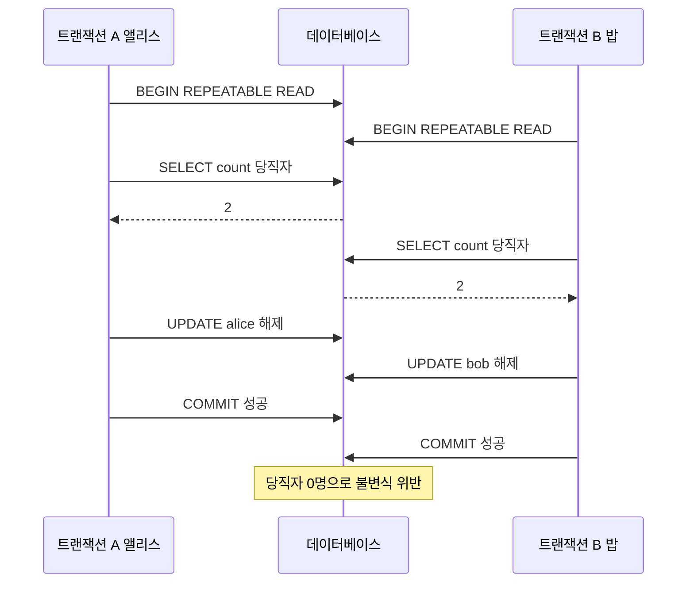

트랜잭션 격리 수준을 설명하는 글은 대개 더티 리드, 반복 불가능한 읽기, 팬텀 리드의 세 가지 이상 현상과 네 단계 표로 끝난다. 그런데 실제 서비스에서 문제를 일으키는 이상 현상은 이 세 가지 밖에 있는 경우가 많다. 잔액 갱신이 사라지는 lost update, 서로 다른 행을 고쳤는데 불변식이 깨지는 write skew가 대표적이다. 이 장은 표준이 왜 이 현상들을 놓쳤는지, 연구자들이 그것을 어떻게 보완했는지, 그리고 PostgreSQL·MySQL·Oracle·SQL Server가 같은 이름의 격리 수준 아래에서 실제로 무엇을 보장하는지를 다룬다.

## 이 장을 읽기 전에

선행 지식은 `BEGIN`/`COMMIT`을 쓰는 트랜잭션 사용법과 ACID의 의미다. 용어 사전 항목인 [ACID Transactions](/post/computerterms/acid-transactions/), [트랜잭션 격리 수준](/post/computerterms/transaction-isolation-levels/), [MVCC](/post/computerterms/mvcc/)를 읽었다면 더 수월하다. 이 장은 그 글들이 다루는 정의를 반복하지 않고, 정의가 놓친 부분에서 시작한다. 시리즈 전체의 구성은 [00. Introduction](/post/database-transactions/getting-started-database-transactions/)에 있다.

이 장의 깊이는 초급에서 중급이다. 이상 현상을 이름으로 구분하는 데서 시작해, 격리 수준을 의존성 그래프로 정의하는 Adya의 접근을 개념 수준에서 소개한다. 락·MVCC·SSI 같은 구현의 내부 동작과 분산 트랜잭션은 다루지 않는다. 구현은 뒤 장에서, 분산 환경은 06장에서 다룬다.

| 수준 | 읽을 부분 | 핵심 목표 |
|---|---|---|
| 처음 배우는 독자 | "표준이 정의한 세 가지 현상", "이상 현상 카탈로그", "오개념" | 현상을 구체적인 SQL 시나리오로 설명한다 |
| 실무 개발자 | "Write skew", "DBMS별 차이", "판단 기준" | 우리 서비스의 코드가 어느 현상에 취약한지 판단한다 |
| 심화 독자 | "표준의 허점과 Adya의 의존성 그래프" | 이상 현상을 그래프의 사이클로 이해한다 |

## 표준이 정의한 세 가지 현상

SQL 표준(ANSI SQL-92)은 격리 수준을 구현 방식이 아니라 <strong>현상(phenomenon)</strong>의 금지 목록으로 정의했다. 더티 리드(Dirty Read)는 커밋되지 않은 변경을 읽는 현상, 반복 불가능한 읽기(Non-repeatable Read)는 같은 행을 두 번 읽었는데 그 사이 다른 트랜잭션의 커밋 때문에 값이 달라지는 현상, 팬텀 리드(Phantom Read)는 같은 조건의 범위 조회가 두 번째에는 다른 행 집합을 돌려주는 현상이다. 네 수준은 이 세 현상을 얼마나 허용하는지로 구분된다. Read Uncommitted는 셋 모두를, Read Committed는 더티 리드만 막고, Repeatable Read는 팬텀만 허용하며, Serializable은 모두 막는다.

이 정의 방식에는 매력이 있다. 락이든 버전 관리든 구현을 지정하지 않으므로 DBMS가 자유롭게 설계할 수 있다. 그러나 이 자유가 문제의 씨앗이었다. 현상 목록이 불완전하면 "목록의 모든 현상이 막혔다"는 말이 "직렬 실행과 같다"는 말을 보장하지 못한다. PostgreSQL 공식 문서도 표준이 Serializable은 "직렬 실행과 같은 결과"라는 문장으로, 나머지 세 수준은 현상 목록으로 정의한다고 구분해서 서술한다. 표준 안에서 Serializable만 현상이 아니라 결과로 정의되어 있다는 사실이 핵심이다. 현상 목록이 완전했다면 두 정의가 일치해야 하지만, 실제로는 그렇지 않다.

## 표준의 허점과 Adya의 의존성 그래프

이 문제를 체계적으로 지적한 것이 Hal Berenson, Phil Bernstein, Jim Gray, Jim Melton, Elizabeth O'Neil, Patrick O'Neil의 논문 「A Critique of ANSI SQL Isolation Levels」(SIGMOD 1995)이다. 논문의 요지는 두 가지다. ANSI의 현상 정의는 모호해서 여러 해석이 가능하고, 해석에 따라 락 기반 구현이 표준 수준에 맞는지가 달라진다. 또한 표준에 없는 현상들, 즉 dirty write, lost update, read skew, write skew가 실제 시스템에서 중요하다. 이 논문은 여기에 더해 멀티버전 방식의 격리 유형인 <strong>스냅샷 격리(Snapshot Isolation)</strong>를 정의하고, 이것이 표준의 어느 수준에도 정확히 대응하지 않는다고 보였다. 논문은 [arXiv에 재게재된 판본](https://arxiv.org/abs/cs/0701157)으로 읽을 수 있다.

Atul Adya는 1999년 MIT 박사학위 논문 「Weak Consistency: A Generalized Theory and Optimistic Implementations for Distributed Transactions」(MIT-LCS-TR-786)에서 더 근본적인 방향을 택했다. 락이나 버전 같은 구현 용어를 쓰지 않고, 커밋된 트랜잭션 사이의 **의존성 그래프**로 격리 수준을 정의한 것이다. 트랜잭션 T1이 쓴 값을 T2가 덮어쓰면 쓰기-쓰기 의존성, T2가 T1이 쓴 값을 읽으면 쓰기-읽기 의존성, T1이 읽은 값을 T2가 이후에 덮어쓰면 읽기-쓰기 반의존성(anti-dependency)이 생긴다. 이 그래프에서 쓰기-쓰기 의존성만으로 이루어진 사이클을 금지하면 PL-1, 읽기 이상(커밋되지 않은 값이나 중간 값을 읽는 것, 사이클을 이루는 정보 흐름)까지 금지하면 PL-2, 반의존성을 포함한 모든 사이클을 금지하면 직렬 가능성에 해당하는 PL-3이다. 이 정의의 가치는 현상 목록을 늘리는 대신 "직렬 실행과 같은 결과를 내려면 그래프에 사이클이 없어야 한다"는 하나의 기준을 준다는 데 있다. 뒤에서 볼 write skew는 읽기-쓰기 반의존성 두 개가 서로를 향하는 사이클이다.

## 이상 현상 카탈로그

현실에서 마주치는 이상 현상을 이름으로 구분해 두면 버그를 분류하기가 쉬워진다. 다음 표의 앞 세 줄은 표준의 현상이고, 나머지 네 줄은 표준 밖에서 Berenson 등이 정리한 것이다.

| 현상 | 무슨 일이 벌어지는가 | 한 줄 예 |
|---|---|---|
| Dirty Read | 커밋되지 않은 값을 읽는다 | 롤백될 입금액을 보고 출금을 승인한다 |
| Non-repeatable Read | 같은 행을 두 번 읽었는데 값이 바뀐다 | 한 트랜잭션 안에서 잔액이 100, 이어서 130으로 읽힌다 |
| Phantom | 같은 조건의 범위 조회에 새 행이 나타나거나 사라진다 | 조건에 맞는 주문 수가 두 번째 조회에서 늘어난다 |
| Dirty Write | 아직 커밋되지 않은 다른 트랜잭션의 쓰기를 덮어쓴다 | A가 쓴 값 위에 B가 쓰고, A가 롤백하면 B의 값도 사라진다 |
| Read Skew | 서로 관련된 두 값을 읽는 사이에 다른 트랜잭션이 커밋해 불일치한 조합을 본다 | 계좌 A를 이체 전에, 계좌 B를 이체 후에 읽어 합계가 맞지 않는다 |
| Lost Update | 읽고 계산해 쓰는 사이 다른 트랜잭션의 갱신이 덮어써진다 | 두 요청이 같은 잔액 100을 읽고 각자 더해 쓰면 하나가 사라진다 |
| Write Skew | 서로 다른 행을 쓰지만, 둘이 읽은 공통 조건이 깨져 불변식이 위반된다 | 두 의사가 동시에 당직을 해제해 당직자가 0명이 된다 |

표의 현상 가운데 dirty write와 read skew는 두 세션의 순서로 보면 더 분명하다. dirty write는 아직 끝나지 않은 다른 트랜잭션이 쓴 값 위에 덮어쓰는 것이다. 계좌 1의 잔액이 100일 때 다음 순서가 허용된다면, A가 롤백할 때 되돌릴 값이 무엇인지 정할 수 없게 된다. Hermitage의 결과표(G0 열)에서 시험한 모든 수준이 이 현상을 막는다.

| 순서 | 세션 A | 세션 B |
|---|---|---|
| 1 | `UPDATE accounts SET balance = 50 WHERE id = 1;` | |
| 2 | | `UPDATE accounts SET balance = 70 WHERE id = 1;` (A가 끝나기 전에 덮어쓰려 한다) |
| 3 | `ROLLBACK;` | |

read skew는 서로 관련된 두 값을 읽는 사이에 다른 트랜잭션이 커밋해 어긋난 조합을 보는 것이다. 계좌 1과 2의 잔액이 각각 50이고 합계가 항상 100이어야 한다면, 다음 순서에서 A는 합계가 120인 상태를 본다.

| 순서 | 세션 A | 세션 B |
|---|---|---|
| 1 | `BEGIN;` `SELECT balance FROM accounts WHERE id = 1;` (50) | |
| 2 | | `UPDATE accounts SET balance = balance - 20 WHERE id = 1;` `UPDATE accounts SET balance = balance + 20 WHERE id = 2;` `COMMIT;` |
| 3 | `SELECT balance FROM accounts WHERE id = 2;` (70, 합계 120) | |

Read Committed는 문장마다 새 스냅샷을 읽으므로 3단계에서 B의 커밋 결과를 보아 위처럼 어긋난 합계가 나올 수 있다. 스냅샷을 트랜잭션 동안 유지하는 Repeatable Read에서는 A가 3단계에서도 B 이전의 값(50)을 읽어 합계가 100으로 유지된다.

각 현상이 어느 격리 수준에서 가능한지는 DBMS마다 다르다. 아래 표는 PostgreSQL 공식 문서의 서술을 기준으로 한다. 문서의 표는 더티 리드, 반복 불가능한 읽기, 팬텀, 직렬화 이상(serialization anomaly)의 네 열을 제공하며, 나머지 열은 그 서술에서 도출했다.

| 현상 | Read Committed | Repeatable Read | Serializable |
|---|---|---|---|
| Dirty Read | 불가 | 불가 | 불가 |
| Non-repeatable Read | 가능 | 불가 | 불가 |
| Phantom | 가능 | 불가 | 불가 |
| Read Skew | 가능 | 불가 | 불가 |
| Lost Update (읽고-계산해-쓰기) | 가능 | 불가: 직렬화 실패로 중단 | 불가 |
| Write Skew | 가능 | **가능** | 불가 |

표에서 눈여겨볼 곳은 PostgreSQL의 Repeatable Read 열이다. 표준은 이 수준에서 팬텀을 허용하지만 PostgreSQL은 팬텀도 막는다. 반대로 표준이 막아야 할 대상이 아닌 write skew는 이 수준에서 그대로 가능하다. 이는 PostgreSQL의 Repeatable Read가 사실상 스냅샷 격리이기 때문이며, 스냅샷 격리와 직렬 실행의 차이가 바로 write skew다. PostgreSQL 문서는 Read Uncommitted를 요청해도 Read Committed처럼 동작한다고 밝히고 있다. 이 DBMS에서는 더티 리드가 어떤 수준에서도 일어나지 않는다.

## 스냅샷 격리는 직렬 실행이 아니다

<strong>스냅샷 격리(Snapshot Isolation, SI)</strong>에서 각 트랜잭션은 시작 시점(또는 첫 문장 실행 시점)의 커밋된 데이터 스냅샷을 읽는다. 트랜잭션이 도는 동안 다른 트랜잭션이 커밋한 변경은 보이지 않는다. 쓰기 충돌은 같은 행을 두 트랜잭션이 갱신할 때만 감지되고, 먼저 커밋하거나 먼저 갱신한 쪽이 이기며 나머지는 중단된다. 읽기가 쓰기를 막지 않고 쓰기가 읽기를 막지 않으므로 동시성이 좋고, 일관된 스냅샷 덕분에 반복 불가능한 읽기와 read skew도 사라진다. 이런 장점 때문에 PostgreSQL의 Repeatable Read, SQL Server의 SNAPSHOT 수준이 이 방식을 쓴다. PostgreSQL 문서는 Repeatable Read 트랜잭션이 스냅샷 이후에 다른 트랜잭션이 갱신해 커밋한 행을 갱신하려 하면 `could not serialize access due to concurrent update` 오류로 중단된다고 설명하는데, 이것이 SI의 쓰기 충돌 감지다.

SI의 약점은 충돌을 **같은 행에 대한 쓰기**로만 정의한다는 점이다. 두 트랜잭션이 같은 조건을 읽고, 각자 서로 다른 행을 쓰면 쓰기-쓰기 충돌이 없으므로 둘 다 커밋된다. 이때 두 트랜잭션은 서로 상대의 쓰기를 보지 못한 채 판단했는데, 직렬 실행이라면 나중에 실행되는 쪽이 앞선 쓰기를 보고 다르게 행동했을 것이다. 앞서 본 의존성 그래프로 말하면, T1이 읽은 값을 T2가 덮어쓰고 T2가 읽은 값을 T1이 덮어써서 반의존성 사이클이 만들어진다.

### 당직 의사 예제

Martin Kleppmann의 『Designing Data-Intensive Applications』 7장이 소개한 당직 의사 예제를 SQL로 옮겨 보자. 병원 규칙은 "당직자가 항상 한 명 이상이어야 한다"이다. 앨리스와 밥이 모두 당직 중이고, 각자 당직 해제를 요청하면 시스템은 현재 당직자 수가 2명 이상일 때만 해제를 허용한다.

```sql
CREATE TABLE doctors (
    name    text PRIMARY KEY,
    on_call boolean NOT NULL
);
INSERT INTO doctors VALUES ('alice', true), ('bob', true);
```

두 트랜잭션이 아래 순서로 끼어들어 실행된다고 하자.



두 트랜잭션이 수정한 행은 각각 `alice`와 `bob`으로 서로 다르다. 같은 행에 대한 쓰기 충돌이 없으니 SI는 둘 다 통과시킨다. 각 트랜잭션은 자신의 스냅샷에서 "당직자가 2명"이라는 사실을 보고 판단했으므로 로컬하게는 올바른 결정이었다. 그러나 두 결정이 합쳐진 결과는 어떤 직렬 실행으로도 만들어질 수 없다. PostgreSQL의 Repeatable Read에서 위 순서대로 실행하면 두 `COMMIT`이 모두 성공하고 `SELECT count(*) FROM doctors WHERE on_call`이 0을 돌려줄 것이다. 이 결과는 공식 문서가 서술하는 스냅샷 격리의 규칙에서 도출한 예측이므로, `psql` 창 두 개로 다음 절차를 따라 직접 확인해 보기를 권한다.

| 순서 | 세션 A | 세션 B |
|---|---|---|
| 1 | `BEGIN ISOLATION LEVEL REPEATABLE READ;` | `BEGIN ISOLATION LEVEL REPEATABLE READ;` |
| 2 | `SELECT count(*) FROM doctors WHERE on_call;` (2) | `SELECT count(*) FROM doctors WHERE on_call;` (2) |
| 3 | `UPDATE doctors SET on_call = false WHERE name = 'alice';` | `UPDATE doctors SET on_call = false WHERE name = 'bob';` |
| 4 | `COMMIT;` | `COMMIT;` |
| 5 | 새 세션에서 `SELECT count(*) FROM doctors WHERE on_call;` | |

Repeatable Read로 실행하면 4단계에서 두 `COMMIT`이 모두 성공하고 5단계가 0을 돌려주어야 한다. 1단계의 격리 수준만 `SERIALIZABLE`로 바꾸어 같은 절차를 반복하면, 둘 중 한 `COMMIT`(또는 그 앞의 문장)이 `40001`로 실패하고 5단계는 1을 돌려주어야 한다. 이 비교가 깨진 코드, 원인, 고친 설정, 검증의 순서다. 단, 고친 설정에서 한 번 오류 없이 지나갔다는 사실이 안전의 증명은 아니다. 오류가 나지 않는 인터리빙도 있으므로 07장처럼 순서를 고정한 시나리오로 확인해야 한다.

### 해결책 세 가지

가장 간단한 해결은 Serializable로 올리는 것이다. 같은 순서를 `SERIALIZABLE`로 실행하면 PostgreSQL이 읽기-쓰기 의존성의 위험한 패턴을 감지해 둘 중 하나를 `could not serialize access due to read/write dependencies among transactions` 오류(SQLSTATE `40001`)로 중단시킨다. 애플리케이션은 이 오류를 받으면 트랜잭션 전체를 처음부터 재시도해야 한다. 중단된 쪽이 재시도하면 이번에는 당직자가 1명뿐임을 보고 해제를 거부한다.

두 번째는 읽은 행에 직접 잠금을 거는 것이다. 당직자 수를 세는 대신 해당 행들을 `SELECT ... FOR UPDATE`로 읽으면 두 트랜잭션이 같은 행들에 대해 서로를 기다리게 된다.

```sql
BEGIN;
SELECT name FROM doctors WHERE on_call = true FOR UPDATE;
-- 결과 행 수가 2 이상일 때만 아래를 실행
UPDATE doctors SET on_call = false WHERE name = 'alice';
COMMIT;
```

이 방법은 Repeatable Read와 Read Committed에서도 통하지만, 잠글 **행이 존재해야** 한다는 한계가 있다. 회의실 예약처럼 "이 시간대에 예약 행이 없는지 확인하고 새 행을 삽입"하는 write skew에서는 잠글 행 자체가 없다. 이런 팬텀 형태의 write skew에는 Serializable을 쓰거나, 유일 제약조건이나 배제 제약조건처럼 데이터베이스가 충돌을 직접 감지하도록 스키마를 설계해야 한다. 세 번째 방법이 바로 이 제약조건이다. 불변식을 `CHECK`나 `UNIQUE`, PostgreSQL의 `EXCLUDE` 제약조건으로 표현할 수 있다면 격리 수준과 무관하게 데이터베이스가 위반을 거부한다.

## Lost Update: 읽고, 계산하고, 쓰는 사이

lost update는 write skew보다 흔하다. 애플리케이션이 잔액을 읽어 코드에서 새 값을 계산한 뒤 그 값을 `UPDATE`로 써넣는 흔한 패턴이 원인이다.

초기 잔액이 100일 때 두 세션이 다음 순서로 실행된다고 하자.

| 순서 | 세션 A | 세션 B |
|---|---|---|
| 1 | `BEGIN;` | `BEGIN;` |
| 2 | `SELECT balance FROM accounts WHERE id = 1;` (100) | `SELECT balance FROM accounts WHERE id = 1;` (100) |
| 3 | 애플리케이션이 100 + 10 = 110을 계산한다 | 애플리케이션이 100 + 20 = 120을 계산한다 |
| 4 | `UPDATE accounts SET balance = 110 WHERE id = 1;` | |
| 5 | `COMMIT;` | |
| 6 | | `UPDATE accounts SET balance = 120 WHERE id = 1;` (A의 커밋 이후 진행) |
| 7 | | `COMMIT;` |

Read Committed에서는 B의 `UPDATE`가 A의 커밋을 기다렸다가 그대로 덮어써서 최종 잔액이 120이 되고 A의 +10이 사라진다. PostgreSQL의 Repeatable Read에서는 B의 `UPDATE`가 스냅샷 이후에 바뀐 행을 만나 직렬화 오류로 중단되므로 사라지는 갱신이 생기지 않는다. 같은 코드가 DBMS에 따라 안전하기도 하고 위험하기도 한 셈이다. MySQL InnoDB의 Repeatable Read에서는 사정이 다르다. 공식 문서에 따르면 스냅샷은 `SELECT`에 적용될 뿐 DML에는 반드시 적용되지 않으며, 다른 트랜잭션이 방금 커밋한 행을 `UPDATE`나 `DELETE`가 건드릴 수 있다. 이 서술로부터 위 시나리오의 B가 중단되지 않고 A의 값을 덮어쓸 수 있다고 추론할 수 있고, 이는 직접 재현해서 확인할 수 있다.

가장 확실한 해결은 읽고 쓰는 단계를 데이터베이스 안의 한 문장으로 합치는 것이다. `UPDATE accounts SET balance = balance + 10 WHERE id = 1`은 행 잠금 아래 현재 값을 읽어 갱신하므로 어느 격리 수준에서도 갱신이 사라지지 않는다. 그 밖에 `SELECT ... FOR UPDATE`로 읽는 시점부터 행을 잠그거나, 버전 컬럼을 두고 `WHERE version = :읽은버전`으로 갱신해 영향받은 행이 0이면 재시도하는 낙관적 방식도 있다. 이 패턴들은 05장에서 자세히 다룬다.

## DBMS별 차이

같은 이름의 격리 수준이 DBMS마다 다른 이유는 표준이 구현을 지정하지 않았기 때문이다. 아래 표는 각 벤더의 공식 문서가 서술하는 내용만 정리한 것이다.

| DBMS | 기본 수준 | 제공하는 수준과 구현 | 유의할 점 |
|---|---|---|---|
| PostgreSQL | Read Committed | Read Uncommitted는 Read Committed로 동작. Repeatable Read는 스냅샷 격리. Serializable은 SSI(예측 잠금 기반 충돌 감지) | Repeatable Read는 팬텀을 막지만 write skew는 허용. Serializable은 `40001`로 중단될 수 있음 |
| MySQL InnoDB | Repeatable Read | 일반 `SELECT`는 첫 읽기에서 만든 스냅샷을 사용. 잠금 읽기와 DML은 갭 락·next-key 락을 사용. Serializable은 autocommit이 꺼진 경우 일반 `SELECT`를 `SELECT ... FOR SHARE`로 변환 | DML은 스냅샷이 아닌 최신 커밋을 본다. Read Committed에서는 갭 락이 대부분 비활성화되어 팬텀 가능 |
| Oracle | Read Committed | Read Committed, Serializable, Read-Only 세 가지만 제공. Serializable은 트랜잭션 시작 이후 커밋된 변경이 있는 행을 갱신하면 `ORA-08177` | 문서는 Serializable에서 더티 리드·퍼지 리드·팬텀이 없다고 서술. 실제 동작은 아래 문단 참고 |
| SQL Server | Read Committed | 기본은 락 기반 Read Committed. `READ_COMMITTED_SNAPSHOT` 옵션을 켜면 문장 단위 행 버전 사용. SNAPSHOT 수준은 별도 옵션 필요. Serializable은 키 범위 락 | Azure SQL Database는 `READ_COMMITTED_SNAPSHOT`이 기본값이라 같은 이름의 수준도 설정에 따라 구현이 다르다 |

표에서 보듯 "Read Committed"만 해도 PostgreSQL에서는 문장마다 새 스냅샷을 읽는 방식이고, SQL Server 기본값에서는 읽는 동안 공유 락을 잡는 방식이다. 이 차이는 동시성 특성에 직접 영향을 준다. 락 기반에서는 읽기가 쓰기를 기다리고, 버전 기반에서는 기다리지 않는다. 격리 수준 이름은 DBMS 사이에서 이식되지 않으므로, 마이그레이션이나 멀티 DBMS 지원 시에는 수준 이름이 아니라 위 표의 구현 설명을 기준으로 재검증해야 한다. Oracle이 이 차이의 대표적인 사례다. 문서의 서술에는 write skew가 언급되지 않는데, 아래에서 소개하는 Hermitage의 시험 결과에서 Oracle의 "serializable"은 실제로 스냅샷 격리로 분류되며 write skew(G2-item)를 막지 못하고 술어 기반 write skew(G2)도 일부 허용한다. 같은 Serializable이라는 이름이 PostgreSQL에서는 write skew를 막고 Oracle에서는 막지 못하는 셈이므로, 이름이 아니라 시험 결과로 보장을 확인해야 한다. 이런 비교를 직접 해 보고 싶다면 Kleppmann이 DDIA의 배경 연구로 만든 [Hermitage](https://github.com/ept/hermitage)가 여러 DBMS에서 이상 현상별 결과를 표로 제공한다. Jepsen의 [일관성 모델 지도](https://jepsen.io/consistency)는 이 격리 수준들이 일관성 모델 전체에서 어디에 놓이는지 보여 준다.

## 재시도 없이는 안전하지 않다

Repeatable Read의 직렬화 실패나 Serializable의 `40001`은 DBMS가 이상 현상을 막는 방식이 "차단"이 아니라 "한 쪽을 중단"이기 때문에 생긴다. 이 오류를 사용자에게 그대로 노출하면 올바르게 동작하는 시스템이 사용자 경험에서는 간헐적 실패처럼 보인다. 따라서 높은 격리 수준을 쓴다면 애플리케이션이 재시도 루프를 갖추어야 한다. 아래 예제는 서드파티 라이브러리인 psycopg 3(`pip install "psycopg[binary]"`)으로 이를 구현한 것이며, 표준 라이브러리만으로 실행되는 이 시리즈의 다른 Python 모델과 달리 PostgreSQL 서버가 있어야 실행된다.

```python
import psycopg
from psycopg import errors


def run_serializable(conninfo, work, max_retries=5):
    """work(conn)을 SERIALIZABLE 트랜잭션으로 실행하고, 직렬화 실패 시 재시도한다."""
    for attempt in range(max_retries):
        try:
            with psycopg.connect(conninfo) as conn:
                conn.isolation_level = psycopg.IsolationLevel.SERIALIZABLE
                result = work(conn)
            return result
        except errors.SerializationFailure:
            continue
    raise RuntimeError("직렬화 실패가 반복되어 포기했다")


def go_off_call(conn, name):
    """work 의 예: 당직자가 2명 이상일 때만 해제를 허용한다."""
    (count,) = conn.execute("SELECT count(*) FROM doctors WHERE on_call").fetchone()
    if count < 2:
        return False
    conn.execute("UPDATE doctors SET on_call = false WHERE name = %s", (name,))
    return True


# 사용 예: run_serializable("dbname=hospital", lambda conn: go_off_call(conn, "alice"))
```

이 코드에서 `with` 블록은 정상 종료 시 커밋하고 예외가 나면 롤백한다. `40001`은 `work` 안의 문장뿐 아니라 커밋 시점에도 발생할 수 있어서, 재시도 단위는 개별 문장이 아니라 `work` 전체여야 한다. 또 `work`가 이메일 발송처럼 되돌릴 수 없는 부작용을 일으키면 재시도 때 중복 실행되므로, 부작용은 커밋 이후로 미루거나 멱등하게 설계해야 한다. 재시도 횟수 상한과 대기 시간 정책은 충돌률에 따라 정한다. 이 예제는 PostgreSQL이 문서화한 `40001` 동작에 근거한 골격이며, 실제 환경에서는 연결 풀과 지수 백오프를 결합하는 편이 일반적이다.

## 흔한 오개념

**"Repeatable Read면 같은 쿼리는 항상 같은 결과를 돌려주고 동시성 버그가 없다."** 일반 `SELECT`가 같은 스냅샷을 읽는다는 것은 사실이지만 두 가지 예외가 있다. PostgreSQL에서는 write skew가 가능하고, MySQL InnoDB에서는 DML이 스냅샷 밖의 최신 커밋을 건드린다. "같은 결과를 돌려준다"는 읽기에 대한 약속이지 불변식에 대한 약속이 아니다.

**"Serializable은 한 번에 하나씩 실행하는 것이다."** Serializable이 보장하는 것은 결과가 어떤 직렬 순서와 같다는 것이지 실제로 직렬 실행한다는 것이 아니다. PostgreSQL은 병렬로 실행하다가 위험한 의존성 구조를 감지하면 트랜잭션을 중단하는 낙관적 방식을, SQL Server와 MySQL InnoDB는 락을 오래 잡는 비관적 방식을 쓴다. 이 구현 차이가 재시도 필요 여부와 대기 비용을 결정한다.

**"격리 수준을 올리면 `SELECT ... FOR UPDATE`는 필요 없다."** 두 도구는 대체재가 아니다. Serializable은 모든 충돌을 사후에 감지해 중단시키고, `FOR UPDATE`는 필요한 행만 사전에 잠가 대기시킨다. 충돌이 잦은 핫 로우에서는 사전 잠금이 재시도 폭주보다 낫기도 하다. 반대로 잠글 행이 없는 팬텀형 write skew에는 `FOR UPDATE`가 소용없다.

**"격리 수준 이름은 DBMS 간에 같은 의미다."** 앞의 비교표가 보여 주듯 Read Committed, Repeatable Read, Serializable은 같은 이름이어도 구현과 허용 현상이 다르다. 이름은 표준이 정했고 보장은 각 DBMS 문서가 정한다.

## 판단 기준: 어떤 문제에 무엇을 쓸까

격리 수준은 "가장 높은 것"이 아니라 "필요한 불변식을 지키는 가장 싼 것"을 고르는 문제다. 다음 표는 증상에서 도구로 가는 대략의 지도다. 모든 경우에 정답은 아니며, 충돌 빈도와 트랜잭션 길이에 따라 달라진다.

| 증상·요구 | 우선 검토할 방법 | 이유 |
|---|---|---|
| 카운터·잔액처럼 `x = x + n` 갱신이 사라진다 | 단일 `UPDATE` 문으로 합치기 | 읽고-계산-쓰기 단계를 DB 안으로 이동해 lost update 제거 |
| 읽은 행을 바탕으로 같은 행을 갱신한다 | `SELECT ... FOR UPDATE` 또는 버전 컬럼 | 읽는 시점부터 충돌을 직렬화하거나 낙관적으로 감지 |
| 같은 조건을 읽고 서로 다른 행을 쓴다 (write skew) | 읽은 행 잠금, 불변식의 제약조건화, Serializable | 쓰기-쓰기 충돌이 없어 SI가 못 막음 |
| 조건에 맞는 행이 없음을 확인하고 삽입한다 | `UNIQUE`/`EXCLUDE` 제약조건 또는 Serializable | 잠글 행이 없으므로 `FOR UPDATE`로는 불가 |
| 여러 문장을 읽어 일관된 보고서를 만든다 | Repeatable Read(스냅샷) 읽기 전용 트랜잭션 | 하나의 스냅샷을 읽으므로 read skew가 없고, 쓰기를 하지 않으니 write skew의 당사자가 되지 않음 |
| 충돌이 드물고 정확성이 최우선이다 | Serializable과 재시도 루프 | 개발자가 이상 현상 목록을 일일이 추론하지 않아도 됨 |

## 이 장을 읽은 후 달성해야 할 목표

이 장을 읽은 후에는 다음을 할 수 있어야 한다. dirty write, read skew, lost update, write skew를 각각 두 세션의 SQL 순서로 설명할 수 있다. 표준의 세 가지 현상만으로는 Serializable과 동치가 되지 않는 이유를 Berenson 등과 Adya의 논점으로 설명할 수 있다. PostgreSQL의 Repeatable Read가 팬텀을 막지만 write skew를 허용하는 이유를 스냅샷 격리의 충돌 정의로 설명할 수 있다. 사고 보고서를 읽고 해당 이상 현상과 현재 격리 수준에서의 발생 가능성을 판단할 수 있다. 증상별로 단일 `UPDATE`, 행 잠금, 제약조건, Serializable과 재시도 중 하나를 골라 비용과 함께 설명할 수 있다.

## 다음 장에서는

[02장: 스냅샷 격리와 MVCC 구현](/post/database-transactions/snapshot-isolation-and-mvcc/)에서는 스냅샷 격리가 내부에서 어떻게 구현되는지, 즉 PostgreSQL의 튜플 버전과 InnoDB의 undo 로그가 "같은 스냅샷을 보여 준다"는 약속을 어떻게 지키는지를 비교한다. 이 장에서 이상 현상을 어휘로 정립했으므로, 02장에서는 각 이상 현상이 어떤 구현 선택의 결과로 허용되는지를 설명할 수 있게 된다.

## 참고 자료

- [Berenson et al., A Critique of ANSI SQL Isolation Levels (SIGMOD 1995)](https://arxiv.org/abs/cs/0701157) — ANSI 현상 정의의 모호성과 snapshot isolation, write skew의 정의
- [Adya, Weak Consistency: A Generalized Theory and Optimistic Implementations for Distributed Transactions (MIT-LCS-TR-786, 1999)](https://dspace.mit.edu/handle/1721.1/149899) — 의존성 그래프에 의한 격리 수준 정의
- [PostgreSQL Documentation: Transaction Isolation](https://www.postgresql.org/docs/current/transaction-iso.html) — Read Uncommitted의 동작, Repeatable Read, Serializable의 `40001`
- [PostgreSQL Documentation: Serialization Failure Handling](https://www.postgresql.org/docs/current/mvcc-serialization-failure-handling.html) — 직렬화 실패 시 재시도 권고
- [MySQL 8.4 Reference Manual: InnoDB Transaction Isolation Levels](https://dev.mysql.com/doc/refman/8.4/en/innodb-transaction-isolation-levels.html) — 격리 수준별 일관 읽기와 잠금 동작
- [MySQL 8.4 Reference Manual: Consistent Nonlocking Reads](https://dev.mysql.com/doc/refman/8.4/en/innodb-consistent-read.html) — 스냅샷이 DML에는 그대로 적용되지 않는다는 서술
- [Oracle Database Concepts: Data Concurrency and Consistency](https://docs.oracle.com/en/database/oracle/oracle-database/19/cncpt/data-concurrency-and-consistency.html) — Read Committed와 Serializable, `ORA-08177`
- [SET TRANSACTION ISOLATION LEVEL (Transact-SQL)](https://learn.microsoft.com/en-us/sql/t-sql/statements/set-transaction-isolation-level-transact-sql) — SQL Server의 수준별 락·행 버전 동작
- [Hermitage](https://github.com/ept/hermitage) — DBMS별 이상 현상 결과를 비교하는 테스트 모음
- [Jepsen: Consistency Models](https://jepsen.io/consistency) — 격리 수준과 일관성 모델의 계층도
- [Designing Data-Intensive Applications](https://dataintensive.net/) — 7장 Transactions: 당직 의사 예제와 write skew 논의
