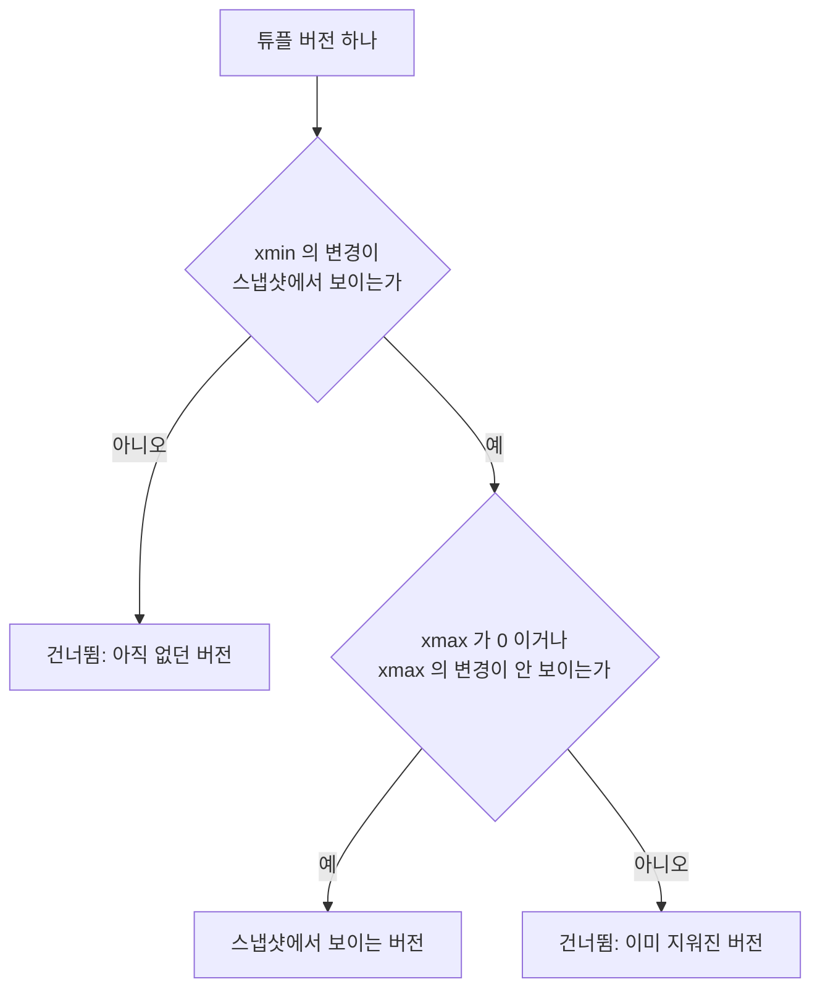
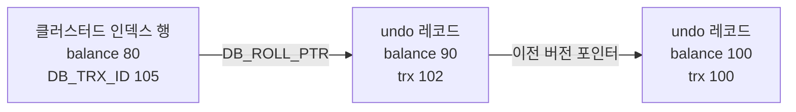

01장에서 PostgreSQL의 Repeatable Read는 팬텀을 막지만 write skew는 막지 못한다고 했다. 이 비대칭은 우연이 아니라 스냅샷을 구현하는 방식에서 곧바로 따라 나온다. 이 장은 "스냅샷 격리"라는 이름 뒤에서 데이터가 실제로 어떻게 저장되고 어떤 규칙으로 읽히는지를 PostgreSQL과 MySQL InnoDB 두 구현으로 나란히 살펴본다. 두 DBMS는 같은 약속, 즉 "트랜잭션은 자신의 스냅샷만 본다"를 정반대의 저장 전략으로 지킨다. 그 차이가 장기 트랜잭션의 비용, 롤백 비용, 쓰기 충돌 처리, 그리고 운영 중 봐야 할 지표를 결정한다.

## 이 장을 읽기 전에

[01장: 격리 수준과 이상 현상](/post/database-transactions/isolation-levels-and-anomalies/)에서 정립한 이상 현상 어휘와 스냅샷 격리의 정의를 안다고 가정한다. [MVCC](/post/computerterms/mvcc/) 용어 사전 항목에서 `xmin`/`xmax`를 처음 소개했으므로, 이 장은 그 설명을 반복하지 않고 스냅샷이 어떤 값으로 표현되는지, 가시성이 어떤 순서로 판정되는지부터 시작한다.

이 장의 깊이는 중급에서 심화다. 락 기반 구현(2PL, next-key lock)은 03장에서, SSI를 통한 Serializable 구현은 04장에서 다룬다. PostgreSQL의 HOT 갱신, 인덱스 가시성 처리, 서브트랜잭션, InnoDB 내부 자료구조의 소스 수준 이름은 범위 밖이다.

| 수준 | 읽을 부분 | 핵심 목표 |
|---|---|---|
| 처음 배우는 독자 | "스냅샷은 복사본이 아니다", "구현 비교", "오개념" | 두 DBMS의 저장 전략 차이를 설명한다 |
| 실무 개발자 | "쓰기 충돌은 어떻게 처리되나", "운영에서 확인할 것" | 장기 트랜잭션 문제를 지표로 진단한다 |
| 심화 독자 | "PostgreSQL의 스냅샷과 가시성 규칙", "장난감 구현" | 가시성 판정 규칙을 코드로 재현한다 |

## 스냅샷은 복사본이 아니다

"트랜잭션이 시작할 때의 스냅샷"이라는 표현은 데이터베이스 전체를 복사해 두었다는 인상을 준다. 실제로는 어떤 DBMS도 데이터를 복사하지 않는다. 스냅샷은 데이터가 아니라 **가시성 규칙**이다. "어느 트랜잭션이 쓴 변경은 보고, 어느 변경은 못 본 것으로 취급할지"를 정하는 작은 메타데이터와, 그 규칙에 따라 옛 값을 복원할 수 있도록 옛 버전을 남겨 두는 저장 방식이 합쳐져 스냅샷처럼 보이는 것이다.

이 정의는 두 가지를 즉시 설명해 준다. 첫째, 스냅샷을 만드는 비용은 데이터 크기와 무관하다. 규칙만 기록하면 되기 때문이다. 둘째, 스냅샷을 오래 유지하는 비용은 데이터가 아니라 **옛 버전을 얼마나 오래 보관해야 하느냐**로 나타난다. 어느 트랜잭션이든 자신의 스냅샷이 필요로 하는 버전이 남아 있어야 하므로, 오래 열린 트랜잭션은 그 시점 이후 생긴 모든 옛 버전의 청소를 막는다. 이 비용이 어디에 쌓이는지가 PostgreSQL과 InnoDB의 가장 큰 차이다.

## PostgreSQL의 스냅샷과 가시성 규칙

PostgreSQL은 행을 바꿀 때 기존 행을 그 자리에서 고치지 않고 새 **튜플 버전**을 만든다. 공식 문서는 `xmin`을 "이 행 버전을 삽입한 트랜잭션의 ID", `xmax`를 "삭제한 트랜잭션의 ID, 삭제되지 않았다면 0"이라고 정의하며, `UPDATE`는 이전 버전에 `xmax`를 채우고 새 버전을 삽입하는 것으로 구현된다. 문서는 `xmax`가 0이 아닌데도 보이는 행 버전이 있을 수 있다고 덧붙이는데, 삭제한 트랜잭션이 아직 커밋하지 않았거나 삭제 시도가 롤백된 경우다. 가시성 판정이 단순히 `xmax`가 있는지가 아니라 그 `xmax`를 가진 트랜잭션이 스냅샷 입장에서 보이는지에 달려 있다는 뜻이다.

스냅샷은 세 값으로 표현된다. `pg_current_snapshot()`이 돌려주는 텍스트 형식은 `xmin:xmax:xip_list`이며 문서의 예는 `10:20:10,14,15`이다. 문서의 정의에 따르면 `xmin`은 스냅샷 시점에 아직 활성이던 가장 작은 트랜잭션 ID로, 이보다 작은 ID는 모두 커밋되었거나 롤백으로 끝났다. `xmax`는 완료된 트랜잭션 ID 중 가장 큰 값의 다음 값으로, 이 이상인 ID는 스냅샷 시점에 아직 끝나지 않았으므로 보이지 않는다. `xip_list`는 스냅샷 시점에 진행 중이던 트랜잭션 목록이다. `xmin <= X < xmax`이면서 이 목록에 없는 ID는 스냅샷 시점에 이미 끝난 트랜잭션이며, 커밋되었으면 보이고 롤백되었으면 죽은 것으로 본다.

이 세 값만 있으면 튜플 버전의 가시성을 판정할 수 있다. 판정은 두 단계다. 먼저 이 버전을 만든 트랜잭션(`xmin`)의 변경이 스냅샷에서 보이는지 본다. 보이지 않으면 이 버전은 존재하지 않는 것으로 취급한다. 보인다면 이 버전을 지운 트랜잭션(`xmax`)이 있는지, 있다면 그 삭제가 스냅샷에서 보이는지 본다. 삭제가 보이면 이미 지워진 버전이므로 건너뛰고, 보이지 않으면 이 버전이 스냅샷에서 살아 있는 버전이다. 아래 그림은 이 순서를 한 장에 정리한 것이다. 트랜잭션 ID가 스냅샷에서 "보이는지"는 자기 자신이면 보이고, `xmax` 이상이거나 `xip_list`에 있으면 안 보이며, 그 외에는 커밋 여부로 결정한다.



실제 튜플 버전은 `pageinspect` 확장으로 직접 볼 수 있다. 다음은 한 행을 삽입한 뒤 갱신하고, 힙 페이지에 남은 두 튜플의 헤더를 조회하는 예다. 확장 설치에는 슈퍼유저 권한이 필요하고, 결과는 다른 활성 트랜잭션이 없는 개발용 DB를 기준으로 한다.

```sql
CREATE EXTENSION IF NOT EXISTS pageinspect;
CREATE TABLE acct (id int PRIMARY KEY, balance int);
INSERT INTO acct VALUES (1, 100);
UPDATE acct SET balance = 90 WHERE id = 1;

SELECT lp, t_xmin, t_xmax, t_ctid
FROM heap_page_items(get_raw_page('acct', 0));
```

결과에는 두 줄이 나온다. 첫 줄은 삽입 트랜잭션이 `t_xmin`이고, 갱신 트랜잭션이 `t_xmax`로 채워진 옛 튜플이며 `t_ctid`가 두 번째 튜플을 가리킨다. 두 번째 줄은 갱신 트랜잭션이 `t_xmin`이고 `t_xmax`가 0인 새 튜플이다. 같은 논리적 행이 물리적으로 두 줄 공존하고, 어느 쪽이 보이는지는 읽는 쪽의 스냅샷이 결정한다. 이 옛 튜플은 어떤 스냅샷도 더는 필요로 하지 않을 때 `VACUUM`이 회수한다. 트랜잭션 ID가 32비트이므로 공식 문서는 모든 테이블을 20억 트랜잭션마다 적어도 한 번은 vacuum해야 ID 순환(wraparound)으로 과거 트랜잭션이 미래처럼 보이는 사고를 막을 수 있다고 경고한다.

## InnoDB의 undo 체인과 read view

InnoDB는 반대로 행을 **제자리에서 갱신**한다. 클러스터드 인덱스의 행에는 숨은 필드가 붙는다. 공식 문서에 따르면 `DB_TRX_ID`(6바이트)는 그 행을 마지막으로 삽입하거나 갱신한 트랜잭션의 ID이고, 삭제는 행에 삭제 표시 비트를 세우는 갱신으로 취급된다. `DB_ROLL_PTR`(7바이트)는 롤백 세그먼트에 기록된 undo 로그 레코드를 가리키며, 행이 갱신되었다면 그 레코드에 갱신 전 내용을 복원하는 데 필요한 정보가 담겨 있다. 옛 값은 테이블이 아니라 undo 로그에 있다.

일관 읽기(consistent read)는 이 체인을 거슬러 올라가며 이루어진다. 읽는 트랜잭션은 자신의 스냅샷(read view)에서 현재 행의 `DB_TRX_ID`가 보이는지 확인하고, 보이지 않으면 `DB_ROLL_PTR`을 따라 undo 레코드에서 이전 버전을 복원해 다시 확인한다. 이 과정은 가시성이 확인될 때까지 반복된다. 공식 용어집은 일관 읽기를 "다른 트랜잭션의 변경과 무관하게 특정 시점을 기준으로 결과를 보여 주며, 데이터가 바뀌었다면 undo 로그의 내용으로 원래 데이터를 복원한다"는 취지로 정의한다. read view가 내부적으로 어떤 필드로 구성되는지는 버전에 따라 다르므로 여기서는 개념만 사용한다. 개념적으로는 PostgreSQL의 `xmin:xmax:xip_list`와 같이, "스냅샷을 만든 시점에 활성이던 트랜잭션 집합"으로 어떤 `DB_TRX_ID`가 보이는지를 판정하는 구조다.

undo 로그는 두 종류다. 삽입 undo는 롤백에만 필요하므로 커밋 직후 버릴 수 있고, 갱신 undo는 일관 읽기에도 쓰이므로 이 버전을 필요로 하는 스냅샷이 하나도 남지 않을 때까지 버릴 수 없다. 삭제도 즉시 물리적으로 일어나지 않는다. 문서에 따르면 InnoDB는 삭제를 기록한 갱신 undo 레코드를 폐기할 때 비로소 행과 인덱스 레코드를 물리적으로 제거하며, 이 작업을 **purge**라고 부른다. 아래 그림은 한 행이 두 번 갱신된 뒤의 구조다. 최신 값은 테이블에 있고 옛 값들은 undo로 연결된다.



## 두 구현의 비교

같은 스냅샷 약속을 정반대로 구현한 결과를 표로 모았다. 표의 행들은 서로 독립적이지 않다. 대부분 "옛 버전이 테이블 안에 있는가, 밖에 있는가"라는 하나의 선택에서 파생된다.

| 항목 | PostgreSQL | MySQL InnoDB |
|---|---|---|
| 갱신 방식 | 새 튜플 버전을 삽입하고 옛 버전에 `xmax`를 기록 | 행을 제자리에서 갱신하고 이전 값은 undo에 기록 |
| 옛 버전의 위치 | 같은 테이블의 힙(heap) | 롤백 세그먼트의 undo 로그 |
| 옛 버전 접근 | 같은 페이지·테이블에서 버전을 스캔해 가시성 판정 | 현재 행에서 `DB_ROLL_PTR`을 따라 거슬러 올라가며 복원 |
| 청소 주체 | `VACUUM`(autovacuum) | purge 스레드 |
| 장기 트랜잭션의 비용 | 죽은 튜플이 테이블에 쌓여 **테이블 팽창** | undo 로그가 커져 undo 테이블스페이스 증가 |
| 롤백(일반적 구현 설명) | 튜플을 지우지 않고 해당 트랜잭션을 "중단됨"으로 취급해 가시성에서 제외하므로 롤백 자체는 가볍고, 남은 튜플의 정리는 VACUUM의 몫 | undo 로그가 롤백에도 쓰이므로(공식 문서가 삽입 undo를 롤백 전용으로 설명) 변경한 만큼 undo를 되돌려 적용해야 하며 비용이 변경량에 따라 늘어남 |
| 트랜잭션 ID | 32비트이며 순환 방지를 위한 vacuum 필요 | `DB_TRX_ID`는 6바이트 |

운영에서 가장 크게 체감되는 차이는 장기 트랜잭션이다. PostgreSQL에서는 오래 열린 스냅샷이 vacuum의 청소를 막아 테이블과 인덱스가 부풀고, 부푼 테이블을 읽는 모든 쿼리가 느려진다. InnoDB에서는 undo 로그가 커져 옛 버전을 거슬러 올라가는 읽기가 길어지고 undo 테이블스페이스가 늘어난다. 공식 문서는 일관 읽기만 하는 트랜잭션까지 포함해 트랜잭션을 정기적으로 커밋하라고 권고하는데, 그렇지 않으면 InnoDB가 갱신 undo에서 데이터를 버릴 수 없어 롤백 세그먼트가 너무 커져 undo 테이블스페이스를 채울 수 있다고 설명한다. 읽기 전용이라고 해서 열어 둔 트랜잭션이 공짜가 아닌 이유다.

## 스냅샷은 언제 만들어지는가

같은 "Repeatable Read"라도 스냅샷이 만들어지는 시점이 다르다. PostgreSQL 문서는 Repeatable Read 트랜잭션의 쿼리가 트랜잭션이 시작한 시점이 아니라 트랜잭션의 첫 번째 비(非)트랜잭션 제어 문장이 시작한 시점의 스냅샷을 본다고 서술한다. 즉 `BEGIN` 직후 한참 있다가 첫 `SELECT`를 실행하면, 스냅샷은 `BEGIN`이 아니라 그 `SELECT` 시점에 만들어진다. Read Committed에서는 문장마다 새 스냅샷을 만든다.

InnoDB의 Repeatable Read는 첫 일관 읽기에서 스냅샷을 만든다. 문서는 같은 트랜잭션 안의 일관 읽기들이 첫 읽기가 만든 스냅샷을 읽는다고 설명한다. `BEGIN`만으로는 스냅샷이 생기지 않고, 첫 일반 `SELECT`가 실행될 때 생긴다. InnoDB에는 `START TRANSACTION WITH CONSISTENT SNAPSHOT`처럼 시작과 동시에 스냅샷을 만드는 구문도 있다. InnoDB의 Read Committed에서는 일관 읽기마다 새 스냅샷을 만든다. 정리하면 두 DBMS 모두 "트랜잭션 시작 시점의 스냅샷"이라는 말은 엄밀히 틀렸고, 첫 읽기 시점이라는 말이 정확하다. 이 차이는 "BEGIN 후 검증 로직이 실행되기까지의 틈"에서 다른 트랜잭션의 커밋이 끼어들 때 중요해진다.

## 쓰기 충돌은 어떻게 처리되나

스냅샷은 읽기의 규칙이다. 쓰기는 항상 **최신 커밋 상태**를 대상으로 해야 하므로 스냅샷만으로는 처리할 수 없고, 별도의 충돌 처리가 필요하다. 이 부분이 01장의 lost update 비교가 갈리는 지점이다.

PostgreSQL의 Read Committed에서 `UPDATE`가 다른 트랜잭션이 아직 커밋하지 않은 갱신을 만나면, 그 트랜잭션이 끝나기를 기다린다. 문서에 따르면 첫 번째 갱신자가 롤백하면 두 번째 갱신자는 원래 찾은 행을 그대로 갱신하고, 커밋하면 갱신된 행에 대해 작업을 시도하며 이때 `WHERE` 조건을 다시 평가해 갱신된 버전이 여전히 조건에 맞는지 확인한다. Repeatable Read에서는 같은 상황에서 첫 갱신자가 롤백하면 계속 진행하지만, 커밋했다면 `ERROR: could not serialize access due to concurrent update`로 중단된다. 스냅샷 시점 이후에 커밋된 변경을 덮어쓸 수 없다는 규칙이며, 이 방식을 흔히 first-updater-wins라고 부른다. 같은 문서는 갱신 트랜잭션만 재시도가 필요할 수 있고 읽기 전용 트랜잭션은 직렬화 충돌을 겪지 않는다고 명시한다.

InnoDB는 다른 길을 택한다. 문서에 따르면 스냅샷은 `SELECT`에 적용되며 DML에 반드시 적용되는 것은 아니다. 다른 트랜잭션이 방금 커밋한 행을 `UPDATE`나 `DELETE`가 건드릴 수 있고, 그렇게 갱신된 행은 이후 같은 트랜잭션의 `SELECT`에서 보이게 된다. 즉 DML은 스냅샷이 아니라 최신 커밋을 읽는 "current read"로 동작한다. 그래서 InnoDB의 Repeatable Read에서는 스냅샷 이후에 바뀐 행도 기다렸다가 최신 값 위에 갱신한다. 이 설계는 직렬화 오류를 내지 않는 대신, 읽고 계산해서 쓰는 패턴에서 lost update를 허용한다.

## 이제 write skew가 허용되는 이유를 구조로 설명할 수 있다

01장의 당직 의사 시나리오를 이 장의 용어로 다시 보자. 앨리스 트랜잭션과 밥 트랜잭션은 모두 같은 스냅샷 규칙으로 "당직자 2명"을 읽는다. 읽기는 튜플에 아무 흔적도 남기지 않는다. `SELECT`는 `xmax`를 건드리지 않고 undo도 만들지 않는다. 이어서 각자 서로 다른 튜플을 갱신하는데, 충돌 검사는 "내가 갱신하려는 이 튜플의 `xmax`가 이미 채워졌는가"만 본다. 앨리스의 튜플과 밥의 튜플은 서로 다른 튜플이므로 두 갱신 모두 충돌 없이 진행된다. 읽은 값과 쓴 값 사이의 의존성(내가 읽은 것을 상대가 바꾼다)은 어디에도 기록되지 않는다. 쓰기-쓰기 충돌만 감지하는 구조에서 읽기-쓰기 반의존성은 보이지 않으므로, write skew는 버그가 아니라 설계의 필연적 귀결이다.

이 관점은 해결책의 작동 원리도 설명한다. PostgreSQL 문서는 `SELECT FOR UPDATE`가 선택한 행을 잠금 표시하기 위해 행을 수정하며 그래서 디스크 쓰기가 일어날 수 있다고 설명한다. 읽은 행에 잠금 표시를 남기면 읽기가 "흔적이 없는" 연산에서 "충돌을 만드는" 연산으로 바뀌고, 그제서야 상대 트랜잭션의 갱신이 그 표시와 부딪혀 대기하게 된다. 반면 Serializable(PostgreSQL의 SSI)은 읽기-쓰기 의존성을 별도로 추적하는 장치를 추가한 것이다. 이는 04장에서 다룬다.

## 장난감 구현으로 확인하기

가시성 규칙이 write skew를 어떻게 만드는지 코드로 확인해 보자. 다음 Python 코드는 PostgreSQL 방식의 스냅샷 가시성만 떼어 낸 교육용 모델이다. `xmin`, `xmax`, `xip` 세 값과 커밋 집합만으로 가시성을 판정하고, 갱신할 튜플에 이미 `xmax`가 있으면 충돌로 처리한다. 롤백(aborted)은 모델에서 생략했으므로 실제 PostgreSQL의 동작과 같지 않으며, 규칙의 골격만 보여 주기 위한 것이다.

```python
"""스냅샷 가시성 규칙만 떼어 낸 교육용 장난감 MVCC (PostgreSQL 소스가 아님)."""


class Conflict(Exception):
    pass


class Db:
    def __init__(self):
        self.next_xid, self.active, self.committed = 1, set(), set()
        self.tuples = []  # 각 원소: {"xmin", "xmax", "name", "on_call"}

    def begin(self):
        xid = self.next_xid
        self.next_xid += 1
        snap = {"xmin": min(self.active | {xid}), "xmax": self.next_xid,
                "xip": set(self.active)}
        self.active.add(xid)
        return xid, snap

    def commit(self, xid):
        self.active.discard(xid)
        self.committed.add(xid)

    def _seen(self, x, xid, snap):
        """트랜잭션 x의 변경이 (xid, snap) 입장에서 보이는가."""
        if x == xid:
            return True
        if x >= snap["xmax"] or x in snap["xip"]:
            return False
        return x in self.committed

    def rows(self, xid, snap):
        return [t for t in self.tuples
                if self._seen(t["xmin"], xid, snap)
                and not (t["xmax"] and self._seen(t["xmax"], xid, snap))]

    def set_on_call(self, xid, snap, name, value):
        old = next(t for t in self.rows(xid, snap) if t["name"] == name)
        if old["xmax"]:  # 같은 튜플을 이미 다른 트랜잭션이 갱신함
            raise Conflict(f"could not serialize access: {name} 는 xid {old['xmax']} 가 먼저 갱신")
        old["xmax"] = xid
        self.tuples.append({"xmin": xid, "xmax": 0, "name": name, "on_call": value})


def count_on_call(db, xid, snap):
    return sum(t["on_call"] for t in db.rows(xid, snap))


db = Db()
setup, s = db.begin()
for n in ("alice", "bob"):
    db.tuples.append({"xmin": setup, "xmax": 0, "name": n, "on_call": True})
db.commit(setup)

a, sa = db.begin()
b, sb = db.begin()
print("A가 본 당직자 수:", count_on_call(db, a, sa))
print("B가 본 당직자 수:", count_on_call(db, b, sb))
db.set_on_call(a, sa, "alice", False)   # 서로 다른 튜플을 갱신
db.set_on_call(b, sb, "bob", False)
db.commit(a)
db.commit(b)
c, sc = db.begin()
print("두 커밋 이후 당직자 수:", count_on_call(db, c, sc))

# 같은 행을 건드리면 스냅샷 격리도 충돌을 감지한다
db2 = Db()
x, sx = db2.begin()
db2.tuples.append({"xmin": x, "xmax": 0, "name": "alice", "on_call": True})
db2.commit(x)
p, sp = db2.begin()
q, sq = db2.begin()
db2.set_on_call(p, sp, "alice", False)
db2.commit(p)
try:
    db2.set_on_call(q, sq, "alice", False)
except Conflict as e:
    print("같은 행 충돌:", e)
```

이 코드를 Python 3으로 실행하면 다음 출력이 나온다.

```text
A가 본 당직자 수: 2
B가 본 당직자 수: 2
두 커밋 이후 당직자 수: 0
같은 행 충돌: could not serialize access: alice 는 xid 2 가 먼저 갱신
```

앞 세 줄이 write skew다. 두 트랜잭션은 같은 스냅샷 규칙으로 2명을 보았고, 서로 다른 튜플을 갱신해 충돌 검사를 통과했으며, 커밋 이후에는 당직자가 0명이 된다. 네 번째 줄은 같은 행을 건드릴 때 스냅샷 격리가 충돌을 감지하는 경우다. 모델이 감지하는 것은 "튜플의 `xmax`가 이미 채워졌는가"뿐이라는 점이 핵심이다. 읽기 의존성을 기록하는 코드는 어디에도 없다.

## 운영에서 확인할 것

장기 트랜잭션은 두 DBMS 모두에서 가장 먼저 의심해야 할 원인이다. PostgreSQL에서는 `pg_stat_activity`로 오래된 스냅샷을 가진 세션을 찾는다.

```sql
SELECT pid, state, now() - xact_start AS xact_age, backend_xmin
FROM pg_stat_activity
WHERE backend_xmin IS NOT NULL
ORDER BY age(backend_xmin) DESC
LIMIT 5;
```

`backend_xmin`은 해당 세션이 의존하는 가장 오래된 트랜잭션 ID이고 `age()`는 그 ID가 현재와 얼마나 떨어져 있는지를 나타낸다. 맨 위에 오래된 `backend_xmin`을 가진 세션이 있다면 그 세션이 vacuum의 청소를 막고 있을 가능성이 크다. 특히 `idle in transaction` 상태가 오래 지속되는 세션이 흔한 원인이다. InnoDB에서는 `SHOW ENGINE INNODB STATUS`의 TRANSACTIONS 절에 나오는 `History list length`가 아직 purge되지 않은 undo 레코드의 양을 대략 보여 준다. 이 값이 계속 증가한다면 오래 열린 트랜잭션이 purge를 막고 있다는 신호다. 두 지표 모두 절대적 임계값은 워크로드에 따라 다르므로, 평소 값을 기준선으로 기록해 두고 이탈을 보는 편이 실용적이다.

## 흔한 오개념

<strong>"스냅샷은 시작 시점에 데이터를 복사해 두는 것이다."</strong> 어느 DBMS도 데이터를 복사하지 않는다. 스냅샷은 가시성 규칙이고, 옛 값은 PostgreSQL에서는 같은 테이블의 옛 튜플 버전에, InnoDB에서는 undo 로그에 남아 있다. 그래서 스냅샷 생성은 싸지만 오래 유지하면 옛 버전 보관 비용이 든다.

<strong>"트랜잭션을 시작하는 순간 스냅샷이 만들어진다."</strong> PostgreSQL은 첫 비(非)트랜잭션 제어 문장 시점, InnoDB는 첫 일관 읽기 시점이다. `BEGIN`만 하고 오래 기다린 뒤 첫 쿼리를 실행하면 스냅샷은 그 쿼리 시점에 만들어진다.

**"InnoDB도 PostgreSQL처럼 옛 버전이 테이블에 쌓인다."** InnoDB의 옛 버전은 테이블이 아니라 undo 로그에 있고, 테이블에는 최신 버전만 있다. 장기 트랜잭션의 비용이 나타나는 곳이 테이블 팽창과 undo 증가로 서로 다르다.

**"읽기 전용 트랜잭션은 열어 두어도 부담이 없다."** 읽기 전용 트랜잭션도 자신의 스냅샷이 필요로 하는 옛 버전의 청소를 막는다. InnoDB 문서가 일관 읽기만 하는 트랜잭션도 정기적으로 커밋하라고 권고하는 이유다. PostgreSQL에서는 읽기 전용 Repeatable Read 트랜잭션이 직렬화 충돌을 겪지 않는다는 장점이 있지만, 그것이 스냅샷 유지 비용이 없다는 뜻은 아니다.

## 판단 기준

장기 트랜잭션이나 갱신 충돌 문제를 마주쳤을 때 이 장의 지식이 어떻게 쓰이는지 정리한 표다.

| 증상 | 의심할 원인 | 확인 방법 | 대응 |
|---|---|---|---|
| PostgreSQL 테이블·인덱스가 계속 커지고 쿼리가 느려진다 | 오래된 스냅샷이 vacuum을 막음 | `pg_stat_activity`의 `backend_xmin`, `idle in transaction` | 장기 트랜잭션 단축, 읽기 전용 복제본으로 분리 |
| InnoDB undo 테이블스페이스가 커진다 | 오래된 read view가 purge를 막음 | `History list length` 추이 | 읽기 전용 트랜잭션까지 정기 커밋 |
| 동시 갱신에서 `could not serialize access`가 난다 | 스냅샷 이후 커밋된 행을 갱신하려 함 | 오류 메시지, SQLSTATE `40001` | 트랜잭션 전체 재시도 |
| InnoDB에서 읽은 값 기반 갱신이 사라진다 | DML은 current read로 최신 커밋을 덮어씀 | 같은 시나리오를 두 세션에서 재현 | 단일 `UPDATE`, `FOR UPDATE`, 버전 컬럼 |
| 서로 다른 행을 갱신했는데 불변식이 깨진다 | 읽기-쓰기 의존성이 추적되지 않음 | 01장의 write skew 패턴 | 읽은 행 잠금, 제약조건, Serializable |

## 이 장을 읽은 후 달성해야 할 목표

이 장을 읽은 후에는 다음을 할 수 있어야 한다. 스냅샷이 데이터 복사본이 아니라 가시성 규칙임을 설명하고, PostgreSQL의 `xmin:xmax:xip_list`로 튜플 버전의 가시성을 판정하는 순서를 말할 수 있다. PostgreSQL의 힙 안 옛 튜플과 InnoDB의 undo 체인이 각각 장기 트랜잭션에서 어떤 비용으로 나타나는지 구분할 수 있다. 두 DBMS에서 스냅샷이 만들어지는 시점과, 동시 갱신 충돌을 처리하는 방식의 차이를 설명할 수 있다. write skew가 읽기 의존성이 기록되지 않는 구조에서 필연적으로 생긴다는 것을 설명할 수 있다. 장기 트랜잭션을 `pg_stat_activity`와 `History list length` 같은 지표로 진단할 수 있다.

## 다음 장에서는

[03장: 락 기반 격리](/post/database-transactions/lock-based-isolation/)에서는 스냅샷 방식과 다른 축인 락 기반 격리를 다룬다. 2단계 락킹(2PL)이 직렬 가능성을 어떻게 보장하는지, InnoDB의 next-key lock과 갭 락이 팬텀을 어떻게 막는지, 그 대가로 생기는 데드락을 어떻게 읽고 줄이는지를 설명한다. 이 장에서 확인한 "읽기가 흔적을 남기지 않는다"는 성질이 락 기반에서는 어떻게 달라지는지를 대비하며 읽으면 좋다.

## 참고 자료

- [PostgreSQL Documentation: System Columns](https://www.postgresql.org/docs/current/ddl-system-columns.html) — `xmin`, `xmax`, `ctid`의 정의와 `xmax`가 0이 아닌 보이는 행 버전
- [PostgreSQL Documentation: System Information Functions](https://www.postgresql.org/docs/current/functions-info.html) — `pg_current_snapshot`과 `xmin:xmax:xip_list` 형식
- [PostgreSQL Documentation: Transaction Isolation](https://www.postgresql.org/docs/current/transaction-iso.html) — 스냅샷 시점, 동시 갱신 처리, first-updater-wins
- [PostgreSQL Documentation: Routine Vacuuming](https://www.postgresql.org/docs/current/routine-vacuuming.html) — 옛 튜플 버전의 회수와 트랜잭션 ID 순환
- [PostgreSQL Documentation: pageinspect](https://www.postgresql.org/docs/current/pageinspect.html) — `heap_page_items`로 튜플 헤더 조회
- [PostgreSQL Documentation: Explicit Locking](https://www.postgresql.org/docs/current/explicit-locking.html) — 행 수준 잠금과 `SELECT FOR UPDATE`
- [MySQL 8.4 Reference Manual: InnoDB Multi-Versioning](https://dev.mysql.com/doc/refman/8.4/en/innodb-multi-versioning.html) — `DB_TRX_ID`, `DB_ROLL_PTR`, undo 로그, purge
- [MySQL 8.4 Reference Manual: Consistent Nonlocking Reads](https://dev.mysql.com/doc/refman/8.4/en/innodb-consistent-read.html) — 스냅샷이 DML에는 그대로 적용되지 않는다는 서술
- [MySQL 8.4 Reference Manual: InnoDB Transaction Isolation Levels](https://dev.mysql.com/doc/refman/8.4/en/innodb-transaction-isolation-levels.html) — 격리 수준별 일관 읽기 동작
