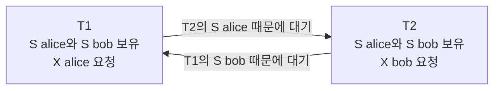

02장에서 스냅샷 격리는 읽기가 흔적을 남기지 않기 때문에 write skew를 막지 못한다고 했다. 락 기반 격리는 정반대의 선택을 한다. 읽는 행에도 락을 걸어 읽기가 흔적을 남기게 만들고, 그 대가로 대기와 데드락을 치른다. 이 장은 락 기반 격리의 이론적 뿌리인 2단계 락킹, 팬텀을 막기 위한 범위 락과 InnoDB의 gap·next-key lock, 그리고 락이 필연적으로 낳는 데드락을 다룬다. 락이 write skew를 어떻게 막는지는 직접 실행되는 모델로 확인한다.

## 이 장을 읽기 전에

[01장](/post/database-transactions/isolation-levels-and-anomalies/)의 이상 현상 어휘와 [02장](/post/database-transactions/snapshot-isolation-and-mvcc/)의 스냅샷 구현을 알고 있으면 대비가 선명해진다. 락의 기본 개념은 [레이스 컨디션과 락](/post/computerterms/race-conditions-and-locks/)과 [데드락](/post/computerterms/deadlocks/)에서 다룬 운영체제 수준의 락과 같은 계열이며, 이 장은 그것이 데이터베이스의 행과 인덱스 범위에 적용될 때의 규칙을 다룬다.

이 장의 깊이는 중급에서 심화다. 직렬 가능성을 낙관적으로 보장하는 SSI는 04장에서, 락을 피하는 애플리케이션 설계는 05장에서 다룬다. 락 에스컬레이션, 래치(latch)와 락의 구분, 분산 락 매니저는 범위 밖이다.

| 수준 | 읽을 부분 | 핵심 목표 |
|---|---|---|
| 처음 배우는 독자 | "락으로 격리를 만든다", "데드락", "오개념" | 데드락이 왜 생기고 어떻게 대응하는지 설명한다 |
| 실무 개발자 | "InnoDB의 락 종류", "판단 기준" | 락 대기·데드락 증상을 진단하고 줄이는 방법을 고른다 |
| 심화 독자 | "2PL과 직렬 가능성", "모델로 확인하기" | 락이 write skew를 데드락으로 바꾸는 과정을 설명한다 |

## 락으로 격리를 만든다

락 기반 동시성 제어의 이론적 토대는 Kapali Eswaran, Jim Gray, Raymond Lorie, Irving Traiger의 1976년 논문 「The notions of consistency and predicate locks in a database system」에서 정립되었다. 이 논문은 트랜잭션이 락을 얻는 단계와 푸는 단계를 분리하는 <strong>2단계 락킹(Two-Phase Locking, 2PL)</strong>을 제안했다. 규칙은 간단하다. 트랜잭션은 락을 늘리기만 하는 성장 단계를 거친 뒤 락을 줄이기만 하는 수축 단계로 넘어가며, 한 번 락을 풀기 시작하면 새 락을 얻을 수 없다. 이 규칙을 지키는 모든 실행은 어떤 직렬 실행과 동등한 결과를 낸다는 것이 2PL의 핵심 정리다. 직관은 이렇다. 충돌하는 두 연산 사이에서는 락 때문에 한 트랜잭션이 완전히 먼저 끝나야 하므로, 충돌 관계가 순환을 이룰 수 없다.

실무에서 쓰는 것은 대개 이보다 엄격한 <strong>엄격한 2PL(strict 2PL)</strong>이다. 수축 단계를 없애고, 쓰기 락(대개 읽기 락까지)을 커밋이나 롤백 시점까지 쥐고 있는다. 이렇게 하면 다른 트랜잭션이 커밋되지 않은 쓰기를 읽거나 덮어쓰는 일이 구조적으로 불가능해져 더티 리드와 더티 라이트가 사라지고, 롤백이 연쇄적으로 번지는 일도 막힌다. 락 모드는 공유(S)와 배타(X) 두 가지가 기본이다. S 락끼리는 공존하고, X 락은 어떤 락과도 공존하지 못한다. 읽기는 S, 쓰기는 X를 요구한다는 규칙에서 "읽기가 쓰기를 막고 쓰기가 읽기를 막는다"는 락 기반 방식의 성격이 나온다.

고전 이론에서 격리 수준은 락의 종류와 보유 기간으로 정의된다. 이 정의는 Berenson 등이 ANSI 현상 정의를 비판하면서 락 기반 수준을 정확히 분류할 때 쓴 틀이기도 하다. SQL Server의 공식 문서가 서술하는 동작이 이 틀에 잘 맞는다.

| 수준 | 읽기 락 | 쓰기 락 | 막는 이상 현상 |
|---|---|---|---|
| Read Uncommitted | 공유 락을 잡지 않음 | 배타 락을 커밋까지 보유 | 더티 라이트 |
| Read Committed | 읽는 동안만 공유 락을 잡고 곧 해제 | 커밋까지 보유 | 더티 리드 |
| Repeatable Read | 읽은 모든 데이터에 공유 락을 커밋까지 보유 | 커밋까지 보유 | 반복 불가능한 읽기. 새 행 삽입은 막지 못해 팬텀 가능 |
| Serializable | 읽은 키 범위 전체에 범위 락을 커밋까지 보유 | 커밋까지 보유 | 팬텀까지 |

SQL Server 문서는 Repeatable Read에서 다른 트랜잭션이 조건에 맞는 새 행을 삽입할 수 있고 재조회하면 팬텀 리드가 생긴다고 서술하며, Serializable에서는 읽은 키 범위에 범위 락을 걸어 이를 막는다고 설명한다. 같은 문서는 격리 수준을 어떻게 고르든 데이터를 수정하는 트랜잭션은 항상 배타 락을 커밋까지 보유한다고 명시한다. 격리 수준이 바꾸는 것은 읽기에 대한 보호 수준이다.

## 팬텀과 범위 락

락을 행 단위로만 걸면 아직 존재하지 않는 행은 잠글 수 없다. "나이가 30 이상인 직원을 모두 읽는다"는 쿼리가 읽은 행들만 잠그면, 다른 트랜잭션이 나이 35인 새 직원을 삽입해도 막을 방법이 없고, 같은 쿼리를 다시 실행하면 새 행이 나타난다. 팬텀은 락의 대상이 "행"이 아니라 "조건"이어야 하기 때문에 생긴다. Eswaran 등의 논문이 제안한 해법이 **술어 락(predicate lock)**, 즉 조건 자체를 잠그는 것이다. 이론적으로는 깔끔하지만, 두 술어가 겹치는지를 판정하는 일이 일반 조건식에서는 계산적으로 비싸서 실제 시스템은 쓰지 않았다.

실제 시스템은 술어 락을 **인덱스 범위 잠금**으로 근사한다. 조건을 인덱스의 연속 구간으로 환원할 수 있다면, 그 구간 전체를 잠가 삽입을 막으면 된다. SQL Server의 Serializable이 범위 락(key-range lock)을 거는 것이 이 방식이며, 문서는 이 수준이 읽은 조건에 맞는 범위에 다른 트랜잭션이 삽입하거나 갱신하지 못하게 한다고 설명한다. MySQL InnoDB의 gap lock과 next-key lock도 같은 발상이다. 인덱스가 없으면 구간을 정의할 수 없으므로 더 넓은 범위를 잠그게 된다는 점이 실무에서 중요하다.

## InnoDB의 락 종류

InnoDB는 행 수준 락의 대상을 **인덱스 레코드**로 정의한다. 공식 문서는 레코드 락을 "인덱스 레코드에 거는 락"이라고 정의하고, 인덱스가 없는 테이블에서도 InnoDB가 만드는 숨은 클러스터드 인덱스에 락을 건다고 설명한다. 락은 크게 네 가지 모양이다.

레코드 락(record lock)은 인덱스 레코드 하나를 잠근다. 갭 락(gap lock)은 인덱스 레코드 사이의 간격, 또는 첫 레코드 앞이나 마지막 레코드 뒤의 간격을 잠근다. 문서의 예처럼 `SELECT c1 FROM t WHERE c1 BETWEEN 10 AND 20 FOR UPDATE`는 그 값이 이미 있든 없든 `c1 = 15`의 삽입을 막는다. 갭 락은 "순수하게 금지적"이어서 목적이 오직 다른 트랜잭션의 삽입을 막는 것이며, 갭 락끼리는 공존할 수 있고 공유와 배타의 구분이 없다. 넥스트키 락(next-key lock)은 인덱스 레코드에 대한 레코드 락과 그 레코드 앞 간격에 대한 갭 락의 결합이다. 인덱스 값이 10, 11, 13, 20이면 다음 구간들이 각각 하나의 next-key 락 단위가 된다.

```text
(음의 무한대, 10]
(10, 11]
(11, 13]
(13, 20]
(20, 양의 무한대)
```

InnoDB는 기본 격리 수준인 Repeatable Read에서 검색과 인덱스 스캔에 next-key 락을 사용하며, 문서는 이것이 팬텀 행을 막는다고 설명한다. 이로써 01장의 질문 하나가 풀린다. InnoDB의 Repeatable Read에서 일반 `SELECT`는 스냅샷으로 팬텀이 없고, 잠금 읽기와 DML은 next-key 락으로 팬텀을 막는다. 예외도 있다. 고유 인덱스로 고유한 행 하나를 검색하는 문장은 갭 락이 필요 없어 레코드 락만 건다. 다만 다중 컬럼 고유 인덱스에서 일부 컬럼만 조건으로 쓰면 갭 락이 걸린다. 또 갭 락은 Read Committed로 낮추면 명시적으로 꺼진다. 문서에 따르면 이때 갭 락은 외래 키 검사와 중복 키 검사에만 쓰이고, 다른 세션이 락 걸린 레코드 옆 간격에 새 행을 자유롭게 삽입할 수 있어 팬텀이 생길 수 있다.

삽입은 별도의 락을 쓴다. 삽입 의도 락(insert intention lock)은 `INSERT`가 행을 넣기 전에 거는 일종의 갭 락으로, 같은 간격에 삽입하더라도 서로 다른 위치라면 기다리지 않게 해 준다. 마지막으로 테이블 수준에는 의도 락(IS, IX)이 있다. 행에 S 락을 걸기 전에는 테이블에 IS 이상을, X 락을 걸기 전에는 IX를 먼저 얻어야 하며, 의도 락끼리는 서로 충돌하지 않고 전체 테이블 락과만 충돌한다.

MySQL 문서가 정리한 테이블 수준 락의 호환 관계는 다음과 같다. 행 하나는 이미 걸려 있는 락이고 열은 새로 요청하는 락이다.

| 보유 / 요청 | X | IX | S | IS |
|---|---|---|---|---|
| X | 충돌 | 충돌 | 충돌 | 충돌 |
| IX | 충돌 | 호환 | 충돌 | 호환 |
| S | 충돌 | 충돌 | 호환 | 호환 |
| IS | 충돌 | 호환 | 호환 | 호환 |

이 규칙을 값 10, 11, 13, 20이 들어 있는 테이블에 적용해 보자. 다음은 MySQL에서 두 세션을 열어 직접 확인해 볼 시나리오다.

```sql
CREATE TABLE t (c1 INT PRIMARY KEY) ENGINE=InnoDB;
INSERT INTO t VALUES (10), (11), (13), (20);

-- 세션 A (Repeatable Read, 기본값)
BEGIN;
SELECT * FROM t WHERE c1 BETWEEN 11 AND 15 FOR UPDATE;

-- 세션 B (아래 세 문장은 각각 별도의 세션에서 실행한다. 한 세션에서 12가 대기하면 다음 문장이 실행되지 않는다)
INSERT INTO t VALUES (12);   -- A가 커밋하거나 롤백할 때까지 대기한다
INSERT INTO t VALUES (14);   -- 마찬가지로 대기한다
INSERT INTO t VALUES (25);   -- 스캔 범위 밖이므로 즉시 성공한다 (예상)

-- 세션 C: 어떤 락이 걸렸는지 확인한다
SELECT index_name, lock_type, lock_mode, lock_status, lock_data
FROM performance_schema.data_locks;
```

세션 B의 12와 14는 A가 훑은 구간 안의 간격이므로 갭 락에 막힌다. 스캔 범위 밖의 값은 영향을 받지 않는다. 정확히 어느 레코드까지 락이 걸리는지는 인덱스 구조와 서버 버전에 따라 달라질 수 있으므로, 가정하지 말고 `performance_schema.data_locks`로 확인하는 것이 안전하다. 이 테이블의 `LOCK_MODE`는 갭 락이 있으면 그 사실을 표시하고, `LOCK_STATUS`는 `GRANTED` 또는 `WAITING`이며, `LOCK_DATA`에는 잠긴 인덱스 값이 나온다. 위 시나리오의 결과는 문서가 설명하는 락 규칙에서 도출한 예측이므로, 사용 중인 MySQL 버전에서 두 세션으로 직접 확인해 보기를 권한다.

## 락이 write skew를 막는 방식: 데드락으로 바꾼다

02장에서 write skew가 생기는 이유는 읽기가 흔적을 남기지 않기 때문이라고 했다. 락 기반 Serializable에서는 읽기도 S 락이라는 흔적을 남긴다. 당직 의사 예제에서 두 트랜잭션이 모두 `alice`와 `bob` 행을 읽으면 둘 다 두 행에 S 락을 쥔다. 이제 한쪽이 `alice`를 갱신하려면 X 락이 필요한데 상대가 S 락을 쥐고 있으므로 기다려야 하고, 상대도 `bob`을 갱신하려다 같은 이유로 기다린다. 서로가 서로를 기다리는 순환, 즉 데드락이다. 락 기반 방식은 write skew를 "일어나지 못하게" 만드는 것이 아니라 "데드락으로 바꿔서 한쪽을 중단"시킨다. 결과적으로 불변식은 지켜지지만 대가는 중단된 트랜잭션의 재시도다.

두 트랜잭션이 서로를 기다리는 모양은 대기 그래프(wait-for graph)로 그리면 한눈에 보인다. 간선은 "누구 때문에 기다리는가"를 뜻하고, 이 그래프에 사이클이 생기면 데드락이다.



이를 확인하는 교육용 모델을 실행해 보자. 다음 코드는 엄격한 2PL의 락 매니저를 단순화한 것으로, 대기 그래프(wait-for graph)에서 사이클이 생기면 데드락으로 판정한다. 락은 해제하지 않고 `release_all`로 트랜잭션 종료 시점에만 한꺼번에 푼다.

```python
"""엄격한 2단계 락킹(strict 2PL)과 대기 그래프 데드락 탐지를 보여 주는 교육용 모델."""


class Deadlock(Exception):
    pass


class LockManager:
    def __init__(self):
        self.holders = {}   # 자원 -> {트랜잭션: "S" 또는 "X"}
        self.waiting = {}   # 트랜잭션 -> (자원, 모드)

    def _conflicts(self, txn, res, mode):
        return {t for t, m in self.holders.get(res, {}).items()
                if t != txn and (mode == "X" or m == "X")}

    def acquire(self, txn, res, mode):
        blockers = self._conflicts(txn, res, mode)
        if not blockers:
            held = self.holders.setdefault(res, {})
            if held.get(txn) != "X":
                held[txn] = mode
            self.waiting.pop(txn, None)
            return "획득"
        self.waiting[txn] = (res, mode)
        if self._in_cycle(txn):
            raise Deadlock(f"{txn} 가 {res} 를 기다리면 대기 그래프에 사이클이 생긴다")
        return f"대기({', '.join(sorted(blockers))} 이 보유)"

    def _in_cycle(self, start):
        seen, stack = set(), [start]
        while stack:
            t = stack.pop()
            if t not in self.waiting:
                continue
            res, mode = self.waiting[t]
            for b in self._conflicts(t, res, mode):
                if b == start:
                    return True
                if b not in seen:
                    seen.add(b)
                    stack.append(b)
        return False

    def release_all(self, txn):          # 커밋·롤백 시점에만 한꺼번에 해제 (strict 2PL)
        for held in self.holders.values():
            held.pop(txn, None)
        self.waiting.pop(txn, None)


lm = LockManager()
print("[시나리오 1] 서로 반대 순서로 X 락을 잡는 두 트랜잭션")
print("T1 X(A):", lm.acquire("T1", "A", "X"))
print("T2 X(B):", lm.acquire("T2", "B", "X"))
print("T1 X(B):", lm.acquire("T1", "B", "X"))
try:
    lm.acquire("T2", "A", "X")
except Deadlock as e:
    print("T2 X(A): 데드락 ->", e)
    lm.release_all("T2")
print("T2 롤백 후 T1 X(B) 재시도:", lm.acquire("T1", "B", "X"))

lm = LockManager()
print("\n[시나리오 2] 당직 의사 write skew를 2PL(Serializable)로 실행")
for t in ("T1", "T2"):
    for row in ("alice", "bob"):
        print(f"{t} S({row}):", lm.acquire(t, row, "S"))
print("T1 X(alice):", lm.acquire("T1", "alice", "X"))
try:
    lm.acquire("T2", "bob", "X")
except Deadlock as e:
    print("T2 X(bob): 데드락 ->", e)
```

이 코드를 Python 3으로 실행하면 다음 출력이 나온다.

```text
[시나리오 1] 서로 반대 순서로 X 락을 잡는 두 트랜잭션
T1 X(A): 획득
T2 X(B): 획득
T1 X(B): 대기(T2 이 보유)
T2 X(A): 데드락 -> T2 가 A 를 기다리면 대기 그래프에 사이클이 생긴다
T2 롤백 후 T1 X(B) 재시도: 획득

[시나리오 2] 당직 의사 write skew를 2PL(Serializable)로 실행
T1 S(alice): 획득
T1 S(bob): 획득
T2 S(alice): 획득
T2 S(bob): 획득
T1 X(alice): 대기(T2 이 보유)
T2 X(bob): 데드락 -> T2 가 bob 를 기다리면 대기 그래프에 사이클이 생긴다
```

시나리오 1은 고전적인 데드락이다. 서로 반대 순서로 락을 잡으면 순환 대기가 생기고, 한쪽을 희생시켜 롤백하면 다른 쪽이 진행한다. 시나리오 2가 이 장의 핵심이다. 두 트랜잭션 모두 읽기만 했는데도 S 락이 남아 있어서 갱신 시점에 서로를 막는다. 스냅샷 방식에서는 조용히 통과하던 write skew가 락 기반에서는 데드락이라는 눈에 보이는 실패로 드러난다. 이 모델에서 희생자는 대기 그래프에 사이클을 만든 요청자로 단순화했는데, 실제 DBMS는 희생자 선택 기준이 다르다. PostgreSQL 문서는 어떤 트랜잭션이 중단될지 예측하기 어렵고 의존하면 안 된다고 명시한다.

## 데드락 탐지와 대응

데이터베이스는 데드락을 두 가지 방식으로 처리한다. 하나는 대기 그래프를 만들어 사이클을 탐지하고 희생자를 골라 롤백하는 것이고, 다른 하나는 일정 시간 이상 기다린 요청을 시간 초과로 실패시키는 것이다. InnoDB는 기본적으로 탐지를 켜 두며, 문서에 따르면 데드락을 감지하면 트랜잭션 하나를 희생자로 롤백한다. 탐지를 끄면(`innodb_deadlock_detect`) 대신 `innodb_lock_wait_timeout`에 의존해 롤백한다. PostgreSQL은 락을 기다리기 시작한 뒤 `deadlock_timeout`(기본 1초)이 지나서야 데드락 검사를 수행한다. 문서는 이 검사가 비싸기 때문에 락 대기마다 돌리지 않으며, 이 값을 대표적인 트랜잭션 시간보다 크게 두면 대기 중에 락이 풀릴 가능성이 커진다고 설명한다. 이 값을 늘리면 불필요한 검사는 줄지만 진짜 데드락 보고가 늦어진다.

애플리케이션이 알아야 할 것은 에러 코드다. MySQL의 데드락은 에러 1213(`ER_LOCK_DEADLOCK`, SQLSTATE `40001`, "Deadlock found when trying to get lock; try restarting transaction")이고 락 대기 시간 초과는 에러 1205(SQLSTATE `HY000`)다. PostgreSQL의 데드락은 SQLSTATE `40P01`(`deadlock_detected`)이고, 직렬화 실패는 `40001`(`serialization_failure`)이다. 데드락(1213)과 직렬화 실패(`40001`)는 트랜잭션 롤백 계열이어서 트랜잭션 전체를 처음부터 재시도하는 것이 공통 대응이다. 반면 락 대기 시간 초과(1205)는 MySQL 에러 레퍼런스에 따르면 기본적으로 시간을 넘긴 문장만 롤백되고 트랜잭션 전체가 롤백되지 않으므로, 애플리케이션이 트랜잭션을 직접 롤백하고 재시도할지 판단해야 한다. 문서도 InnoDB에서 애플리케이션 로직이 올바르더라도 트랜잭션 재시도를 처리해야 한다고 명시한다. 데드락은 버그가 아니라 락 기반 동시성 제어의 정상적인 부산물이다.

관측 도구도 알아 두자. InnoDB는 `SHOW ENGINE INNODB STATUS`로 마지막 데드락의 정보를 볼 수 있고, `innodb_print_all_deadlocks`를 켜면 모든 데드락을 서버 에러 로그에 남긴다. 데드락이 잦다면 로그에서 어떤 쿼리 쌍이 충돌하는지부터 찾는다.

데드락을 줄이는 방법은 문서가 공통으로 권하는 몇 가지로 수렴한다. 여러 객체에 락을 걸 때는 모든 코드가 같은 순서로 걸게 한다. PostgreSQL 문서는 이것이 데드락에 대한 최선의 방어이며, 한 객체에 대한 첫 락은 그 트랜잭션이 필요로 할 가장 엄격한 모드로 잡으라고 조언한다. 트랜잭션을 짧게 유지한다. `SELECT ... FOR UPDATE`나 `UPDATE ... WHERE`가 쓰는 컬럼에는 인덱스를 둔다. InnoDB는 검색이나 스캔 중 만나는 인덱스 레코드마다 락을 걸기 때문에, 인덱스를 못 쓰는 조건은 훑는 레코드를 광범위하게 잠가 충돌 가능성을 키운다. 마지막으로 순서를 통제할 수 없다면 재시도로 받아낸다.

## 락 기반과 MVCC 비교

두 방식의 차이를 02장과 연결해 정리하면 다음과 같다. 현실의 DBMS는 둘을 섞어 쓰므로 "락 방식이냐 MVCC냐"가 아니라 "읽기에 어떤 방식을 쓰고 쓰기 충돌은 어떻게 처리하느냐"의 조합으로 보는 편이 정확하다.

| 항목 | 락 기반(2PL) | 스냅샷(MVCC) |
|---|---|---|
| 읽기와 쓰기의 관계 | 서로 차단 | 서로 차단하지 않음 |
| 읽기가 남기는 흔적 | S 락 | 없음 |
| write skew | 데드락으로 드러나 한쪽 중단 | 허용(Serializable로 올려야 방지) |
| 팬텀 | 범위 락·next-key 락으로 방지 | 스냅샷이 방지(읽기). 쓰기 쪽은 별도 처리 |
| 대기와 데드락 | 빈번할 수 있음 | 같은 행의 쓰기 충돌에서만 |
| 장기 트랜잭션의 비용 | 락을 오래 쥐어 다른 트랜잭션이 대기 | 옛 버전을 붙잡아 공간 증가 |

InnoDB의 Serializable은 두 방식의 혼합을 잘 보여 준다. MySQL 8.4의 격리 수준 문서에 따르면 autocommit이 꺼져 있을 때 InnoDB는 일반 `SELECT`를 `SELECT ... FOR SHARE`로 변환한다. 평소 스냅샷으로 읽던 쿼리가 S 락을 잡는 쿼리로 바뀌는 것이다. 앞의 모델이 보여 준 S 락 기반 write skew 방지가 바로 이 변환 덕분에 작동한다.

## 흔한 오개념

**"MVCC를 쓰는 DBMS는 락을 쓰지 않는다."** 읽기에는 락이 없어도 쓰기에는 행 락이 있다. PostgreSQL 문서도 행 수준 락이 데이터 조회에는 영향을 주지 않고 같은 행의 쓰기와 잠금자만 막는다고 설명한다. MVCC DBMS에서도 데드락은 일어난다. 두 트랜잭션이 서로 반대 순서로 같은 두 행을 갱신하면 된다.

**"데드락은 코드 버그이므로 없애야 한다."** 락 순서를 통일하면 줄일 수는 있지만, 여러 테이블과 인덱스를 건드리는 현실의 워크로드에서 완전히 없애기는 어렵다. 문서도 올바른 로직에서도 재시도가 필요하다고 말한다. 목표는 제거가 아니라 빈도를 낮추고 발생했을 때 안전하게 재시도하는 것이다.

**"`FOR UPDATE`는 조건에 맞는 행만 잠근다."** InnoDB는 검색 중 만나는 인덱스 레코드를 잠그므로, 적절한 인덱스가 없으면 조건에 맞지 않는 행까지 잠글 수 있다. Repeatable Read에서는 갭 락까지 걸려 겉보기에 무관한 삽입이 대기하는 현상이 생긴다.

**"Repeatable Read와 Serializable 사이에는 팬텀 방지 여부만 차이가 있다."** 이것은 표준의 설명이고 실제 구현은 더 복잡하다. InnoDB의 Repeatable Read도 next-key 락으로 팬텀을 막고, PostgreSQL의 Repeatable Read는 스냅샷으로 팬텀을 막는다. 두 DBMS의 Repeatable Read와 Serializable을 가르는 진짜 차이는 write skew 같은 읽기-쓰기 의존성의 처리다.

## 판단 기준

락 문제를 마주쳤을 때 증상에서 원인과 대응으로 가는 지도다.

| 증상 | 의심할 원인 | 확인 방법 | 대응 |
|---|---|---|---|
| 에러 1213 또는 `40P01`이 간헐적으로 난다 | 서로 반대 순서의 락 획득 | `SHOW ENGINE INNODB STATUS`, PostgreSQL 서버 로그 | 락 순서 통일, 트랜잭션 전체 재시도 |
| 삽입이 이유 없이 대기한다(InnoDB) | Repeatable Read의 갭 락·next-key 락 | `performance_schema.data_locks`에서 `GAP` 표시 확인 | 인덱스 추가, 필요하면 Read Committed 검토 |
| 에러 1205(락 대기 시간 초과) | 오래 열린 트랜잭션이 락을 쥠 | 장기 트랜잭션 조회, `innodb_lock_wait_timeout` | 트랜잭션 단축, 커밋 지점 앞당기기 |
| Serializable 전환 후 처리량이 급감한다 | 읽기 락 증가로 대기·데드락 폭증 | 락 대기 지표, 데드락 빈도 | 읽기 전용 구간 분리, 04장의 SSI 검토 |
| 조건에 맞지 않는 행까지 잠긴다 | 인덱스 없는 조건으로 인한 광범위 스캔 | 실행 계획, `data_locks`의 잠긴 레코드 | 조건 컬럼에 인덱스 추가 |

## 이 장을 읽은 후 달성해야 할 목표

이 장을 읽은 후에는 다음을 할 수 있어야 한다. 2PL과 엄격한 2PL의 차이를 설명하고, 엄격한 2PL이 더티 리드와 연쇄 롤백을 막는 이유를 말할 수 있다. 팬텀이 락의 대상이 행이 아니라 조건이어야 하기 때문에 생긴다는 것과, 범위 락과 next-key 락이 이를 인덱스 구간으로 근사하는 방식을 설명할 수 있다. InnoDB의 레코드·갭·next-key·삽입 의도 락의 역할을 구분하고, Read Committed에서 갭 락이 꺼지는 영향을 설명할 수 있다. 락 기반 Serializable이 write skew를 데드락으로 바꾸어 막는 과정을 설명할 수 있다. 데드락 에러 코드와 관측 도구를 알고, 락 순서·인덱스·재시도로 대응할 수 있다.

## 다음 장에서는

04장에서는 락 없이 직렬 가능성을 보장하려는 시도인 SSI(Serializable Snapshot Isolation)를 다룬다. 스냅샷 방식의 장점인 읽기-쓰기 비차단을 유지하면서도 이 장에서 본 write skew를 감지해 중단시키는 방법이다. 이 장의 락 기반 모델이 write skew를 데드락으로 잡는다면, SSI는 읽기-쓰기 반의존성의 위험한 구조를 추적해 잡는다. 두 방식이 같은 불변식을 서로 다른 비용으로 지킨다는 점을 대비하며 읽으면 좋다.

## 참고 자료

- Eswaran, Gray, Lorie, Traiger, 「The notions of consistency and predicate locks in a database system」, Communications of the ACM 19(11), 1976 — 2단계 락킹과 술어 락의 원전
- [MySQL 8.4 Reference Manual: InnoDB Locking](https://dev.mysql.com/doc/refman/8.4/en/innodb-locking.html) — 공유·배타·의도 락, 레코드·갭·next-key·삽입 의도 락
- [MySQL 8.4 Reference Manual: InnoDB Transaction Isolation Levels](https://dev.mysql.com/doc/refman/8.4/en/innodb-transaction-isolation-levels.html) — Serializable에서 일반 `SELECT`가 `FOR SHARE`로 변환되는 동작
- [MySQL 8.4 Reference Manual: Deadlocks in InnoDB](https://dev.mysql.com/doc/refman/8.4/en/innodb-deadlocks.html) — 데드락 탐지, 모니터링, 최소화 방법
- [MySQL 8.4 Reference Manual: The data_locks Table](https://dev.mysql.com/doc/refman/8.4/en/performance-schema-data-locks-table.html) — 현재 걸린 락과 대기 중인 락 조회
- [MySQL 8.4 Server Error Reference](https://dev.mysql.com/doc/mysql-errors/8.4/en/server-error-reference.html) — 에러 1213(`ER_LOCK_DEADLOCK`)과 1205
- [PostgreSQL Documentation: Explicit Locking](https://www.postgresql.org/docs/current/explicit-locking.html) — 데드락 처리와 행 수준 락
- [PostgreSQL Documentation: Lock Management](https://www.postgresql.org/docs/current/runtime-config-locks.html) — `deadlock_timeout`
- [PostgreSQL Documentation: Error Codes](https://www.postgresql.org/docs/current/errcodes-appendix.html) — `40001`과 `40P01`
- [SET TRANSACTION ISOLATION LEVEL (Transact-SQL)](https://learn.microsoft.com/en-us/sql/t-sql/statements/set-transaction-isolation-level-transact-sql) — SQL Server의 수준별 락 동작과 범위 락
- [Berenson et al., A Critique of ANSI SQL Isolation Levels](https://arxiv.org/abs/cs/0701157) — 락 기반 격리 수준의 정확한 분류
