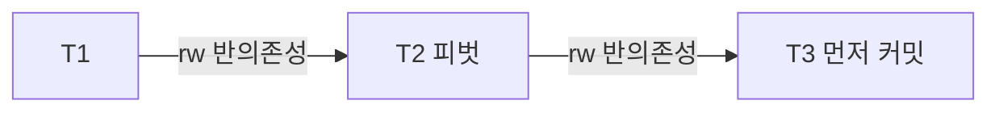

03장의 락 기반 Serializable은 읽기에도 락을 걸어 write skew를 데드락으로 바꾸었다. 그 대가로 읽기와 쓰기가 서로를 막아 동시성이 떨어진다. 스냅샷 격리의 장점인 "읽기가 쓰기를 막지 않는다"를 유지하면서도 직렬 가능성을 보장할 수는 없을까. 이 질문에 대한 연구 결과가 <strong>SSI(Serializable Snapshot Isolation)</strong>이고, PostgreSQL이 이를 실서비스용 데이터베이스 릴리스로는 처음 구현했다. 이 장은 SSI가 무엇을 감시하는지, 왜 거짓 경보가 생기는지, 그리고 이 방식이 애플리케이션에 요구하는 것이 무엇인지를 다룬다.

## 이 장을 읽기 전에

[01장](/post/database-transactions/isolation-levels-and-anomalies/)의 write skew, [02장](/post/database-transactions/snapshot-isolation-and-mvcc/)의 스냅샷 가시성, [03장](/post/database-transactions/lock-based-isolation/)의 락 기반 Serializable을 알고 있다고 가정한다. 이 장은 세 장의 내용이 모이는 지점이다.

이 장의 깊이는 중급에서 심화다. 직렬화 그래프를 개념 수준에서 사용하되 증명은 다루지 않는다. SSI를 도입한 원 논문의 증명과 PostgreSQL 소스 코드 수준의 자료구조(SLRU, 서브트랜잭션 처리 등)는 범위 밖이며, 분산 환경의 직렬 가능성은 06장에서 다룬다.

| 수준 | 읽을 부분 | 핵심 목표 |
|---|---|---|
| 처음 배우는 독자 | "Serializable을 구현하는 세 가지 방법", "오개념" | Serializable의 보장과 비용의 형태를 설명한다 |
| 실무 개발자 | "PostgreSQL의 SSI", "운영과 튜닝" | Serializable 도입 시 필요한 재시도·설정을 설계한다 |
| 심화 독자 | "위험한 구조", "모델로 확인하기" | 위험한 구조 감지와 false positive의 원인을 설명한다 |

## Serializable을 구현하는 세 가지 방법

Serializable의 정의는 "결과가 어떤 직렬 실행과 같다"이고, 이를 만족시키는 방법은 크게 세 갈래다. 가장 단순한 것은 **실제 직렬 실행**이다. 트랜잭션을 한 번에 하나씩, 보통 단일 스레드에서 순서대로 실행하면 동시성 문제 자체가 없다. 트랜잭션이 짧고 데이터가 메모리에 있으며 파티션이 잘 나뉘는 워크로드에서만 현실적이고, Kleppmann의 『Designing Data-Intensive Applications』 7장이 이 방식을 채택한 시스템들을 소개한다. 두 번째는 03장에서 본 **2단계 락킹**이다. 읽기와 쓰기가 서로 차단되어 동시성이 낮고 데드락이 생기지만, 어떤 워크로드에서도 동작하는 범용 방법이다. 세 번째가 **낙관적 방식**이다. 일단 막지 않고 실행시킨 뒤, 직렬 가능성이 깨질 징후를 감지하면 사후에 중단한다. SSI는 이 세 번째 방식에 속한다.

세 방식은 비용이 나타나는 형태가 다르고 어느 쪽이 유리한지는 충돌 빈도에 달려 있다. 이 비교는 장 끝의 표에 정리했다.

## 직렬화 그래프와 위험한 구조

SSI를 이해하려면 먼저 직렬 가능성을 그래프로 보는 관점이 필요하다. 01장에서 소개한 Adya의 의존성 그래프에서, 커밋된 트랜잭션을 노드로 두고 세 종류의 의존성을 간선으로 그린다. 쓰기-쓰기(ww)는 한 트랜잭션이 쓴 값을 다른 트랜잭션이 덮어쓴 경우, 쓰기-읽기(wr)는 한 트랜잭션이 쓴 값을 다른 트랜잭션이 읽은 경우, 읽기-쓰기(rw) 반의존성은 한 트랜잭션이 읽은 값을 다른 트랜잭션이 나중에 덮어쓴 경우다. 이 그래프에 사이클이 없으면 간선의 방향을 따라 위상 정렬한 순서가 곧 등가의 직렬 순서이고, 사이클이 있으면 어떤 직렬 순서로도 설명되지 않는다.

스냅샷 격리에서는 같은 행을 쓰는 트랜잭션끼리 ww 충돌을 막고, 읽는 값은 스냅샷에서 가져오므로 ww와 wr 간선만으로는 사이클이 생기지 않는다. 사이클을 만드는 것은 rw 반의존성이다. 스냅샷 격리의 읽기는 흔적을 남기지 않아서 "내가 읽은 것을 상대가 덮어쓴다"는 사실이 기록되지 않고, 바로 그 틈에서 write skew가 나온다. 당직 의사 예제에서 앨리스 트랜잭션은 밥의 행을 읽었고 밥 트랜잭션이 그 행을 썼으므로 앨리스에서 밥으로 rw 간선이 생긴다. 반대로 밥이 읽은 앨리스의 행을 앨리스가 썼으므로 밥에서 앨리스로도 rw 간선이 생긴다. 두 간선이 사이클을 이룬다.

SSI의 핵심은 사이클 전체를 찾지 않고 그 안에 반드시 들어 있는 부분 구조만 찾는 것이다. Cahill, Röhm, Fekete의 「Serializable Isolation for Snapshot Databases」(SIGMOD 2008)가 제안한 이 접근은 이후 연구로 정리되었다. PostgreSQL 구현 논문은 이를 다음 정리로 설명한다. 스냅샷 격리에서 일어나는 모든 직렬화 이상(사이클)에는 T1에서 T2로, T2에서 T3으로 이어지는 **연속한 두 rw 반의존성**이 들어 있고, 그 가운데 T3이 가장 먼저 커밋한다. 이 구조를 <strong>위험한 구조(dangerous structure)</strong>라 부르고, 가운데 T2를 <strong>피벗(pivot)</strong>이라 한다. 그림으로 보면 다음과 같다.



이 구조를 쓰는 이유는 비용이다. 사이클을 직접 찾으려면 ww와 wr 간선까지 모두 추적해야 하지만, 위험한 구조는 rw 반의존성만으로 이루어져서 그 두 종류는 추적할 필요가 없다. 대가는 false positive다. 모든 위험한 구조가 실제 사이클의 일부인 것은 아니어서, 직렬 가능한 실행이 위험한 구조를 포함했다는 이유로 중단될 수 있다. 앞의 정리에서 T3이 먼저 커밋한다는 조건을 확인하면 이 거짓 경보를 일부 걸러 낼 수 있다. 정리가 "T3이 가장 먼저 커밋한다"를 요구하므로 T1이나 T2가 T3보다 먼저 커밋했다면 중단이 필요 없다. PostgreSQL 구현 논문은 이런 커밋 순서 확인을 적용해 거짓 경보를 줄였다고 서술한다.

## PostgreSQL의 SSI

PostgreSQL은 9.1 버전에서 SSI를 도입했다. Dan Ports와 Kevin Grittner의 논문 「Serializable Snapshot Isolation in PostgreSQL」(VLDB 2012)은 이 구현이 실서비스(프로덕션) 데이터베이스 릴리스에서의 첫 SSI 구현이자, 그 이전에 락 기반 Serializable이 없던 데이터베이스에서의 첫 구현이라고 밝힌다. 논문은 성능이 스냅샷 격리보다 약간 낮은 수준이며 읽기가 많은 워크로드에서는 전통적인 2PL보다 훨씬 낫다고 평가한다.

사용자 관점에서 Serializable은 Repeatable Read와 똑같이 동작하면서 추가로 모니터링을 한다. 공식 문서는 Serializable이 동시 실행된 트랜잭션 집합이 어떤 직렬 실행과도 모순되는 결과를 낼 수 있는 조건을 감시한다고 설명한다. 이를 위해 <strong>예측 락(predicate lock)</strong>을 쓴다. 문서에 따르면 PostgreSQL은 "쓰기가 이전 읽기의 결과에 영향을 주었을지"를 판단할 수 있도록 락을 유지한다. 이 락은 `pg_locks`에서 `SIReadLock` 모드로 나타나고, 03장의 락과 달리 아무도 차단하지 않으므로 데드락에 관여할 수 없다. 실제로 접근한 데이터에 기반해 만들어진다. 즉 SIREAD 락은 락이라는 이름의 "읽기 기록"이다. 읽은 위치를 기록해 두었다가, 다른 트랜잭션이 거기에 쓰면 rw 반의존성 간선을 긋는 데 쓴다.

읽기 기록의 정밀도는 메모리에 의해 제한된다. 기록이 많아지면 튜플 단위에서 페이지 단위로, 다시 릴레이션 단위로 합쳐서 메모리를 아낀다. 정밀도가 낮아질수록 실제로는 충돌하지 않는 접근도 충돌로 보이므로 false positive가 늘어난다. 문서가 성능 지침으로 순차 스캔은 항상 릴레이션 수준 예측 락을 요구한다고 밝히는 이유다. 쿼리 계획이 인덱스를 못 쓰고 순차 스캔을 택하면 테이블 전체를 읽은 것으로 기록되어 같은 테이블에 대한 거의 모든 쓰기가 반의존성 후보가 된다.

```sql
-- Serializable로 실행 중인 세션이 남긴 읽기 기록 확인
SELECT locktype, relation::regclass AS rel, page, tuple, pid
FROM pg_locks
WHERE mode = 'SIReadLock';
```

충돌이 감지되면 트랜잭션은 `ERROR: could not serialize access due to read/write dependencies among transactions`(SQLSTATE `40001`)로 중단된다. 이 오류는 개별 문장에서뿐 아니라 커밋 시점에도 나올 수 있다. 문서는 Serializable에 의존해 이상을 막는 경우, 트랜잭션이 성공적으로 커밋되기 전에는 영구 테이블에서 읽은 어떤 데이터도 유효하다고 간주하면 안 된다고 강조한다. 이 한 문장이 애플리케이션 설계에 미치는 영향은 크다. 트랜잭션 안에서 읽은 값을 바탕으로 이메일을 보내거나 외부 API를 호출하면, 그 트랜잭션이 커밋 시점에 중단될 때 이미 일어난 외부 효과를 되돌릴 수 없다. 외부 효과는 반드시 커밋이 성공한 뒤로 미뤄야 한다.

## 읽기 전용 트랜잭션의 최적화

Ports와 Grittner의 논문은 SSI를 읽기 전용 트랜잭션에 대해 확장했다. 스냅샷 격리의 이상에 읽기 전용 트랜잭션이 연루되는 경우는 특정한 구조에 한정되고, 그 구조가 아님이 확인되는 스냅샷을 <strong>안전한 스냅샷(safe snapshot)</strong>이라 부른다. 안전한 스냅샷에서 실행되는 읽기 전용 트랜잭션은 SSI의 추적 비용도 중단 위험도 없다. 문서에 따르면 `READ ONLY` 트랜잭션은 시작 시점에 안전함을 확인해 예측 락을 아예 잡지 않는 경우가 많고, 도중에 충돌 가능성이 사라지면 락을 일찍 풀 수도 있다. 안전함이 즉시 확인되지 않을 때 기다려 확실히 하고 싶다면 `SERIALIZABLE READ ONLY DEFERRABLE`을 요청한다. 이 트랜잭션은 안전한 스냅샷을 얻을 때까지 시작을 미루고, 그 뒤에는 중단될 일이 없다. 문서는 이것이 Serializable 트랜잭션은 블록하지만 Repeatable Read 트랜잭션은 블록하지 않는 유일한 경우라고 설명한다.

```sql
-- 오래 걸리는 보고서 쿼리: 직렬화 실패 없이, 직렬 가능한 일관된 스냅샷을 읽는다
BEGIN ISOLATION LEVEL SERIALIZABLE READ ONLY DEFERRABLE;
SELECT department, count(*) FROM employees GROUP BY department;
COMMIT;
```

읽기 전용 보고서처럼 길고 읽기만 하는 트랜잭션은 SSI의 추적 부담을 키우는 주범이므로, 이렇게 선언해 부담에서 빼 주는 것이 가장 값싼 튜닝이다.

## 모델로 확인하기

위험한 구조 감지가 write skew를 어떻게 막는지 확인하는 교육용 모델을 실행해 보자. 다음 코드는 02장의 장난감 모델에 읽기 집합과 쓰기 집합 추적을 더한 것이다. 동시에 실행된 두 트랜잭션 사이에서 한쪽이 읽은 항목을 다른 쪽이 썼다면 rw 반의존성 간선으로 보고, 커밋하려는 트랜잭션이 들어오는 간선과 나가는 간선을 모두 가지면(피벗이면) 중단시킨다. Cahill 등의 기본형처럼 커밋 순서를 따지지 않는 보수적인 규칙이므로 false positive가 PostgreSQL보다 많다.

```python
"""스냅샷 격리 + 읽기-쓰기 반의존성 추적(기본형 SSI)으로 write skew를 막는 교육용 모델."""


class SerializationFailure(Exception):
    pass


class Db:
    def __init__(self):
        self.clock = 0
        self.rows = {"alice": True, "bob": True}          # 커밋된 최신 상태
        self.txns = []

    def begin(self):
        self.clock += 1
        t = {"begin": self.clock, "commit": None, "aborted": False,
             "snap": dict(self.rows), "reads": set(), "writes": {}}
        self.txns.append(t)
        return t

    def read_all(self, t):
        view = {**t["snap"], **t["writes"]}
        t["reads"].update(t["snap"])                      # SIREAD: 읽은 항목을 기록
        return view

    def write(self, t, name, value):
        t["writes"][name] = value

    def _concurrent(self, a, b):
        end = lambda x: x["commit"] if x["commit"] is not None else float("inf")
        return a["begin"] < end(b) and b["begin"] < end(a)

    def _rw_edges(self):
        live = [t for t in self.txns if not t["aborted"]]
        return [(r, w) for r in live for w in live
                if r is not w and self._concurrent(r, w) and r["reads"] & set(w["writes"])]

    def commit(self, t):
        edges = self._rw_edges()
        incoming = any(w is t for _, w in edges)
        outgoing = any(r is t for r, _ in edges)
        if incoming and outgoing:                         # 위험한 구조의 중심(pivot)
            t["aborted"] = True
            raise SerializationFailure("could not serialize access due to read/write dependencies")
        self.clock += 1
        t["commit"] = self.clock
        self.rows.update(t["writes"])


db = Db()
a, b = db.begin(), db.begin()
for name, t in (("A", a), ("B", b)):
    print(f"{name}가 본 당직자 수:", sum(db.read_all(t).values()))
db.write(a, "alice", False)
db.write(b, "bob", False)
for name, t in (("A", a), ("B", b)):
    try:
        db.commit(t)
        print(f"{name} 커밋 성공")
    except SerializationFailure as e:
        print(f"{name} 커밋 실패:", e)

retry = db.begin()
count = sum(db.read_all(retry).values())
print("A 재시도 시 본 당직자 수:", count, "-> 해제", "허용" if count >= 2 else "거부")
print("최종 당직자 수:", sum(db.rows.values()))
```

이 코드를 Python 3으로 실행하면 다음 출력이 나온다.

```text
A가 본 당직자 수: 2
B가 본 당직자 수: 2
A 커밋 실패: could not serialize access due to read/write dependencies
B 커밋 성공
A 재시도 시 본 당직자 수: 1 -> 해제 거부
최종 당직자 수: 1
```

두 트랜잭션이 같은 스냅샷에서 당직자 2명을 보고 서로 다른 행을 쓰는 것은 02장의 시나리오와 같다. 달라진 점은 읽기 기록 덕분에 A에서 B로, B에서 A로 두 rw 반의존성이 생긴다는 것이다. 먼저 커밋을 시도한 A는 들어오는 간선과 나가는 간선을 모두 가진 피벗이므로 중단된다. A가 중단되어 간선이 사라진 뒤 B는 문제없이 커밋된다. 재시도한 A는 이번에는 당직자가 1명뿐임을 보고 해제를 거부하며, 불변식이 지켜진다. 이 모델에서는 한쪽 트랜잭션만 잃고 다른 쪽은 살았다. 다만 이는 이 모델의 결과일 뿐이다. 위험한 구조가 곧 사이클은 아니므로 실제 SSI는 직렬 가능했을 트랜잭션도 중단시킬 수 있고, 이것이 앞에서 설명한 false positive다.

## 운영과 튜닝

SSI를 도입하면 중단과 재시도가 일상이 되므로 PostgreSQL 문서의 성능 지침이 곧 운영 체크리스트가 된다. 읽기 전용 구간의 분리는 앞 절의 `READ ONLY`·`DEFERRABLE`로 해결하고, 여기서는 그 밖의 항목을 본다. 활성 연결 수를 커넥션 풀로 통제한다. 문서는 Serializable을 쓰는 바쁜 시스템에서 특히 중요하다고 설명한다. 트랜잭션에는 무결성에 필요한 만큼만 넣는다. 트랜잭션이 길수록 읽기 기록이 오래 남아 충돌 후보가 늘어난다. 연결을 `idle in transaction` 상태로 오래 방치하지 않는다. 문서는 `idle_in_transaction_session_timeout` 설정을 쓸 수 있다고 안내한다. 더 이상 필요 없는 명시적 락과 `SELECT FOR UPDATE`, `SELECT FOR SHARE`는 제거한다. 메모리 한도 때문에 읽기 기록이 넓은 단위로 합쳐진다면 `max_pred_locks_per_transaction`, `max_pred_locks_per_relation`, `max_pred_locks_per_page`를 늘리는 것을 검토한다.

재시도는 설계의 일부여야 한다. 01장의 재시도 예제를 그대로 쓰되, 재시도 단위는 트랜잭션 전체이고, 외부 부작용은 커밋 뒤로 미루며, 재시도에는 지터를 둔 백오프를 붙이고 횟수 상한을 둔다는 원칙을 지킨다. 재시도율이 높아지면 그것이 곧 경합이 심하다는 신호이므로, 반복되는 충돌 지점에는 05장에서 다룰 행 잠금이나 제약조건을 병행하는 편이 낫다.

## 세 가지 구현 비교

세 가지 Serializable 구현이 비용을 치르는 방식을 표로 정리한다.

| 항목 | 실제 직렬 실행 | 2PL(락 기반) | SSI(낙관적) |
|---|---|---|---|
| 읽기-쓰기 차단 | 해당 없음(한 번에 하나) | 서로 차단 | 차단하지 않음 |
| 충돌 시 비용 | 처리량 상한 | 대기와 데드락 | 중단과 재시도 |
| 거짓 경보 | 없음 | 없음 | 있음(false positive) |
| 충돌이 드문 워크로드 | 처리량이 낮을 수 있음 | 락 오버헤드 | 유리 |
| 충돌이 잦은 워크로드 | 예측 가능 | 줄 세워 안정적 | 재시도 폭증 위험 |
| 대표 구현 | 단일 스레드·파티션 직렬 실행 엔진 | SQL Server, MySQL InnoDB의 Serializable | PostgreSQL의 Serializable |

## 흔한 오개념

**"Serializable은 락으로 구현한다."** PostgreSQL의 Serializable은 락으로 차단하지 않는다. SIREAD 락이라는 이름이 붙은 읽기 기록을 쓰고 이는 아무도 막지 않는다. 같은 이름의 수준이 DBMS에 따라 비관적이기도 낙관적이기도 하다는 것은 01장에서 강조한 "이름보다 보장"의 대표 사례다.

**"Serializable로 올리면 재시도 코드는 필요 없다."** 오히려 반대다. 낙관적 방식의 Serializable은 충돌을 중단으로 해소하므로 재시도가 필수이고, 락 기반 Serializable도 데드락이 생기면 재시도가 필요하다. Serializable이 없애는 것은 개발자가 이상 현상 목록을 일일이 추론하는 부담이지 실패 처리 부담이 아니다.

**"SSI가 중단시키면 실제로 이상이 생길 뻔한 것이다."** 위험한 구조는 사이클의 필요조건이지 충분조건이 아니다. 중단된 트랜잭션 중에는 직렬 가능했을 것도 있다. 이것이 정확성을 위해 치르는 false positive의 비용이다.

**"읽기 전용 트랜잭션은 Serializable에서도 항상 안전하다."** 스냅샷 격리의 이상에는 읽기 전용 트랜잭션이 연루되는 경우가 있고, 그 구조를 이론적으로 규명한 것이 PostgreSQL의 읽기 전용 최적화의 배경이다. 그래서 `READ ONLY`를 선언해 안전함을 확인받거나 `DEFERRABLE`로 안전한 스냅샷을 기다리는 장치가 필요하다.

## 판단 기준

Serializable 도입을 검토할 때 이 장의 지식으로 내릴 수 있는 판단을 정리한 표다.

| 상황 | 권장 | 이유 |
|---|---|---|
| 충돌이 드물고 불변식이 복잡하다 | PostgreSQL이라면 SERIALIZABLE과 재시도 | 개별 이상 현상을 추론하지 않고 정확성을 확보 |
| 특정 한 행에 쓰기가 몰린다(핫 로우) | `FOR UPDATE` 또는 원자적 `UPDATE` 병행 | SSI의 재시도 폭증을 피하고 대기로 줄 세움 |
| 긴 읽기 전용 보고서가 있다 | `SERIALIZABLE READ ONLY DEFERRABLE` | 추적 부담과 중단 위험을 제거 |
| 쿼리가 순차 스캔을 한다 | 인덱스 추가 | 릴레이션 수준 읽기 기록으로 인한 거짓 경보 감소 |
| MySQL InnoDB 또는 SQL Server | 락 기반 Serializable의 대기·데드락 비용 평가 | 낙관적 SSI가 아님. 읽기 락이 대기를 만든다 |
| 재시도 단위를 만들기 어렵다 | Serializable 대신 제약조건·행 잠금으로 불변식 보호 | 부작용 중복을 피하고 충돌 지점을 국소화 |

## 이 장을 읽은 후 달성해야 할 목표

이 장을 읽은 후에는 다음을 할 수 있어야 한다. Serializable을 구현하는 세 가지 방식을 비용이 나타나는 형태로 비교할 수 있다. 스냅샷 격리의 직렬화 이상에 연속한 두 rw 반의존성의 위험한 구조가 들어 있다는 정리와, 그것이 false positive를 낳는 이유를 설명할 수 있다. PostgreSQL의 SIREAD 락이 차단하지 않는 읽기 기록이며 메모리 한도로 정밀도가 떨어질 수 있음을 설명하고, 순차 스캔이 거짓 경보를 키우는 이유를 말할 수 있다. `READ ONLY`와 `DEFERRABLE`이 무엇을 줄이는지 설명하고 적절히 쓸 수 있다. Serializable 도입 시 재시도 단위와 부작용 처리를 설계할 수 있다.

## 다음 장에서는

05장에서는 지금까지의 이론을 애플리케이션 설계로 옮긴다. 격리 수준을 올리는 것만이 해법이 아니라는 점, 즉 원자적 `UPDATE`, `SELECT FOR UPDATE`와 `SKIP LOCKED`, 낙관적 락, 제약조건, 어드바이저리 락, 재시도 패턴을 문제 유형별로 고르는 방법을 다룬다. 이번 장에서 본 "재시도는 설계의 일부"라는 원칙이 구체적인 코드 패턴으로 이어진다.

## 참고 자료

- Cahill, Röhm, Fekete, 「Serializable Isolation for Snapshot Databases」, SIGMOD 2008 — SSI를 제안한 원 논문
- [Ports, Grittner, Serializable Snapshot Isolation in PostgreSQL (VLDB 2012)](https://drkp.net/papers/ssi-vldb12.pdf) — PostgreSQL의 SSI 구현, 위험한 구조 정리, 읽기 전용 최적화
- [PostgreSQL Documentation: Transaction Isolation](https://www.postgresql.org/docs/current/transaction-iso.html) — Serializable 격리 수준, 예측 락, 성능 지침
- [PostgreSQL Documentation: Serialization Failure Handling](https://www.postgresql.org/docs/current/mvcc-serialization-failure-handling.html) — 직렬화 실패 시 재시도
- [Berenson et al., A Critique of ANSI SQL Isolation Levels](https://arxiv.org/abs/cs/0701157) — 스냅샷 격리와 write skew의 정의
- [Adya, Weak Consistency (MIT-LCS-TR-786, 1999)](https://dspace.mit.edu/handle/1721.1/149899) — 의존성 그래프에 의한 격리 수준 정의
- [Designing Data-Intensive Applications](https://dataintensive.net/) — 7장 Transactions: 직렬 실행, 2PL, SSI의 비교
