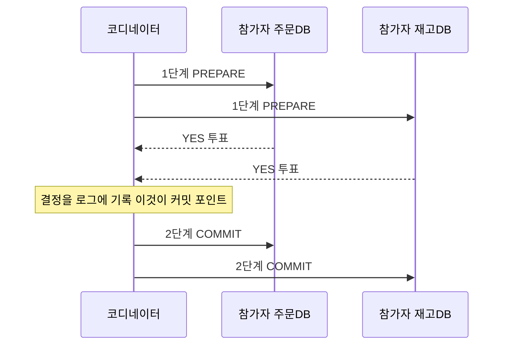

지금까지는 하나의 데이터베이스 안에서 트랜잭션이 어떻게 격리되는지를 다뤘다. 이 장은 그 가정을 깬다. 주문은 주문 서비스의 데이터베이스에, 결제는 결제 서비스의 데이터베이스에, 재고는 재고 서비스의 데이터베이스에 있다면 이 세 곳을 하나의 트랜잭션처럼 커밋할 방법이 필요하다. 단일 노드에서는 공짜로 얻던 원자성이 분산 환경에서는 프로토콜이 되고, 그 프로토콜은 가용성과 지연이라는 값비싼 대가를 요구한다. 이 장은 2단계 커밋이 왜 막히는지, 사가와 아웃박스는 무엇을 포기하고 무엇을 얻는지, 퍼컬레이터와 스패너는 분산 환경에서 스냅샷 격리를 어떻게 구현하는지를 다룬다.

## 이 장을 읽기 전에

앞선 다섯 장, 특히 [02장](/post/database-transactions/snapshot-isolation-and-mvcc/)의 스냅샷 가시성과 [05장](/post/database-transactions/application-design-patterns/)의 멱등성·재시도를 알고 있다고 가정한다. 분산 시스템의 일관성과 합의에 대한 기본 개념은 [CAP 정리와 합의](/post/computerterms/cap-theorem-and-consensus/)에서 다룬 내용을 참고하면 좋다.

이 장의 깊이는 중급에서 심화다. 프로토콜의 흐름과 장애 시나리오를 중심으로 설명하고, Paxos·Raft 같은 합의 알고리즘의 내부 동작과 개별 분산 SQL 제품의 비교는 범위 밖이다.

| 수준 | 읽을 부분 | 핵심 목표 |
|---|---|---|
| 처음 배우는 독자 | "분산 환경에서 원자성이 어려운 이유", "2단계 커밋", "오개념" | 코디네이터 장애가 왜 문제인지 설명한다 |
| 실무 개발자 | "사가", "트랜잭셔널 아웃박스", "선택 지도" | 서비스 경계를 넘는 일관성 전략을 고른다 |
| 심화 독자 | "분산 격리", "퍼컬레이터와 스패너" | 분산 스냅샷에 타임스탬프가 필요한 이유를 설명한다 |

## 분산 환경에서 원자성이 어려운 이유

원자적 커밋의 요구는 단순하다. 모든 참가자가 커밋하거나, 모든 참가자가 중단해야 한다. 단일 데이터베이스에서는 로그에 커밋 레코드 하나를 기록하는 순간이 곧 결정의 순간이다. 분산 환경에서는 참가자마다 자신의 로그가 따로 있고, 참가자와 참가자 사이에는 지연되거나 유실될 수 있는 네트워크가 있다. 참가자 하나는 커밋했는데 다른 하나가 크래시했다면, 두 참가자가 서로 다른 결정을 내린 채 남는다. 이를 막으려면 모든 참가자가 "나는 커밋할 수 있다"고 약속한 뒤에야 커밋하는 합의 절차가 필요하다.

이 약속에는 비용이 따른다. 한번 커밋할 수 있다고 약속한 참가자는 이후 마음대로 중단할 수 없고, 최종 결정을 들을 때까지 변경한 데이터를 잠가 둔 채 기다려야 한다. 이 대기 중에 결정을 알려 줄 쪽이 사라지면 참가자는 무기한 막힌다. 분산 트랜잭션의 어려움은 대부분 이 "약속한 뒤의 대기"에서 나온다.

## 2단계 커밋

<strong>2단계 커밋(Two-Phase Commit, 2PC)</strong>은 이 합의 절차의 표준이다. 한 코디네이터와 여러 참가자가 있고, 두 단계로 진행한다. 첫 번째 단계는 준비(prepare)다. 코디네이터가 모든 참가자에게 준비를 요청하면, 각 참가자는 커밋에 필요한 모든 것을 내구성 있게 기록하고 "예" 또는 "아니오"로 투표한다. "예"로 투표한 참가자는 이제 준비됨(PREPARED) 상태이며 스스로 중단할 권리를 포기한다. 두 번째 단계는 결정 전파다. 모든 참가자가 "예"로 투표했다면 코디네이터는 커밋을 결정해 이를 자신의 로그에 먼저 기록한 뒤 모두에게 전달하고, 한 명이라도 "아니오"였다면 중단을 결정한다. 결정을 로그에 기록하는 순간이 전체 트랜잭션의 커밋 포인트다.



PostgreSQL은 이 프로토콜의 참가자 측 기능을 `PREPARE TRANSACTION`으로 제공한다. 공식 문서에 따르면 이 명령은 현재 트랜잭션을 2단계 커밋을 위해 준비시키고, 이후 트랜잭션은 현재 세션과 분리되어 상태가 전부 디스크에 저장되므로, 커밋이 요청되기 전에 데이터베이스가 크래시해도 커밋에 성공할 가능성이 매우 높다. 같은 문서는 이 기능이 애플리케이션이나 대화형 세션에서 쓰라고 만든 것이 아니라 여러 데이터베이스나 트랜잭션 자원에 걸친 원자적 전역 트랜잭션을 수행하는 외부 트랜잭션 관리자를 위한 것이며, 트랜잭션 관리자를 직접 작성하는 것이 아니라면 쓰지 말라고 권고한다. 이런 관리자와 자원 사이의 표준 인터페이스가 X/Open XA다.

2단계 커밋의 약점은 코디네이터가 죽는 순간에 드러난다. 다음 모델은 코디네이터가 크래시하는 두 시점에 참가자가 어떤 상태에 놓이는지를 보여 준다. 코디네이터는 결정을 로그에 기록하고, 복구 시 로그를 읽어 결정을 마무리한다. 로그에 결정이 없으면 중단으로 간주한다.

```python
"""2단계 커밋(2PC)에서 코디네이터가 죽었을 때 참가자가 어떤 상태에 놓이는지 보여 주는 모델."""


class Participant:
    def __init__(self, name, can_commit=True):
        self.name, self.can_commit, self.state = name, can_commit, "ACTIVE"

    def prepare(self):
        if not self.can_commit:
            self.state = "ABORTED"
            return "NO"
        self.state = "PREPARED"        # 이후에는 혼자 커밋/중단을 정할 수 없고 락도 쥔 채로 대기한다
        return "YES"

    def finish(self, decision):
        self.state = decision


class Coordinator:
    def __init__(self, participants):
        self.ps, self.log = participants, []   # 로그는 디스크에 남는다고 가정

    def run(self, crash_at=None):
        votes = [p.prepare() for p in self.ps]                    # 1단계: PREPARE
        if crash_at == "before_decision":
            return "코디네이터 중단(결정 기록 전)"
        decision = "COMMITTED" if all(v == "YES" for v in votes) else "ABORTED"
        self.log.append(decision)                                 # 결정을 먼저 로그에 남긴다
        if crash_at == "after_decision":
            return f"코디네이터 중단(결정 {decision} 기록 후, 전달 전)"
        for p in self.ps:                                         # 2단계: 결정 전달
            p.finish(decision)
        return decision

    def recover(self):
        decision = self.log[-1] if self.log else "ABORTED"         # 결정이 없으면 중단으로 간주
        for p in self.ps:
            if p.state == "PREPARED":
                p.finish(decision)
        return decision


def show(title, ps, result):
    print(f"{title}: {result} | " + ", ".join(f"{p.name}={p.state}" for p in ps))


for title, flags, crash in [
    ("정상", (True, True), None),
    ("한 참가자가 NO", (True, False), None),
    ("결정 기록 후 크래시", (True, True), "after_decision"),
    ("결정 기록 전 크래시", (True, True), "before_decision"),
]:
    ps = [Participant("주문DB", flags[0]), Participant("재고DB", flags[1])]
    c = Coordinator(ps)
    show(title, ps, c.run(crash))
    if crash:
        print("   -> 복구 전 PREPARED 상태의 참가자는 락을 쥔 채 대기 중")
        show("   복구 후", ps, c.recover())
```

이 코드를 Python 3으로 실행하면 다음 출력이 나온다.

```text
정상: COMMITTED | 주문DB=COMMITTED, 재고DB=COMMITTED
한 참가자가 NO: ABORTED | 주문DB=ABORTED, 재고DB=ABORTED
결정 기록 후 크래시: 코디네이터 중단(결정 COMMITTED 기록 후, 전달 전) | 주문DB=PREPARED, 재고DB=PREPARED
   -> 복구 전 PREPARED 상태의 참가자는 락을 쥔 채 대기 중
   복구 후: COMMITTED | 주문DB=COMMITTED, 재고DB=COMMITTED
결정 기록 전 크래시: 코디네이터 중단(결정 기록 전) | 주문DB=PREPARED, 재고DB=PREPARED
   -> 복구 전 PREPARED 상태의 참가자는 락을 쥔 채 대기 중
   복구 후: ABORTED | 주문DB=ABORTED, 재고DB=ABORTED
```

앞의 두 줄은 정상 경로다. 한 참가자가 거절하면 전체가 중단된다. 핵심은 뒤의 두 시나리오다. 코디네이터가 결정을 기록한 뒤 전달 전에 죽으면 참가자들은 모두 PREPARED 상태에 머문다. 이들은 결정을 모르므로 커밋도 중단도 스스로 선택할 수 없고, 락을 쥔 채 코디네이터가 복구될 때까지 기다려야 한다. 복구된 코디네이터는 로그의 결정(COMMITTED)을 읽어 마무리한다. 결정을 기록하기 전에 죽은 경우에도 참가자는 똑같이 막히고, 복구 후 로그에 결정이 없으므로 중단으로 처리된다. 모델에는 나타나지 않았지만 현실에서는 이 대기 시간 동안 해당 행에 접근하려는 모든 트랜잭션이 함께 막힌다. PostgreSQL 문서도 준비된 트랜잭션을 오래 방치하면 `VACUUM`이 저장 공간을 회수하지 못하게 방해하고, 극단적으로는 트랜잭션 ID 순환을 막기 위해 데이터베이스가 종료될 수 있다고 경고하며, 외부 트랜잭션 관리자 없이는 `max_prepared_transactions`를 0으로 두어 기능을 꺼 두라고 권고한다.

2PC가 지불하는 비용은 세 가지로 정리된다. 가용성 측면에서 코디네이터가 단일 장애점이고, 참가자는 그 장애 동안 막힌다. 지연 측면에서 두 번의 왕복과 내구성 있는 로그 기록이 매번 필요하다. 락 보유 측면에서 준비 이후 결정을 받을 때까지 락이 유지되어 분산 환경에서는 락 보유 시간이 네트워크 지연만큼 늘어나 03장의 락 경합이 악화된다. 이 비용 때문에 서비스 경계를 넘는 일관성에 2PC를 쓰는 것을 꺼리는 시스템이 많고, 트랜잭셔널 아웃박스 패턴의 설명도 전통적인 분산 트랜잭션(2PC)이 신뢰할 수 없거나 지원되지 않는 환경을 출발점으로 삼는다.

## 분산 환경의 격리

2PC는 원자성에 대한 해법이지 격리에 대한 해법이 아니다. 모든 참가자가 함께 커밋하는 것을 보장할 뿐, 다른 트랜잭션이 이 커밋을 일부만 보게 되는 일은 막지 못한다. 참가자 A의 커밋이 반영된 직후 참가자 B의 커밋이 반영되기 직전에 다른 트랜잭션이 두 곳을 읽으면, 이체의 한쪽만 본 불일치한 상태(01장의 read skew)가 보인다. 각 데이터베이스가 각자의 로컬 스냅샷을 갖는 것으로는 전역적으로 일관된 스냅샷을 얻을 수 없다.

전역 스냅샷을 만들려면 모든 참가자가 동의하는 하나의 순서가 필요하고, 그 순서의 원천은 대개 타임스탬프다. 그러면 질문은 "어떻게 서로 다른 머신이 일관된 타임스탬프를 얻는가"가 된다. 아래의 두 시스템은 이 질문에 정반대의 답을 낸다. 하나는 중앙에서 타임스탬프를 발급하고, 다른 하나는 시계 오차 자체를 모델링한다.

## 퍼컬레이터와 스패너

구글의 퍼컬레이터는 Daniel Peng 등의 논문 「Large-scale Incremental Processing Using Distributed Transactions and Notifications」(OSDI 2010)에서 소개되었다. 웹 문서 색인을 점진적으로 갱신하기 위한 시스템으로, 여러 행에 걸친 트랜잭션에서 스냅샷 격리를 제공한다. 이 구현은 Bigtable이 보장하는 단일 행 원자성을 바탕으로, 여러 행을 한 트랜잭션으로 묶기 위해 그중 한 행을 기본(primary)으로 지정해 커밋 락을 두는 2단계 커밋 변형을 쓴다. 스냅샷 격리를 위해 단조 증가하는 타임스탬프를 발급하는 타임스탬프 오라클을 둔다. 읽기 트랜잭션은 시작 시 받은 타임스탬프 이전에 커밋된 버전만 읽으므로 02장의 스냅샷 규칙이 분산된 행들에 그대로 적용되는 셈이다. 중앙 오라클은 단순하지만, 모든 트랜잭션이 오라클을 거치므로 오라클이 처리량과 가용성의 병목이 될 수 있다는 점은 감수해야 한다.

구글 스패너는 James Corbett 등의 논문 「Spanner: Google's Globally-Distributed Database」(OSDI 2012)에서 소개되었다. 논문 초록은 스패너를 확장 가능한 다중 버전 전역 분산 동기 복제 데이터베이스로 소개하고, 전역 규모에서 데이터를 분산하면서 외부적으로 일관된(externally consistent) 분산 트랜잭션을 지원하는 첫 시스템이라고 주장한다. 이를 가능하게 하는 핵심은 시계의 불확실성을 노출하는 새로운 시간 API다. 서로 다른 데이터센터의 시계는 완벽히 일치할 수 없으므로, 스패너는 오차를 숨기지 않고 시각이 속하는 구간으로 표현해 그 구간을 기준으로 트랜잭션 순서를 정한다. 외부 일관성이란 트랜잭션 T1이 커밋을 끝낸 뒤 T2가 시작되면 T2는 반드시 T1의 효과를 본다는 실시간 순서의 보장이다. 논문은 이 구조로 과거 시점의 읽기를 락 없이 하는 읽기 전용 트랜잭션과 비차단 과거 읽기를 제공한다고 설명한다. 02장의 "읽기가 쓰기를 막지 않는다"는 성질을 전역 규모로 확장한 것이다.

두 시스템의 공통점이 중요하다. 둘 다 분산 환경에서 직렬 가능성이나 스냅샷 격리를 얻기 위해 전역 순서의 원천을 따로 만들었고, 원자성은 2PC 계열의 프로토콜로 해결했다. 단일 노드의 락과 스냅샷 개념이 사라지는 것이 아니라 네트워크 위로 옮겨가며 비용이 커진다. 이런 시스템을 쓴다고 해서 애플리케이션의 재시도가 필요 없어지는 것은 아니다. 충돌과 장애는 여전히 중단으로 나타난다.

## 사가: 원자성을 포기하고 보상한다

서비스 경계를 넘는 일관성에서 2PC를 피하고 싶다면 원자성을 다른 방식으로 얻어야 한다. <strong>사가(Saga)</strong>는 Hector Garcia-Molina와 Kenneth Salem이 1987년 SIGMOD 논문 「Sagas」에서 제안한 개념이다. 논문은 오래 걸리는 트랜잭션(long lived transaction)이 데이터베이스 자원을 오래 쥐어 짧은 트랜잭션의 종료를 크게 지연시킨다는 문제에서 출발하고, 오래 걸리는 트랜잭션을 다른 트랜잭션과 끼어들 수 있는 트랜잭션들의 시퀀스로 쓸 수 있다면 이를 사가라 부르자고 제안한다. 시스템은 사가의 모든 트랜잭션이 성공적으로 끝나거나, 아니면 부분 실행을 되돌리기 위해 <strong>보상 트랜잭션(compensating transaction)</strong>을 실행하는 것을 보장한다.

마이크로서비스 맥락의 사가도 같은 구조다. 각 서비스의 로컬 트랜잭션을 순서대로 실행하고, 중간에 실패하면 이미 성공한 단계들의 보상 트랜잭션을 역순으로 실행한다. 조율 방식은 두 가지다. 코레오그래피(choreography)에서는 서비스들이 도메인 이벤트를 발행해 서로의 다음 트랜잭션을 촉발하고, 오케스트레이션(orchestration)에서는 오케스트레이터가 참가자에게 실행할 로컬 트랜잭션을 지시한다. 다음 모델은 오케스트레이션 방식을 단순화한 것이다.

```python
"""사가(Saga): 로컬 트랜잭션을 순서대로 실행하고, 실패하면 보상 트랜잭션을 역순으로 실행한다."""


def run_saga(steps):
    done = []
    for name, action, compensate in steps:
        try:
            action()
            print(f"  성공: {name}")
            done.append((name, compensate))
        except Exception as e:
            print(f"  실패: {name} ({e})")
            for done_name, comp in reversed(done):
                comp()
                print(f"  보상: {done_name} 취소")
            return "SAGA 실패(보상 완료)"
    return "SAGA 성공"


state = {"order": None, "payment": None, "stock": 1}


def create_order():
    state["order"] = "PENDING"            # 중간 상태가 다른 요청에 그대로 보인다(격리 없음)


def charge():
    state["payment"] = "CHARGED"


def confirm_order():
    state["order"] = "CONFIRMED"


def reserve_stock(fail):
    def action():
        if fail:
            raise RuntimeError("재고 부족")
        state["stock"] -= 1
    return action


for fail in (False, True):
    state.update(order=None, payment=None, stock=1)
    print(f"[재고 {'부족' if fail else '충분'}]")
    steps = [
        ("주문 생성", create_order, lambda: state.update(order="CANCELLED")),
        ("결제 승인", charge, lambda: state.update(payment="REFUNDED")),
        ("재고 확보", reserve_stock(fail), lambda: state.update(stock=state["stock"] + 1)),
        ("주문 확정", confirm_order, lambda: None),
    ]
    print(" ", run_saga(steps), state)
```

이 코드를 Python 3으로 실행하면 다음 출력이 나온다.

```text
[재고 충분]
  성공: 주문 생성
  성공: 결제 승인
  성공: 재고 확보
  성공: 주문 확정
  SAGA 성공 {'order': 'CONFIRMED', 'payment': 'CHARGED', 'stock': 0}
[재고 부족]
  성공: 주문 생성
  성공: 결제 승인
  실패: 재고 확보 (재고 부족)
  보상: 결제 승인 취소
  보상: 주문 생성 취소
  SAGA 실패(보상 완료) {'order': 'CANCELLED', 'payment': 'REFUNDED', 'stock': 1}
```

재고가 충분하면 네 단계가 모두 성공한다. 재고가 부족하면 세 번째 단계가 실패하고, 이미 성공한 결제와 주문 생성이 역순으로 보상되어 결제는 환불, 주문은 취소 상태가 된다. 이 모델의 주석이 가리키는 점이 사가의 가장 큰 대가다. 보상은 롤백이 아니다. 롤백은 변경이 없었던 것처럼 되돌리지만, 보상은 새 트랜잭션으로 의미상 상쇄하는 것이어서 중간 상태가 다른 요청에 이미 보였을 수 있다. 사가에는 ACID의 격리가 없다. microservices.io의 패턴 설명도 사가가 격리(ACID의 I)를 결여해 여러 사가와 트랜잭션이 동시에 실행될 때 데이터 이상이 생길 위험이 있고, 롤백이 자동이 아니라 보상 트랜잭션을 개발자가 설계해야 한다고 단점으로 명시한다. 그래서 사가 설계자는 격리를 흉내 내는 대응 기법을 써야 한다. 주문 상태에 `PENDING` 같은 중간 상태를 두어 다른 로직이 확정되지 않은 주문을 건드리지 못하게 하거나, 순서에 무관하게 결과가 같은 교환 가능한 갱신으로 설계하는 식이다. 01장의 이상 현상 어휘로 말하면 사가는 서비스 수준에서 read skew와 lost update를 허용하며, 이를 애플리케이션 설계로 막아야 한다.

## 트랜잭셔널 아웃박스

사가나 이벤트 기반 설계에는 또 다른 함정이 있다. 서비스가 자기 데이터베이스를 갱신하고 이벤트를 메시지 브로커에 발행해야 하는데, 이 두 쓰기를 원자적으로 묶을 수 없다. 데이터베이스는 커밋했는데 발행 직전에 크래시하면 이벤트가 사라지고, 발행하고 커밋 전에 크래시하면 존재하지 않는 변경에 대한 이벤트가 나간다. 이것이 이중 쓰기(dual write) 문제다.

<strong>트랜잭셔널 아웃박스(transactional outbox)</strong>는 이를 2PC 없이 푼다. 이벤트를 곧바로 브로커에 보내는 대신, 비즈니스 데이터를 갱신하는 같은 로컬 트랜잭션 안에서 이벤트를 `outbox` 테이블에 삽입한다. 그러면 하나의 로컬 트랜잭션이 원자성을 보장하므로, 커밋되면 이벤트도 함께 저장되고 롤백되면 둘 다 사라진다. 이후 별도의 메시지 릴레이가 `outbox` 테이블을 읽어 브로커에 발행한다.

```sql
BEGIN;
INSERT INTO orders (id, customer_id, total) VALUES (1001, 7, 5900);
INSERT INTO outbox (id, topic, payload)
VALUES (gen_random_uuid(), 'order.created', '{"order_id": 1001}');
COMMIT;

-- 릴레이: 여러 인스턴스가 동시에 돌아도 서로 다른 행을 가져가도록 05장의 SKIP LOCKED를 쓴다
SELECT id, topic, payload
FROM outbox
WHERE published_at IS NULL
ORDER BY created_at
LIMIT 100
FOR UPDATE SKIP LOCKED;
```

이 패턴의 보장은 메시지가 데이터베이스 트랜잭션이 커밋될 때만, 그리고 반드시 전송된다는 것이다. 대가는 중복이다. 릴레이가 발행한 뒤 완료 표시를 하기 전에 크래시하면 같은 메시지가 다시 발행된다. 그러므로 소비자는 멱등해야 하며, 처리한 메시지 ID를 기록하는 05장의 멱등성 키 패턴이 여기서 다시 쓰인다. 즉 아웃박스는 "정확히 한 번"이 아니라 "최소 한 번 전달 + 멱등한 소비"로 효과적으로 한 번의 처리를 얻는 패턴이다. 위 `gen_random_uuid()`는 PostgreSQL 13 이상에서 기본 제공되는 함수이고 `outbox` 테이블 정의와 완료 표시 로직은 생략했다.

## 선택 지도

서비스 경계를 넘는 일관성 요구에서 전략으로 가는 대응을 표로 정리한다.

| 요구 | 권장 전략 | 얻는 것 | 포기하는 것 |
|---|---|---|---|
| 같은 DBMS 안의 여러 테이블 | 단일 로컬 트랜잭션 | ACID 전부 | 없음 |
| 서로 다른 DB를 강하게 묶어야 함(소수, 낮은 지연) | 2PC(XA) | 원자성 | 가용성, 지연, 락 보유 시간 |
| 서비스 경계를 넘는 업무 흐름 | 사가(오케스트레이션 또는 코레오그래피) | 가용성, 느슨한 결합 | 격리, 자동 롤백 |
| DB 갱신과 이벤트 발행의 원자성 | 트랜잭셔널 아웃박스 | 유실 없는 발행 | 중복 가능성, 릴레이 운영 |
| 전역 규모에서 강한 일관성 | 스패너류 분산 DB | 외부 일관성, 비차단 읽기 | 시계·인프라 요건, 비용 |
| 읽기가 대부분이고 약간 낡아도 됨 | 읽기 전용 복제본과 최종 일관성 | 확장성 | 최신성 |

## 흔한 오개념

**"2PC를 쓰면 분산 환경에서도 ACID가 해결된다."** 2PC는 원자성을 해결한다. 격리는 별개 문제여서, 커밋이 진행되는 동안 일부만 반영된 상태가 다른 트랜잭션에 보이는 것을 막지 못한다. 전역 격리에는 전역 타임스탬프 같은 추가 장치가 필요하다.

**"사가는 분산 트랜잭션을 롤백하는 방법이다."** 사가의 보상은 롤백이 아니라 의미상의 상쇄다. 중간 상태는 외부에 보였을 수 있고, 환불이나 취소 같은 보상이 불가능한 단계(이메일 발송 등)는 사가의 마지막으로 미뤄야 한다.

**"메시지 시스템을 쓰면 정확히 한 번 처리된다."** 아웃박스와 릴레이로 얻는 것은 최소 한 번 전달이다. 정확히 한 번의 효과는 소비자의 멱등성이 만든다.

**"분산 데이터베이스를 쓰면 재시도 코드는 필요 없다."** 분산 SQL 시스템도 충돌과 장애를 트랜잭션 중단으로 해소하며, 직렬화 실패 시 재시도를 요구하는 경우가 일반적이다. 05장의 재시도와 멱등성 원칙은 분산 환경에서 더 중요하다.

## 이 장을 읽은 후 달성해야 할 목표

이 장을 읽은 후에는 다음을 할 수 있어야 한다. 2PC의 두 단계와 커밋 포인트를 설명하고, 코디네이터 장애 시 참가자가 PREPARED 상태에서 막히는 이유와 그 비용(가용성, 지연, 락 보유)을 설명할 수 있다. 2PC가 원자성만 해결하고 전역 격리를 해결하지 못한다는 점과, 전역 스냅샷에 타임스탬프가 필요한 이유를 설명할 수 있다. 퍼컬레이터의 타임스탬프 오라클과 스패너의 시계 불확실성 모델이 같은 문제에 대한 서로 다른 해법임을 설명할 수 있다. 사가의 보상 트랜잭션이 롤백과 다르다는 것과 격리 부재의 영향을 설명하고, 상태 설계로 대응할 수 있다. 아웃박스가 이중 쓰기를 어떻게 풀고 왜 소비자의 멱등성이 필요한지 설명할 수 있다.

## 다음 장에서는

마지막 07장에서는 지금까지 읽은 모든 주장을 직접 검증하는 방법을 다룬다. 벤더 문서와 블로그의 주장을 믿는 대신 두 세션의 인터리빙을 재현하는 테스트 하네스를 만들고, Hermitage와 Jepsen의 Elle 같은 기존 도구가 이를 어떻게 체계화했는지 살펴본다. 같은 시나리오를 설정만 달리해 실행하면 결과가 달라진다는 것을 실제 출력으로 확인한다.

## 참고 자료

- [Garcia-Molina, Salem, Sagas (SIGMOD 1987)](https://www.cs.cornell.edu/andru/cs711/2002fa/reading/sagas.pdf) — 사가와 보상 트랜잭션의 원전
- [Peng et al., Percolator (OSDI 2010)](https://www.usenix.org/legacy/event/osdi10/tech/full_papers/Peng.pdf) — 스냅샷 격리와 타임스탬프 오라클, 행 단위 2단계 커밋
- [Corbett et al., Spanner (OSDI 2012)](https://www.usenix.org/system/files/conference/osdi12/osdi12-final-16.pdf) — 외부 일관성과 시계 불확실성 API
- [Spanner 논문 소개 페이지](https://research.google/pubs/spanner-googles-globally-distributed-database-2/) — 논문 초록
- [PostgreSQL Documentation: PREPARE TRANSACTION](https://www.postgresql.org/docs/current/sql-prepare-transaction.html) — 2PC의 참가자 기능과 방치된 준비 트랜잭션의 위험
- [microservices.io: Saga pattern](https://microservices.io/patterns/data/saga.html) — 코레오그래피와 오케스트레이션, 격리 부재의 단점
- [microservices.io: Transactional outbox](https://microservices.io/patterns/data/transactional-outbox.html) — 이중 쓰기 문제와 아웃박스 해법
- [CAP 정리와 합의](/post/computerterms/cap-theorem-and-consensus/) — 분산 시스템 일관성의 배경
