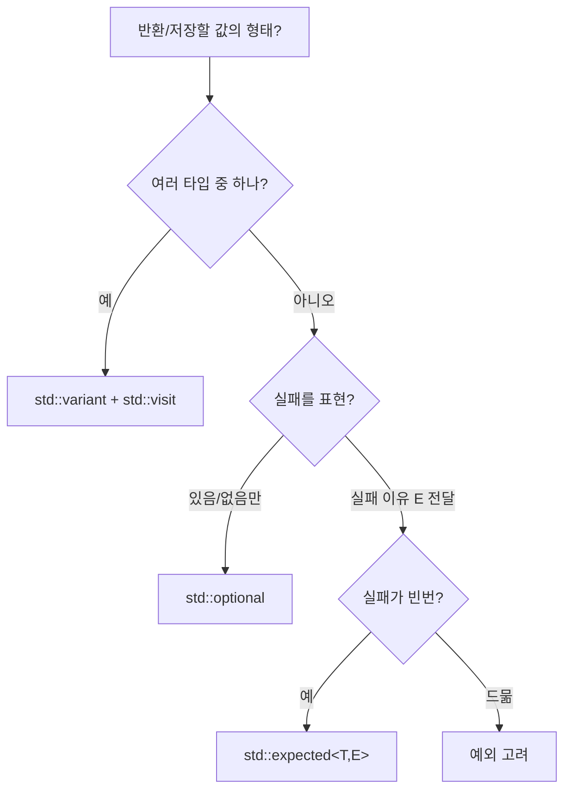

**std::variant**·**std::optional**·**std::expected**는 타입 안전 유니온·"있음/없음"·성공/실패 전달을 위한 표준 타입입니다. 본 챕터에서는 이들의 성능 특성과 오버헤드를 분석하고, 포인터·공용체·예외 대비 비용과 선택 기준을 다룹니다.

## 이 장을 읽기 전에

**완전한 초보자?** 이 장은 [11장: 예외 처리 심화](/post/cpp-optimization/exception-deep-dive/)에서 본 "예외 vs 에러 코드" 트레이드오프와 [03장: 추상화 비용 분석](/post/cpp-optimization/abstraction-cost/)을 전제로 합니다. 유니온·"값이 있거나 없거나"가 무엇인지 정도만 알면 충분합니다.

**이 장의 깊이**: 이 장은 **중급–전문가**를 포괄합니다. `variant`·`optional`·`expected`의 의미와 사용법부터 시작해, 전문가 구간에서는 `sizeof` 레이아웃·접근 비용을 따지고 포인터·공용체·예외 대비 선택 기준을 다룹니다. **다루지 않는 것**: 예외 메커니즘 내부([11장](/post/cpp-optimization/exception-deep-dive/))와 타입 소거 일반론([19장](/post/cpp-optimization/type-erasure-cost-patterns/))입니다.

## 당신의 수준에 맞는 경로

| 수준 | 읽을 부분 | 핵심 목표 |
|------|---------|---------|
| **초보자** | "std::variant" ~ "std::optional" | 세 타입의 의미·사용법 이해 |
| **중급자** | "std::expected (C++23)" ~ "sizeof 레이아웃 노트" | 레이아웃·접근 비용 파악 |
| **전문가** | "선택 가이드" ~ "비판적 시각" | 포인터·예외 대비 선택 판단 |

---

## variant/optional/expected 표준화 (역사·배경)

**std::variant**와 **std::optional**은 C++17에서 표준에 추가되었습니다. variant는 타입 안전 유니온, optional은 "값이 있거나 없거나"를 표현합니다. **std::expected**는 C++23에서 도입되어 성공 타입 T 또는 실패 타입 E를 담고, 예외 없이 에러 전달을 표준화합니다. 이들로 RTTI·포인터·예외 대신 타입 안전하고 비용이 예측 가능한 패턴을 쓸 수 있어, Low-latency에서 선택지가 됩니다.

## std::variant

**std::variant**는 **타입 안전 유니온**입니다. 여러 타입 중 하나만 활성화되어 있고, <strong>인덱스(타입 식별)</strong>와 **정렬된 저장소**(가장 큰 타입 크기·정렬에 맞춤)로 표현됩니다. **std::visit**로 값을 방문할 때는 활성 타입에 따라 디스패치가 일어나며, 컴파일러가 visit 대상을 인라인할 수 있으면 switch/테이블 점프 수준으로 최적화됩니다. 포인터 하나로 간접 접근하는 방식보다 값을 직접 담아 캐시에 유리할 수 있습니다.

아래 예시는 `std::holds_alternative`로 활성 타입을 검사하고, `std::visit`로 활성 값을 한 번에 방문합니다. 대입으로 활성 타입을 전환하면 `index()`가 바뀌는 것을 확인할 수 있습니다.

```cpp
#include <variant>
#include <string>
#include <iostream>

int main() {
    std::variant<int, double, std::string> v = std::string{"hello"};

    if (std::holds_alternative<std::string>(v))
        std::cout << "string: " << std::get<std::string>(v) << '\n';

    std::visit([](auto&& x) { std::cout << "visit: " << x << '\n'; }, v);

    v = 42;                                       // 활성 타입 전환
    std::cout << "index=" << v.index() << '\n';   // 0 (int)
}
```

**포인터·수동 union 대비**: 포인터는 힙 할당과 간접 접근 비용이 있고, 수동 union은 타입 안전성이 없습니다. variant는 스택/멤버에 직접 담고 visit로 타입을 검사하므로 할당 없이 타입 안전하게 "여러 타입 중 하나"를 표현할 수 있습니다.

## std::optional

<strong>std::optional&lt;T&gt;</strong>는 "값이 있거나 없거나"를 표현합니다. 내부적으로는 **T**와 **값 존재 여부**(bool 판별자)를 갖습니다. 크기는 "**sizeof(T) + 판별자 1바이트 + 정렬 패딩**"으로 결정되며, 정확한 값은 **구현 정의**입니다. 예를 들어 `T`의 정렬이 1인 경우(`optional<char>`)는 2바이트가 흔하지만, `optional<int>`는 판별자 1바이트가 4바이트 경계로 패딩되어 보통 **8바이트**이고, `optional<double>`은 보통 16바이트입니다. 즉 "sizeof(T)+1"로 단정하지 말고 정렬 패딩을 함께 봐야 합니다. **값에 접근할 때**는 "값이 있는지" 한 번의 분기가 있고, 있으면 저장된 객체를 반환합니다. 대체로 오버헤드는 "한 번의 분기 + 정렬용 패딩" 수준입니다.

크기보다 성능에 더 크게 작용하는 것은 **trivial 속성의 전파**입니다. 표준은 `T`가 trivially copy constructible이면 `optional<T>`의 복사 생성자도 trivial이 되고, `T`가 trivially destructible이면 `optional<T>`도 trivially destructible이 되도록 규정합니다. 이 속성이 유지되면 `optional<int>` 같은 객체는 `memcpy`로 복사할 수 있는 평범한 값으로 취급되고, x86-64 System V처럼 Itanium C++ ABI를 쓰는 플랫폼에서는 작은 trivial 객체를 레지스터로 주고받을 수 있습니다. 반대로 `optional<std::string>`처럼 `T`에 사용자 정의 소멸자가 있으면 optional도 non-trivial이 되어, 값으로 넘길 때 메모리(임시 객체 주소)를 거쳐 전달되고 소멸자 호출이 따라붙습니다. 즉 optional 자체의 비용은 "T가 원래 갖던 비용 + 분기 한 번"이며, optional이 T를 더 비싸게 만들지는 않습니다.

`value_or`는 값이 없을 때 기본값을 반환해 분기를 간결하게 합니다. 아래 함수는 빈 문자열이면 `std::nullopt`를 돌려주고, 호출 측은 `value_or(8080)`로 기본 포트를 사용합니다.

```cpp
#include <optional>
#include <string>
#include <iostream>

std::optional<int> parsePort(const std::string& s) {
    if (s.empty()) return std::nullopt;   // 값 없음
    return std::stoi(s);
}

int main() {
    int port = parsePort("").value_or(8080);  // 없으면 기본값
    std::cout << "port=" << port << '\n';      // 8080
}
```

**null 포인터·스마트 포인터**와 비교하면, optional은 **값을 직접 보관**하므로 할당이 없고, null 체크 한 번의 분기만 있습니다. 포인터는 간접 접근과 (힙 사용 시) 할당 비용이 있으므로, "값이 없을 수 있는 작은 객체"에는 optional이 성능·의도 표현 모두 유리한 경우가 많습니다.

## std::expected (C++23)

<strong>std::expected&lt;T, E&gt;</strong>는 "성공하면 T, 실패하면 E"를 담는 타입입니다. 에러 전파를 예외 없이 표현할 수 있어 **예외 대안**으로 쓰입니다. 에러 전달 비용은 **E**의 복사/이동 비용과 "성공/실패" 분기 한 번입니다. 인라인 가능하면 호출 오버헤드는 작고, 실패 경로가 예외보다 예측 가능한 비용을 가집니다.

아래 예시는 실패 시 `std::unexpected`로 에러 코드를 돌려줍니다. 변환에는 예외를 던지지 않는 `std::from_chars`를 써서, 숫자가 아닌 입력과 `int` 범위를 넘는 입력("99999999999")까지 모두 반환값으로 처리합니다. `std::stoi`를 쓰면 범위 초과 시 `std::out_of_range` 예외가 다시 끼어들어 "예외 없는 에러 전달"이라는 목적이 깨집니다. 호출 측은 `if (r)`로 성공/실패를 분기하고, 실패 경로에서 `r.error()`로 이유를 읽습니다(`-std=c++23`, GCC 12 이상 또는 Clang 16 이상의 표준 라이브러리 필요).

```cpp
#include <expected>      // C++23
#include <charconv>
#include <string_view>
#include <system_error>
#include <iostream>

enum class Err { Empty, NotNumber, OutOfRange };

std::expected<int, Err> parse(std::string_view s) {
    if (s.empty()) return std::unexpected(Err::Empty);
    int value = 0;
    auto [ptr, ec] = std::from_chars(s.data(), s.data() + s.size(), value);
    if (ec == std::errc::result_out_of_range) return std::unexpected(Err::OutOfRange);
    if (ec != std::errc{} || ptr != s.data() + s.size())
        return std::unexpected(Err::NotNumber);
    return value;
}

int main() {
    for (std::string_view in : {"8080", "abc", "99999999999", ""}) {
        auto r = parse(in);
        if (r) std::cout << in << " -> ok: " << *r << '\n';
        else   std::cout << in << " -> err code=" << static_cast<int>(r.error()) << '\n';
    }
}
```

## sizeof 레이아웃 노트

레이아웃은 직접 출력해 보면 가장 확실합니다. `optional`은 판별자 1바이트가 정렬 경계로 패딩되고, `variant`는 "인덱스 + 가장 큰 멤버 + 정렬 패딩"이 됩니다. 아래 값은 흔한 64비트 구현 기준 예시이며 정확한 값은 구현 정의입니다.

```cpp
#include <optional>
#include <variant>
#include <string>
#include <cstdio>

int main() {
    std::printf("opt<char>=%zu opt<int>=%zu opt<double>=%zu\n",
        sizeof(std::optional<char>),    // 흔히 2
        sizeof(std::optional<int>),     // 흔히 8 (패딩)
        sizeof(std::optional<double>)); // 흔히 16
    std::printf("variant=%zu\n",
        sizeof(std::variant<int, double, std::string>)); // string 크기 + 인덱스
}
```

## 선택 가이드

세 타입은 "무엇을 구분해야 하는가"로 갈립니다. 값이 있거나 비어 있거나만 구분하면 되는 경우에는 **optional**이 가장 작은 비용(판별자 1바이트와 분기 한 번)으로 의도를 드러냅니다. 비어 있는 이유까지 호출자에게 알려야 한다면 optional로는 부족하고, 이유 타입 E를 함께 담는 **expected**가 필요합니다. 반면 "실패"가 아니라 동등한 자격의 여러 타입 중 하나가 활성화되는 상황, 예를 들어 파서 토큰이나 메시지 종류라면 **variant**와 **visit**가 맞습니다.

expected와 예외 사이의 선택은 실패 빈도가 가릅니다. 예외는 던지지 않는 정상 경로의 비용이 거의 없지만 실패 경로에서 스택 되감기 비용이 크므로, 실패가 드문 경로에는 예외가, 실패가 자주 나와 비용을 예측해야 하는 경로에는 expected가 유리합니다. 아래 흐름도는 이 판단 순서를 그대로 옮긴 것입니다.



## 흔한 오해

<strong>"optional&lt;T&gt;의 크기는 항상 sizeof(T)+1이다"</strong>는 틀린 통념입니다. 판별자 1바이트가 T의 정렬 경계로 패딩되므로, 위 sizeof 예제에서 보듯 `optional<int>`는 흔히 8바이트, `optional<double>`은 흔히 16바이트입니다(정확한 값은 구현 정의). "+1바이트"만 기대하고 구조체에 여러 optional 멤버를 촘촘히 배치하면 예상보다 메모리를 더 쓰게 됩니다.

<strong>"expected는 예외보다 항상 빠르다"</strong>도 과장된 통념입니다. zero-cost exception 모델(11장)에서는 예외를 던지지 않는 정상 경로의 비용이 거의 없으므로, 실패가 드물게만 일어나는 경로에서는 예외 쪽이 오히려 더 유리할 수 있습니다. expected가 이기는 지점은 "실패가 빈번해 예측 가능한 비용이 필요한 경로"이지, 모든 상황에서의 절대적 우위가 아닙니다.

## 비판적 시각: 한계와 트레이드오프

**variant는 타입 집합이 닫혀 있어야 합니다.** 대안 목록이 컴파일 타임에 고정되므로, 플러그인처럼 런타임에 새 타입이 추가되는 구조에는 상속·가상 함수나 타입 소거([19장](/post/cpp-optimization/type-erasure-cost-patterns/))가 맞습니다. 또 variant는 "항상 값을 가진다"는 약속에 예외가 하나 있습니다. variant는 동적 할당을 할 수 없어 이전 값을 따로 보관해 둘 곳이 없습니다. 그래서 대입이나 활성 타입을 바꾸는 `emplace` 도중 새 값의 초기화가 예외를 던지면, variant는 `valueless_by_exception()`이 `true`인 빈 상태가 될 수 있습니다(이동 대입 중 예외는 반드시, 나머지 경우는 구현에 따라). 이 상태에서 `std::visit`나 `std::get`을 호출하면 `std::bad_variant_access`가 던져지므로, 예외를 던질 수 있는 타입을 담는 variant는 이 상태를 점검하거나 `noexcept` 이동 생성자를 가진 타입으로 대안을 구성하는 편이 안전합니다.

**visit의 코드 생성 비용도 공짜가 아닙니다.** 표준은 variant 하나를 visit할 때 호출이 대안 개수와 무관한 상수 시간에 이뤄지도록 요구하지만, 컴파일러는 대안마다 방문자 호출을 하나씩 인스턴스화합니다. 여러 variant를 한 번에 visit하면 각 variant 대안 수의 곱만큼 조합이 생성되므로, 대안 8개짜리 variant 두 개를 함께 visit하면 64개의 호출 경로가 만들어져 코드 크기와 컴파일 시간이 빠르게 늘어납니다. 마지막으로 **expected**는 반환값에 E가 함께 실리므로 E의 크기와 복사/이동 비용이 모든 반환 경로에 영향을 줍니다. E는 `enum class`나 `std::error_code`처럼 작게 두고, 상세 메시지가 필요하면 실패 경로에서만 만듭니다.

## 핵심 요약

| 항목 | 비용·이점 | 활용 기준 |
|------|-----------|-----------|
| variant | 인덱스+저장소, visit 디스패치, 할당 없음 | 고정 타입 집합 중 하나 |
| optional | 값+존재 플래그, 할당 없음, 분기 한 번 | 있음/없음 |
| expected | 성공 T/실패 E, 실패 경로 예측 가능 | 실패 빈번 시, E 가볍게 |

### 자주 묻는 질문 (FAQ)

**Q: `std::variant<int, int>`처럼 같은 타입을 두 번 넣어도 되나요?**  
A: 선언은 가능합니다. 다만 `std::get<int>`·`std::holds_alternative<int>`처럼 타입으로 고르는 연산은 대상이 모호해 컴파일 오류가 되므로, `std::get<0>`·`std::in_place_index<1>`처럼 인덱스로 접근해야 합니다. "같은 타입이지만 의미가 다른 두 상태"(예: 성공 코드와 실패 코드)를 구분할 때 쓰는 기법입니다.

**Q: 성공 시 돌려줄 값이 없는 함수는 expected로 어떻게 표현하나요?**  
A: C++23은 `std::expected<void, E>` 부분 특수화를 제공합니다. 성공 시에는 값 없이 `{}`를 반환하고, 실패 시에만 `std::unexpected(e)`를 반환하므로 크기는 사실상 E와 판별자만큼입니다.

## 이 글을 읽은 후 달성해야 할 목표

이 장의 목표는 세 타입을 "문법"이 아니라 "비용 모델"로 고를 수 있게 되는 것입니다. 다음을 스스로 설명하고 적용할 수 있으면 충분합니다.

- `optional<T>`의 크기가 sizeof(T)+1이 아니라 정렬 패딩을 포함한다는 점과, T의 trivial 속성이 optional로 전파되어 전달 방식이 결정된다는 점을 설명할 수 있다.
- variant의 인덱스+저장소 레이아웃, visit 디스패치 비용, 다중 visit의 코드 크기 증가, `valueless_by_exception` 상태를 설명할 수 있다.
- 예외를 쓰지 않는 expected 기반 파서를 `std::from_chars`로 작성하고, 실패 빈도에 따라 expected와 예외 중 하나를 고를 수 있다.

### 적용 체크리스트

- [ ] 구조체에 optional 멤버를 여러 개 둘 때 `sizeof`를 직접 출력해 확인했는가? — 판별자 패딩이 멤버마다 붙어 예상보다 커질 수 있다.
- [ ] 값으로 넘기는 optional·expected의 T와 E가 trivially copyable인가? — non-trivial이면 레지스터 전달이 막히고 소멸자 호출이 붙는다.
- [ ] 핫 경로에서 할당·분기·visit 디스패치를 벤치마크했는가? — 인라인 여부에 따라 visit 비용이 크게 달라진다.
- [ ] expected의 에러 타입 E를 가볍게 두었는가? — E는 성공 경로의 반환 크기에도 포함된다.

### 더 읽을 거리

- [cppreference: std::variant](https://en.cppreference.com/w/cpp/utility/variant) — 타입 안전 유니온의 표준 레퍼런스로, `visit`·`get`·`index()` 등 멤버 함수 명세를 확인할 수 있습니다.
- [cppreference: std::optional](https://en.cppreference.com/w/cpp/utility/optional) — `value_or`·`has_value` 등 API와 함께, 구현체별 레이아웃 차이를 다룰 때 참고할 근거 문서입니다.
- [cppreference: std::expected](https://en.cppreference.com/w/cpp/utility/expected) — C++23에서 추가된 `expected`의 정확한 인터페이스와 `unexpected`와의 관계를 확인할 수 있습니다.

## 다음 장에서는

**이전 장**: [인라이닝 유도 기법](/post/cpp-optimization/inlining-techniques/) (챕터 12)

**std::span과 뷰 패턴**을 다룹니다. 안전한 연속 구간 뷰인 span·string_view 활용과 성능 이점, non-owning 패턴을 정리합니다. → [std::span과 뷰 패턴](/post/cpp-optimization/span-and-views/) (챕터 14)
