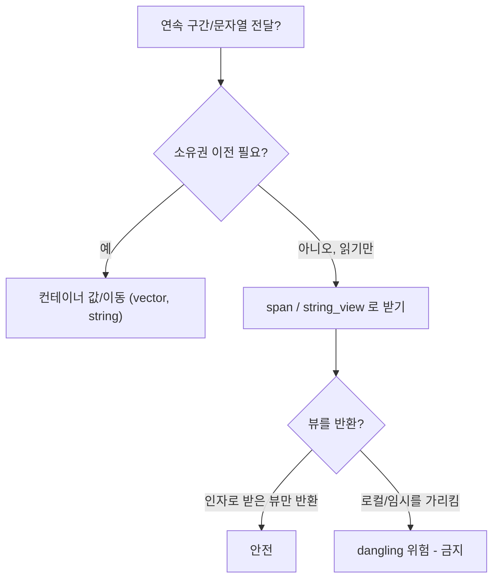

**뷰 패턴**이란 연속 메모리나 문자열을 **소유하지 않고 참조만** 하는 non-owning 타입으로 전달해 복사·할당을 줄이는 방식을 말합니다. 본 챕터에서는 **std::span**과 **std::string_view** 활용, API 경계에서의 전달 기준, 수명·안전성을 정리합니다.

## 이 장을 읽기 전에

**완전한 초보자?** 이 장은 앞서 [05장: 문자열 최적화](/post/cpp-optimization/string-optimization/)에서 소개한 `string_view`를 전제로 합니다. 값/참조/뷰 전달 비용의 일반 비교는 뒤의 [17장: Parameter Passing 전략](/post/cpp-optimization/parameter-passing/)에서 더 깊이 다루지만, 이 장은 뷰 전달에 필요한 만큼만 짚으므로 **순서대로 읽어도 됩니다**. "포인터 + 크기"로 배열을 가리킨다는 개념만 알면 충분합니다.

**이 장의 깊이**: 이 장은 **중급–전문가**를 포괄합니다. `span`·`string_view`로 복사 없이 전달하는 법부터 시작해, 전문가 구간에서는 API 경계에서 뷰를 받을지/소유 타입을 받을지, 그리고 댕글링 등 수명·안전성 함정을 다룹니다. **다루지 않는 것**: 컨테이너 자체의 비용([04장](/post/cpp-optimization/stl-container-cost/))과 ranges 뷰의 지연 평가([09장](/post/cpp-optimization/modern-cpp-features/))입니다.

## 당신의 수준에 맞는 경로

| 수준 | 읽을 부분 | 핵심 목표 |
|------|---------|---------|
| **초보자** | "std::span" | non-owning 뷰가 복사를 없애는 원리 이해 |
| **중급자** | "std::string_view와 수명" ~ "API 경계에서의 전달" | 뷰를 받는 API 설계 |
| **전문가** | "수명과 안전성" ~ "비판적 시각" | 댕글링 위험과 뷰 vs 소유 선택 판단 |

---

## std::span과 뷰 타입 도입 (역사·배경)

**std::span**은 C++20에서 표준에 추가되었습니다. "포인터 + 크기" 쌍을 타입 안전하게 감싼 non-owning 뷰로, 배열 붕괴를 막고 API를 단순화합니다. **std::string_view**는 C++17에서 도입되어 문자열의 non-owning 뷰를 제공합니다. 둘 다 읽기 전용 전달 시 복사를 제거하고, 수명은 호출자가 보장해야 합니다.

## std::span

**std::span**은 **연속 메모리**를 가리키는 **non-owning** 뷰입니다. 내부적으로는 포인터와 크기(또는 시작·끝 반복자)를 갖고, 복사·할당 비용이 거의 없습니다. const correctness는 `span<const T>`로 읽기 전용 뷰를 표현하면 됩니다. 배열이나 **vector**를 함수에 넘길 때 "포인터 + 크기" 두 인자로 넘기던 패턴을 **span 하나**로 대체할 수 있어, API가 단순해지고 배열 붕괴(array decay)를 막을 수 있습니다.

`std::span<const int>` 하나로 `std::vector`, C 스타일 스택 배열, `std::array`를 모두 받을 수 있습니다. 세 컨테이너 모두 연속 메모리를 보장하므로 동일한 함수에 그대로 전달됩니다.

```cpp
#include <span>
#include <vector>
#include <array>
#include <cstdio>

long sum(std::span<const int> data) {   // 포인터+크기 두 인자를 하나로
    long s = 0;
    for (int x : data) s += x;          // 크기를 알고 있으니 range-for 가능
    return s;
}

int main() {
    std::vector<int> v{1, 2, 3};
    int raw[]{4, 5, 6};
    std::array<int, 3> arr{7, 8, 9};

    std::printf("%ld %ld %ld\n",
        sum(v),     // std::vector 에서 구성
        sum(raw),   // C 스타일 스택 배열에서 구성
        sum(arr));  // std::array 에서 구성
}
```

레거시 C API가 `(ptr, size)`를 요구하면 `span.data()`, `span.size()`로 넘기면 됩니다.

## std::string_view와 수명

**문자열 의미**(길이·부분 문자열 연산)가 필요하면 **std::string_view**가 적합하고, 단순 바이트 범위면 `span<const std::byte>`를 쓸 수 있습니다. string_view는 복사 없이 부분 문자열·접두/접미 제거를 O(1)로 처리하지만, **참조만** 하므로 가리키는 버퍼의 수명을 호출자가 보장해야 합니다.

아래 예제는 같은 의도("인사말 문자열을 만들어 돌려준다")를 잘못 구현한 BAD 버전과 고친 FIXED 버전을 나란히 둡니다. `bad_greeting`은 함수 안에서 만든 로컬 `std::string`의 뷰를 반환하므로, 함수가 끝나 `local`이 파괴되는 순간 반환된 뷰는 해제된 힙 메모리를 가리키는 dangling이 됩니다. 새로 만든 문자열은 소유자가 필요하므로 `good_greeting`처럼 `std::string`을 값으로 반환하는 것이 올바른 수정입니다. 반면 `trim_prefix`는 입력으로 받은 뷰가 가리키던 호출자 버퍼의 일부를 돌려줄 뿐이라, 호출자의 버퍼가 살아 있는 동안 복사 없이 안전합니다.

```cpp
#include <cstdio>
#include <string>
#include <string_view>

// BAD: 로컬 std::string의 뷰를 반환 → 함수 종료 시 dangling
std::string_view bad_greeting(std::string_view name) {
    std::string local = "hello, " + std::string(name) + "!";   // 힙 할당되는 길이
    return local;        // local 파괴 후 뷰는 해제된 메모리를 가리킴 (UB)
}

// FIXED: 새로 만든 문자열은 소유 타입으로 반환한다
std::string good_greeting(std::string_view name) {
    return "hello, " + std::string(name) + "!";
}

// 뷰를 반환해도 안전한 경우: 입력 뷰가 가리키던 호출자 버퍼의 일부를 돌려준다
std::string_view trim_prefix(std::string_view sv, std::string_view prefix) {
    if (sv.substr(0, prefix.size()) == prefix)
        sv.remove_prefix(prefix.size());
    return sv;
}

int main(int argc, char**) {
    std::string path = "/usr/local/bin";
    std::string_view rest = trim_prefix(path, "/usr");   // path가 살아 있는 동안 유효
    std::printf("%.*s\n", static_cast<int>(rest.size()), rest.data());

    std::string ok = good_greeting("a very long user name");
    std::printf("%s\n", ok.c_str());

    if (argc > 1) {      // 인자를 주고 실행하면 BAD 경로를 탄다
        std::string_view v = bad_greeting("a very long user name");
        std::printf("%.*s\n", static_cast<int>(v.size()), v.data());
    }
}
```

이 BAD 경로는 두 단계로 검증할 수 있습니다. 먼저 컴파일 단계에서 Clang은 `bad_greeting`의 `return local;`에 "address of stack memory associated with local variable 'local' returned" 경고(`-Wreturn-stack-address`, 기본 활성)를 냅니다(Clang 18에서 확인). 다만 이런 경고는 뷰가 여러 함수를 거쳐 전달되면 놓치기 쉬우므로, 실행 단계에서는 `-std=c++20 -g -fsanitize=address`로 빌드한 뒤 인자를 하나 주고 실행해 BAD 경로를 태웁니다. AddressSanitizer는 해제된 힙 메모리를 읽는 접근을 `heap-use-after-free`로 보고하도록 설계돼 있으므로, 테스트 스위트를 ASan 빌드로 돌리는 것이 댕글링 뷰를 잡는 가장 확실한 방법입니다.

## API 경계에서의 전달

API 경계에서 뷰와 소유 타입을 가르는 기준은 "함수가 호출이 끝난 뒤에도 데이터를 붙잡아 두는가"입니다. 함수가 데이터를 **읽기만** 하고 호출이 끝나면 더 이상 참조하지 않는다면, 호출자 버퍼를 `span<const T>`나 `string_view`로 받는 것이 가장 싸고 유연합니다. 호출자가 `vector`, 배열, `std::array`, 문자열 리터럴 중 무엇을 갖고 있든 복사·할당 없이 그대로 넘길 수 있기 때문입니다.

반대로 함수가 데이터를 멤버에 저장하거나 다른 스레드에 넘기는 등 **소유권이 필요한** 경우에는 뷰를 받으면 안 됩니다. 뷰를 저장해 두면 호출자의 버퍼가 먼저 사라질 때 dangling이 되므로, 이때는 `std::vector`·`std::string`을 값으로 받아 이동시키거나 스마트 포인터를 씁니다. 레거시 C API가 `(T* ptr, size_t size)`를 요구하는 경계에서는 span의 `data()`와 `size()`를 그대로 꺼내 넘기면 되므로, 내부 코드는 span으로 통일하고 C 경계에서만 풀어 주는 구성이 깔끔합니다.

## 수명과 안전성

뷰를 쓸 때 가장 중요한 것은 **뷰가 참조하는 메모리의 수명**을 호출자·설계자가 보장하는 것입니다. 반환값으로 뷰를 줄 경우, **임시**나 **함수 내 로컬 버퍼**를 가리키지 않도록 해야 합니다. 컴파일러나 정적 분석 도구가 일부 dangling을 경고할 수 있지만, 완전히 자동으로 잡기 어렵기 때문에 코딩 규칙(예: "뷰를 반환하지 않거나, 반환 시에는 인자로 받은 뷰만 반환")으로 보완하는 것이 좋습니다. 검증 빌드에서는 도구별 역할을 구분해야 합니다. <strong>AddressSanitizer(`-fsanitize=address`)</strong>는 댕글링 뷰가 가리키는 <strong>해제된 메모리 접근(use-after-free)</strong>을 잡는 데 유용하지만, span의 **인덱스 경계 자체를 검사하지는 않습니다**. `span::operator[]`의 범위 위반은 표준 라이브러리 하드닝 모드(libstdc++ `-D_GLIBCXX_ASSERTIONS`, libc++ `-D_LIBCPP_HARDENING_MODE=_LIBCPP_HARDENING_MODE_FAST` 또는 `_EXTENSIVE`/`_DEBUG`)를 켜야 디버그/테스트 빌드에서 잡을 수 있고, 고정 크기 C 배열의 인덱스는 UBSan의 `-fsanitize=bounds`가 검사합니다. 한편 C++26은 `span::at`을 추가했는데, 이 함수는 하드닝 설정과 무관하게 범위를 벗어나면 항상 `std::out_of_range` 예외를 던집니다.



## 흔한 오해

<strong>"string_view는 null 종료 문자열이다"</strong>는 틀린 생각입니다. `string_view`는 포인터와 길이만 가지므로, `substr`이나 `remove_suffix`로 잘라 낸 뷰의 끝 다음 바이트는 원래 문자열의 다음 글자일 뿐 `'\0'`이 아닙니다. 그래서 `sv.data()`를 `fopen`·`printf("%s")`처럼 null 종료를 기대하는 C API에 그대로 넘기면 뒤의 문자까지 읽힙니다. C API 경계에서는 `std::string(sv).c_str()`로 복사하거나, 위 예제처럼 `"%.*s"`에 길이를 함께 넘깁니다.

<strong>"인자로 받은 뷰는 무엇으로 만들었든 안전하다"</strong>도 오해입니다. 뷰를 함수 안에서만 쓰고 버린다면 임시 객체로 만든 뷰도 문제가 없지만, 그 뷰를 변수에 담아 두면 이야기가 달라집니다.

```cpp
#include <cstdio>
#include <span>
#include <string>
#include <string_view>
#include <vector>

std::vector<int> load() { return {1, 2, 3}; }

int main() {
    std::string_view name = std::string("temporary user name");  // BAD: 문장 끝에서 임시 파괴
    std::span<const int> data = load();                             // BAD: 임시 vector 파괴
    // 여기서 name·data를 읽으면 이미 해제된 메모리 접근(UB)

    std::string owned = "temporary user name";                      // FIXED: 소유자를 먼저 만든다
    std::vector<int> buf = load();
    std::string_view ok_name = owned;
    std::span<const int> ok_data = buf;
    std::printf("%zu %zu\n", ok_name.size(), ok_data.size());
}
```

임시 객체는 그것을 만든 완전식(full-expression)이 끝날 때 파괴되므로, 첫 두 줄의 `name`과 `data`는 선언문이 끝나는 순간 dangling이 됩니다. `const std::string&`라면 임시의 수명이 참조에 맞춰 연장되지만 `string_view`와 `span`은 참조가 아니라 포인터를 담은 값 타입이라 수명 연장 규칙이 적용되지 않습니다. 소유자를 먼저 이름 있는 변수로 만들고 거기서 뷰를 꺼내는 것이 해법입니다. Clang은 이 중 `string_view` 쪽을 `-Wdangling-gsl` 경고(기본 활성, "object backing the pointer will be destroyed at the end of the full-expression")로 알려 주지만 GCC 14의 `-Wall`은 경고하지 않으므로(둘 다 Compiler Explorer에서 확인), 컴파일러 경고에만 기대지 말아야 합니다.

## 비판적 시각: 한계와 트레이드오프

뷰의 가장 큰 비용은 성능이 아니라 **계약의 무게**입니다. 뷰를 쓰는 순간 "가리키는 메모리가 언제까지 살아 있는가"라는 질문이 타입에서 사라지고 주석·코딩 규칙·리뷰로 옮겨 갑니다. 함수 인자로만 쓰는 뷰는 이 부담이 작지만, 멤버 변수나 반환값으로 뷰를 들고 다니기 시작하면 수명 추론이 호출 그래프 전체로 퍼지므로, 그런 설계는 소유 타입보다 측정 가능한 이득이 있을 때만 택합니다.

`span`은 또한 연속 메모리만 표현할 수 있어, `std::list`나 트리처럼 비연속 구조를 같은 인터페이스로 받으려면 반복자 쌍이나 C++20 ranges의 범위 개념을 써야 합니다. 전달 비용도 플랫폼에 따라 다릅니다. x86-64 System V ABI에서는 포인터와 크기로 이뤄진 16바이트 `span`을 레지스터 두 개로 넘길 수 있지만, Windows x64 호출 규약은 8바이트를 넘는 구조체를 값으로 넘길 때 복사본의 주소를 전달하므로 포인터+크기를 별도 인자로 넘기는 것보다 메모리 왕복이 하나 늘 수 있습니다. 대부분의 코드에서는 무시해도 되는 차이지만, 인라인되지 않는 초고빈도 함수 경계라면 확인해 볼 만합니다.

## 이 글을 읽은 후 달성해야 할 목표

이 장을 마치면 뷰 타입을 "복사를 없애는 도구"이자 "수명 계약을 요구하는 도구"로 함께 다룰 수 있어야 합니다.

- `span<const T>` 하나로 vector·C 배열·`std::array`를 받는 API를 설계하고, 포인터+크기 두 인자 방식과 비교해 장단점을 설명할 수 있다.
- 함수가 데이터를 호출 이후에도 붙잡는지에 따라 뷰와 소유 타입 중 하나를 고를 수 있다.
- 로컬·임시 객체를 가리키는 뷰를 코드에서 찾아내고, 컴파일러 경고와 AddressSanitizer로 검증할 수 있다.
- `string_view`가 null 종료를 보장하지 않는다는 점을 C API 경계 처리에 반영할 수 있다.

## 핵심 요약

| 항목 | 비용·이점 | 활용 기준 |
|------|-----------|-----------|
| span | non-owning, 타입 안전, array decay 방지 | 연속 구간 읽기 전달 |
| string_view | 복사 없음, O(1) 부분 문자열 | 문자열 뷰, null 종료 확인 |
| 수명 | 뷰는 원본보다 짧게 | 인자로만 받기 권장 |

### 자주 묻는 질문 (FAQ)

**Q: span vs 포인터+크기?**  
A: span은 연속 메모리의 non-owning 뷰로, 포인터+크기를 타입 안전하게 묶고 array decay를 방지합니다. 코드 생성은 포인터+크기를 직접 넘기는 것과 **동등한 경우가 많고**, 크기를 타입으로 들고 다녀 `range-for`·`subspan`·경계 검사를 안전하게 쓸 수 있다는 점이 추가 이점입니다. 컨테이너를 값으로 받던 핫 루프를 `span<const T>`로 바꾸면 복사·할당이 사라지는 만큼 유리해집니다.

**Q: `std::span<int, 4>`처럼 크기를 템플릿 인자로 주는 것은 무엇이 다른가요?**  
A: 크기가 컴파일 타임에 고정된 static extent span은 크기를 멤버로 저장할 필요가 없어 포인터 하나 크기가 되고(x86-64 libstdc++에서 `sizeof(std::span<int, 4>)`는 8, `sizeof(std::span<int>)`는 16), 컴파일러가 루프 횟수를 상수로 알 수 있습니다. 크기를 생략하면 `std::dynamic_extent`가 되어 포인터와 크기를 함께 저장합니다. 고정 크기 블록(예: 4x4 행렬, SIMD 레인 묶음)을 다루는 함수라면 static extent가 더 많은 최적화 정보를 줍니다.

### 적용 체크리스트

- [ ] 읽기 전용 연속 구간 인자를 `span<const T>`/`string_view`로 받았는가? — 호출자 컨테이너 종류와 무관하게 복사·할당이 사라진다.
- [ ] 뷰를 멤버나 반환값으로 들고 다니는 곳의 수명을 문서화했는가? — 함수 인자를 벗어난 뷰는 수명 추론이 호출 그래프 전체로 퍼진다.
- [ ] C API에 `string_view`를 넘기기 전에 null 종료를 확보했는가? — 잘라 낸 뷰의 끝은 `'\0'`이 아니다.
- [ ] 테스트 빌드를 ASan·하드닝 모드로 돌리는가? — 댕글링과 `operator[]` 범위 위반은 컴파일러 경고만으로 다 잡히지 않는다.

### 더 읽을 거리

- [cppreference: std::span](https://en.cppreference.com/w/cpp/container/span) — C++20에 추가된 non-owning 뷰의 표준 레퍼런스로, 생성자·`subspan`·`extent` 등 정확한 인터페이스를 확인할 수 있습니다.
- [cppreference: std::basic_string_view](https://en.cppreference.com/w/cpp/string/basic_string_view) — `string_view`의 멤버 함수와 null 종료 여부, `remove_prefix`/`remove_suffix` 동작을 확인할 수 있습니다.

## 다음 장에서는

**이전 장**: [std::variant/optional/expected](/post/cpp-optimization/variant-optional-expected/) (챕터 13)

**람다 표현식 성능**을 다룹니다. 캡처 비용(by-value vs by-reference), 클로저 크기·인라이닝, std::function과의 비교를 정리합니다. → [람다 표현식 성능](/post/cpp-optimization/lambda-performance/) (챕터 15)
