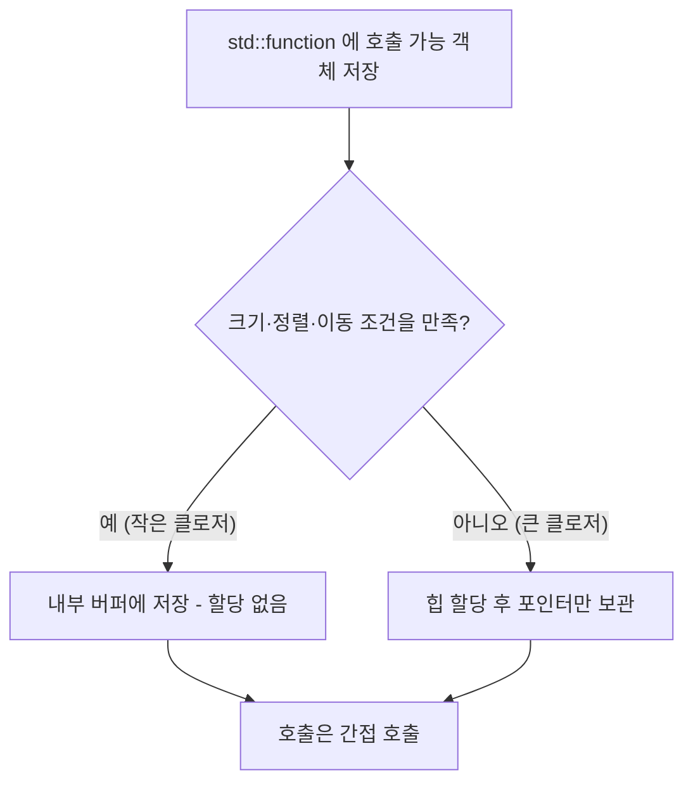

<strong>SBO(Small Buffer Optimization)</strong>는 "작은 객체는 내부 버퍼에 직접 저장하고, 큰 객체만 힙에 올린다"는 패턴입니다. 본 챕터에서는 SBO 개념과 **std::function**·**std::any** 등 타입 소거 타입의 내부 구조, 성능·ABI 영향을 정리합니다.

## 이 장을 읽기 전에

**완전한 초보자?** 이 장은 [05장: 문자열 최적화](/post/cpp-optimization/string-optimization/)의 SSO와 [15장: 람다 표현식 성능](/post/cpp-optimization/lambda-performance/)의 클로저 크기 개념을 전제로 합니다. "작은 객체는 내부에 두고 큰 객체만 힙에 둔다"는 한 줄만 떠올릴 수 있으면 충분합니다.

**이 장의 깊이**: 이 장은 **심화–전문가**를 포괄합니다. SBO 패턴 개념부터 시작해, 전문가 구간에서는 `std::function`·`std::any`의 내부 버퍼 구조와 ABI·성능 영향, 버퍼 크기 선택·이식성 주의점을 다룹니다. **다루지 않는 것**: 타입 소거 패턴의 호출 비용 일반론([19장](/post/cpp-optimization/type-erasure-cost-patterns/))과 커스텀 할당자(Tr.04 메모리 트랙)입니다.

## 당신의 수준에 맞는 경로

| 수준 | 읽을 부분 | 핵심 목표 |
|------|---------|---------|
| **초보자** | "SBO 패턴 개념" | 내부 버퍼로 힙을 피하는 원리 이해 |
| **중급자** | "std::function 내부" ~ "std::any 내부" | 표준 타입의 SBO 동작 파악 |
| **전문가** | "타입 소거와 ABI·성능" ~ "비판적 시각" | 버퍼 한도·ABI·이식성 판단 |

---

## SBO가 쓰이는 곳

**std::string**의 SSO([05장](/post/cpp-optimization/string-optimization/))와 마찬가지로, **std::function**·**std::any**처럼 타입 소거를 쓰는 표준 타입은 구현체마다 객체 안에 **내부 버퍼**를 두어, 그 안에 들어가는 객체는 힙 할당 없이 저장합니다. 한계를 넘는 객체는 힙에 할당하고 포인터만 보관합니다. 표준은 버퍼 크기를 숫자로 정하지 않지만 SBO를 전혀 언급하지 않는 것은 아닙니다. `std::function`은 대상이 함수 포인터나 `std::reference_wrapper`일 때 동적 할당을 하지 않도록 보장하고, `std::any`는 작은 객체의 동적 할당을 피하도록 권고하되 그 최적화를 nothrow 이동 생성이 가능한 타입에만 허용합니다. 그 밖의 크기 경계는 구현체가 정합니다.

## SBO 패턴 개념

<strong>Small Buffer Optimization(SBO)</strong>은 "작은 객체는 **내부 버퍼**에 직접 저장하고, 그보다 큰 객체만 **힙**에 올린다"는 패턴입니다. 타입 소거 타입(여러 구체 타입을 하나의 타입으로 담아야 하는 경우)에서, **크기·정렬·이동 안전성 조건**을 만족하는 객체는 할당 없이 버퍼에 저장하고, 그렇지 않으면 힙에 두고 포인터만 보관합니다. 이렇게 하면 **할당 비용**을 줄이고, 작은 객체일 때 데이터가 래퍼 객체와 같은 캐시 라인에 놓여 **캐시 친화성**도 유지할 수 있습니다.



이 패턴을 직접 구현해 보면 구조가 분명해집니다. 아래 `SmallBox`는 임의 타입 하나를 담는 최소 SBO 상자입니다. 버퍼 크기·정렬·`noexcept` 이동 가능 여부를 컴파일 타임에 검사해 조건을 만족하면 placement new로 버퍼에 생성하고, 아니면 힙으로 넘깁니다(spill). 저장 위치와 무관하게 올바르게 파괴하려면 타입을 아는 소멸 함수를 생성 시점에 함수 포인터로 기록해 두어야 하는데, 이것이 타입 소거 타입이 공통으로 갖는 "관리(manager) 함수 포인터"의 축소판입니다.

```cpp
#include <cstddef>
#include <cstdio>
#include <new>
#include <string>
#include <type_traits>
#include <utility>

// 최소 SBO 상자: 작고 nothrow-move인 타입은 내부 버퍼, 나머지는 힙
class SmallBox {
    static constexpr std::size_t kBuf = 3 * sizeof(void*);           // 버퍼 24바이트(x86-64)
    alignas(std::max_align_t) unsigned char buf_[kBuf];
    void* ptr_ = nullptr;                                              // 실제 객체 위치
    void (*destroy_)(SmallBox&) = nullptr;                             // 타입별 소멸 디스패치

    template <class T>
    static constexpr bool fits = sizeof(T) <= kBuf
        && alignof(T) <= alignof(std::max_align_t)
        && std::is_nothrow_move_constructible_v<T>;

public:
    template <class T>
    explicit SmallBox(T value) {
        if constexpr (fits<T>) {
            ptr_ = ::new (static_cast<void*>(buf_)) T(std::move(value));   // placement new
            destroy_ = [](SmallBox& b) { static_cast<T*>(b.ptr_)->~T(); };
        } else {
            ptr_ = new T(std::move(value));                                  // 힙으로 spill
            destroy_ = [](SmallBox& b) { delete static_cast<T*>(b.ptr_); };
        }
    }
    SmallBox(const SmallBox&) = delete;                // 예제를 짧게 하려고 복사·이동 금지
    SmallBox& operator=(const SmallBox&) = delete;
    ~SmallBox() { destroy_(*this); }

    bool is_local() const { return ptr_ == static_cast<const void*>(buf_); }
    template <class T> T& get() { return *static_cast<T*>(ptr_); }
};

struct Big { char data[64]{}; };

int main() {
    SmallBox a(42);                                    // int: 버퍼 안
    SmallBox b(std::string("short"));                  // std::string: 구현에 따라 다름
    SmallBox c(Big{});                                 // 64바이트: 힙
    std::printf("int local=%d string local=%d big local=%d\n",
                a.is_local(), b.is_local(), c.is_local());
    std::printf("%d %s\n", a.get<int>(), b.get<std::string>().c_str());
}
```

Compiler Explorer에서 실행하면 GCC 14.2(libstdc++)는 `int local=1 string local=0 big local=0`을, Clang 18(libc++)은 `int local=1 string local=1 big local=0`을 출력합니다. libstdc++의 `std::string`은 32바이트라 24바이트 버퍼에 들어가지 못하고, libc++의 `std::string`은 24바이트라 들어가기 때문입니다. 같은 코드에서도 표준 라이브러리 구현에 따라 SBO 적중 여부가 달라진다는, 이 장 전체를 관통하는 사실을 보여 줍니다.

## std::function 내부

**std::function**은 호출 가능 객체(함수 포인터, 람다, 함수 객체 등)를 **타입 소거**해 저장합니다. 객체 안에는 대략 세 가지가 들어 있습니다. 대상을 담는 **내부 버퍼**(또는 힙 객체를 가리키는 포인터), 대상의 복사·이동·파괴를 맡는 **관리 함수**, 그리고 실제 호출을 수행하는 **호출 함수**입니다. libstdc++는 이 두 함수를 함수 포인터로, libc++의 기본 구현은 내부 기반 클래스의 가상 함수로 둡니다.

버퍼에 저장되는 조건도 크기만이 아닙니다. libstdc++의 `std::function`은 대상이 버퍼 크기 이하이고, 정렬이 맞고, **trivially copyable**일 때만 버퍼에 둡니다(소스의 `__stored_locally` 조건). 그래서 크기가 작아도 `std::string`을 캡처한 람다처럼 trivially copyable이 아닌 클로저는 힙으로 갑니다.

아래 예시에서 캡처 없는 람다는 버퍼에 들어가 할당이 없습니다. 반면 256바이트짜리 `std::array`를 값으로 캡처한 클로저는 어느 구현에서도 버퍼를 넘어 힙 할당이 발생합니다.

```cpp
#include <functional>
#include <array>
#include <cstdio>

int main() {
    std::function<int()> small = [] { return 1; };  // 캡처 없음 → 버퍼, 할당 없음

    std::array<char, 256> payload{};                 // 256바이트 상태
    std::function<int()> big =                        // 버퍼 한계 초과 → 힙 할당
        [payload] { return payload[0]; };

    std::printf("%d %d\n", small(), big());
}
```

버퍼 경계는 구현 정의이므로, 문서의 수치보다 **전역 `operator new`를 교체해 할당 횟수를 세는 방식**으로 대상 표준 라이브러리에서 직접 확인하는 것이 정확합니다. 아래 코드는 N바이트 함수 객체를 `std::function`과 `std::any`에 각각 담아 보고 할당이 0이었는지 출력합니다.

```cpp
#include <functional>
#include <any>
#include <cstdio>
#include <cstdlib>

static int g_allocs = 0;
void* operator new(std::size_t sz) { ++g_allocs; return std::malloc(sz); }
void operator delete(void* p) noexcept { std::free(p); }
void operator delete(void* p, std::size_t) noexcept { std::free(p); }

template <std::size_t N>
struct Padded { char buf[N]{}; int operator()() const { return buf[0]; } };

template <std::size_t N>
bool function_fits() {
    g_allocs = 0;
    { std::function<int()> f = Padded<N>{}; }
    return g_allocs == 0;   // 힙 할당이 0이면 이 크기는 내부 버퍼에 들어간 것
}

template <std::size_t N>
bool any_fits() {
    g_allocs = 0;
    { std::any a = Padded<N>{}; }
    return g_allocs == 0;
}

int main() {
    std::printf("sizeof(function)=%zu sizeof(any)=%zu\n",
        sizeof(std::function<int()>), sizeof(std::any));
    std::printf("function: 8=%d 16=%d 24=%d 32=%d 48=%d\n",
        function_fits<8>(), function_fits<16>(), function_fits<24>(),
        function_fits<32>(), function_fits<48>());
    std::printf("any:      8=%d 16=%d 24=%d 32=%d 48=%d\n",
        any_fits<8>(), any_fits<16>(), any_fits<24>(), any_fits<32>(), any_fits<48>());
}
```

x86-64에서 Compiler Explorer로 실행한 결과는 다음과 같습니다(`-std=c++17 -O0`, 1은 할당 없음). MSVC STL은 이 방법으로 측정하지 않았으므로 표에 넣지 않았습니다.

| 구현 | `sizeof(std::function)` | function 버퍼에 들어간 최대 크기 | `sizeof(std::any)` | any 버퍼에 들어간 최대 크기 |
|------|---:|---:|---:|---:|
| GCC 14.2 / libstdc++ | 32 | 16바이트 | 16 | 8바이트 |
| Clang 18 / libc++ | 48 | 24바이트 | 32 | 24바이트 |

두 구현의 경계가 이 정도로 다르므로, "우리 프로젝트가 실제로 쓰는 컴파일러·표준 라이브러리 조합"에서 이 코드를 한 번 돌려 보는 것이 어떤 요약 수치보다 신뢰할 수 있습니다. **호출**은 저장된 객체의 `operator()`를 **간접 호출**로 수행합니다. **이동** 시 힙에 있는 대상은 포인터만 옮기면 되지만 버퍼에 있는 대상은 객체 자체를 이동해야 하고, **복사**는 언제나 대상의 복사 비용(힙 대상이면 새 할당 포함)이 따릅니다.

## std::any 내부

**std::any**는 **임의의 타입**의 값을 하나 담습니다. 내부적으로는 타입 정보와 복사·파괴를 맡는 관리 함수, 그리고 **저장소**(내부 버퍼 또는 힙 포인터)를 갖습니다. libstdc++의 `std::any`는 버퍼가 포인터 하나 크기(x86-64에서 8바이트)이고, 그 안에 들어가더라도 nothrow 이동 생성이 가능한 타입만 버퍼에 둡니다. 위 표에서 libstdc++ `any`의 경계가 8바이트로 유독 작은 이유입니다.

값을 꺼낼 때는 **any_cast**가 저장된 타입과 요청한 타입이 일치하는지 확인합니다. 값·참조를 받는 오버로드는 일치하지 않으면 `std::bad_any_cast` 예외를 던지고, 포인터를 받는 오버로드(`std::any_cast<T>(&a)`)는 예외 대신 `nullptr`를 반환합니다. 이 타입 확인과 간접 접근 비용 때문에, `std::any`는 "타입을 정말 런타임에만 아는 값"을 넘길 때로 한정하는 것이 좋습니다.

## 타입 소거와 ABI·성능

**ABI 안정성**: std::function, std::any의 **내부 버퍼 크기**는 객체 레이아웃의 일부이므로, 버퍼 크기를 바꾸면 이미 컴파일된 바이너리와의 **호환**이 깨집니다. 그래서 구현체는 한 번 정한 크기를 쉽게 바꾸지 않으며, 위 표의 차이는 각 구현이 처음 정한 레이아웃이 굳어진 결과로 보는 것이 맞습니다. **성능** 측면에서는 버퍼에 들어가면 할당이 없고 간접 호출 비용만 남고, 버퍼를 넘으면 생성·복사 시점의 힙 할당이 추가됩니다. 설계 시 "우리 타입 소거에 넣을 객체는 대부분 이 크기 이하"인지 측정하고, 한계를 넘는 객체가 많으면 캡처를 포인터로 줄이거나 템플릿 기반 대안을 고려합니다.

## SBO를 vector에 적용한 서드파티 라이브러리

지금까지 다룬 SBO는 "호출 가능 객체·임의 타입 하나"를 담는 `std::function`·`std::any` 중심이었지만, 같은 아이디어를 **가변 길이 시퀀스**에 적용한 라이브러리도 널리 쓰입니다. `llvm::SmallVector<T, N>`, `boost::container::small_vector<T, N>`, `folly::small_vector<T, N>`은 모두 요소 수가 N 이하인 동안은 객체 내부 버퍼에 저장하고, N을 넘으면 일반 `vector`처럼 힙으로 전환(spill)하는 **하이브리드 컨테이너**입니다. 컴파일러(LLVM 자체가 대표 사용처), 게임 엔진, 서버 인프라 코드에서 "대부분 짧지만 가끔 길어지는" 리스트(함수 인자 목록, 짧은 경로 조각 등)에 흔히 쓰입니다.

이 라이브러리들은 **작으면 할당 없음**이라는 점에서 [04장](/post/cpp-optimization/stl-container-cost/)에서 다룬 `std::inplace_vector`(C++26)와 목적이 겹치지만 결정적으로 다릅니다. `std::inplace_vector`는 **용량 상한을 절대 넘을 수 없는 고정 용량** 컨테이너인 반면, `SmallVector` 계열은 **N을 넘으면 자동으로 힙에 재할당**해 크기 제한이 없습니다. 즉 "상한이 확실히 존재"하면 `inplace_vector`, "대부분 작지만 가끔 커질 수 있다"면 `SmallVector` 계열이 더 맞는 선택입니다.

| 컨테이너 | 용량 초과 시 동작 | 힙 할당 | 표준 여부 |
|------|------|------|------|
| `std::inplace_vector<T, N>` | 넘칠 수 없음(`push_back`은 예외, `try_push_back`은 실패 반환) | 없음 | C++26 표준 |
| `llvm::SmallVector<T, N>` 등 | 힙으로 spill해 계속 증가 | N 초과 시 발생 | 서드파티 |
| `std::vector<T>` | 재할당하며 증가 | 첫 요소부터 발생 | 표준 |

## 흔한 오해

<strong>"std::function은 할당이 없다"</strong>는 흔한 오해입니다. 캡처가 내부 버퍼를 넘거나 버퍼 저장 조건(libstdc++의 trivially copyable 등)을 만족하지 못하면 힙 할당이 발생하며, "람다니까 가볍다"고 가정하고 큰 상태(예: 배열, 여러 개의 `shared_ptr`)를 캡처하면 핫패스에서 예상치 못한 할당이 생깁니다.

<strong>"SBO 경계는 어디서나 같다"</strong>도 오해입니다. 위 측정처럼 같은 x86-64에서도 libstdc++와 libc++의 버퍼 경계가 다르므로, 크로스 플랫폼 코드에서 "이 크기까지는 안전하다"고 하드코딩하면 다른 표준 라이브러리에서는 같은 코드가 힙 할당 경로로 넘어갈 수 있습니다. 표준이 보장하는 것은 함수 포인터와 `reference_wrapper` 대상의 비할당뿐입니다.

## 비판적 시각: 한계와 트레이드오프

SBO는 공짜가 아닙니다. 내부 버퍼만큼 래퍼 객체 자체가 커지므로, 대상이 작든 크든 `std::function` 하나가 32–48바이트를 차지합니다. 콜백을 수천 개 담는 컨테이너라면 이 고정 크기가 메모리와 캐시를 잡아먹고, 대상이 버퍼를 넘는 경우에는 버퍼가 통째로 낭비됩니다. 또 버퍼에 저장된 대상은 이동할 때 포인터만 옮기는 대신 객체 자체를 이동해야 하므로, 이동이 비싼 대상이라면 SBO가 오히려 이동 비용을 늘립니다. 구현체가 이동 안전성 조건(trivially copyable, nothrow 이동)을 두는 것도 이 때문입니다.

결국 SBO 크기는 "작은 객체의 할당 절감"과 "모든 객체의 크기 증가" 사이의 절충이며, 그 절충점은 ABI 때문에 사용자가 바꿀 수 없습니다. 기본 타입의 절충점이 맞지 않는 핫 경로라면, 위 `SmallBox`처럼 버퍼 크기를 템플릿 인자로 받는 자체 타입 소거 래퍼를 두는 것이 대안이며, 그 설계 비용은 [19장](/post/cpp-optimization/type-erasure-cost-patterns/)에서 다룹니다.

## 핵심 요약

| 항목 | 비용·이점 | 활용 기준 |
|------|-----------|-----------|
| SBO | 작은 객체 내부 버퍼·힙 회피, 래퍼 크기 증가 | 대상이 구현의 버퍼 조건을 만족할 때 |
| std::function | 타입 소거, 버퍼 또는 힙, 간접 호출 | 콜백 저장 |
| std::any | 타입 정보+저장소, any_cast 확인 비용 | 런타임에만 타입을 아는 값 |

## 이 글을 읽은 후 달성해야 할 목표

이 장을 마치면 SBO를 "작으면 할당이 없다"는 한 줄이 아니라 "구현마다 다른 조건과 비용을 가진 설계 선택"으로 다룰 수 있어야 합니다.

- `std::function`·`std::any`가 버퍼 대신 힙을 쓰게 되는 조건(크기·정렬·trivially copyable·nothrow 이동)을 구현별로 설명할 수 있다.
- 할당 횟수를 세는 `operator new` 교체로 대상 표준 라이브러리의 버퍼 경계를 직접 측정할 수 있다.
- placement new와 소멸 함수 포인터로 최소 SBO 상자를 구현하고, 그 구조를 표준 타입 소거 타입의 내부와 연결할 수 있다.
- 용량 상한 여부에 따라 `inplace_vector`와 `SmallVector` 계열 중 하나를 고를 수 있다.

### 자주 묻는 질문 (FAQ)

**Q: 함수 포인터를 `std::function`에 담아도 할당이 생기나요?**  
A: 아니요. 표준이 대상이 함수 포인터나 `std::reference_wrapper`일 때 객체 안에 직접 저장하도록 보장하므로 할당이 없습니다. 큰 함수 객체를 할당 없이 넘기고 싶다면 `std::ref(obj)`로 감싸 참조로 담는 방법도 있지만, 이때는 `obj`의 수명을 호출자가 보장해야 합니다.

**Q: move-only 람다(예: `unique_ptr`을 캡처한 람다)는 어떻게 담나요?**  
A: `std::function`은 대상이 복사 가능해야 하므로 담을 수 없습니다. C++23의 `std::move_only_function`을 쓰면 되며, 이 타입도 구현 정의 크기의 내부 버퍼를 갖는 타입 소거 래퍼라 이 장의 SBO 고려 사항이 그대로 적용됩니다.

### 적용 체크리스트

- [ ] 핫패스에서 `std::function`·`std::any`에 담는 대상의 크기와 trivially copyable 여부를 확인했는가? — 버퍼 조건을 벗어나면 생성·복사마다 할당이 붙는다.
- [ ] 버퍼 경계를 대상 표준 라이브러리에서 실측했는가? — libstdc++와 libc++의 경계가 다르다.
- [ ] 콜백을 대량으로 저장하는 컨테이너에서 래퍼 자체 크기(32–48바이트)를 고려했는가? — 작은 대상도 래퍼 크기만큼 메모리를 쓴다.

### 더 읽을 거리

- [cppreference: std::function 생성자](https://en.cppreference.com/w/cpp/utility/functional/function/function) — 함수 포인터·`reference_wrapper` 대상의 소형 객체 최적화 보장과, 그 밖의 대상은 동적 할당될 수 있다는 노트.
- [cppreference: std::any](https://en.cppreference.com/w/cpp/utility/any) — 작은 객체의 동적 할당 회피 권고와, 그 최적화를 nothrow 이동 가능 타입에만 허용하는 조건.
- [LLVM Programmer's Manual: SmallVector](https://llvm.org/docs/ProgrammersManual.html#llvm-adt-smallvector-h) — 가변 길이 시퀀스에 SBO를 적용한 대표 구현체의 설계 문서.
- [챕터 04: STL 컨테이너 비용](/post/cpp-optimization/stl-container-cost/) — `std::inplace_vector`(C++26)와 SmallVector 계열의 차이를 다룹니다.

## 다음 장에서는

**이전 장**: [람다 표현식 성능](/post/cpp-optimization/lambda-performance/) (챕터 15)

**Parameter Passing 전략**을 다룹니다. by value, const reference, rvalue reference의 정량적 분석과 객체 크기·복사/이동 비용에 따른 전달 전략을 정리합니다. → [Parameter Passing 전략](/post/cpp-optimization/parameter-passing/) (챕터 17)
