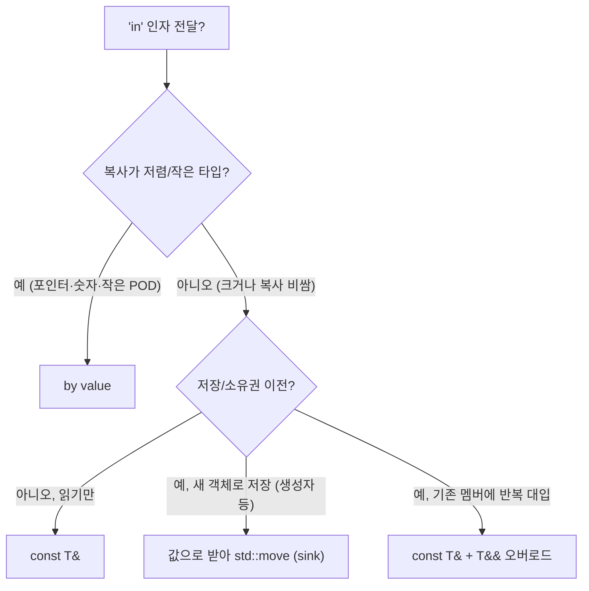

**Parameter Passing 전략**이란 인자 전달 방식을 타입 크기·복사/이동 비용에 맞게 선택하는 것을 말합니다. 본 챕터에서는 **by value**, **const reference**, **rvalue reference**의 정량적 분석과 선택 기준, 할당 횟수 측정으로 검증하는 방법을 정리합니다.

## 이 장을 읽기 전에

**완전한 초보자?** 이 장은 [06장: 객체 수명 최적화](/post/cpp-optimization/object-lifetime/)의 복사·이동 비용을 전제로 합니다. 함수 인자를 값/참조/우측값 참조로 받을 수 있다는 정도만 알면 충분합니다.

**이 장의 깊이**: 이 장은 **중급–전문가**를 포괄합니다. by value·const reference·rvalue reference의 의미부터 시작해, 전문가 구간에서는 객체 크기·복사/이동 비용에 따른 전달 전략을 할당 횟수 측정으로 정량 분석합니다. **다루지 않는 것**: non-owning 뷰 전달([14장](/post/cpp-optimization/span-and-views/))과 반환값 최적화([06장](/post/cpp-optimization/object-lifetime/))의 세부입니다.

## 당신의 수준에 맞는 경로

| 수준 | 읽을 부분 | 핵심 목표 |
|------|---------|---------|
| **초보자** | "by value" ~ "const reference" | 값/참조 전달의 비용 차이 이해 |
| **중급자** | "rvalue reference" ~ "정량 분석과 선택 기준" | 크기·이동 비용에 따른 전달 전략 |
| **전문가** | "비판적 시각" | 과잉 최적화 없이 전달 방식 판단 |

---

## 인자 전달 권장 사항의 변화 (역사·배경)

C++03에서는 "큰 타입은 const 참조로"가 사실상 유일한 규칙이었습니다. C++11이 **이동 의미론**을 도입하고 함수가 지역 객체를 반환할 때 복사 대신 이동을 시도하도록 바꾸면서, "값으로 받아 이동"하는 패턴의 비용이 크게 줄었습니다. C++17은 여기에 prvalue에 대한 **복사 생략 보장**(guaranteed copy elision)을 더해, 임시 객체로 값 인자를 초기화할 때 복사·이동 자체가 일어나지 않게 했습니다. 이런 변화 속에서 Scott Meyers는 *Effective Modern C++*(2014) Item 41에서, 값 전달을 **이동이 싸고 항상 복사(저장)되는 복사 가능 매개변수에 한해 고려하라**는 조건부 권고를 내놓았습니다. 무조건 값 전달을 권한 것이 아니라는 점이 중요하며, 그 조건이 깨지는 경우는 아래 정량 분석에서 직접 확인합니다.

오늘날 가장 널리 인용되는 기준은 C++ Core Guidelines의 F.16 규칙입니다.

> "F.16: For “in” parameters, pass cheaply-copied types by value and others by reference to `const`" — [C++ Core Guidelines F.16](https://isocpp.github.io/CppCoreGuidelines/CppCoreGuidelines#f16-for-in-parameters-pass-cheaply-copied-types-by-value-and-others-by-reference-to-const)

같은 문서는 이어서 F.18에서 이동될 매개변수는 `X&&`로 받고, F.19에서 전달만 하는 매개변수는 `TP&&`와 `std::forward`로 받으라고 정리합니다. 이 장은 이 세 규칙이 실제로 어떤 비용 차이에서 나오는지를 다룹니다.

## by value

**값으로 전달**하는 것은 인자를 **복사**(또는 이동)해 함수에 넘기는 방식입니다. **작은 타입**(트리비얼 복사, 레지스터 몇 개로 넘어가는 크기)은 값 전달이 **저렴**하고, 레지스터로 그대로 넘어가므로 함수 안에서 추가 간접 접근이 없습니다. 컴파일러 입장에서도 값으로 받은 인자는 다른 포인터를 통한 쓰기와 별칭(aliasing)될 가능성이 없으므로, 레지스터에 묶어 두고 최적화하기가 쉽습니다.

**이동 가능한 타입**이고 복사 비용이 크면, 호출자가 **std::move**로 넘기거나 임시를 넘길 때 이동 생성만 일어나 복사보다 비용이 적습니다. 반대로 호출자가 lvalue를 넘기면 값 매개변수를 만들기 위해 반드시 복사가 한 번 일어난다는 점이 값 전달의 숨은 비용입니다.

## const reference

**큰 타입**이거나 **복사 비용이 큰** 타입을 **읽기만** 할 때는 <strong>const T&</strong>로 받으면 복사를 피할 수 있습니다. 참조는 보통 포인터 크기만 전달되므로 전달 비용이 작지만, 함수 내부에서 멤버에 접근할 때 **간접 접근**이 따르고, 컴파일러는 그 메모리가 함수 안의 다른 쓰기로 바뀔 수 있다고 가정해야 할 때가 있습니다.

임시 객체를 넘기는 것도 안전합니다. `f(std::string("hello"))`처럼 함수 인자의 참조 매개변수에 바인딩된 임시는 그 호출을 포함한 **완전식(full-expression)이 끝날 때까지** 살아 있으므로, 함수 실행 중에는 언제나 유효합니다. 이것은 지역 변수 `const std::string& r = std::string("x");`에서 일어나는 "수명 연장"과는 다른 규칙이며, 함수 인자의 경우 수명이 연장되지 않습니다. 따라서 함수가 받은 참조를 멤버나 전역에 저장해 두면 호출이 끝난 뒤 dangling이 됩니다.

## rvalue reference

<strong>rvalue reference(T&&)</strong>는 **이동 시맨틱**을 표현합니다. "소유권을 넘기거나 리소스를 재사용해도 된다"는 의미이므로, 함수 내부에서 **std::move**로 다른 함수에 넘기거나 멤버로 저장할 때 이동이 선택됩니다. **Perfect forwarding**은 **T&&**(forwarding reference)와 **std::forward**를 사용해, 인자를 "값 카테고리만 유지한 채" 다음 함수에 그대로 넘기는 패턴입니다.

아래 예시에서 함수 이름을 `fwd`로 둔 이유는 표준의 `std::forward`와 이름이 겹쳐 가려지는 것을 피하기 위해서입니다. `fwd`는 lvalue를 받으면 복사 후 이동, rvalue를 받으면 이동으로 `sink`에 전달합니다.

```cpp
#include <string>
#include <utility>
#include <vector>

std::vector<std::string> store;

void sink(std::string s) { store.push_back(std::move(s)); } // 값으로 받아 멤버로 이동

template<typename T>
void fwd(T&& x) { sink(std::forward<T>(x)); }  // 값 카테고리 유지 (forward를 호출)

int main() {
    std::string s = "lvalue";
    fwd(s);                  // lvalue → 복사 후 이동
    fwd(std::string{"rv"});  // rvalue → 이동만
}
```

## 정량 분석과 선택 기준

선택은 **객체 크기**와 **복사/이동 비용**, 그리고 **함수가 인자를 어떻게 쓰는가**에 따라 달라집니다. 먼저 작은 타입부터 봅니다. 아래 `Point`는 8바이트(`int` 2개) 트리비얼 타입이라, x86-64 System V와 Windows x64 호출 규약 모두에서 값 전달이 레지스터 하나로 처리됩니다. const ref로 받으면 대신 주소가 전달되고 멤버마다 메모리를 읽어야 합니다. 다만 두 함수가 호출부에 인라인되면 이 차이는 사라지므로, 전달 방식의 차이가 실제 비용으로 남는 것은 인라인되지 않는 함수 경계에서입니다.

```cpp
#include <cstdio>

struct Point { int x, y; };  // 8바이트, 트리비얼 복사

long dot_val(Point a, Point b)               // 값: 레지스터로 전달, 간접 접근 없음
{ return (long)a.x * b.x + (long)a.y * b.y; }

long dot_ref(const Point& a, const Point& b) // 참조: 주소 전달 + 멤버 간접 접근
{ return (long)a.x * b.x + (long)a.y * b.y; }

int main() {
    Point p{1, 2}, q{3, 4};
    std::printf("%ld %ld\n", dot_val(p, q), dot_ref(p, q));   // 11 11
}
```

큰 타입에서 결정적인 변수는 **힙 할당 횟수**입니다. `std::string`처럼 힙 버퍼를 가진 타입을 멤버에 저장하는 setter(sink)를 두 방식으로 구현하고, 같은 setter를 1000번 호출할 때 할당이 몇 번 일어나는지 전역 `operator new`를 교체해 셉니다. 시간 측정과 달리 할당 횟수는 실행 환경의 잡음 없이 결정적으로 재현됩니다.

```cpp
#include <cstdio>
#include <cstdlib>
#include <new>
#include <string>
#include <utility>

static long g_allocs = 0;
void* operator new(std::size_t sz) { ++g_allocs; if (void* p = std::malloc(sz)) return p; throw std::bad_alloc{}; }
void operator delete(void* p) noexcept { std::free(p); }
void operator delete(void* p, std::size_t) noexcept { std::free(p); }

struct ByValue {                       // sink-by-value: 값으로 받아 이동
    std::string name_;
    void setName(std::string name) { name_ = std::move(name); }
};

struct ByRefOverloads {                // const& + && 오버로드 쌍
    std::string name_;
    void setName(const std::string& name) { name_ = name; }          // 기존 capacity 재사용 가능
    void setName(std::string&& name) { name_ = std::move(name); }
};

template <class W>
void run(const char* label) {
    const std::string long_name(64, 'x');   // SSO 한도(05장)를 넘는 길이 → 힙 버퍼
    W w;
    constexpr int kIters = 1000;

    g_allocs = 0;
    for (int i = 0; i < kIters; ++i) w.setName(long_name);             // lvalue 반복 대입
    long lvalue_allocs = g_allocs;

    g_allocs = 0;
    for (int i = 0; i < kIters; ++i) w.setName(std::string(64, 'y'));  // rvalue(새 임시) 반복
    long rvalue_allocs = g_allocs;

    std::printf("%-15s lvalue: %4ld allocs / %d calls, rvalue: %4ld allocs / %d calls\n",
                label, lvalue_allocs, kIters, rvalue_allocs, kIters);
}

int main() {
    run<ByValue>("by-value+move");
    run<ByRefOverloads>("const& / &&");
}
```

GCC 14.2(libstdc++)와 Clang 18(libc++)에서 `-std=c++17 -O2`로 실행한 결과는 두 구현 모두 같았습니다(Compiler Explorer).

```text
by-value+move   lvalue: 1000 allocs / 1000 calls, rvalue: 1000 allocs / 1000 calls
const& / &&     lvalue:    1 allocs / 1000 calls, rvalue: 1000 allocs / 1000 calls
```

rvalue 행은 두 방식이 같습니다. 1000번의 할당은 모두 호출자가 매번 새 임시 문자열을 만드는 데서 생기고, setter 안에서는 버퍼 포인터만 옮겨지기 때문입니다. 차이는 lvalue 행에서 납니다. 값 전달 버전은 매 호출마다 매개변수를 만들기 위해 문자열을 복사하므로 1000번 할당합니다. 반면 const& 버전의 `name_ = name`은 복사 대입이라, 첫 호출에서 확보한 `name_`의 버퍼(capacity)가 이미 충분하면 새로 할당하지 않고 그 버퍼에 내용만 덮어씁니다. 그래서 1000번 호출에 할당이 1번뿐입니다. 이것이 Item 41이 값 전달을 "항상 복사되는" 매개변수로 한정한 이유이며, 생성자처럼 매번 새 객체를 만드는 경로가 아니라 **기존 멤버에 반복 대입하는 setter**에서는 sink-by-value가 오히려 비쌀 수 있다는 뜻입니다.

이 결과를 정리하면 다음과 같습니다.

| 전달 방식 | 대상·상황 | 복사/이동 | 힙 할당 |
|-----------|------|-----------|-----------|
| by value | 8바이트 `Point` | 복사 1 (레지스터) | 없음 |
| const ref | 8바이트 `Point` | 없음, 멤버마다 간접 접근 | 없음 |
| by value + move (sink) | `std::string` rvalue | 이동 | 호출자의 임시 생성분만 |
| by value + move (sink) | `std::string` lvalue, 반복 대입 | 복사 1 + 이동 1 | 매 호출 |
| const& 오버로드 | `std::string` lvalue, 반복 대입 | 복사 대입 1 | 기존 capacity가 부족할 때만 |



## 흔한 오해

<strong>"참조 전달(const T&)이 항상 값 전달보다 빠르다"</strong>는 흔한 오해입니다. 8바이트 `Point`는 by value가 레지스터로 그대로 전달되어 간접 접근이 없는 반면, const ref는 주소를 넘기고 멤버에 접근할 때마다 메모리를 읽어야 합니다. "작은 타입도 참조가 유리하다"고 습관적으로 적용하면 인라인되지 않는 경계에서 오히려 손해를 볼 수 있습니다.

<strong>"T&&는 항상 rvalue reference다"</strong>도 자주 틀리는 지점입니다. `template<typename T> void fwd(T&& x)`처럼 **템플릿 타입 파라미터**에 붙은 `T&&`는 **forwarding reference**(universal reference)로, T가 추론되는 문맥에서만 적용되는 특수 규칙에 따라 lvalue·rvalue를 모두 받을 수 있습니다. 반면 `void f(std::string&& x)`처럼 **구체 타입**에 붙은 `T&&`는 진짜 rvalue reference이며 lvalue를 받을 수 없습니다.

<strong>"sink-by-value는 const& 오버로드 쌍과 비용이 같다"</strong>도 위 측정이 반박합니다. 두 방식이 같은 비용을 갖는 것은 매번 새 객체를 만드는 경우(생성자, 빈 컨테이너에 추가)뿐이고, 기존 멤버에 반복 대입하는 경우에는 const& 쪽이 기존 버퍼를 재사용할 수 있어 할당이 훨씬 적습니다.

## 비판적 시각: 한계와 트레이드오프

"작은 타입"의 기준은 플랫폼·ABI에 따라 다릅니다. x86-64 System V는 16바이트까지의 트리비얼 구조체를 레지스터 두 개로 넘기지만, Windows x64는 1·2·4·8바이트가 아닌 구조체를 호출자가 만든 복사본의 주소로 넘깁니다. 같은 16바이트 구조체라도 한쪽에서는 값 전달이 공짜에 가깝고 다른 쪽에서는 복사본 생성 비용이 붙으므로, 크로스 플랫폼 핫 경로라면 대상 플랫폼마다 확인해야 합니다. 또 트리비얼하지 않은 타입(사용자 정의 복사 생성자나 소멸자가 있는 타입)은 크기와 무관하게 Itanium C++ ABI에서 레지스터로 전달되지 않습니다.

sink-by-value의 가장 큰 장점은 오버로드 두 개를 함수 하나로 줄여 유지보수를 단순하게 만드는 것이며, 그 대가는 위에서 본 반복 대입 시의 추가 할당과 lvalue 전달 시 이동 한 번입니다. 값 매개변수는 슬라이싱 문제도 가집니다. 기반 클래스 타입을 값으로 받으면 파생 클래스 객체를 넘겼을 때 파생 부분이 잘려 나가므로, 다형적으로 쓰이는 타입은 값 전달 후보에서 제외합니다.

## 핵심 요약

| 항목 | 비용·이점 | 활용 기준 |
|------|-----------|-----------|
| by value | 작은 타입 복사 저렴, 간접 접근 없음 | 작은·트리비얼 타입, 새 객체로 저장하는 sink |
| const T& | 참조만, 복사 없음, 임시는 호출 완전식 동안 유효 | 큰 타입 읽기 전용, 반복 대입 setter |
| T&& / T&&+forward | 이동 유도, 값 카테고리 유지 | 소유권 이전·템플릿 전달 |

## 이 글을 읽은 후 달성해야 할 목표

이 장을 마치면 인자 전달 방식을 "습관"이 아니라 "비용 모델"로 고를 수 있어야 합니다.

- 작은 트리비얼 타입의 값 전달이 const 참조보다 유리한 이유를 호출 규약과 간접 접근으로 설명하고, 플랫폼별 예외(Windows x64)를 짚을 수 있다.
- 함수 인자에 바인딩된 임시의 수명이 호출 완전식까지라는 점과, 참조를 저장하면 dangling이 되는 이유를 설명할 수 있다.
- 할당 횟수 측정으로 sink-by-value와 const&/&& 오버로드의 비용 차이를 재현하고, 생성자와 반복 대입 setter에서 다른 방식을 고를 수 있다.
- forwarding reference와 rvalue reference를 구분하고 `std::forward`로 값 카테고리를 보존할 수 있다.

### 자주 묻는 질문 (FAQ)

**Q: 읽기 전용 문자열 인자는 `const std::string&`와 `std::string_view` 중 무엇으로 받아야 하나요?**  
A: 함수가 문자열을 읽기만 하고 저장하지 않는다면 `std::string_view`가 더 유연합니다. 문자열 리터럴이나 `char*`를 넘길 때 `const std::string&`는 임시 `std::string`을 만들어야 하고(긴 문자열이면 할당), `string_view`는 포인터와 길이만 전달하기 때문입니다. 다만 null 종료가 필요한 C API에 넘겨야 하거나 결국 `std::string`으로 저장한다면 이 이점이 사라지므로, 뷰의 수명 주의점과 함께 [14장](/post/cpp-optimization/span-and-views/)을 참고합니다.

### 적용 체크리스트

- [ ] 인라인되지 않는 경계의 작은 트리비얼 타입을 값으로 받았는가? — 레지스터 전달로 간접 접근이 사라진다.
- [ ] 기존 멤버에 반복 대입하는 setter를 sink-by-value로 만들지 않았는가? — const& 오버로드는 기존 capacity를 재사용해 할당을 피한다.
- [ ] 받은 참조를 호출 이후까지 보관하는 코드가 없는가? — 인자 임시는 호출 완전식이 끝나면 파괴된다.
- [ ] 다형적 기반 클래스를 값으로 받지 않았는가? — 파생 부분이 슬라이싱된다.

### 더 읽을 거리

- [C++ Core Guidelines F.16](https://isocpp.github.io/CppCoreGuidelines/CppCoreGuidelines#f16-for-in-parameters-pass-cheaply-copied-types-by-value-and-others-by-reference-to-const) — in 매개변수 전달 규칙의 원문과, 이어지는 F.17–F.19(in-out·이동·전달 매개변수) 규칙.
- [cppreference: 값 카테고리 (Value categories)](https://en.cppreference.com/w/cpp/language/value_category) — lvalue/rvalue/xvalue 등 값 카테고리의 정확한 정의를 다루는 언어 표준 명세입니다.
- [cppreference: std::forward](https://en.cppreference.com/w/cpp/utility/forward) — perfect forwarding에 쓰이는 `std::forward`의 동작과 forwarding reference와의 관계를 확인할 수 있습니다.

## 다음 장에서는

**이전 장**: [Small Buffer Optimization](/post/cpp-optimization/small-buffer-optimization/) (챕터 16)

다음은 **ABI·링크 경계와 극한 튜닝**(전문)입니다. 지금까지 다룬 언어·라이브러리 수준의 비용이 번역 단위·링크·가시성 경계에서 어떻게 제약되는지로 범위를 넓힙니다. 전체 커리큘럼·권장 독해 순서는 [도입(00)](/post/cpp-optimization/getting-started-cpp-language-performance-tuning/)에서 확인할 수 있습니다.

→ [ABI·링크 경계와 극한 튜닝](/post/cpp-optimization/abi-link-boundaries-extreme-cpp-performance/) (챕터 18)
