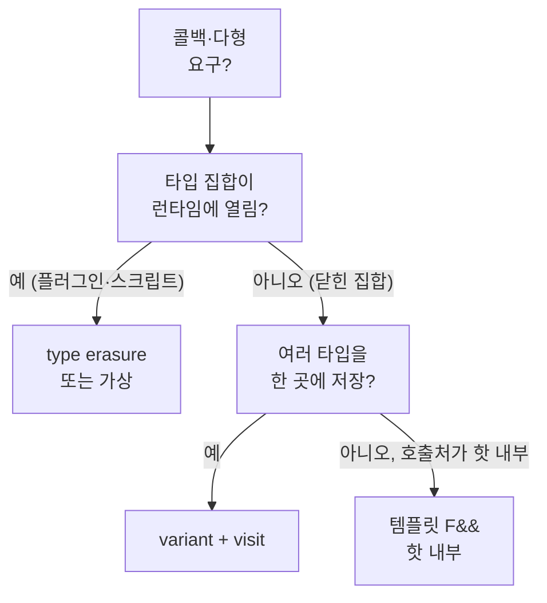

<strong>Type erasure(타입 소거)</strong>는 구체 타입 정보를 런타임에 한 겹 감추고, **공통 인터페이스(호출 연산)** 만 노출하는 기법입니다. `std::function`, `std::any`, 많은 커스텀 “다형 콜백” 래퍼가 이 패턴을 씁니다. Low-latency 관점에서는 **간접 호출 한 번**, **SBO 한도를 넘을 때의 힙 할당**, **인라인 실패**가 한데 묶여 나타나기 쉬워, “한 가지 요인”으로 쪼개어 측정하는 것이 중요합니다.

챕터 16에서 SBO 내부 구조를 다뤘다면, 본 장은 **왜 소거가 간접 호출을 남기는지**, **대안 설계가 어떤 비용을 바꾸는지**를 패턴 중심으로 정리합니다. 챕터 03(가상 함수)·챕터 15(람다)과 함께 읽으면 “정적 다형 vs 동적 다형 vs 소거” 지도가 완성됩니다.

## 이 장을 읽기 전에

**완전한 초보자?** 이 장은 [16장: Small Buffer Optimization](/post/cpp-optimization/small-buffer-optimization/)의 SBO와 [03장: 추상화 비용 분석](/post/cpp-optimization/abstraction-cost/)의 가상 호출, [15장: 람다 표현식 성능](/post/cpp-optimization/lambda-performance/)을 전제로 합니다. `std::function`을 콜백 저장에 써 봤다면 충분합니다.

**이 장의 깊이**: 이 장은 **심화–전문가**를 포괄합니다. 타입 소거가 가상 함수와 닮은 이유부터 시작해, 전문가 구간에서는 커스텀 소거 스케치, SBO 기반 소거(힙·vtable 회피), 대안 패턴(템플릿·variant·CRTP·함수 포인터+void*)의 트레이드오프와 경계 설계를 다룹니다. **다루지 않는 것**: SBO 버퍼의 내부 구조 자체([16장](/post/cpp-optimization/small-buffer-optimization/))와 ABI 경계 일반론([18장](/post/cpp-optimization/abi-link-boundaries-extreme-cpp-performance/))입니다.

## 당신의 수준에 맞는 경로

| 수준 | 읽을 부분 | 핵심 목표 |
|------|---------|---------|
| **초보자** | "정의: 소거와 가상 함수의 유사점" ~ "std::function이 하는 일 (비용 관점)" | 소거가 간접 호출을 남기는 이유 이해 |
| **중급자** | "커스텀 type erasure 스케치 (개념)" ~ "대안 패턴과 트레이드오프" | 소거 비용을 줄이는 대안 파악 |
| **전문가** | "ABI 경계와 소거 객체" ~ "판단 기준: type erasure를 쓸지 말지" | 정적 다형 vs 소거 선택 판단 |

---

## 정의: 소거와 가상 함수의 유사점

**가상 함수**는 vtable을 통해 **런타임에 구체 타입에 맞는 함수**를 고릅니다. **Type erasure**도 저장소 안에 **구체 객체**를 두고, 공개 타입은 **고정된 연산 집합**(예: `operator()`, `clone`, `destroy`)만 노출합니다. 구현은 흔히 **vtable 비슷한 함수 포인터 테이블**이나 **소멸·호출용 함수 포인터 쌍**으로 표현됩니다.

차이는 주로 **타입 집합이 열려 있는지**(새 구체 타입을 런타임에 넣을 수 있는지), **컴파일 타임에 알려진 타입 집합으로 닫혀 있는지**에 있습니다. 열린 집합이 필요하면 소거·가상 중 하나를 택하게 되고, 닫힌 집합이면 `std::variant`·템플릿이 더 효율적일 수 있습니다. 또 가상 함수는 상속 관계를 요구하지만 타입 소거는 "호출 연산만 맞으면" 서로 무관한 타입(람다, 함수 포인터, 함수 객체)을 한 타입에 담을 수 있다는 점에서, 기존 코드에 손대지 않고 다형성을 붙이는 수단이 됩니다.

## std::function이 하는 일 (비용 관점)

`std::function<R(Args...)>`는 **임의의 호출 가능 객체**를 담습니다. 구현은 대개 **소형 객체 SBO 버퍼 + (필요 시) 힙에 타입별 상태**이며, SBO 한도는 구현체 의존입니다(16장의 실측 표 참고). 호출은 저장해 둔 관리·호출 함수를 거치므로, 생성과 호출이 서로 다른 함수에 있으면 컴파일러가 구체 타입을 추적하지 못해 **간접 호출**로 남습니다. 핫패스에서는 **템플릿으로 구체 타입을 받는 API**와 비교해 차이가 납니다.

아래 프로그램은 같은 람다(`i + k`)를 (a) 템플릿 인자로, (b) `std::function`으로 넘겨 1억 번 호출하고 시간을 잽니다. 두 합산 함수에 `noinline`을 붙여 호출부 인라인을 막고 함수 경계 너머의 일반적인 경우를 재현했으며, `k`를 실행 인자 개수(`argc`)에서 가져와 람다 결과가 컴파일 시점 상수로 접히지 않게 했습니다.

```cpp
#include <chrono>
#include <cstdio>
#include <functional>

// (a) 템플릿: 람다 타입이 보여 인라인 가능
template <class F>
__attribute__((noinline)) long sum_tmpl(F&& f, int n) {
    long acc = 0;
    for (int i = 0; i < n; ++i) acc += f(i);
    return acc;
}

// (b) std::function: 타입 소거 → 호출마다 저장된 포인터를 통한 간접 호출
__attribute__((noinline)) long sum_func(const std::function<int(int)>& f, int n) {
    long acc = 0;
    for (int i = 0; i < n; ++i) acc += f(i);
    return acc;
}

template <class Fn>
void time_it(const char* label, Fn&& run) {
    auto t0 = std::chrono::steady_clock::now();
    long r = run();
    auto t1 = std::chrono::steady_clock::now();
    std::printf("%-14s result=%ld  %.1f ms\n", label, r,
        std::chrono::duration<double, std::milli>(t1 - t0).count());
}

int main(int argc, char**) {
    const int n = 100'000'000;
    const int k = argc;                                   // 실행 시점 값: 상수 접기 방지
    auto lam = [k](int i) { return i + k; };              // 작은 람다 → SBO 적중
    std::function<int(int)> fn = lam;

    time_it("template F&&", [&] { return sum_tmpl(lam, n); });
    time_it("std::function", [&] { return sum_func(fn, n); });
}
```

GCC 14.2 `-std=c++17 -O2`(x86-64, Compiler Explorer)로 컴파일하면 두 함수의 기계어가 완전히 다릅니다. 템플릿 버전은 람다 본문이 루프에 펼쳐진 뒤, 반복 횟수가 상수로 전파된 복제본에서 루프 전체가 닫힌 식(등차수열 합)으로 바뀌어 곱셈·덧셈 몇 개만 남습니다. `std::function` 버전은 반복마다 빈 함수인지 검사하고, 객체 안에 저장된 호출 함수 포인터를 메모리에서 읽어 간접 호출합니다.

```text
; sum_tmpl (상수 전파된 복제본) — 루프가 사라짐
        movabs  rdx, 4999999850000001
        movsx   rdi, edi
        lea     rax, [rdi+1]
        add     rdi, rdx
        imul    rax, rax, 99999999
        add     rax, rdi
        ret

; sum_func — 루프 본문 발췌
.L23:
        cmp     QWORD PTR [r14+16], 0        ; 빈 std::function인지 검사
        mov     DWORD PTR [rsp+12], ebx
        je      .L26
        mov     rsi, r13
        mov     rdi, r14
        add     ebx, 1
        call    [QWORD PTR [r14+24]]          ; 저장된 호출 함수를 통한 간접 호출
        cdqe
        add     rbp, rax
        cmp     r12d, ebx
        jne     .L23
```

같은 환경에서 한 번 실행했을 때 템플릿 버전은 0.0 ms(루프가 없으므로), `std::function` 버전은 188.7 ms가 나왔습니다. Compiler Explorer의 공유 실행 환경에서 잰 단일 측정이라 절대값은 참고용이며, 의미 있는 것은 "한쪽은 루프 자체가 사라지고 다른 쪽은 1억 번의 간접 호출이 남는다"는 구조적 차이입니다. 이 람다는 `int` 하나만 캡처해 SBO에 들어가므로 힙 할당은 전혀 없었습니다. 즉 차이의 주범은 할당이 아니라 **간접 호출이 인라이닝과 그 뒤의 최적화를 막는 것**이며, 같은 람다라도 **API가 타입을 소거하는 순간** 비용 구조가 바뀝니다.

## 커스텀 type erasure 스케치 (개념)

소거의 내부 구조는 직접 만들어 보면 분명해집니다. 아래 `CallableErased`는 가장 고전적인 방식으로, 추상 기반 클래스 `Concept`가 연산 집합을 정의하고 템플릿 파생 클래스 `Model<F>`가 구체 타입마다 그 연산을 구현합니다. 공개 타입은 `Concept` 포인터 하나만 들고 있으므로 `F`가 무엇이든 같은 타입이 됩니다. 교육용 최소 예시이며, 실제 라이브러리는 예외 안전·복사·이동·small buffer·정렬을 더 정교하게 다룹니다.

```cpp
#include <cstdio>
#include <memory>
#include <utility>

class CallableErased {
    struct Concept {
        virtual ~Concept() = default;
        virtual int invoke(int x) const = 0;
    };
    template <class F>
    struct Model final : Concept {
        F f;
        explicit Model(F fn) : f(std::move(fn)) {}
        int invoke(int x) const override { return f(x); }
    };
    std::unique_ptr<Concept> self;
public:
    template <class F>
    CallableErased(F f) : self(std::make_unique<Model<F>>(std::move(f))) {}
    int operator()(int x) const { return self->invoke(x); }
};

int main() {
    int base = 10;
    CallableErased e = [base](int x) { return base * x; };   // 힙 1회 + 가상 호출
    std::printf("%d\n", e(3));                                // 30
}
```

여기서 **호출마다 가상 함수 `invoke`**가 있고, 생성할 때 `make_unique`로 **힙 할당**도 한 번 일어납니다. 구체 `F`가 작고 자주 쓰인다면, **템플릿 래퍼**나 **variant<구체 타입들>**이 더 나을 수 있습니다.

## SBO 기반 소거: 힙·vtable 없이 (대조)

위 `CallableErased`는 힙 할당과 가상 디스패치를 둘 다 씁니다. 대안으로 <strong>고정 크기 버퍼(SBO)</strong>에 호출 객체를 직접 담고, **가상 함수 대신 일반 함수 포인터**(`invoke`/`destroy`)로 연산을 표현하면 힙 할당과 vtable 로드를 피할 수 있습니다. 버퍼에 들어가는 작은 호출 객체에 한정되지만, 핫패스에서 자주 쓰는 콜백에 효과적입니다.

```cpp
#include <new>
#include <utility>
#include <cstddef>
#include <cstdio>

class SboCallable {
    static constexpr std::size_t kBuf = 32;
    alignas(std::max_align_t) unsigned char storage_[kBuf];
    int  (*invoke_)(void*, int) = nullptr;   // 멤버로 저장한 일반 함수 포인터(vtable 아님)
    void (*destroy_)(void*)     = nullptr;

public:
    template <class F>
    SboCallable(F f) {
        static_assert(sizeof(F) <= kBuf, "callable too big for SBO");
        static_assert(alignof(F) <= alignof(std::max_align_t), "over-aligned callable");
        ::new (static_cast<void*>(storage_)) F(std::move(f));   // 버퍼에 직접 배치(힙 없음)
        invoke_  = [](void* p, int x) { return (*static_cast<F*>(p))(x); };
        destroy_ = [](void* p) { static_cast<F*>(p)->~F(); };
    }
    int operator()(int x) { return invoke_(storage_, x); }
    ~SboCallable() { if (destroy_) destroy_(storage_); }

    SboCallable(const SboCallable&) = delete;
    SboCallable& operator=(const SboCallable&) = delete;
};

int main() {
    int base = 10;
    SboCallable c = [base](int x) { return base + x; };  // 버퍼 안에 보관
    std::printf("%d\n", c(5));  // 15
}
```

`CallableErased`와 달리 **할당이 0회**이고, 호출은 멤버로 저장한 함수 포인터 한 단계만 거칩니다. 여전히 **간접 호출**은 남지만(컴파일러가 `invoke_`를 항상 정적으로 풀 수는 없음), 힙 할당과 가상 소멸자 비용은 사라집니다. 대신 버퍼를 넘는 큰 캡처는 담을 수 없고, 복사·이동·예외 안전을 직접 설계해야 합니다.

`SboCallable`이 `F`에 요구하는 것은 두 가지 `static_assert`, 즉 **크기**가 버퍼 이하이고 **정렬**이 `std::max_align_t` 이하라는 것뿐입니다. 정렬 검사가 빠지면 `alignas(64)` 같은 과정렬 타입을 버퍼에 배치할 때 정렬이 어긋나 미정의 동작이 됩니다. 반면 `F`가 trivially copyable일 필요는 없습니다. `SboCallable` 자신의 복사 생성자·복사 대입이 `= delete`라 이동 생성자도 암시적으로 만들어지지 않으므로, `F`를 옮기는 지점은 생성자의 placement new 한 번뿐이고 소멸은 `destroy_`가 `F::~F()`를 명시적으로 호출해 처리하기 때문입니다. `SboCallable`을 복사 가능하게 확장하려면 그때는 `F`의 복사 생성자를 버퍼 대 버퍼로 호출하는 별도 함수 포인터(`clone_`)가 필요해집니다.

## 대안 패턴과 트레이드오프

| 패턴 | 장점 | 비용·한계 |
|------|------|-----------|
| 템플릿 + F&& | 인라이닝·직접 호출 유리 | 헤더 노출·인스턴스 증가·바이너리 크기 |
| std::variant + visit | 닫힌 집합에서 분기 명확 | 타입 추가 시 재컴파일·visit 복잡도 |
| 가상 인터페이스 | 열린 집합·모듈 경계에 익숙 | vtable·간접 호출 |
| 함수 포인터 | 간접 한 단계·단순 | 상태 캡처 어려움(데이터 별도) |
| CRTP | 정적 다형·간접 제거 | 설계 복잡·타입 폭발 관리 |

**std::any**도 소거의 한 형태지만 호출 연산이 아니라 "임의 타입 값 하나"를 담습니다. 값을 꺼낼 때마다 `any_cast`가 저장된 타입과 요청한 타입을 비교하고, 값·참조 오버로드는 불일치 시 `std::bad_any_cast`를 던지며 포인터 오버로드는 `nullptr`를 돌려줍니다. 핫패스에서 자주 캐스팅하는 패턴은 타입 비교 분기가 쌓이므로, 담을 타입이 정해져 있다면 **variant**나 **명시적 메시지 타입**이 먼저입니다.

<strong>함수 포인터 + <code>void*</code>(C 스타일)</strong>은 간접 호출 한 번이지만 vtable보다 구조가 단순하고, 사용자 데이터를 `void*`로 함께 넘깁니다. 타입 안전성을 잃는 대가로 레이아웃이 C 수준에서 고정되므로, C++에서는 opaque 핸들과 문서화된 계약으로 감싸 쓰며 모듈 경계·C API에서는 오히려 이 단순함이 ABI 안정성에 유리합니다.

<strong>CRTP(Curiously Recurring Template Pattern)</strong>는 기반 클래스가 파생 타입을 템플릿 인자로 받아 **정적 다형**을 구현합니다. 런타임 간접 호출을 피할 수 있지만 파생 타입마다 코드가 복제되므로, 작은 핫 함수에만 쓰고 나머지는 가상으로 두는 **하이브리드**도 흔합니다. 바이너리 크기가 I-cache를 압박하면 Tr.03·[챕터 12](/post/cpp-optimization/inlining-techniques/)에서 다루는 **코드 크기 vs 인라인** 균형으로 되돌아갑니다.

## ABI 경계와 소거 객체 (챕터 18 연계)

챕터 18(ABI·링크)과 연결하면, **소거 타입을 DLL·공유 라이브러리 경계로 넘길 때**는 생성·소멸·복사가 **어느 모듈에서 일어나는지**가 ABI와 맞물립니다. `std::function`의 레이아웃과 관리 함수는 표준 라이브러리 구현에 따라 다르고(16장의 libstdc++·libc++ 크기 차이 참고), 힙에 놓인 대상은 그것을 할당한 모듈의 할당자로 해제되어야 합니다. 양쪽 모듈이 다른 표준 라이브러리나 빌드 플래그로 컴파일되면 같은 이름의 타입이라도 레이아웃이 어긋날 수 있으므로, 경계에서는 **C API + opaque 포인터**나 **명시적 팩토리**로 좁히고 내부에서만 구체 타입이나 템플릿을 쓰는 팀이 많습니다. 성능은 **호출 한 번**보다 **계약**이 먼저 안전해야 합니다.

## 선택 흐름 한눈에



## 흔한 오해

<strong>"할당만 없으면 std::function도 충분히 빠르다"</strong>는 위 측정이 반박합니다. 람다가 SBO에 들어가 힙을 쓰지 않았는데도, 템플릿 경로는 루프가 통째로 사라졌고 `std::function` 경로에는 1억 번의 간접 호출이 남았습니다. 소거의 비용은 할당보다 "최적화기가 호출 너머를 볼 수 없게 되는 것"에서 더 크게 나옵니다.

<strong>"`std::invocable`로 제약하면 소거 비용이 없어진다"</strong>도 오해입니다. concept 제약은 템플릿 매개변수 `F&&`를 유지할 때만 의미가 있고, 시그니처를 `std::function`으로 바꾸는 순간 제약 여부와 무관하게 소거가 일어납니다. 콜백 API가 실제로 구체 타입을 유지하는지는 함수 시그니처를 보고 판단합니다.

## 비판적 시각

모든 콜백을 템플릿으로 바꾸면 **빌드 시간**과 **심볼 크기**가 늘고, 구현을 헤더에 노출해야 하며, 콜백 타입이 인터페이스에 드러나지 않아 읽기 어려워집니다. 반대로 `std::function` 남용은 개별 호출은 가벼워 보이는데 **간접 호출이 쌓여** 최적화 기회를 잃는 형태가 됩니다. “팀 표준으로 std::function만 쓴다”는 규칙은 **핫패스 예외**를 두고, 예외를 둘지는 프로파일러로 검증하는 편이 안전합니다.

표준 대안도 이 절충을 조금씩 옮깁니다. C++23의 `std::move_only_function`은 복사 불가능한 클로저를 담을 수 있고 `const`·`noexcept`를 시그니처에 반영하지만 여전히 소유하는 타입 소거라 간접 호출은 그대로입니다. "호출하는 동안만 빌려 쓰는" 콜백이라면 소유하지 않는 함수 참조 래퍼(C++26 `std::function_ref`)가 할당과 복사 문제를 없애 주지만, 이것도 간접 호출 자체를 없애지는 않습니다. 간접 호출을 없앨 수 있는 것은 결국 구체 타입을 호출부까지 유지하는 설계뿐입니다.

## 판단 기준: type erasure를 쓸지 말지

| 언제 소거·가상이 합리적인가 | 언제 템플릿·variant를 먼저 볼까 |
|----------------------------|----------------------------------|
| 플러그인·스크립트 바인딩처럼 **컴파일 타임에 타입을 모름** | 콜백 타입이 **우리 저장소 안에서 닫힌 목록**으로 열거 가능 |
| 바이너리 경계에서 **공통 시그니처**만 노출해야 함 | 핫 루프 안에서 **인라인·직접 호출**이 프로파일에서 요구됨 |
| 런타임에 핸들러를 바꿔 끼우는 **이벤트 버스** | `visit` 한 번으로 끝나는 **유한 상태·메시지 타입** |

왼쪽 열의 경우라도 "확장성"이 실제 요구인지 확인합니다. 우리 코드베이스 안에서만 쓰이는 이벤트 핸들러라면 타입 목록을 enum + variant로 닫는 편이 대개 더 싸며, "확장성"과 "마이크로초 예산"을 설계 문서에 함께 적어 두면 리뷰에서 논점이 분명해집니다.

## 평가 기준: 이 장을 읽은 후

이 장의 목표는 타입 소거를 "편한 콜백 타입"이 아니라 "최적화 경계를 하나 만드는 설계 선택"으로 다룰 수 있게 되는 것입니다. 다음 질문에 답할 수 있는지 확인합니다.

- [ ] type erasure가 인라인에 불리한 이유를 생성된 어셈블리(루프 접기 vs 간접 호출)로 설명할 수 있는가?
- [ ] 가상 기반 소거와 SBO + 함수 포인터 소거의 비용 차이(할당·vtable)와 SBO 버퍼의 크기·정렬 조건을 말할 수 있는가?
- [ ] 닫힌 타입 집합에 variant가 유리한 경우를 한 가지 말할 수 있는가?
- [ ] std::function 대신 템플릿을 쓰면 무엇이 늘고 무엇이 줄어드는지 말할 수 있는가?

## 실무 체크리스트

- [ ] 핫패스 콜백이 `std::function`인가? — 구체 타입을 빌드 시점에 다 안다면 템플릿·variant로 대체해 인라인을 되살린다.
- [ ] 람다 캡처 크기가 SBO를 넘지 않는가? — 넘으면 생성·복사마다 할당이 붙으므로 할당 횟수를 잰다.
- [ ] 루프 안에서 람다를 매번 `std::function`에 다시 담지 않는가? — 한 번 만들어 재사용하면 반복 생성·할당이 사라진다.
- [ ] 모듈 경계에서만 소거하고, 내부는 구체 타입으로 풀었는가? — 경계 너머의 레이아웃·할당자 불일치를 피한다.

## 핵심 메시지 요약

| 구분 | 내용 |
|------|------|
| 병목 후보 | 간접 호출, SBO 밖 할당, 인라인 실패 |
| 닫힌 집합 | variant·템플릿이 종종 유리 |
| 열린 집합 | 소거·가상·플러그인 경계 설계 |
| 검증 | 어셈블리로 간접 호출 확인, 할당 횟수와 시간을 요인별로 분리 측정 |

## 용어 정리

- **Type erasure**: 구체 타입을 숨기고 공통 연산만 노출하는 기법; 보통 간접 호출·저장소 내부 레이아웃이 뒤따름.
- **SBO**: 작은 객체를 힙 없이 래퍼 내부에 넣는 최적화; 한도는 구현 의존.
- **닫힌 집합**: 컴파일 타임에 대안 타입 목록을 열거할 수 있는 경우.

## FAQ

**Q. std::move한 std::function은 빠른가요?**  
A. 이동은 대상이 힙에 있으면 포인터만 옮기지만, SBO 버퍼에 있으면 대상 객체 자체를 이동해야 합니다. 어느 쪽이든 이동은 생성 비용에만 영향을 줄 뿐, 이후 **호출 경로의 간접**은 그대로입니다.

## 더 읽을 거리 (트랙 내)

- [Small Buffer Optimization](/post/cpp-optimization/small-buffer-optimization/) (챕터 16)
- [람다 표현식 성능](/post/cpp-optimization/lambda-performance/) (챕터 15)
- [추상화 비용 분석](/post/cpp-optimization/abstraction-cost/) (챕터 03)
- [ABI·링크 경계](/post/cpp-optimization/abi-link-boundaries-extreme-cpp-performance/) (챕터 18)
- [cppreference: std::function](https://en.cppreference.com/w/cpp/utility/functional/function) — `std::function`의 인터페이스와 대상 요구 사항을 정리한 1차 레퍼런스입니다. SBO 보장 문장은 생성자 하위 페이지에 있습니다.
- [cppreference: std::any](https://en.cppreference.com/w/cpp/utility/any) — `std::any`의 저장 방식(작은 객체 할당 회피 권고)과 `any_cast` 동작을 정리한 1차 레퍼런스입니다.

## 트랙 마무리와 다음 학습

이것으로 **Low-latency C++ 언어 최적화** 트랙(optimization-02-cpp-language)의 챕터 **00–19** 주제를 모두 다룹니다. 커리큘럼·측정 방법·선행 순서는 도입 장에서 정리되어 있으므로, 로드맵을 다시 보고 싶다면 아래로 돌아가면 됩니다.

**이전 장**: [ABI·링크 경계와 극한 튜닝](/post/cpp-optimization/abi-link-boundaries-extreme-cpp-performance/) (챕터 18)

→ [Introduction: Low-latency C++ 언어 최적화](/post/cpp-optimization/getting-started-cpp-language-performance-tuning/) (챕터 00)

→ [Low-latency 최적화 시리즈 개요](/post/low-latency-optimization-series/getting-started-low-latency-optimization-series-overview/)
