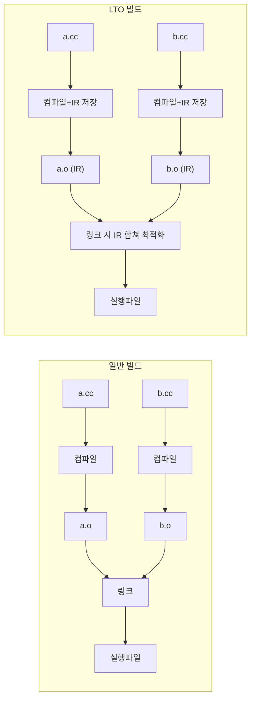

<strong>LTO(Link-Time Optimization)</strong>는 링크 시점에 여러 <strong>번역 단위(TU)</strong>를 합쳐 **크로스-TU 인라이닝**·상수 전파·데드 코드 제거 등을 적용하는 최적화입니다. 코드를 바꾸지 않고도 작은 헬퍼가 여러 TU에 흩어져 있는 구조에서 성능 이득을 얻을 수 있으며, **ThinLTO**는 빌드 시간·메모리를 줄이면서 그 이득의 대부분을 유지합니다. 이 챕터에서는 LTO/ThinLTO 개념, GCC/Clang/MSVC에서의 활성화 방법, **언제 쓸지/피할지** 판단 기준, LTO on/off 성능·크기 검증을 다룹니다.

## 왜 LTO인가 (동기)

일반 빌드에서는 각 TU가 독립적으로 컴파일되므로, 컴파일러는 **다른 TU에 있는 함수의 구현**을 보지 못합니다. 그 결과 **크로스-TU 인라이닝**이 불가능하고, 작은 함수가 여러 TU에서 호출될 때마다 호출 비용이 그대로 남습니다. LTO는 컴파일 시 **IR**을 오브젝트에 넣어 두고 링크 시점에 이를 모아 최적화하므로, TU 경계를 넘는 인라이닝·상수 전파가 가능해집니다. Tr.02(인라이닝 유도)과 함께 쓰면 시너지가 큽니다.

## 정의: LTO와 ThinLTO

<strong>LTO(Link-Time Optimization)</strong>는 컴파일 단계에서 기계어 대신(또는 기계어와 함께) <strong>중간 표현(IR)</strong>을 오브젝트 파일에 넣어 두고, **링크 시점**에 링커(또는 링커가 부르는 LTO 플러그인)가 이 IR을 모두 모아 하나의 큰 번역 단위처럼 다시 최적화하는 방식입니다. 이 중 전체 프로그램의 IR을 실제로 한 덩어리로 합쳐 처리하는 방식을 **Full LTO**(Clang의 `-flto`/`-flto=full`)라고 부릅니다. 전역 시야를 가지므로 최적화 기회는 가장 많지만, Clang Full LTO 기준으로 링크 단계가 사실상 직렬이고 메모리 사용량이 프로그램 크기에 비례해 커집니다. GCC의 기본 `-flto`는 이와 조금 달라서, 전역 분석 뒤 프로그램을 여러 파티션(`-flto-partition=balanced`)으로 나눠 병렬 최적화하며, 분할 없이 처리하려면 `-flto-partition=none`을 지정합니다.

**ThinLTO**는 이 비용을 줄이기 위해 LLVM이 도입한 방식으로, IR 전체를 합치지 않고 **모듈 단위**를 유지한 채 필요한 정보만 주고받습니다. 빌드 시간과 링크 메모리가 크게 줄어드는 대신, 전체 IR을 한 번에 보는 Full LTO보다 일부 크로스 모듈 최적화 기회를 포기합니다. 구체적인 동작은 아래 ThinLTO 절에서 다룹니다.

## 일반 빌드 vs LTO 빌드 흐름



## LTO 활성화 방법

GCC에서는 컴파일과 링크 **모두**에 **-flto**를 넣어야 합니다. GCC 매뉴얼도 "-flto and optimization options should be specified at compile time and during the final link"라고 명시하므로, Make라면 `CXXFLAGS`와 `LDFLAGS` 양쪽에 같은 `-flto`와 최적화 옵션을 두는 것이 안전합니다. 참고로 GCC 드라이버는 "GCC automatically performs link-time optimization if any of the objects involved were compiled with the -flto command-line option"이라는 매뉴얼 설명대로, 링크 명령에 `-flto`가 빠져도 입력 오브젝트에 LTO IR이 있으면 자동으로 LTO를 수행합니다. 반대로 링크에만 `-flto`를 넣고 컴파일에서 빠뜨리면 오브젝트에 IR이 없어 아무 경고 없이 일반 링크가 됩니다. Clang도 같은 위치에 **-flto**를 두되 **-flto=full**(기본)과 **-flto=thin**(ThinLTO)으로 모드를 고를 수 있습니다. MSVC에서는 컴파일 단계의 **/GL**(Whole Program Optimization)과 링크 단계의 **/LTCG**(Link-Time Code Generation)가 짝을 이루며, Visual Studio의 "Whole Program Optimization" 속성을 켜면 둘이 함께 설정됩니다.

정적 라이브러리를 만들 때는 함정이 하나 더 있습니다. LTO 오브젝트에는 기계어 대신 IR만 들어 있을 수 있어(slim LTO 오브젝트), 플러그인을 모르는 일반 `ar`로 묶으면 심볼 인덱스가 비어 링크 시 "undefined reference"가 납니다. GCC는 `gcc-ar`, Clang은 `llvm-ar`를 써야 하고, CMake는 IPO를 켜면 이를 자동으로 처리합니다.

LTO를 켜면 오브젝트 파일이 IR을 담은 형태로 커지고 **링크 시간**과 링커 메모리가 크게 늘어납니다. 이 부담은 링커 선택에도 영향을 줍니다. 병렬 링커인 **mold**는 [릴리스 노트](https://github.com/rui314/mold/releases)에 따르면 2.41에서 GCC의 fat LTO 오브젝트를 LLVM LTO 플러그인과 함께 쓸 때 네이티브 코드로 폴백하도록 호환성을 개선했습니다. LTO 도입 뒤 링크 시간이 병목이 됐다면, 최적화 옵션을 손대기 전에 lld·mold 같은 병렬 링커로 바꿔 측정해 볼 가치가 있습니다.

## ThinLTO

**ThinLTO**는 Clang에서 **-flto=thin**으로 켭니다. [LLVM ThinLTO 문서](https://clang.llvm.org/docs/ThinLTO.html)에 따르면 동작은 세 단계로 나뉩니다. 먼저 컴파일 단계에서 각 모듈의 비트코드(IR)에 함수 호출 그래프·함수 크기·참조 관계 등을 담은 <strong>간결한 요약(summary)</strong>을 덧붙입니다. 링크 시의 **thin link** 단계는 IR 본문이 아니라 이 요약들만 하나의 결합 인덱스로 모아 전역 분석을 수행하고, 각 모듈이 다른 모듈의 어떤 함수를 가져와(import) 인라이닝할지 결정합니다. 마지막 **백엔드** 단계에서는 각 모듈이 결정된 함수만 import한 상태로 서로 독립적으로, 즉 병렬로 최적화·코드 생성됩니다.

이 구조 덕분에 직렬로 도는 부분은 가벼운 요약 처리뿐이고, 무거운 최적화는 코어 수만큼 병렬화됩니다. 전체 IR을 한 메모리에 올리지 않으므로 링크 메모리도 프로그램 크기에 덜 민감하며, 백엔드 결과를 `-Wl,--thinlto-cache-dir=<경로>`(ld.lld 기준; gold는 `-Wl,-plugin-opt,cache-dir=<경로>`, ld64는 `-Wl,-cache_path_lto,<경로>`)로 캐시하면 일부 파일만 바뀐 재빌드에서 바뀌지 않은 모듈의 코드 생성을 건너뛸 수 있습니다. 대가는 시야의 제한입니다. 각 모듈은 import한 함수 외에는 다른 모듈의 본문을 보지 못하므로, 전체 IR을 한 번에 분석하는 Full LTO보다 일부 전역 최적화를 놓칠 수 있습니다. 그래서 대부분의 릴리즈 빌드에는 ThinLTO가 실용적인 기본값이고, 마지막 몇 퍼센트가 중요한 핫패스에서만 Full LTO와 벤치마크로 비교해 보는 것이 일반적입니다.

GCC에는 ThinLTO에 정확히 대응하는 모드가 없습니다. 대신 링크 단계의 IR을 여러 파티션으로 나눠 병렬 처리하는 분할 LTO(`-flto-partition`, 기본값 `balanced`)와 병렬 작업 수 지정(`-flto=n`, `-flto=jobserver`, `-flto=auto`)으로 링크 시간을 줄입니다. `-flto=auto`는 GNU make의 jobserver가 있으면 그것을 쓰고 없으면 CPU 스레드 수를 자동으로 감지하는 옵션일 뿐, ThinLTO 같은 요약 기반 방식이 아니라는 점에 주의합니다.

## 예시: 크로스-TU 인라이닝 확인

LTO의 효과는 다른 파일에 정의된 작은 함수에서 가장 잘 드러납니다. 아래 두 파일에서 `add`는 `a.cc`에 있으므로, LTO 없이 `b.cc`를 컴파일할 때는 컴파일러가 본문을 보지 못해 루프 안에 함수 호출이 그대로 남습니다.

```cpp
// a.cc
int add(int x, int y) { return x + y; }
```

```cpp
// b.cc
#include <cstdio>

int add(int, int);  // 정의는 a.cc에 있음

int main() {
  long s = 0;
  for (int i = 0; i < 1'000'000'000; ++i)
    s = add(static_cast<int>(s), i) & 0xffff;  // 비-LTO에서는 매 반복 call
  std::printf("%ld\n", s);  // 결과 출력으로 계산 제거를 막음
}
```

두 설정으로 빌드한 뒤 `main` 안의 `add` 호출을 세어 보면 차이가 바로 보입니다. 비-LTO 바이너리에는 `call ... <add...>`가 남고, LTO 바이너리에서는 링크 시점에 `add`가 인라이닝되어 호출이 사라집니다.

```bash
# GCC: 비-LTO vs LTO
g++ -O2       a.cc b.cc -o app_nolto
g++ -O2 -flto a.cc b.cc -o app_lto

# main 안의 add 호출 수 비교 (비-LTO는 1 이상, LTO는 0이 기대값)
objdump -d --no-show-raw-insn app_nolto | grep -c 'call.*<_Z3addii>'
objdump -d --no-show-raw-insn app_lto   | grep -c 'call.*<_Z3addii>'

# Clang: ThinLTO
clang++ -O2 -flto=thin a.cc b.cc -o app_thinlto
```

CMake에서는 플래그를 직접 넣기보다 IPO 지원 여부를 먼저 확인한 뒤 켜는 방식이 정석입니다. 이렇게 하면 컴파일·링크 양쪽 플래그와 `gcc-ar`/`llvm-ar` 선택을 CMake가 맞춰 줍니다.

```cmake
include(CheckIPOSupported)
check_ipo_supported(RESULT ipo_ok OUTPUT ipo_msg)
if(ipo_ok)
  set_property(TARGET app PROPERTY INTERPROCEDURAL_OPTIMIZATION TRUE)
else()
  message(WARNING "IPO/LTO not supported: ${ipo_msg}")
endif()
```

## LTO on/off 성능·크기 비교

동일 소스·동일 -O2/-O3에 대해 **LTO 없이** 빌드한 바이너리와 **LTO(또는 ThinLTO)** 적용 바이너리를 만들고, **같은 벤치마크**로 실행 시간과 바이너리 크기를 측정합니다. 작은 함수가 여러 TU에 흩어져 있을수록 LTO 이득이 크고, 이미 대부분 인라인되거나 단일 TU에 몰려 있으면 차이가 작을 수 있습니다. 회귀 테스트에서 LTO on을 기본으로 두고, 변경이 성능에 영향을 주지 않는지 확인하는 것을 권장합니다.

세 가지 설정을 같은 소스로 빌드해 크기와 실행 시간을 한 번에 비교하면 트레이드오프가 드러납니다.

```bash
# 같은 소스를 비-LTO / Full LTO / ThinLTO로 빌드
clang++ -O2          a.cc b.cc -o app_nolto
clang++ -O2 -flto=full a.cc b.cc -o app_fulllto
clang++ -O2 -flto=thin a.cc b.cc -o app_thinlto

# 바이너리 크기와 실행 시간 비교
size app_nolto app_fulllto app_thinlto
for b in app_nolto app_fulllto app_thinlto; do echo "== $b =="; time ./$b; done
```

아래 표의 수치는 **예시값**이며, 실제 이득·링크 비용은 TU 수·인라이닝 구조·링커·하드웨어에 따라 크게 달라집니다.

| 설정 | 실행 시간(예시) | 바이너리 크기(예시) | 링크 시간(예시) |
|------|---------------|------------------|----------------|
| 비-LTO (`-O2`) | 1.00× | 기준 | 짧음 |
| Full LTO | 0.92–0.99× | ±수 % | 길고 메모리 큼 |
| ThinLTO | 0.93–0.99× | ±수 % | 중간 |

## 빌드 캐시(ccache 등)와 LTO

**ccache**는 컴파일러 호출 결과를 캐시합니다. LTO를 쓰면 **오브젝트에 IR**이 들어가 소스만 같아도 플래그(-O2 vs -O3, -flto 유무)에 따라 오브젝트 내용이 달라지므로 ccache hit이 줄어들 수 있습니다. LTO 빌드와 비-LTO 빌드를 섞어 쓰면 캐시 키가 달라져 효과가 반감됩니다. CI에서는 "LTO 한 가지 설정"으로 통일하고 캐시 키에 플래그를 포함하는 것이 안전합니다.

## 역사·배경

GCC는 **-flto**를 [GCC 4.5](https://gcc.gnu.org/gcc-4.5/)(2010년 4월 릴리스)부터 공식 지원했습니다. 현행 GCC 매뉴얼은 `-flto` 옵션을 다음과 같이 설명합니다.

> "This option runs the standard link-time optimizer. When invoked with source code, it generates GIMPLE (one of GCC's internal representations) and writes it to special ELF sections in the object file. When the object files are linked together, all the function bodies are read from these ELF sections and instantiated as if they had been part of the same translation unit." — [GCC Manual, Optimize Options (-flto)](https://gcc.gnu.org/onlinedocs/gcc/Optimize-Options.html)

Clang/LLVM은 **Gold 플러그인**을 통한 LTO와 이후 **ThinLTO**를 도입해 대형 프로젝트에서의 빌드 시간 문제를 완화했습니다. MSVC의 **/LTCG**는 그 이전부터 링크 시점 코드 생성으로 제공되어 왔습니다.

## 판단 기준: 언제 쓸지 / 언제 피할지

| 상황 | 권장 | 비권장 | 근거 |
|------|------|--------|------|
| 일반 릴리즈 | ThinLTO (또는 Full LTO) | LTO 없음 | 크로스-TU 인라이닝 이득을 거의 공짜로 얻음 |
| 대형 프로젝트·빌드 시간 중요 | ThinLTO | Full LTO | Full LTO는 링크가 직렬이고 링커 메모리가 프로그램 크기에 비례 |
| 디버그 빌드 | LTO 끔 (-O0 등) | LTO 켬 | 링크 시점 재최적화로 단계 실행·변수 조사가 어긋남 |
| ccache hit 극대화 | LTO 한 설정으로 통일 | LTO on/off 혼용 | 플래그가 다르면 캐시 키가 갈림 |

## 자주 하는 실수

가장 흔한 실수는 **링크에만 `-flto`를 넣고 컴파일에는 빠뜨리는 것**(예: `LDFLAGS`에만 추가)입니다. 오브젝트에 IR이 없으므로 링커는 오류 없이 일반 링크를 수행하고, LTO가 꺼져 있다는 사실을 알아채기 어렵습니다. 반대로 컴파일에만 넣은 경우 GCC는 링크 시 자동으로 LTO를 수행하지만, Clang은 링커 구성에 따라 비트코드 오브젝트를 읽지 못해 링크 오류가 날 수 있습니다. 위의 `objdump` 확인처럼 핫한 크로스-TU 호출이 실제로 사라졌는지 한 번 확인해 두면 이런 설정 누락을 잡을 수 있습니다.

두 번째는 **정적 라이브러리를 일반 `ar`로 묶는 것**입니다(위 'LTO 활성화 방법'의 정적 라이브러리 문단 참고). `gcc-ar`/`llvm-ar`를 쓰거나, 비-LTO 소비자도 지원해야 한다면 GCC의 `-ffat-lto-objects`로 IR과 기계어를 함께 넣습니다.

세 번째는 **디버그 빌드에 LTO를 켜는 것**입니다. 링크 시점에 함수가 다른 TU로 인라이닝되면 소스 라인과 변수 위치 대응이 크게 흐트러지므로, 디버그 빌드에서는 LTO를 끄고 릴리즈 동작 재현이 필요할 때만 LTO + `-g` 빌드를 따로 만듭니다.

## 용어 정리

| 용어 | 설명 |
|------|------|
| **IR** | Intermediate Representation; 컴파일러가 내부적으로 사용하는 중간 표현. LTO 시 오브젝트에 저장됨 |
| **크로스-TU 인라이닝** | 서로 다른 번역 단위에 있는 함수끼리 인라이닝하는 것; 일반 빌드에서는 불가, LTO에서 가능 |
| **thin link** | ThinLTO에서 요약 인덱스만으로 전역 분석·import 결정을 하는 직렬 단계 |
| **fat LTO 오브젝트** | IR과 기계어를 함께 담은 오브젝트(GCC `-ffat-lto-objects`) |

## 비판적 시각

LTO는 **항상 이득**인 것은 아닙니다. 크로스-TU 인라이닝이 늘면 코드 크기가 커져 I-cache 압박으로 오히려 느려질 수 있고, 링크 시간·메모리가 치명적인 환경에서는 ThinLTO도 부담일 수 있습니다. "LTO = 켜두는 것"이 아니라, **자신의 프로젝트에서 LTO on/off를 측정한 뒤** 선택하는 것이 좋습니다.

## 학습 성과 목표

- **LTO**와 **ThinLTO**의 정의와 차이를 설명할 수 있다.
- GCC/Clang/MSVC에서 LTO를 활성화하는 방법을 적용할 수 있다.
- LTO on/off 성능·크기 차이를 동일 벤치마크로 검증할 수 있다.
- 빌드 캐시와 LTO의 상충 관계를 설명하고, CI에서 LTO 설정을 통일할 수 있다.

## 다음 장에서는

**PGO(Profile-Guided Optimization)** 3단계 워크플로우, 프로파일 수집·대표성, PGO 전/후 검증을 다룹니다.

→ [PGO 고급 워크플로우](/post/compiler-optimization/pgo-workflow-advanced/) (챕터 03)
