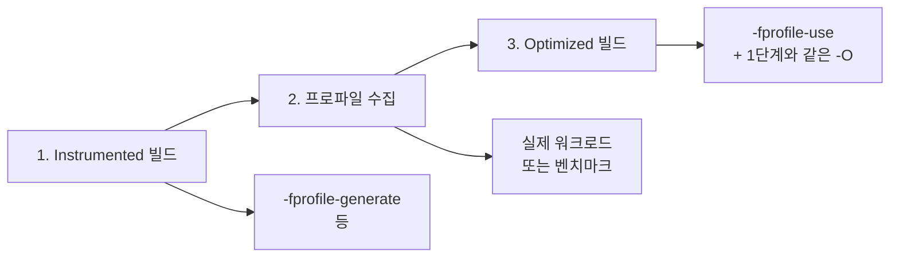

<strong>PGO(Profile-Guided Optimization)</strong>는 실제 실행 **프로파일**을 수집한 뒤 그 정보로 재컴파일해 분기·인라이닝·코드 배치 등을 더 잘 맞춥니다. 이득의 크기는 워크로드와 프로파일 품질에 따라 크게 달라지며, **프로파일 대표성**이 부족하면 오히려 성능이 나빠질 수 있습니다. 이 챕터에서는 3단계 워크플로우, 프로파일 수집·대표성, PGO 전/후 검증, **언제 쓸지/피할지** 판단 기준을 다룹니다.

## Profile-Guided Optimization 개념

<strong>PGO(Profile-Guided Optimization)</strong>는 "실제로 어떻게 실행되는지"를 한 번 실행해서 수집한 **프로파일**을, 그다음 컴파일 단계에서 사용하는 방식입니다. 프로파일이 없을 때 컴파일러는 분기마다 "어느 쪽이 더 자주 실행될까"를 휴리스틱으로 추정합니다. 루프 back-edge는 대개 taken, 오류 처리 경로는 드물다는 식의 정적 추정이므로, 실제 입력에 따라 갈리는 데이터 의존 분기 앞에서는 자주 틀릴 수밖에 없습니다.

계측 기반 PGO는 이 추정을 측정값으로 바꿉니다. 계측 빌드에서 컴파일러는 제어 흐름 그래프(CFG)의 엣지나 기본 블록마다 실행 횟수를 세는 카운터를 심고, 간접 호출 지점에는 실제 호출 대상을 기록하는 값 프로브를 넣습니다. 대표 워크로드로 실행해 얻은 카운터 값은 다음 컴파일에서 IR의 분기 가중치(branch weight)와 함수 진입 횟수로 다시 붙습니다.

최적화 패스들은 이 가중치를 각자의 결정에 씁니다. 인라이너는 호출 횟수가 큰 호출 지점을 우선 인라이닝하고 한 번도 안 불린 지점은 건너뛰며, 블록 배치는 자주 실행되는 경로가 fall-through로 이어지도록 기본 블록을 재배열합니다. 거의 실행되지 않는 블록과 함수는 hot/cold 분리로 별도 섹션에 밀어내 I-cache와 페이지를 핫 코드가 독점하게 하고, 간접 호출이 특정 대상으로 몰리면 그 대상으로의 직접 호출 분기를 삽입해 인라이닝까지 가능하게 합니다(간접 호출 승격). [Microsoft 문서](https://learn.microsoft.com/en-us/cpp/build/profile-guided-optimizations)가 PGO 최적화로 나열하는 Inlining·Virtual Call Speculation·Basic Block Optimization·Function Layout·Dead Code Separation이 바로 이 목록에 해당합니다.

## 역사·배경

프로파일 정보를 컴파일에 쓰는 발상은 오래되었습니다. 측정된 실행 프로파일로 코드 배치를 결정한 대표적 초기 연구는 Pettis와 Hansen의 "Profile Guided Code Positioning"(ACM SIGPLAN PLDI, 1990)이고, Microsoft Visual C++는 Visual Studio 2005에서 PGO를 제품 기능으로 도입했습니다. Clang 문서는 그 목적을 다음과 같이 설명합니다.

> "Profile information enables better optimization. For example, knowing that a branch is taken very frequently helps the compiler make better decisions when ordering basic blocks. Knowing that a function foo is called more frequently than another function bar helps the inliner. Optimization levels -O2 and above are recommended for use of profile guided optimization." — LLVM Project, *Clang Compiler User's Manual*, §Profile Guided Optimization (2026-10 조회), [링크](https://clang.llvm.org/docs/UsersManual.html#profile-guided-optimization)

GCC는 **-fprofile-generate** / **-fprofile-use** 형태로 프로파일 기반 최적화를 지원했고, Microsoft는 Visual C++에서 **/LTCG**와 연계한 PGO를 제공해 왔습니다. Clang/LLVM은 **-fprofile-instr-generate**·**-fprofile-instr-use**와 샘플링 기반 AutoFDO 등으로 진화했습니다. 분기가 많고 핫 경로가 분명한 코드일수록 PGO 이득이 커지는 경향이 있지만, 그 크기는 프로그램마다 달라 아래 「PGO 전/후 성능 검증」처럼 직접 측정해야 합니다.

## 3단계 워크플로우

1. **Instrumented 빌드**: 프로파일 수집을 위해 **계측 코드**가 삽입된 바이너리를 만듭니다. GCC는 **-fprofile-generate**, Clang은 **-fprofile-instr-generate**, MSVC는 **/GENPROFILE** 등을 사용합니다. GCC는 계측 컴파일과 최종 컴파일에 같은 소스와 같은 최적화 옵션을 쓰도록 요구하므로("you must use the same source code and the same optimization options for both compilations" — [GCC Manual, -fbranch-probabilities](https://gcc.gnu.org/onlinedocs/gcc/Optimize-Options.html)), 릴리즈에 -O3를 쓸 계획이면 계측 빌드도 -O3로 맞춥니다.
2. **프로파일 수집**: 위 바이너리를 **실제 워크로드**나 **대표 벤치마크**로 실행합니다. 실행이 끝나면 .gcda(GCC) 또는 .profraw(Clang) 등 프로파일 파일이 생성됩니다. 이 파일에는 함수/엣지/블록별 실행 횟수 등이 기록됩니다.
3. **Optimized 빌드**: 프로파일을 사용해 **다시 컴파일**합니다. GCC는 **-fprofile-use**, Clang은 **-fprofile-instr-use**, MSVC는 **/USEPROFILE** 등을 사용하고, 최적화 레벨은 1단계와 같게 둡니다. 레벨이 다르면 GCC에서는 생성 코드 구조가 달라져 `-Wcoverage-mismatch`(기본 오류)로 빌드가 멈출 수 있습니다. Clang의 프런트엔드 계측(`-fprofile-instr-generate`)은 소스 수준 카운터를 쓰므로 이 제약에 덜 민감합니다. 컴파일러는 프로파일을 읽어 핫 경로를 우선 인라인하고, 분기를 예측하기 좋게 재배치합니다.

소스나 빌드 설정이 바뀌면 프로파일이 무효화되므로, 큰 변경 후에는 1–3단계를 다시 수행해야 합니다.

## 3단계 워크플로우 (Mermaid)



## 컴파일러별 실제 명령

GCC는 한 쌍의 플래그(`-fprofile-generate`/`-fprofile-use`)로 3단계를 처리합니다. 1단계 바이너리를 실행하면 오브젝트 파일 이름을 딴 `.gcda`가 생기고, 3단계에서 같은 오브젝트 이름으로 `-fprofile-use` 재컴파일해야 그 파일을 찾습니다. 컴파일과 링크를 한 명령으로 하면 최근 GCC는 `.gcda` 이름 앞에 출력 실행 파일 이름을 붙이므로(`app_instr-app.gcda`), 출력 이름이 다른 재빌드가 프로파일을 찾지 못하고 경고만 낸 채 PGO 없이 빌드됩니다. 아래처럼 컴파일과 링크를 분리하면 이 문제를 피할 수 있습니다.

```bash
# GCC: (1) 계측 빌드 -> (2) 실행해 프로파일 수집 -> (3) 프로파일로 재빌드
# 컴파일과 링크를 분리해 두 빌드가 같은 app.gcda를 쓰게 한다
g++ -O3 -fprofile-generate -c app.cpp -o app.o
g++ -fprofile-generate app.o -o app_instr
./app_instr < representative_input    # app.gcda 생성
g++ -O3 -fprofile-use -fprofile-correction -Werror=missing-profile -c app.cpp -o app.o
g++ app.o -o app_pgo
```

Clang은 raw 프로파일(`.profraw`)을 `llvm-profdata merge`로 합쳐 `.profdata`로 만든 뒤 사용합니다. 여러 번 실행한 프로파일을 한 번에 병합할 수 있어 대표성을 높이기 좋습니다.

```bash
# Clang: 계측 -> 실행(LLVM_PROFILE_FILE) -> merge -> 사용
clang++ -O2 -fprofile-instr-generate app.cpp -o app_instr
LLVM_PROFILE_FILE="app-%p.profraw" ./app_instr < representative_input
llvm-profdata merge -output=app.profdata app-*.profraw
clang++ -O3 -fprofile-instr-use=app.profdata app.cpp -o app_pgo
```

MSVC에서는 PGO가 링크 타임 코드 생성에 묶여 있습니다. Microsoft 문서의 절차대로 소스를 `/GL`로 컴파일하고 `/LTCG /GENPROFILE`로 링크해 계측 바이너리를 만들며, 실행이 끝날 때마다 `appname!N.pgc` 파일이 생기고 이 데이터가 `.pgd` 파일에 모입니다. 마지막으로 `/LTCG /USEPROFILE`로 다시 링크하면 최적화된 이미지가 나옵니다. `/GL`로 컴파일한 모듈만 계측·최적화 대상이 된다는 점에 주의합니다.

## MSVC Sample PGO(SPGO): 계측 없는 대안

위 3단계 워크플로우는 공통적으로 **계측(instrumented) 빌드**가 필요합니다. MSVC는 이와 별개로 <strong>Sample PGO(SPGO)</strong>를 제공합니다. 별도의 계측 빌드 없이, 이미 배포 중인 **릴리스 바이너리**에서 `xperf`로 수집한 **하드웨어 성능 카운터 샘플링**(IP 샘플링 또는 LBR, 즉 Last Branch Records)만으로 인라이닝·코드 레이아웃·hot/cold 분리·투기적 역가상화 등 계측 기반 PGO와 동일한 종류의 최적화를 적용합니다. [Microsoft C++ 팀 블로그](https://devblogs.microsoft.com/cppblog/introducing-sample-profile-guided-optimization-in-msvc/)는 "SPGO is available in all versions of Visual Studio 2022, and Visual Studio 2026"이라고 밝히며, 도구 요건은 MSVC Build Tools 14.51(Visual Studio 2026 18.6)입니다. 같은 글은 이득을 프로파일 품질에 따라 5–15%로 제시합니다. SPGO는 "계측 빌드 → 대표 워크로드 실행 → 재빌드"라는 3단계 자체를 생략할 수 있다는 점에서 CI 비용 문제를 다른 각도로 해결합니다. GCC/Clang 계열의 AutoFDO(15장에서 다룹니다)와 개념적으로 유사하지만, MSVC는 이를 표준 PGO 워크플로우의 대안으로 명시적으로 통합해 제공합니다.

## 프로파일 수집 방법과 대표성

프로파일은 **실제 서비스 트래픽에 가까운 입력**으로 수집하는 것이 이상적입니다. 그래야 "실제로 자주 타는 경로"가 반영됩니다. 현실적으로는 자주 쓰는 시나리오를 자동화한 통합·시스템 테스트를 계측 바이너리로 돌리고, 여기에 대표 부하를 만드는 벤치마크 스위트를 더해 여러 실행의 프로파일을 병합합니다. Clang에서 `llvm-profdata merge`로 여러 `.profraw`를 합치는 이유가 이것입니다.

계측 빌드 자체가 부담이라면 perf·VTune 같은 샘플링 프로파일러로 기존 릴리스 바이너리에서 프로파일을 만드는 방법(AutoFDO, 15장)도 있습니다. 계측 카운터보다 정밀도는 낮지만 실제 프로덕션 트래픽에서 바로 수집할 수 있어, 대표성 문제를 다른 방향에서 푸는 셈입니다.

**대표성이 부족한** 프로파일(예: 한두 개의 극단적인 테스트만 돌린 경우)을 쓰면, 실제 트래픽과 다른 경로가 "핫"으로 잡혀 오히려 성능이 나빠질 수 있으므로, 가능한 한 다양한·대표적인 워크로드로 수집하는 것이 중요합니다.

## PGO 전/후 성능 검증

PGO를 적용한 뒤에는 **동일한 벤치마크**로 PGO 적용 전·후 실행 시간을 측정합니다. 수치적으로 개선이 나와야 하고, 중요한 지표(지연 시간, 처리량)가 나빠지면 프로파일 대표성이나 빌드 설정을 점검해야 합니다. 회귀 테스트 파이프라인에 "PGO 빌드 + 벤치마크"를 넣어 두면, 변경이 PGO 이득을 깨뜨리지 않는지 계속 확인할 수 있습니다.

검증은 `-O3` baseline과 PGO 바이너리를 **같은 입력**으로 여러 번 돌려 비교하는 방식이 기본입니다. 아래 스켈레톤은 GNU time(`/usr/bin/time`)의 wall-clock 값을 모아 평균을 내고, 마지막에 `size`로 코드 크기 변화도 확인합니다. PGO는 핫 코드를 키우고 콜드 코드를 줄이므로 전체 크기는 늘 수도 줄 수도 있습니다. 분포까지 보려면 `hyperfine`을 쓰는 편이 편합니다.

```bash
# baseline(-O3)과 PGO 바이너리를 같은 입력으로 반복 측정
g++ -O3 app.cpp -o app_base
# (app_pgo는 위 3단계로 생성)
for b in app_base app_pgo; do
  rm -f "$b.times"
  for i in $(seq 5); do
    /usr/bin/time -f "%e" -a -o "$b.times" ./$b < representative_input > /dev/null
  done
  awk -v b="$b" '{s+=$1; n++} END {printf "%s mean=%.3fs over %d runs\n", b, s/n, n}' "$b.times"
done
size app_base app_pgo   # 텍스트 세그먼트 크기 비교
```

아래 표의 개선폭은 **예시값**입니다. 실제 이득은 분기·인라이닝에 민감한 코드일수록 크고, 경로가 균등하거나 프로파일 대표성이 낮으면 0에 가깝거나 음수일 수 있습니다(측정값은 CPU·컴파일러·워크로드에 따라 다름).

| 빌드 | 실행 시간(예시) | 비고 |
|------|---------------|------|
| `-O2` | 1.00× | 기준 |
| `-O3` | 0.97× | 일반 최적화 |
| `-O3` + PGO(대표 프로파일) | 0.85–0.95× | 핫 경로 분기·인라이닝 개선 |
| `-O3` + PGO(비대표 프로파일) | 1.0× 이상 | 잘못된 핫 경로 → 회귀 가능 |

## CI/자동화에서 PGO 적용 시 고려사항

CI에서 가장 먼저 부딪히는 문제는 **비용**입니다. 3단계 워크플로우는 빌드·실행·재빌드로 이어져 파이프라인 시간을 크게 늘리므로, 주 브랜치나 릴리즈 브랜치에만 PGO 빌드를 두고 PR에서는 일반 -O2/-O3만 돌리는 식으로 정책을 나누는 경우가 많습니다.

비용을 줄이는 수단은 **캐시**지만, 잘못 쓰면 오히려 위험합니다. 프로파일 파일(.gcda, .profdata, .pgd)과 PGO 빌드 산출물을 캐시하면 다음 빌드에서 프로파일 재수집을 건너뛸 수 있는데, 캐시 키에 소스 해시·빌드 플래그·프로파일 입력 식별자가 빠지면 이전 코드로 수집한 프로파일이 새 코드에 조용히 적용됩니다. 불일치 처리는 컴파일러마다 다릅니다. GCC는 제어 흐름 체크섬이 맞지 않는 함수를 기본적으로 오류(`-Wcoverage-mismatch`)로 처리하지만, 프로파일 파일 자체를 찾지 못하면 `-Wmissing-profile` 경고만 내고 프로파일 없이 빌드를 계속합니다. Clang도 오래된 프로파일을 `-Wprofile-instr-out-of-date` 경고로 알립니다. 따라서 CI에서는 `-Werror=missing-profile`(GCC)·`-Werror=profile-instr-out-of-date`(Clang)처럼 프로파일 관련 경고를 오류로 승격해 두는 것이 안전합니다.

마지막은 **재현성**입니다. 프로파일은 입력 데이터와 실행 순서, 멀티스레드라면 스레드 스케줄에 따라서도 조금씩 달라집니다. CI에서 같은 입력·같은 순서로 프로파일을 수집하고 그 프로파일 파일을 산출물로 보관해 두면, 나중에 같은 PGO 바이너리를 다시 만들 수 있습니다.

## 판단 기준: 언제 PGO를 쓸지 / 피할지

| 상황 | 권장 | 비권장 |
|------|------|--------|
| 핫패스가 분기·인라이닝에 민감 | PGO 적용, 대표 워크로드로 수집 | 대표성 없는 입력으로만 수집 |
| 실제 트래픽과 유사한 벤치 보유 | PGO + 회귀 테스트 | 한두 테스트만으로 프로파일 |
| CI 시간·비용 제약 | 릴리즈/주 브랜치만 PGO | 모든 PR에 PGO |
| 소스·빌드 자주 변경 | 프로파일 재수집 주기 정책 | 변경 후 프로파일 미갱신 |

**적용 체크리스트**: (1) 한 번에 전체 빌드에 걸지 말고 핵심 실행 파일부터 적용해 이득을 확인한 뒤 범위를 넓힌다. (2) 프로파일 파일과 수집 입력 식별자를 빌드 산출물로 함께 보관한다. (3) CI에서 프로파일 관련 경고를 오류로 승격한다.

## 자주 하는 실수

- **프로파일 미갱신**: 소스·의존성·빌드 플래그가 바뀐 뒤에도 예전 프로파일로 Optimized 빌드를 하면, 잘못된 핫 경로에 맞춰 최적화되어 성능이 나빠질 수 있다. 변경이 있을 때마다 1–3단계를 다시 수행하는 습관을 들인다.
- **대표성 없는 입력으로만 수집**: 한두 개의 극단적인 테스트나 실제 트래픽과 다른 벤치만 돌려 프로파일을 만들면, 실제로 자주 타는 경로가 반영되지 않아 PGO가 역효과를 낸다. 가능한 한 다양한·대표적인 워크로드로 수집한다.
- **PGO 빌드로만 성능 판단**: PGO 적용 후 숫자가 좋아졌다고 해서, "PGO가 무조건 이득"이라고 일반화하면 안 된다. 워크로드·대표성에 따라 이득이 없거나 손해일 수 있으므로, 전/후 측정과 회귀 테스트로 검증한다.

## 용어 정리

| 용어 | 설명 |
|------|------|
| **Instrumented 빌드** | 프로파일 수집을 위해 계측 코드가 삽입된 빌드; -fprofile-generate 등 사용 |
| **.gcda / .profraw** | GCC·Clang에서 생성하는 프로파일 파일; 함수/엣지/블록별 실행 횟수 등 기록 |
| **프로파일 대표성** | 수집한 프로파일이 실제 배포 환경·트래픽을 얼마나 잘 반영하는지; 대표성 부족 시 PGO가 역효과 |

## 학습 성과 목표

- **PGO** 3단계(Instrumented 빌드 → 프로파일 수집 → Optimized 빌드)를 설명하고 적용할 수 있다.
- 프로파일 **대표성**이 부족할 때 성능이 나빠질 수 있음을 설명하고, 다양한·대표적인 워크로드로 수집할 수 있다.
- PGO 전/후 성능 검증과 CI 연동 시 캐시·재현성·비용을 고려할 수 있다.

## 비판적 시각: 한계와 트레이드오프

PGO는 **만능이 아니다**. 이득은 워크로드가 고정적이고 핫 경로가 분명할 때 크고, 입력이 매우 다양하거나 경로가 균등하면 작거나 없을 수 있다. "PGO를 켜면 무조건 빨라진다"가 아니라 측정으로 판단해야 하는 이유다.

더 근본적인 한계는 프로파일이 "한 번 찍은 스냅샷"이라는 점이다. 컴파일러는 프로파일에서 거의 실행되지 않은 경로를 콜드로 취급해 크기 위주로 최적화하고 핫 코드에서 멀리 떨어뜨리므로, 배포 후 사용 패턴이 바뀌어 그 경로가 핫해지면 PGO가 없을 때보다 느려질 수 있다. 사용자 집단이 여러 갈래라면 시나리오별 프로파일을 병합하거나, 프로덕션 샘플링 기반(AutoFDO·SPGO)으로 주기적으로 갱신하는 쪽이 이 문제에 더 강하다.

## 다음 장에서는

**GCC vs Clang vs MSVC** 최적화 차이, 벡터화·인라이닝·루프 영역별 비교, 플랫폼별 선택을 다룹니다.

→ [컴파일러 비교: GCC vs Clang vs MSVC](/post/compiler-optimization/compiler-comparison-gcc-clang-msvc/) (챕터 04)
