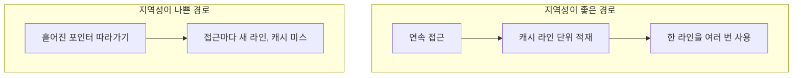

이 장은 **기초** 난이도입니다. 이 트랙의 본문 챕터들은 할당기·풀·레이아웃 같은 주제로 빠르게 들어가는데, 독자마다 <strong>"메모리가 왜 비싼가"</strong>에 대한 머릿속 그림이 다르면 같은 조언도 다르게 읽힙니다. 여기서는 수식 대신 스택과 힙, 객체 수명, 캐시 라인이라는 세 가지 직관을 맞추고, 각 직관이 이후 어느 챕터의 어떤 결정으로 이어지는지를 연결합니다. 트랙의 다른 장에서 측정한 수치가 나오는 곳은 해당 장을 링크하므로, 이 장의 숫자는 새로 잰 것이 아니라 그 장의 측정을 다시 가져온 것입니다.

## 스택과 힙: 누가 수명을 정하는가

스택은 함수 호출이 살아 있는 동안만 의미가 있는 프레임 단위의 저장소입니다. 함수에 들어갈 때 스택 포인터를 한 번 옮기면 그 프레임 안의 모든 지역 변수 자리가 정해지고, 반환할 때 포인터를 되돌리면 한꺼번에 사라집니다. 그래서 스택에 객체를 만드는 일은 별도의 "할당"이라기보다 이미 계산된 오프셋을 쓰는 일에 가깝고, 대가로 크기가 컴파일 시점에 알려져야 하며 수명이 함수 스코프를 넘지 못한다는 제약을 받습니다. 힙은 반대로 수명을 프로그램이(또는 런타임이) 직접 정하는 더 일반적인 저장소입니다. 크기와 수명이 자유로운 대신, 요청마다 할당기가 알맞은 빈 공간을 찾고 메타데이터를 갱신하며 멀티스레드에서는 경합까지 조정해야 합니다.

이 차이의 크기는 [12장: Stack vs Heap 할당 비용](/post/memory-optimization/stack-vs-heap-allocation-cost/)에서 직접 쟀습니다. 2KiB 페이로드를 스택에 만드는 경로는 0.90–1.27 ns/op, `new`/`delete`로 힙을 오가는 경로는 21.54–48.31 ns/op였습니다. 다만 이 값은 특정 서버에서 반복 실행해 얻은 범위이므로 배율이 아니라 "힙 경로는 수십 배까지 무거워질 수 있다"는 방향으로만 읽어야 합니다. 그렇다고 힙이 나쁜 것은 아닙니다. 문제는 지연 예산이 빠듯한 핫패스에서 힙을 얼마나 자주 두드리느냐이고, 그 빈도를 줄이는 방법이 이 트랙의 02–04장(풀·아레나·`std::pmr`)입니다.

## 수명이 성능으로 들어오는 방식

C++에서 수명(lifetime)은 정의되지 않은 동작을 피하기 위한 규칙이지만, 성능을 이야기할 때도 같은 질문으로 돌아옵니다. 누가 이 객체를 언제까지 쥐고 있는가입니다. 스코프가 끝나는 곳에서 바로 파괴되는 객체는 스택과 RAII에 잘 맞고 소멸 시점이 분명합니다. 반대로 오래 살아남는 객체는 그동안 캐시와 메모리 계층에 자리를 차지하며, 여러 스레드가 함께 쥐면 동기화 비용까지 따라옵니다. 예를 들어 `std::shared_ptr`는 소유권 공유를 편하게 해 주지만 참조 횟수를 원자적으로 갱신해야 하고, 참조 횟수를 담는 제어 블록을 따로 두는 대가를 치릅니다. `std::string_view` 같은 뷰 타입은 원본 문자열이 먼저 사라지면 성능 이전에 정확성이 무너집니다.

그래서 "어떤 타입이 빠른가"를 고르기 전에 누가 언제까지 유효해야 하는지를 먼저 그려 보는 것이 순서입니다. 수명이 짧고 크기가 정해져 있으면 스택, 수명이 길거나 크기가 실행 중에 정해지면 힙이라는 단순한 규칙으로 대부분의 첫 설계가 정리되고, 그 규칙이 맞지 않는 지점(예외 경로에서 해제가 빠지는 문제)은 [14장: 메모리 누수 탐지](/post/memory-optimization/memory-leak-detection-valgrind-asan/)에서 다룹니다.

## 캐시 라인: 한 번에 가져오는 덩어리

CPU는 메모리를 바이트 하나씩이 아니라 캐시 라인이라는 덩어리 단위로 가져옵니다. x86-64에서는 흔히 64바이트이지만 플랫폼마다 다릅니다. C++17은 이 값을 코드에서 쓸 수 있도록 [`std::hardware_destructive_interference_size`](https://en.cppreference.com/w/cpp/thread/hardware_destructive_interference_size)를 제공하며, 이 상수는 거짓 공유를 피하기 위한 두 객체 사이의 최소 간격으로 정의됩니다. 한 라인에는 이웃한 데이터가 함께 실려 오므로, 배열을 순서대로 읽으면 한 번 가져온 라인을 여러 번 쓰게 됩니다. 이것이 공간 지역성입니다. 같은 주소를 짧은 간격으로 다시 읽으면 아직 캐시에 남아 있을 확률이 높아지는 것이 시간 지역성입니다. 순차 접근은 하드웨어 프리페처가 다음 라인을 미리 가져오기 쉬운 패턴이기도 합니다.

차이는 접근 순서만 바꿔도 드러납니다. [06장: 캐시 친화적 접근 패턴](/post/memory-optimization/cache-friendly-access-patterns/)에서 64MiB 배열을 순서대로 더하면 원소당 0.42–0.53 ns였지만, 같은 원소를 무작위 순서로 방문하면 14.9–22.0 ns로 30배 안팎 벌어졌습니다. 같은 일을 하는데 방문 순서가 다르다는 이유만으로 생기는 차이이고, 포인터를 따라가야 다음 주소를 알 수 있는 연결 리스트가 이 무작위 쪽에 가깝습니다. 구조체의 필드를 어떻게 배치하느냐도 같은 원리로 라인을 얼마나 알뜰하게 쓰는지를 바꾸며, 이는 [05장: AoS vs SoA](/post/memory-optimization/aos-vs-soa-data-layout/)와 [07장: 구조체 패딩과 정렬](/post/memory-optimization/struct-padding-alignment-optimization/)의 주제입니다.

멀티스레드에서는 캐시 라인이 하나 더 문제를 만듭니다. 서로 다른 코어가 서로 다른 변수를 쓰더라도 그 변수들이 같은 캐시 라인에 있으면, 한 코어가 쓸 때마다 다른 코어의 복사본이 무효화되어 라인이 코어 사이를 오가게 됩니다. 이것이 거짓 공유(false sharing)이며, 변수들이 논리적으로는 독립인데도 성능만 무너진다는 점이 까다롭습니다. 해결은 자주 쓰는 변수를 서로 다른 라인에 놓는 것이고, 앞에서 본 상수와 `alignas`가 그 도구입니다. 캐시 구조와 일관성 프로토콜 자체는 Drepper의 글 [2부](https://lwn.net/Articles/252125/)가 CPU 캐시를 다루므로 거기서 이어 읽으면 됩니다.

## 할당 한 번의 비용이 커지는 이유

할당기는 주소만 돌려주는 함수가 아닙니다. 알맞은 크기의 빈 블록을 찾고, 필요하면 블록을 쪼개거나 합치며, 블록 앞에 메타데이터를 기록하고, 스레드 사이 경합을 조정합니다. 그래서 한 번의 `new`가 스택 프레임의 오프셋 계산보다 훨씬 무겁고, 이 비용이 반복문 안에서 곱해질 때 지연 예산을 잠식합니다. 눈에 띄는 패턴은 세 가지입니다. 루프 안에서 작은 객체를 매번 새로 만드는 경우, 문자열을 반복해서 이어 붙이는 경우, 컨테이너가 용량을 넘어 재할당하는 경우입니다. 마지막 경우는 [01장: 컨테이너 비용 모델](/post/memory-optimization/container-cost-model-selection/)에서 `reserve`로 할당 횟수를 줄이는 방법을 다룹니다. 반복해서 할당과 해제를 거치며 쌓이는 조각화는 [10장](/post/memory-optimization/memory-fragmentation-analysis/)에서 다룹니다. 기초 단계에서 중요한 것은 도구 이름이 아니라 이런 패턴을 코드에서 알아보는 눈입니다.

## 자주 하는 오개념

"힙은 항상 느리다"는 말은 절반만 맞습니다. 할당 빈도가 낮은 초기화 경로나, 크기가 실행 중에 정해지는 데이터에는 힙이 맞는 선택이고, 느린 것은 힙 자체가 아니라 핫패스에서의 반복 호출입니다. "연속 메모리면 항상 빠르다"도 조건이 붙습니다. 연속 배열도 간격을 크게 건너뛰며 읽으면 라인을 낭비하고, 데이터가 캐시보다 작으면 순서와 무관하게 비슷하게 빠릅니다. 마지막으로 "캐시 라인은 항상 64바이트다"는 가정을 코드에 박아 두면 다른 플랫폼에서 틀어집니다. 상수를 직접 쓰기보다 위의 표준 상수를 쓰거나, 쓰지 못하는 환경에서는 대상 플랫폼 값을 별도로 확인해야 합니다.

## 판단 기준

| 상황 | 권장 | 비권장 |
|------|------|--------|
| 크기가 컴파일 시점에 알려지고 함수 안에서만 쓰는 객체 | 스택에 둔다 | 굳이 힙에 올린다 |
| 핫패스 반복문 안에서 작은 객체를 계속 만든다 | 반복 밖으로 빼거나 풀·아레나로 바꾼다(02–04장) | 매 반복 `new`를 부른다 |
| 큰 배열을 순회한다 | 인덱스 순서대로 읽는다 | 무작위 순서나 포인터 체이싱 |
| 여러 스레드가 쓰는 독립 카운터가 인접해 있다 | 서로 다른 캐시 라인으로 분리한다 | 한 구조체에 붙여 둔다 |
| 소유자가 분명하지 않은 객체 | 수명 소유자를 먼저 정하고 `unique_ptr`로 시작한다 | 습관적으로 `shared_ptr`를 쓴다 |

## 이 트랙과 다른 트랙의 연결

읽는 순서는 이 장에서 시작해 [01장](/post/memory-optimization/container-cost-model-selection/)의 컨테이너 비용 모델로 내려가고, 할당 횟수를 줄이는 02–04장, 레이아웃을 다루는 05–07장, OS와 하드웨어 경계를 다루는 08–13장, 검증 도구를 다루는 14장, 마지막으로 16장의 전역 할당자 튜닝으로 이어집니다. Tr.02는 추상화 비용과 컨테이너·문자열에서 할당이 어디서 드러나는지를, Tr.05는 캐시 미스 같은 하드웨어 증거로 가설을 확인하는 방법을 다룹니다. 어떤 결론이든 측정 없이는 내리지 않는다는 원칙은 [Tr.01의 마이크로벤치마크 설계 원칙](/post/profiling-analysis/microbenchmark-design-principles/)을 따릅니다.

## 학습 성과

이 장을 읽고 나면 다음을 할 수 있어야 합니다.

- 객체 하나가 스택과 힙 중 어디에 있어야 하는지를 크기와 수명으로 판단한다.
- 같은 연산이 접근 순서에 따라 수십 배 차이 날 수 있는 이유를 캐시 라인과 프리페처로 설명한다.
- 거짓 공유가 생기는 조건을 알아보고 캐시 라인 단위로 변수를 분리한다.
- 반복문 안의 할당·문자열 연결·컨테이너 재할당을 패턴으로 알아본다.

## 참고 자료

- Ulrich Drepper, "What Every Programmer Should Know About Memory" — LWN.net 게재본 [1부](https://lwn.net/Articles/250967/)(RAM·DRAM 하드웨어)와 [2부](https://lwn.net/Articles/252125/)(CPU 캐시)
- [cppreference: std::hardware_destructive_interference_size](https://en.cppreference.com/w/cpp/thread/hardware_destructive_interference_size)

다음 장으로는 이 트랙의 첫 본문인 [01장: 컨테이너 비용 모델](/post/memory-optimization/container-cost-model-selection/)을 읽으면 됩니다.
