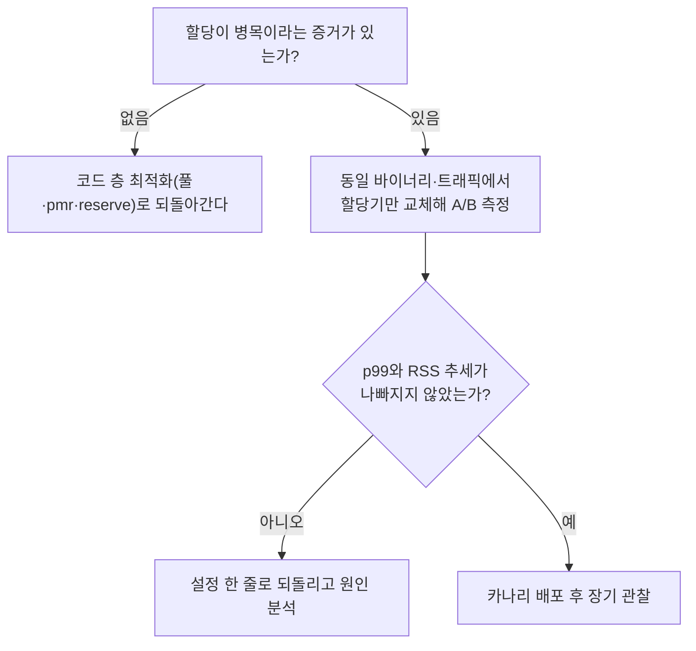

이 장은 **전문** 난이도입니다. **전역 할당자**, 곧 프로세스의 기본 `malloc`/`free`(C++에서는 `operator new`/`delete`가 보통 이를 호출합니다)를 다른 구현으로 바꾸거나 설정을 조정하면 다스레드 할당 경합, 조각화, 캐시 지역성이 함께 움직입니다. jemalloc과 tcmalloc은 자주 언급되지만 "설치하면 빨라진다" 수준으로 접근하면 회귀와 디버깅 비용으로 돌아오기 쉽습니다. 이 장은 후보들의 현재 상태를 확인하고, 구조적 차이가 어디서 결과를 가르는지, 어떻게 교체하고 설정하는지, 그리고 바꾸기 전에 무엇을 증명해야 하는지를 다룹니다. 앞선 장에서 [풀·아레나](/post/memory-optimization/pool-arena-allocation-strategy/)와 [`std::pmr`](/post/memory-optimization/pmr-polymorphic-allocator-practical/)로 애플리케이션 쪽의 할당을 줄이는 방법을 봤다면, 이 장은 남은 할당 요청을 런타임이 어떻게 처리하는지를 다룹니다.

## 2026년 시점의 할당자 후보

전역 할당자의 선택지는 정적이지 않습니다. jemalloc의 원저자 Jason Evans는 2025년 6월 12일 [jemalloc postmortem](https://jasone.github.io/2025/06/12/jemalloc-postmortem/)에서 소프트웨어가 20년 가까이 공개 사용되어 왔고 앞으로도 계속 공개되겠지만 "active upstream development has come to an end"라고 밝혔습니다. 같은 글은 Meta가 핵심 기술에 대한 투자를 줄이면서 개발의 성격이 달라졌고, 거대 페이지 할당(HPA)의 씨앗이 2016년에 뿌려졌으나 코드 건강을 지키는 리팩터링 없이 기능이 쌓이다가 정체됐다고 설명합니다. 다만 이 선언이 곧 프로젝트의 소멸은 아닙니다. 이 글을 쓴 2026년 10월 25일 시점에 GitHub 저장소는 아카이브되지 않았고 최근 푸시가 있으며, 릴리스 페이지에는 5.3.1(2026-04-13)에 이어 5.4.0(2026-09-17)이 올라 있습니다. 그러므로 "jemalloc은 끝났다"가 아니라 "원저자가 선언한 대로 능동적 업스트림 개발은 끝났고, 이후 릴리스의 성격은 저장소와 릴리스 노트에서 직접 확인해야 한다"가 정확한 요약입니다. 신규 프로젝트가 jemalloc을 기본 선택지로 깔고 시작하는 것은 더 이상 자명하지 않다는 정도로만 받아들이면 충분합니다.

같은 날짜 기준으로 다른 후보들은 활발히 릴리스되고 있습니다. mimalloc은 v3.6.0(2026-10-23), snmalloc은 0.7.6(2026-10-02)이 최신이며, tcmalloc은 GitHub 저장소에서 최근까지 푸시가 이어지고 있습니다. 따라서 "jemalloc과 tcmalloc 중 양자택일"이라는 이전 프레임은 "glibc 기본값을 포함해 워크로드에 맞는 후보를 비교한다"로 바꿔 읽어야 합니다. 아래 표는 각 후보에서 이 글이 근거를 확인한 항목만 모은 것입니다.

| 후보 | 확인한 구조·설정 | 교체·계측 방법 |
|------|-----------------|---------------|
| glibc ptmalloc | `arena_max` 기본값은 0으로 온라인 CPU 코어 수가 한도이고(그 한도를 따지기 전 만들 수 있는 arena 수 `arena_test`는 64비트에서 8), `tcache_count` 기본값은 16([glibc 매뉴얼](https://sourceware.org/glibc/manual/latest/html_node/Memory-Allocation-Tunables.html)) | `GLIBC_TUNABLES`로 설정 |
| jemalloc | `opt.narenas` 기본값은 CPU 수의 4배, 미사용 dirty 페이지의 purge 시간은 `opt.dirty_decay_ms`로 조정([jemalloc(3)](https://jemalloc.net/jemalloc.3.html)) | `MALLOC_CONF`, `malloc_stats_print` |
| tcmalloc | 기본은 CPU별 캐시(Linux 4.18에 병합된 RSEQ 필요), RSEQ가 없으면 스레드별 캐시로 되돌아감([개요](https://github.com/google/tcmalloc/blob/master/docs/overview.md)) | 링크 시 지정 |
| mimalloc | README 기준 `MIMALLOC_SHOW_STATS=1`로 종료 시 통계를 출력하는 것은 디버그 버전([README](https://github.com/microsoft/mimalloc)) | `LD_PRELOAD`로 교체 가능 |

## 무엇이 달라지는가

전역 할당자 튜닝은 보통 네 가지를 노립니다. 첫째는 스레드 간 경합 완화입니다. 모든 스레드가 하나의 락이 지키는 자료구조를 공유하면 스레드가 늘수록 대기가 늘기 때문에, 할당자들은 스레드나 CPU 단위의 캐시와 여러 개의 arena를 두어 락 없이 처리되는 경로를 늘립니다. tcmalloc의 CPU별 캐시, jemalloc의 arena 다중화, glibc의 `tcache`와 arena가 모두 이 아이디어의 변형입니다. 둘째는 요청 크기별 경로 분리로, 작은 객체와 큰 객체를 다른 방식으로 다뤄 작은 객체의 반복 할당을 싸게 만듭니다. 셋째는 조각화 완화입니다. 장기 실행 프로세스의 메모리 사용량이 시간에 따라 어떻게 변하는지는 [10장: 메모리 단편화](/post/memory-optimization/memory-fragmentation-analysis/)에서 본 것처럼 할당자의 크기 클래스와 반환 정책에 크게 좌우됩니다. 넷째는 지연 분포로, 평균이 아니라 꼬리에서 할당기가 튀는 일을 줄이는 것입니다.

반환 정책은 특히 설정이 결과를 바꾸는 곳입니다. jemalloc에서 `dirty_decay_ms`는 쓰지 않는 dirty 페이지가 생긴 뒤 그것을 purge하기까지의 대략적인 시간이며, 운영체제가 지원하면 `madvise`의 `MADV_FREE` 같은 힌트로 처리됩니다. [13장](/post/memory-optimization/virtual-memory-hints-madvise-mte/)에서 봤듯 `MADV_FREE`는 RSS에서 바로 사라지지 않으므로, 이 값을 줄여 메모리를 빨리 돌려주면 RSS는 안정되지만 이후 재사용 때 폴트 비용이 늘 수 있습니다. 이 트레이드오프는 어떤 할당자를 쓰든 반환 정책을 건드릴 때 반복됩니다.

## 워크로드 의존성

같은 바이너리라도 다음에 따라 결과가 갈립니다. 객체 크기 분포가 작은 할당이 폭주하는 쪽인지 드물게 큰 블록이 나오는 쪽인지, 수명 분포가 매우 짧은 객체 중심인지 오래 사는 객체 중심인지, 스레드 수가 per-thread 캐시의 이득이 오버헤드를 넘을 만큼 많은지, 그리고 NUMA 환경에서 소켓 사이 할당이 섞이는지가 그 요인입니다. 소켓 사이 배치는 [9장: NUMA 메모리 할당](/post/memory-optimization/numa-memory-allocation-locality/)의 주제입니다. 그래서 벤치마크 한 줄보다 프로덕션 프로파일에서 할당 패턴을 먼저 요약해야 합니다. 애플리케이션이 이미 풀이나 아레나로 할당을 크게 줄였다면 전역 교체의 이득이 작아질 수 있고, 전역 교체 효과를 보려던 코드가 알고 보니 할당이 병목이 아니었다는 결론도 흔합니다.

## 교체 방법과 설정

가장 가벼운 방법은 코드와 빌드를 건드리지 않고 실행 시점에 라이브러리를 끼워 넣는 것입니다. mimalloc README는 `LD_PRELOAD`로 교체하는 예를 보여 주며, 라이브러리 경로는 배포판마다 다릅니다. glibc 자체의 동작은 `GLIBC_TUNABLES` 환경 변수로, jemalloc은 `MALLOC_CONF`로 조정합니다.

```bash
# glibc: arena 수를 2개로 제한 (기본값 0은 온라인 CPU 코어 수가 한도)
GLIBC_TUNABLES=glibc.malloc.arena_max=2 ./app

# jemalloc: 백그라운드 스레드로 purge를 맡기고, dirty 페이지 purge 시간을 1초로
MALLOC_CONF="background_thread:true,dirty_decay_ms:1000" LD_PRELOAD=/usr/lib/libjemalloc.so.2 ./app

# mimalloc: 교체 (종료 시 통계 출력은 README 기준 디버그 버전에서 MIMALLOC_SHOW_STATS=1)
LD_PRELOAD=/usr/lib/libmimalloc.so ./app
```

환경 변수 방식은 A/B 비교와 즉시 되돌리기가 쉽다는 장점이 있고, 정적 링크나 사용자 정의 전역 `operator new` 오버로드와는 충돌할 수 있습니다. 전역 `new`/`delete`를 직접 오버로드하는 방식은 모듈 경계와 서드파티 라이브러리가 서로 다른 할당자를 보게 만들어 디버깅을 어렵게 하므로, 범위가 분명한 컨테이너에는 [`std::pmr`](/post/memory-optimization/pmr-polymorphic-allocator-practical/)나 컨테이너별 할당자가 더 국소적인 선택입니다. 풀을 이미 쓰고 있다면 풀과 전역 할당자가 같은 메모리를 이중으로 캐싱하지 않는지도 확인해야 합니다.

교체 효과를 재는 가장 단순한 프로그램은 여러 스레드가 크기가 섞인 블록을 계속 할당하고 해제하게 하는 것입니다. 아래 프로그램은 스레드 수를 인자로 받아 걸린 시간을 출력하므로, 같은 바이너리를 위의 환경 변수 조합만 바꿔 실행해 비교할 수 있습니다.

```cpp
#include <chrono>
#include <cstddef>
#include <cstdio>
#include <cstdlib>
#include <thread>
#include <vector>

// 각 스레드가 크기가 섞인 블록을 무작위 슬롯에 할당하고 이전 블록을 해제하는 일을 반복한다.
void churn(int iters, unsigned seed) {
  std::vector<void*> live(1024, nullptr);
  unsigned x = seed;
  for (int i = 0; i < iters; ++i) {
    x = x * 1664525u + 1013904223u;  // 간단한 LCG로 슬롯과 크기를 고른다
    const std::size_t idx = (x >> 8) % live.size();
    std::free(live[idx]);
    const std::size_t size = 16 + (x >> 16) % 2048;
    live[idx] = std::malloc(size);
    if (live[idx]) static_cast<char*>(live[idx])[0] = 1;  // 할당이 최적화로 사라지지 않게 한 번 쓴다
  }
  for (void* p : live) std::free(p);
}

int main(int argc, char** argv) {
  const int threads = argc > 1 ? std::atoi(argv[1]) : 8;
  const int iters = 2'000'000;

  const auto t0 = std::chrono::steady_clock::now();
  std::vector<std::thread> pool;
  for (int t = 0; t < threads; ++t) pool.emplace_back(churn, iters, 12345u + t);
  for (auto& th : pool) th.join();
  const auto t1 = std::chrono::steady_clock::now();

  std::printf("threads=%d elapsed_ms=%lld\n", threads,
              static_cast<long long>(std::chrono::duration_cast<std::chrono::milliseconds>(t1 - t0).count()));
}
```

`g++ -O2 -std=c++17 -pthread alloc_bench.cpp -o alloc_bench`로 빌드합니다. 이 장을 쓴 환경에서는 이 프로그램을 실행하지 못해 수치는 싣지 않습니다. 스레드 수를 1, 2, 4, 8로 늘려 가며 기본 할당기와 교체한 할당기를 각각 실행하고, 경과 시간이 스레드 수에 따라 어떻게 늘어나는지를 비교하면 경합이 병목인지 아닌지가 드러납니다. 다만 이 프로그램은 할당과 해제만 반복하는 합성 부하이므로 실제 서비스의 크기·수명 분포와는 다르다는 한계를 전제로 읽어야 합니다.

## 검증 절차

바꾸기 전에 기준선을 잡고, 바꾼 뒤에 같은 조건에서 비교하는 순서를 지켜야 합니다. 먼저 기본 할당기에서 할당 횟수, 지연 분포, RSS 추세를 기록합니다. 그다음 같은 바이너리와 같은 트래픽에서 할당기만 교체해 비교하는데, 변수를 하나만 바꿔야 회귀의 원인을 분리할 수 있기 때문입니다. 환경 변수나 플래그 하나로 원래대로 되돌릴 수 있게 해 두면 문제가 생겼을 때 대응이 빨라집니다. 디버그 빌드에서는 ASan이나 TSan 같은 도구가 자체적으로 할당 함수를 가로채므로, 이 도구들과 교체한 할당자를 함께 쓰는 정책을 미리 정해 둬야 합니다. 할당 패턴 자체를 보려면 jemalloc을 `--enable-prof`로 빌드했을 때 켜는 `opt.prof` 같은 내장 프로파일링을 쓸 수 있습니다([jemalloc(3)](https://jemalloc.net/jemalloc.3.html)). 문자열·컨테이너 수준의 할당 절감은 Tr.02의 몫이고, 이 장은 그것을 마친 뒤 남는 전역 할당 요청을 다룹니다. 마지막으로 장기간 돌려 보며 메모리가 천천히 새거나 조각화가 시간에 따라 악화되지 않는지 확인합니다. 새는 것처럼 보이는 RSS가 실제 누수인지 반환 정책의 결과인지는 [14장](/post/memory-optimization/memory-leak-detection-valgrind-asan/)의 도구로 구분합니다.



## 운영과 보안 관점

일부 환경에서는 바이너리에 비표준 런타임을 끼워 넣는 것 자체가 정책 검토 대상이고, 규제가 있는 산업에서는 공급망 관리 문서에 할당기 버전까지 포함해야 할 수 있습니다. 외부 할당자는 유지 상태가 바뀔 수 있으므로 사용 버전을 고정하고 업스트림 상태를 주기적으로 확인하는 정책이 필요합니다.

## 자주 하는 오개념

"할당기를 바꾸면 항상 빨라진다"는 가장 흔한 착각입니다. 효과는 할당이 실제로 병목일 때만 나타나고, 평균이 좋아져도 꼬리가 나빠져 서비스 수준 목표를 어기는 경우가 있습니다. "jemalloc은 개발이 끝났으니 쓰면 안 된다"는 결론은 앞의 사실에서 곧바로 나오지 않으며, 유지보수 위험을 평가에 넣으라는 뜻으로 읽어야 합니다. "개발자 노트북에서 빨랐으니 서버에서도 빠르다"는 NUMA 토폴로지와 컨테이너의 cgroup 한도가 다른 환경에서 깨집니다.

## 판단 기준

| 상황 | 권장 | 비권장 |
|------|------|--------|
| 프로파일에서 `malloc`이 상위가 아니다 | 애플리케이션 쪽 할당 줄이기(풀·`reserve`)를 먼저 한다 | 증거 없이 전역 교체부터 한다 |
| 스레드 수가 늘수록 할당 지연이 비선형으로 나빠진다 | per-thread/CPU 캐시가 있는 후보를 A/B 비교한다 | 합성 벤치 한 번으로 결론 낸다 |
| RSS가 시간과 함께 계속 늘어난다 | 조각화·반환 정책을 먼저 분석하고 필요하면 반환 설정을 조정한다 | 곧바로 누수로 단정한다 |
| 서드파티가 자체 할당기를 가정한다 | 범위를 좁혀 시험하고 되돌릴 수 있게 둔다 | 전역 `operator new`를 직접 오버로드한다 |
| 디버그·ASan 파이프라인이 있다 | 교체 할당자와의 공존 정책을 문서로 정한다 | 충돌을 방치한다 |

## 학습 성과

이 장을 읽고 나면 다음을 할 수 있어야 합니다.

- 각 할당자의 현재 유지 상태를 1차 출처에서 확인하는 방법을 안다.
- per-thread 또는 per-CPU 캐시와 arena가 경합을 줄이는 방식, 반환 정책이 RSS와 재폴트 비용에 미치는 영향을 설명한다.
- `LD_PRELOAD`, `GLIBC_TUNABLES`, `MALLOC_CONF`로 할당자를 교체·설정하고 같은 바이너리로 A/B 비교를 설계한다.
- 할당이 병목이라는 증거가 있을 때만 전역 교체를 선택하고, 롤백 경로를 함께 준비한다.

## 참고 자료

- Jason Evans, [jemalloc postmortem](https://jasone.github.io/2025/06/12/jemalloc-postmortem/) (2025-06-12)
- [jemalloc(3) 매뉴얼](https://jemalloc.net/jemalloc.3.html) — `opt.narenas`, `opt.dirty_decay_ms`, `MALLOC_CONF`
- [glibc 매뉴얼: Memory Allocation Tunables](https://sourceware.org/glibc/manual/latest/html_node/Memory-Allocation-Tunables.html)
- [tcmalloc 개요](https://github.com/google/tcmalloc/blob/master/docs/overview.md), [mimalloc](https://github.com/microsoft/mimalloc), [snmalloc](https://github.com/microsoft/snmalloc)

이전 장은 [메모리 누수 탐지](/post/memory-optimization/memory-leak-detection-valgrind-asan/)이고, 이 장은 트랙의 마지막 챕터입니다. 처음 읽는 독자는 [15장: 메모리·수명·캐시 라인 직관](/post/memory-optimization/memory-lifetime-cache-line-intuition-fundamentals/)에서 시작해 이 장까지 순서대로 내려오면 됩니다.
