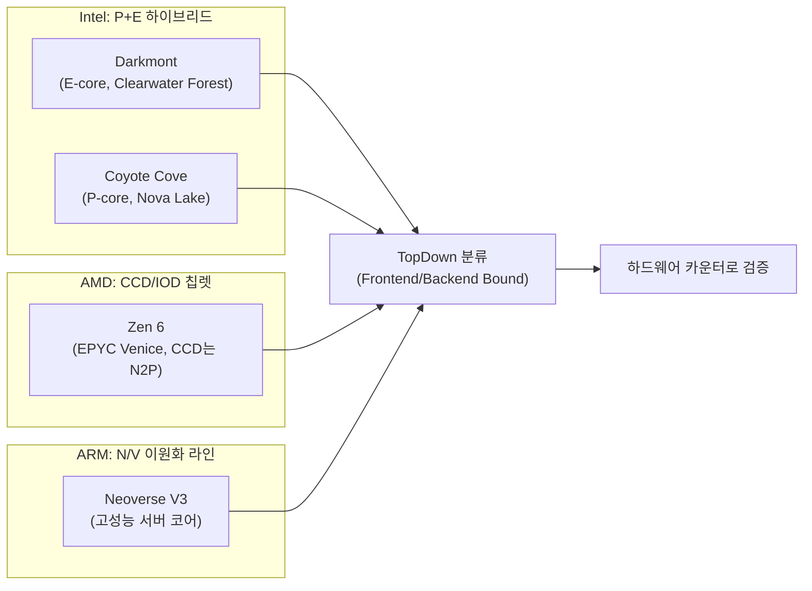

**현대 CPU 아키텍처 비교**란 Intel·AMD·ARM이 같은 시기에 서로 다른 설계 철학(하이브리드 P/E 코어, 칩렛, 서버/모바일 이원화 코어)으로 수렴하거나 갈라지는 지점을 정리해, 특정 워크로드에 어떤 세대·계열이 유리한지 판단하는 것을 말합니다. 프로파일러가 "이 함수가 느리다"를 알려줘도, 그 원인이 코어의 프런트엔드 폭 때문인지 캐시 계층 때문인지 벤더별로 답이 달라질 수 있고, 2025–2026년 사이 Intel 18A 세대(Clearwater Forest)와 AMD Zen 6(EPYC Venice)이 잇따라 발표되고 ARM Neoverse V 시리즈 기반 서버 칩이 확산되면서 이 격차는 더 벌어졌습니다. 이 장은 개별 메커니즘(파이프라인·캐시·분기 예측)을 다시 설명하지 않고, 그 메커니즘들이 벤더·세대별로 어떤 조합으로 나타나는지, 그리고 그 조합이 왜 벤치마크 숫자만으로는 판단하기 어려운지를 다룹니다.

## 이 장을 읽기 전에

이 장은 [01장: CPU 파이프라인 기초](/post/cpu-optimization/cpu-pipeline-fundamentals/), [03장: 캐시 계층 구조](/post/cpu-optimization/cache-hierarchy-l1-l2-l3/), [06장: Out-of-Order 실행과 성능](/post/cpu-optimization/out-of-order-execution-performance/)에서 다룬 파이프라인 단계·캐시 레벨·비순차 실행의 기본 개념을 전제로 합니다. 그 메커니즘들이 무엇인지 모른다면 이 장의 비교표가 추상적으로 느껴질 수 있으니 먼저 해당 장을 읽는 것을 권합니다. **이 장의 깊이**는 **중급**이며, 각 벤더의 최신 세대가 "무엇을 다르게 하는지"를 구조적으로 비교하는 데 집중합니다. **다루지 않는 것**: SMT/Hyper-Threading의 내부 동작(→ [14장](/post/cpu-optimization/smt-hyperthreading-performance/)), μOp 캐시·DSB의 세부 구조(→ [15장](/post/cpu-optimization/uop-cache-decoded-stream-buffer/)), Apple Silicon M시리즈의 통합 메모리·P/E 코어 심화(→ [13장](/post/cpu-optimization/apple-silicon-m-series-architecture/)), RISC-V ISA 자체(→ [16장](/post/cpu-optimization/risc-v-architecture-performance-fundamentals/)), 하드웨어 카운터로 실제 병목을 측정하는 방법(→ [09장](/post/cpu-optimization/cpu-hardware-performance-counters/))입니다. 이 장은 그 챕터들을 읽기 전에 "지금 어떤 CPU 세대들이 있고 왜 서로 다른가"라는 지도를 그리는 역할을 합니다.

## 당신의 수준에 맞는 경로

| 수준 | 읽을 부분 | 핵심 목표 |
|------|---------|---------|
| **초보자** | "왜 지금 아키텍처 비교가 다시 중요해졌나" ~ "세 가지 설계 철학" | 하이브리드 코어·칩렛·N/V 이원화라는 세 가지 큰 그림 이해 |
| **중급자** | "ISA 확장 경쟁" ~ "흔한 오개념" | AVX10.2/APX·SVE2 등 최신 ISA 확장이 실제로 뭘 바꾸는지, 흔한 착각 교정 |
| **전문가** | "판단 기준" ~ "비판적 시각" | 워크로드별 벤더 선택 기준과 벤더 벤치마크를 읽는 법 |

---

## 왜 지금 아키텍처 비교가 다시 중요해졌나

2010년대 중반까지 x86 서버 CPU는 "코어를 늘리고 클록을 올리는" 단일 궤적을 따랐습니다. 이 궤적에 가장 먼저 변화를 준 것은 칩렛 설계였습니다. AMD는 2019년 Zen 2부터 CCD(Core Complex Die)와 IOD(I/O Die)를 분리하는 칩렛 설계로 전환해 공정 미스매치를 우회했습니다. 두 번째 계기는 코어 자체의 분화였습니다. Intel은 2021년 Alder Lake부터 성능 코어(P-core)와 효율 코어(E-core)를 한 다이에 섞는 하이브리드 설계를 데스크톱에 들여왔고, 서버 라인에서도 Sierra Forest 같은 E-core 전용 제품을 별도로 두기 시작했습니다. 세 번째 계기는 ARM 서버 생태계의 성숙으로, AWS Graviton과 NVIDIA Grace 같은 커스텀 실리콘이 ARM Neoverse V-시리즈를 채택하면서 "ARM은 모바일용" 이라는 가정이 서버 시장에서도 깨졌습니다. 2026년 현재는 이 세 흐름이 동시에 새 세대로 갱신되는 시점입니다 — Intel 18A 공정의 Clearwater Forest(Xeon 6+), AMD의 2nm(TSMC N2P) CCD를 쓰는 Zen 6, ARM Neoverse V 시리즈 기반 커스텀 실리콘이 거의 같은 시기에 로드맵에 오르면서, "어떤 벤더가 어떤 워크로드에 맞는가"라는 질문이 다시 실무적으로 중요해졌습니다.

## 세 가지 설계 철학: 하이브리드 코어, 칩렛, N/V 이원화

세 벤더는 "트랜지스터 예산을 어디에 쓸 것인가"라는 같은 문제에 서로 다른 답을 내놓고 있습니다. Intel은 코어 종류를 나눠(P/E) 워크로드에 맞는 코어에 배정하는 쪽을, AMD는 코어 설계는 하나로 통일하되 다이를 쪼개 수율과 공정 조합을 최적화하는 쪽을, ARM은 아예 다른 두 계열(N-시리즈, V-시리즈)을 만들어 라이선스 고객이 목적에 맞는 코어를 골라 쓰게 하는 쪽을 택했습니다. 아래 다이어그램은 이 세 철학이 결국 같은 TopDown 분류(Frontend/Backend Bound) 위에서 측정된다는 점을 보여줍니다 — 설계는 다르지만 병목을 해석하는 언어는 공유합니다.



이 분류 언어 자체는 [17장: Frontend vs Backend Bound 개념](/post/cpu-optimization/frontend-backend-bound-topdown-basics/)에서 다루고, 실제 카운터로 측정하는 방법은 [09장](/post/cpu-optimization/cpu-hardware-performance-counters/)에서 이어집니다.

### Intel: P/E 하이브리드와 18A 세대

Intel의 E-core 전용 서버 라인은 Xeon 6+ "Clearwater Forest"입니다. [Wikipedia](https://en.wikipedia.org/wiki/Clearwater_Forest)에 따르면 이 제품은 Intel 18A 공정으로 만든 첫 데이터센터 프로세서이며, Darkmont E-core만으로 소켓당 최대 288코어와 PCIe 5.0 96레인을 갖춥니다. [Chips and Cheese의 Hot Chips 2025 분석](https://chipsandcheese.com/p/intels-clearwater-forest-e-core-server)은 L3를 별도의 베이스 타일에 올려 확보한 면적으로 8MB L3 슬라이스를 구현했고, 그 결과 칩 전체의 마지막 레벨 캐시가 576MB에 이른다고 설명합니다. 코어 내부의 디코드 폭이나 IPC 향상률 같은 수치는 이 글에서 인용하지 않습니다. 출시 전 발표 자료는 조정될 수 있으므로, 필요하면 Intel의 공식 최적화 문서와 출하 후 독립 분석으로 직접 확인해야 합니다. 소비자용으로는 Coyote Cove P-core와 Arctic Wolf E-core를 조합한 Nova Lake가 있으며([Wikipedia: Nova Lake](https://en.wikipedia.org/wiki/Nova_Lake_%28microprocessor%29)), P-core 전용 서버 라인의 후속 제품은 공식 사양이 확정되기 전이라 세부 수치를 다루지 않습니다.

### AMD: CCD/IOD 칩렛과 Zen 6

AMD는 Zen 2 이후 이어온 칩렛 전략을 유지하면서 공정만 세대마다 갱신하는 방식을 택했습니다. [Wikipedia: Zen 6](https://en.wikipedia.org/wiki/Zen_6)에 따르면 Zen 6는 CCD(연산 다이)를 TSMC N2P로, IOD(I/O 다이)를 TSMC N6로 제작해 두 다이를 각각 다른 공정에 배치합니다. 서버용 EPYC "Venice"는 2026년 7월 23일 AMD 행사에서 발표되었고, 2nm 공정의 Zen 6c 변형(Venice-X)은 최대 256코어 구성이 소개되었습니다. AMD의 칩렛 전략이 Intel의 P/E 하이브리드와 다른 점은, 코어 자체의 종류를 나누지 않고 "얼마나 많은 CCD를 붙이는가"로 스케일을 조절한다는 것입니다. 이는 스케줄러가 이종 코어를 구분할 필요가 없다는 장점과, 모든 코어가 같은 실리콘 예산(전력·다이 면적)을 요구한다는 제약을 동시에 만듭니다.

### ARM: 서버 N/V 이원화와 소비자 빅.리틀

ARM은 Intel·AMD와 달리 코어 설계 자체를 라이선스로 판매하기 때문에, "설계 철학"이 곧 "제품 계열 구분"으로 나타납니다. 서버용 Neoverse는 범용 데이터센터를 겨냥한 N-시리즈와, 고성능 컴퓨팅을 겨냥한 V-시리즈로 나뉩니다. V-시리즈의 세 번째 세대인 Neoverse V3는 [Wikipedia: ARM Neoverse](https://en.wikipedia.org/wiki/ARM_Neoverse)에 DDR5, PCIe 6.0, CXL 3.0을 겨냥한 설계로 소개되어 있습니다. 코어 수·IPC 향상률 같은 구체 수치는 Arm의 공식 자료로 확인해야 하므로 여기서는 싣지 않습니다. AWS Graviton3가 Neoverse V1 기반이라고 같은 문서에 적혀 있듯 커스텀 실리콘이 V 계열을 바탕으로 만들어지고 있어, ARM 서버 생태계는 이제 "실험적 대안"이 아니라 하이퍼스케일러의 표준 옵션 중 하나로 자리잡았습니다. 반면 Apple Silicon M시리즈처럼 소비자·워크스테이션용 ARM 구현은 성능 코어와 효율 코어를 통합 메모리 아키텍처 위에서 조합하는 전혀 다른 트레이드오프를 가지는데, 그 세부 내용은 [13장](/post/cpu-optimization/apple-silicon-m-series-architecture/)에서 다룹니다. 여기서 기억할 요점은, "ARM"이라는 이름 아래에도 서버(N/V)와 모바일/데스크톱(빅.리틀 계열) 설계가 서로 다른 목표함수를 최적화한다는 것입니다.

## ISA 확장 경쟁: AVX10.2/APX 대 SVE2 대 AVX-512

명령어 집합 확장은 코어 마이크로아키텍처만큼이나 세대 간 성능 차이를 만듭니다. Intel의 Nova Lake는 **AVX10.2**와 <strong>APX(Advanced Performance Extensions)</strong>를 데스크톱·모바일에 처음 들여오는 플랫폼이 될 것으로 예상되는데, AVX10 계열은 하이브리드 코어에서 AVX-512 지원 여부가 코어 종류마다 갈리던 비일관성을 줄이려는 확장입니다([Intel Architecture Instruction Set Extensions 프로그래밍 레퍼런스](https://cdrdv2-public.intel.com/922690/319433-062-architecture-instruction-set-extensions-programming-reference.pdf)). APX는 범용 레지스터 수를 늘리고 3-operand 형태의 새 인코딩을 추가해 레지스터 압박(register pressure)을 줄이고 명령어당 처리량을 높이는 것을 목표로 하며, ([Wikipedia: Nova Lake](https://en.wikipedia.org/wiki/Nova_Lake_%28microprocessor%29)에는 이 두 확장을 지원하는 첫 소비자 플랫폼이 될 것으로 예상된다고 적혀 있습니다). AMD는 Zen 4/5부터 이미 AVX-512를 지원해 왔고, Zen 6에서는 AVX512_BMM 같은 새 확장이 추가될 예정인 것으로 [Wikipedia: Zen 6](https://en.wikipedia.org/wiki/Zen_6)에 정리되어 있습니다. ARM 진영은 SVE2(Scalable Vector Extension 2)로 응답하는데, x86의 AVX 계열이 고정 폭(128/256/512비트) 명령어를 따로 인코딩하는 것과 달리 SVE는 벡터 길이를 하드웨어 구현에 위임하는 "길이 비종속(length-agnostic)" 설계라 같은 바이너리가 다른 벡터 폭의 코어에서도 재컴파일 없이 동작하도록 의도되었습니다. 실무 관점에서 중요한 것은 ISA 확장 자체가 아니라, 컴파일러가 그 확장을 활용하도록 코드를 생성하는지입니다 — 벡터화 여부와 `-march`/`-mavx512f`류 컴파일러 플래그의 관계는 [Tr.03: 컴파일러·빌드 최적화](/post/compiler-optimization/getting-started-compiler-build-performance-tuning/)에서 더 깊이 다룹니다.

실제 배포 환경에서 어떤 ISA 확장이 켜져 있는지 확인하는 것은 벤더 발표 자료를 읽는 것보다 신뢰도가 높습니다. 아래는 Linux에서 현재 코어가 지원하는 플래그를 직접 확인하는 방법입니다.

```bash
# /proc/cpuinfo의 flags 필드에서 avx512, avx10, apx 관련 플래그를 확인
grep -m1 flags /proc/cpuinfo | tr ' ' '\n' | grep -iE 'avx512|avx10|apx_f'

# lscpu는 벤더·모델·플래그를 요약해서 보여줌
lscpu | grep -iE 'Model name|Flags' 
```

이 명령은 실행 중인 커널·CPU가 실제로 노출하는 플래그만 보여주므로, 벤더가 "지원 예정"이라고 발표한 확장이 아직 실리콘에 없거나 BIOS/마이크로코드로 꺼져 있는 경우를 걸러낼 수 있습니다. 다만 커널 버전에 따라 신규 플래그(`avx10`, `apx_f` 등) 이름이 아직 반영되지 않았을 수 있으므로, 플래그가 안 보인다고 곧바로 "미지원"이라 단정하지 말고 커널·마이크로코드 버전을 함께 확인해야 합니다.

## 흔한 오개념

<strong>"코어 수가 많을수록 무조건 빠르다"</strong>는 처리량(throughput) 워크로드에서나 성립하는 이야기입니다. Clearwater Forest의 288 E-core는 스레드당 성능이 아니라 코어당 전력·면적 효율을 최적화한 설계이므로, 단일 요청의 꼬리 지연(p99 latency)이 중요한 워크로드에서는 오히려 P-core 중심 제품이 유리할 수 있습니다. 코어 수와 지연시간의 관계는 [11장: CPU 주파수 스케일링과 성능](/post/cpu-optimization/cpu-frequency-scaling-performance/)에서 다루는 클록·전력 곡선과 함께 봐야 의미가 생깁니다.

<strong>"ARM은 항상 저전력, x86은 항상 고성능"</strong>이라는 이분법도 더 이상 정확하지 않습니다. Neoverse V3는 고성능 컴퓨팅을 정면으로 겨냥한 설계이고, 반대로 Intel의 E-core 라인(Darkmont)은 전력·밀도를 최우선 목표로 설계되었습니다. 두 축(성능 대 효율)은 이제 벤더가 아니라 제품 계열(N 대 V, P 대 E) 단위로 갈립니다.

<strong>"신규 ISA 확장을 지원하면 자동으로 빨라진다"</strong>도 틀린 가정입니다. AVX10.2·SVE2 같은 확장은 컴파일러가 해당 명령을 생성하고, 코드가 실제로 벡터화 가능한 형태여야 이득을 봅니다. 게다가 넓은 벡터 명령을 쓰면 일부 코어에서 클록이 일시적으로 낮아지는 현상(AVX-512 다운클로킹과 유사한 패턴)이 세대에 따라 여전히 남아 있을 수 있으므로, 벡터 폭을 넓히는 선택이 항상 순이득인지는 해당 세대에서 직접 측정해야 합니다.

## 판단 기준

| 워크로드 특성 | 유리한 경향 | 근거 |
|------|------|------|
| 단일 요청 꼬리 지연(p99)이 SLA인 경우 | P-core/V-시리즈 중심 제품(고클록, 넓은 프런트엔드) | 단일 요청의 지연시간은 코어 한 개의 IPC와 클록이 정함([11장](/post/cpu-optimization/cpu-frequency-scaling-performance/)) |
| 초당 요청 수(throughput), 컨테이너 밀도 우선 | E-core 전용/코어 수 극대화 제품(Clearwater Forest류) | 총처리량은 소켓당 코어 수와 코어당 전력·면적 효율이 정함(Clearwater Forest는 소켓당 최대 288 E-core, [Wikipedia](https://en.wikipedia.org/wiki/Clearwater_Forest)) |
| 벡터·AI 커널이 핫패스인 경우 | 최신 ISA 확장(AVX10.2, SVE2, 최신 AVX-512) 지원 세대 | 벡터 폭·명령 확장이 커널 처리량에 직접 반영 |
| 멀티벤더 이식성이 중요한 경우 | 표준 확장(AVX2, SVE2 기본 프로파일) 중심 설계 | 벤더 전용 확장 의존은 이식성을 낮춤 |

## 비판적 시각: 벤더 벤치마크와 로드맵의 함정

벤더가 공개하는 "30% 빠르다" 류의 숫자는 대개 특정 SKU·특정 워크로드·특정 컴파일러 플래그 조합에서 나온 결과이며, 비교 대상 제품도 벤더가 고른 것입니다. Intel이든 AMD든 자사 발표에서 강조하는 수치는 같은 함정을 공유합니다 — 발표 시점의 우호적인 벤치마크 스위트를 근거로 하므로, 실제 프로덕션 워크로드에서는 독립 리뷰와 자체 재현이 필요합니다. 로드맵 자체도 불확실성을 안고 있습니다. 발표된 사양과 출시 시점은 출하 전에 바뀔 수 있으므로, 로드맵에 적힌 코드명과 일정은 확정 사실이 아니라 계획으로 읽어야 합니다. ARM 진영도 라이선스 기반이라 실제 실리콘 성능은 커스텀 실리콘 제작사(AWS, Google, NVIDIA)의 구현 품질에 좌우되므로, "Neoverse V3"라는 이름만으로 특정 클라우드 인스턴스의 실제 성능을 예단할 수 없습니다.

## 마무리

- Intel(P/E 하이브리드), AMD(CCD/IOD 칩렛), ARM(N/V 이원화)이 같은 문제에 다른 방식으로 답한다는 것을 설명할 수 있다.
- Clearwater Forest 같은 E-core 전용 제품과 P-core 중심 제품의 차이가 "코어 수 대 스레드당 성능" 트레이드오프에서 나온다는 것을 안다.
- AVX10.2/APX, SVE2 같은 ISA 확장이 컴파일러·코드 형태와 함께 작동해야 이득이 생긴다는 것을 설명할 수 있다.
- 벤더 벤치마크 수치를 볼 때 SKU·워크로드·비교 대상 선택 편향을 의심하는 습관을 갖는다.
- 워크로드 특성(꼬리 지연 대 처리량, 벡터 의존도, 이식성 요구)에 따라 벤더·제품 계열을 선택하는 기준을 적용할 수 있다.

**이전 장**: [TLB 미스 최적화](/post/cpu-optimization/tlb-miss-optimization/) (챕터 07)

다음 장에서는 이 장에서 비교한 아키텍처 차이를 실제로 관측하는 도구, 즉 **CPU 하드웨어 성능 카운터**를 다룹니다. `perf`·VTune으로 벤더별 이벤트를 어떻게 읽고, 하이브리드 코어에서 코어 타입별로 카운터를 분리해 측정하는지가 핵심입니다.

→ [CPU 하드웨어 카운터 활용](/post/cpu-optimization/cpu-hardware-performance-counters/) (챕터 09)
