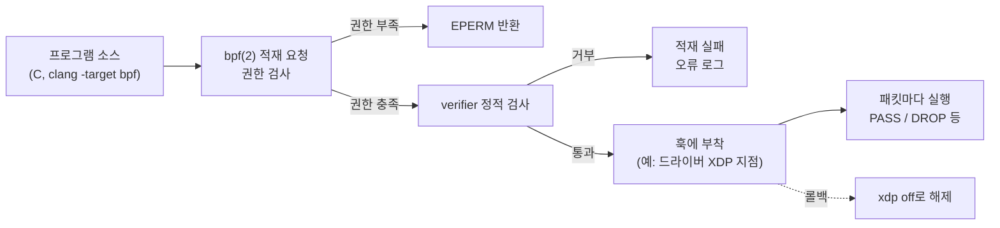

**eBPF**는 커널 안에 검증된 작은 프로그램을 올려 패킷 처리, 관측, 성능 진단을 수행하게 하는 기술이고, **XDP**는 그중 네트워크 드라이버 수신 경로의 가장 이른 지점에 프로그램을 붙이는 방식입니다. 이 장은 **전문** 난이도로, 챕터 09([XDP/eBPF 개요](/post/os-optimization/xdp-ebpf-overview-fundamentals/))가 다룬 "무엇이 있는가"를 넘어, 이 기술을 실제 서비스에 도입할 때 성능 이득과 함께 따라오는 검증·권한·업그레이드 비용을 어떻게 저울질할지를 다룹니다.

## 이 장을 읽기 전에

챕터 09에서 설명한 XDP 훅의 위치와 verifier의 존재를 알고 있다고 가정합니다. 컨테이너 환경의 권한 문제는 [챕터 11](/post/os-optimization/container-virtualization-performance-considerations/)과 [챕터 13](/post/os-optimization/cgroups-v2-resource-control-performance/)에서 다룬 개념과 맞물립니다. 이 장은 프로토콜 구현이나 스토리지 경로를 다루지 않으며, 그 영역은 이 트랙 바깥의 네트워크·I/O 심화 주제입니다.

## 왜 커널 경계를 건드리는가

유저 공간 애플리케이션을 아무리 다듬어도 패킷이 소켓에 닿기 전에 커널이 수행하는 복사, 스케줄링, 소프트IRQ 처리가 지연의 바닥을 정할 수 있습니다. eBPF는 이 경로 위에서 불필요한 작업을 일찍 끊거나, 커널 안에서 통계를 집계해 유저 공간에는 요약만 올려 보내는 수단입니다. 다만 이 수단은 커널 안에서 실행되는 코드라는 사실 때문에 일반 애플리케이션 최적화와 다른 종류의 비용을 동반합니다. 코드가 커널 메모리를 망가뜨리지 못하게 막는 검증기의 제약, 커널 버전과 얽히는 호환성, 그리고 "누가 이런 코드를 올릴 수 있는가"라는 권한 문제입니다. 따라서 도입 결정은 성능 숫자 하나가 아니라 이 세 가지 비용을 함께 놓고 내려야 합니다.

## 프로그램이 커널에 들어오는 경로와 권한

eBPF 프로그램은 `bpf(2)` 시스템 콜로 커널에 적재되고, 적재 시점에 verifier의 정적 검사를 통과해야 실행됩니다. 권한 측면에서 [bpf(2) man 페이지](https://man7.org/linux/man-pages/man2/bpf.2.html)는 `bpf()` 호출에 충분한 권한이 없으면 `EPERM`을 반환한다고 설명하고, 커널 sysctl 문서([kernel.unprivileged_bpf_disabled](https://docs.kernel.org/admin-guide/sysctl/kernel.html))는 이 값을 1로 쓰면 비특권 `bpf()` 호출이 막히며 이후 `CAP_SYS_ADMIN` 또는 `CAP_BPF` 없이 호출하면 `-EPERM`이 반환된다고 정의합니다. 같은 문서에 따르면 한 번 1로 설정하면 실행 중인 커널에서는 되돌릴 수 없고, 2로 설정하면 비특권 호출을 막으면서도 관리자가 나중에 값을 바꿀 수 있습니다. 즉 운영 환경에서는 "누가 프로그램을 올릴 수 있는가"가 커널 설정으로 통제되는 항목이며, 이를 정책으로 문서화하지 않으면 보안 검토와 장애 대응에서 책임 소재가 불분명해집니다.



위 그림은 적재 경로에서 비용이 발생하는 세 지점, 즉 권한 검사, verifier 검사, 부착 후 운영을 보여 줍니다.

## verifier가 실제로 하는 일

verifier는 프로그램이 커널을 망가뜨릴 수 없음을 로드 시점에 증명하려는 정적 분석기입니다. [커널 verifier 문서](https://docs.kernel.org/bpf/verifier.html)는 이를 여러 단계로 설명하며, 도달할 수 없는 명령어를 찾아내고, 레지스터와 메모리 접근이 유효한 타입의 포인터에 대해서만 일어나는지 검사한다고 밝힙니다. 같은 문서에는 거부되는 프로그램의 실제 오류 메시지 예시가 실려 있습니다. 예를 들어 `map_lookup_elem()`의 반환값이 NULL일 수 있는데 검사 없이 접근하면 `R0 invalid mem access 'map_value_or_null'`이라는 메시지로 거부되고, 스택 범위를 벗어나 접근하면 `invalid stack off=8 size=8`이라는 메시지로 거부됩니다. 이런 거부는 코드가 안전하다는 증명이 되지 않을 때 일어나므로, 개발 속도와 CI에서의 재현성이 도입 비용에 들어갑니다. 따라서 verifier 실패를 CI에서 재현할 수 있도록 대상 커널 버전 범위에서 프로그램 적재를 자동 테스트하는 것이 운영 준비의 일부입니다.

## 최소 XDP 프로그램과 적재·해제 절차

아래는 IPv4 UDP 목적지 포트 9999 패킷만 버리고 나머지는 통과시키는 최소 XDP 프로그램입니다. 모든 헤더 접근 앞에 `data_end` 경계 검사를 두는 것이 verifier를 통과하기 위한 필수 패턴이며, 이 검사를 빼면 패킷 범위 접근이 안전하다고 증명되지 않아 적재가 거부됩니다.

```c
// 빌드: clang -O2 -g -target bpf -c drop_udp.c -o drop_udp.o
#include <linux/bpf.h>
#include <linux/if_ether.h>
#include <linux/ip.h>
#include <linux/udp.h>
#include <linux/in.h>
#include <bpf/bpf_helpers.h>
#include <bpf/bpf_endian.h>

SEC("xdp")
int drop_udp_9999(struct xdp_md *ctx) {
  void *data = (void *)(long)ctx->data;
  void *data_end = (void *)(long)ctx->data_end;

  struct ethhdr *eth = data;
  if ((void *)(eth + 1) > data_end) return XDP_PASS;
  if (eth->h_proto != bpf_htons(ETH_P_IP)) return XDP_PASS;

  struct iphdr *ip = (void *)(eth + 1);
  if ((void *)(ip + 1) > data_end) return XDP_PASS;
  if (ip->protocol != IPPROTO_UDP || ip->ihl < 5) return XDP_PASS;

  struct udphdr *udp = (void *)ip + ip->ihl * 4;
  if ((void *)(udp + 1) > data_end) return XDP_PASS;
  if (udp->dest == bpf_htons(9999)) return XDP_DROP;
  return XDP_PASS;
}

char LICENSE[] SEC("license") = "GPL";
```

적재와 확인, 그리고 롤백은 모두 명령 하나로 끝납니다. 롤백이 단순하다는 점은 eBPF 도입의 운영상 장점이지만, 이 절차를 문서에 남기지 않으면 새벽 장애 때 아무도 모르는 상태가 됩니다.

```bash
# 적재(드라이버가 native XDP를 지원하지 않으면 generic 모드로 폴백될 수 있음)
sudo ip link set dev eth0 xdp obj drop_udp.o sec xdp

# 올라가 있는 프로그램 확인
sudo bpftool prog show
sudo bpftool net show dev eth0

# 롤백: 프로그램 해제
sudo ip link set dev eth0 xdp off
```

## 커널 업그레이드와 호환성

업그레이드 리스크는 "eBPF 전부가 위험하다"가 아니라 어느 부분이 안정적이고 어느 부분이 아닌지를 구분하는 문제입니다. [BPF 설계 Q&A](https://docs.kernel.org/bpf/bpf_design_QA.html)에 따르면 BPF 명령어, 프로그램 인자, 헬퍼 함수와 그 인자, 인식되는 반환 코드는 안정적인 ABI에 속하며, 이전 커널이 받아들인 프로그램을 이후 커널도 받아들인다는 것이 개발 프로세스의 보장입니다. 반면 같은 문서는 tracepoint가 안정 ABI가 아니라고 명시하고, kfunc은 안정 API로 간주되지 않는다고 밝힙니다. 따라서 tracepoint나 커널 내부 구조체에 의존하는 관측 프로그램은 업그레이드 때 깨질 수 있고, XDP처럼 안정 ABI에 의존하는 프로그램은 상대적으로 안전합니다. 이식성을 높이는 방법으로 커널 문서는 BPF CO-RE를 설명합니다([libbpf overview](https://docs.kernel.org/bpf/libbpf/libbpf_overview.html)). CO-RE는 BTF 타입 정보, libbpf, 컴파일러를 결합해 한 번 컴파일한 바이너리를 여러 커널 버전과 설정에서 실행할 수 있게 합니다. 이 때문에 도입 전에 "우리 프로그램이 어떤 훅에 의존하며 그 훅이 안정 ABI인가"를 확인하는 것이 업그레이드 대비의 출발점입니다.

## 측정과 검증

성능 이득은 도입 전후를 같은 부하에서 비교해야 입증됩니다. 처리량은 초당 패킷 수와 CPU 사용률로, 지연은 경로별 p99로 보고, 챕터 06의 측정 도구와 방법론을 그대로 적용합니다. 여기에 eBPF 특유의 검증 항목이 더해집니다. 드롭·리다이렉트 규칙이 비즈니스 로직과 일치하는지 확인해야 하고, 패킷이 사라졌을 때 어느 지점에서 사라졌는지 추적할 관측 지점이 충분한지 점검해야 합니다. 이 두 번째 항목이 중요한 이유는 XDP가 커널 네트워크 스택보다 앞단에서 동작하므로 스택 이후에 위치한 기존 도구로는 버려진 패킷을 볼 수 없는 경우가 있기 때문입니다.

## 흔한 오개념

<strong>"XDP를 붙이면 항상 빨라진다"</strong>는 오해입니다. 이득은 조기에 버리거나 처리해도 되는 패킷 비율이 높고 규칙이 단순할 때 나오며, 복잡한 상태 추적이나 무거운 연산을 프로그램에 넣으면 오히려 지연이 늘 수 있습니다.

<strong>"eBPF는 검증되니 권한 걱정이 없다"</strong>도 틀렸습니다. verifier는 프로그램이 커널을 망가뜨리지 못하게 막을 뿐, 누가 어떤 프로그램을 올릴 수 있는지는 `CAP_SYS_ADMIN`·`CAP_BPF` 같은 권한과 `unprivileged_bpf_disabled` 설정이 정합니다.

<strong>"eBPF 프로그램은 커널 업그레이드에 무조건 취약하다"</strong>는 과장입니다. 안정 ABI에 속하는 부분과 그렇지 않은 부분이 문서로 구분되어 있으므로, 어디에 의존하는지에 따라 위험이 달라집니다.

## 판단 기준

| 상황 | 권장 | 비권장 |
|------|------|--------|
| 단순 필터로 대량 패킷을 일찍 폐기 | native XDP + 롤백 절차 문서화 | 복잡한 상태 추적을 XDP에 이식 |
| 안정 ABI(XDP 등)에만 의존하는 프로그램 | CI에서 대상 커널 범위의 적재 테스트 | 검증 없이 배포 |
| tracepoint·내부 구조체에 의존하는 관측 | CO-RE 적용과 커널별 회귀 테스트 | 한 커널에서만 시험하고 전 노드 배포 |
| 멀티 테넌트 환경에서 프로그램 적재 권한 | `unprivileged_bpf_disabled` 정책과 적재 주체 한정 | 컨테이너에 광범위한 capability 부여 |
| 기존 `tcpdump`·방화벽 로그에 의존하는 운영 | 병행 관측 경로 구축 후 도입 | 관측 공백을 둔 채 전면 전환 |

## 비판적 시각: 한계와 트레이드오프

eBPF의 이득은 측정되는 반면 비용은 조직 안에 흩어져 나타납니다. verifier 제약은 개발자 생산성에, 업그레이드 호환성은 플랫폼 팀의 회귀 테스트 부담에, 권한 통제는 보안 팀의 승인 절차에 각각 숨어 있어서, 성능 대시보드만 보면 이득만 보입니다. 또 XDP는 상태를 스스로 관리하지 않으므로 복잡한 정책을 옮기려 하면 맵으로 직접 구현해야 하고, 그 순간 검증기 제약과 유지보수 부담이 이득을 잠식할 수 있습니다. 따라서 이 기술은 측정된 병목이 커널 경로 자체라는 증거가 있고, 롤백 절차와 대상 커널 범위가 정해져 있으며, 적재 권한 정책이 합의된 경우에 쓰는 것이 합리적입니다. 클라우드 환경의 제약은 [챕터 18](/post/os-optimization/cloud-noisy-neighbor-cpu-steal-time/)에서 이어서 다룹니다.

## 학습 목표

이 장을 읽은 뒤 다음을 할 수 있어야 합니다.

- [ ] 비특권 `bpf()` 호출을 막는 sysctl과 필요한 capability를 설명하고, 적재 권한 정책을 어떻게 문서화할지 말할 수 있다.
- [ ] verifier가 프로그램을 거부하는 대표적인 사유(NULL 검사 누락, 스택 범위 초과, 패킷 경계 검사 누락)를 구분할 수 있다.
- [ ] 안정 ABI에 속하는 요소와 속하지 않는 요소(tracepoint, kfunc)를 구분하고, 그에 따라 업그레이드 위험을 평가할 수 있다.
- [ ] 적재·확인·롤백 절차를 `ip link`와 `bpftool` 명령으로 수행할 수 있다.
- [ ] 판단 기준 표를 근거로 우리 워크로드에 XDP를 도입할지 결정할 수 있다.

## 참고 자료

- [bpf(2) man page](https://man7.org/linux/man-pages/man2/bpf.2.html)
- [커널 문서: sysctl/kernel (unprivileged_bpf_disabled)](https://docs.kernel.org/admin-guide/sysctl/kernel.html)
- [커널 문서: eBPF verifier](https://docs.kernel.org/bpf/verifier.html)
- [커널 문서: BPF design Q&A](https://docs.kernel.org/bpf/bpf_design_QA.html)
- [커널 문서: libbpf overview (BPF CO-RE)](https://docs.kernel.org/bpf/libbpf/libbpf_overview.html)

이전 장은 [프로세스 vs 스레드 아키텍처 선택](/post/os-optimization/process-vs-thread-architecture-choice/)(챕터 16)이고, 다음 장은 퍼블릭 클라우드 환경의 꼬리 지연을 다루는 [클라우드 환경 꼬리 지연](/post/os-optimization/cloud-noisy-neighbor-cpu-steal-time/)(챕터 18)입니다.
