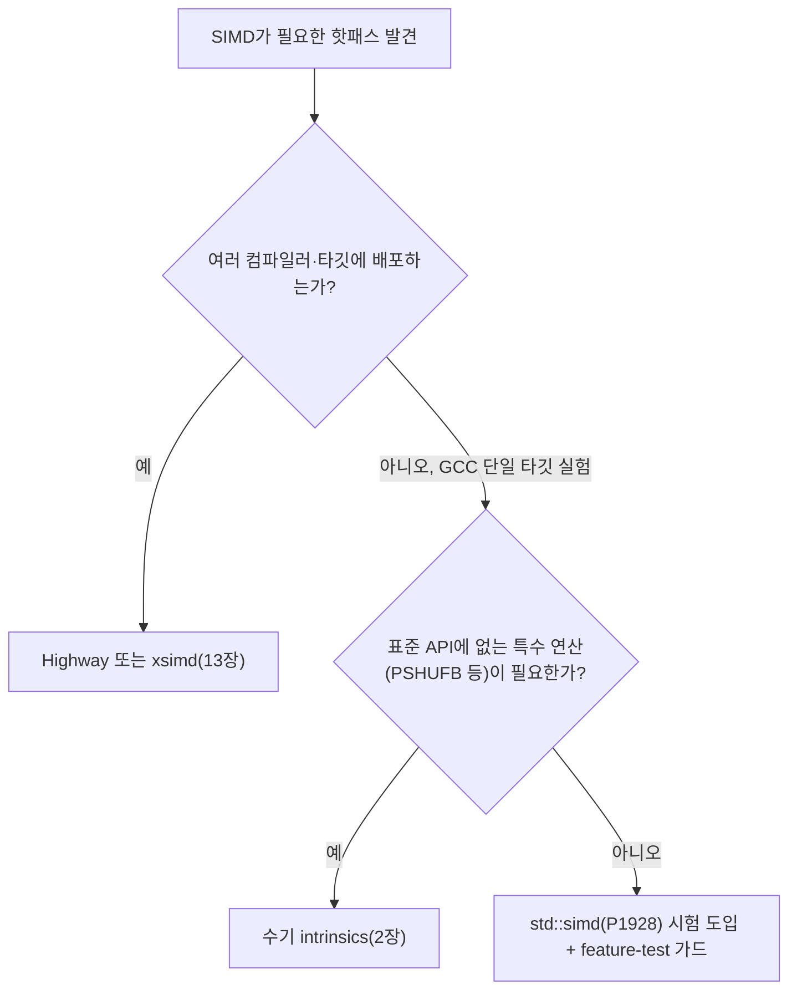

<strong>C++26 std::simd(P1928)</strong>는 C++26에 편입된 라이브러리 기반 SIMD 추상화로, `<simd>` 헤더 하나로 SSE/AVX/AVX-512/NEON/SVE 대상 코드를 한 번만 작성하려는 시도입니다. 이 장은 이 추상화가 무엇을 표준화했고, 왜 표준화에 10년 넘게 걸렸으며, 지금 시점(GCC 16.1의 부분 구현)에 서드파티 라이브러리·수동 intrinsics 대신 실전에 투입할 만한지를 판단하는 것을 목표로 합니다. 동기는 단순합니다 — "표준"이라는 단어가 주는 안정감과 실제 성숙도 사이의 간극이 이 기능만큼 큰 경우가 드물기 때문입니다.

## 이 장을 읽기 전에

**전제 지식**: 이 장은 [13장: 포터블 SIMD 라이브러리](/post/extreme-optimization/portable-simd-libraries-highway-xsimd/)에서 다룬 Highway·xsimd의 설계(추상 레인 폭, 태그 기반 디스패치)를 이미 안다는 전제로 씁니다. SIMD 자체의 레지스터·명령어 개념이 낯설다면 [1장: SIMD 기초](/post/extreme-optimization/simd-fundamentals-sse-avx/)를, intrinsics를 직접 다뤄본 적이 없다면 [2장: SIMD Intrinsics 실전 활용](/post/extreme-optimization/simd-intrinsics-practical-usage/)을 먼저 읽는 편이 좋습니다.

**이 장의 깊이**: **전문** 난이도로, `std::simd`의 표준화 경위, `<simd>` 헤더의 타입·ABI 설계, 그리고 "표준이니 도입한다"는 판단이 왜 성급한지를 다룹니다. **다루지 않는 것**: AVX-512/AVX10.2 세부 명령어([3장](/post/extreme-optimization/avx512-avx10-optimization/)), 자동 벡터화 검증 절차([4장](/post/extreme-optimization/auto-vectorization-guidance-verification/)), Highway/xsimd API 자체의 상세 사용법(13장에서 이미 다룸)입니다. 이 장은 그 위에서 "표준 라이브러리 대안"이라는 좌표 하나를 더 놓는 역할만 합니다.

## 당신의 수준에 맞는 경로

| 수준 | 읽을 부분 | 핵심 목표 |
|------|---------|---------|
| **중급자** | "역사와 표준화 경로" ~ "핵심 메커니즘" | P1928이 무엇을 표준화했는지, 왜 지금 나왔는지 이해 |
| **심화** | "흔한 오개념 교정" ~ "판단 기준" | GCC 부분 구현 상태에서 실제로 무엇을 믿고 무엇을 의심할지 판단 |
| **전문가** | "비판적 시각" | 표준화 자체에 대한 반론을 이해하고 도입 시점을 스스로 결정 |

---

## 역사와 표준화 경로

`std::simd`의 뿌리는 Matthias Kretz(GSI Helmholtz Centre)가 만든 **Vc 라이브러리**입니다. Vc는 컴파일러가 자동 벡터화를 신뢰할 수 없던 시절, "타입으로 SIMD 레인을 표현하고 연산자 오버로딩으로 커널을 쓴다"는 아이디어를 실제 라이브러리로 구현한 것이었고, 이 설계는 Kretz와 Lindenstruth의 2012년 논문 "Vc: A C++ library for explicit vectorization"(Software: Practice and Experience)으로 정식 발표되었습니다. 이 설계는 2018년 **ISO/IEC TS 19570:2018**(Parallelism TS v2)로 표준화되어 `std::experimental::simd`라는 이름으로 GCC에 실험적으로 들어갔고, 이후 논문 [**P1928**: "simd — merge data-parallel types from the Parallelism TS 2"](https://www.open-std.org/jtc1/sc22/wg21/docs/papers/2024/p1928r15.pdf)이 이를 정식 표준(`std::simd`)으로 승격시키는 작업을 맡았습니다.

P1928은 R15까지 여러 차례 개정되며 committee 리뷰를 거쳤고, 그 과정에서 이름과 API가 바뀌었습니다. 네임스페이스 이름을 다룬 **P3287**("Exploration of namespaces for std::simd")과 **P3691**("Reconsider naming of the namespace for 'std::simd'")이 대표적입니다(두 문서의 제목은 [GSI-HPC 구현 저장소](https://github.com/GSI-HPC/simd)의 구현 현황 표에서 확인했습니다). 이름이 바뀐 흔적은 표기에서도 보입니다. 이 장이 근거로 삼는 P1928R15는 `basic_simd`를 쓰는 반면 GSI-HPC 저장소는 `simd::vec`·`simd::mask` 표기를 씁니다. 즉 오늘 블로그·발표 자료에서 보는 클래스 이름은 최종 확정 API와 다를 수 있으므로, 표준 문서를 직접 확인하지 않은 자료는 과거 리비전의 이름을 그대로 쓰고 있을 가능성이 있습니다.

이 논문은 C++26에 편입되었고(승인 회의의 정확한 날짜는 이 글에서 WG21 문서로 재검증하지 않았습니다), 이후 출시된 **GCC 16.1**의 [릴리스 소식](https://isocpp.org/blog/2026/04/gcc-16.1)은 `std::simd`를 libstdc++의 실험적 지원 개선 항목으로 소개합니다. 이는 라이브러리 기능이 아직 완성 단계가 아니라는 신호로 읽을 수 있습니다.

## 핵심 메커니즘: 헤더, 네임스페이스, ABI 태그

`<simd>` 헤더는 `std::simd` 네임스페이스 아래에 두 개의 클래스 템플릿을 정의합니다. 값 벡터는 `Abi` 태그를 받는 클래스 템플릿이고(P1928R15에서는 `basic_simd<T, Abi>`, 구현 저장소 표기로는 `vec`), 이를 감싸 "네이티브 폭"을 자동으로 골라 주는 별칭이 `vec<T, N = 네이티브폭>`입니다. 마스크(조건부 레인 선택)도 같은 방식으로 `mask<T, N>` 별칭이 있습니다(`vec`·`mask` 표기는 GSI-HPC 구현 저장소 기준이며, 최종 표준 문서의 이름은 직접 확인해야 합니다). 핵심은 `Abi` 템플릿 인자입니다 — 이 값이 "이 벡터가 몇 바이트 레지스터에 몇 개의 레인으로 매핑되는가"를 결정하며, 기본값(`vec<T>`, 즉 N을 생략)은 **컴파일 시점에 활성화된 타깃 플래그**(`-march`, `-mavx2` 등)를 보고 컴파일러가 고르는 "네이티브 ABI"입니다.

이 마지막 문장이 실무에서 가장 자주 오해되는 지점입니다. `vec<float>`은 "이 머신에서 가장 넓은 레지스터"를 뜻하지 않고, **번역 단위를 컴파일할 때 컴파일러에게 준 타깃 플래그가 허용하는 가장 넓은 레지스터**를 뜻합니다. 별도 플래그 없이 컴파일하면 대부분의 x86-64 툴체인은 SSE2(128비트, `float` 4개)를 기본 타깃으로 잡으므로, AVX2가 있는 CPU에서 실행되는 바이너리라도 `vec<float>::size()`는 4로 고정됩니다. 아래는 이 함정을 그대로 보여주는 코드와, 이를 고치는 두 가지 방법입니다.

```cpp
// 깨진 코드: 컴파일 플래그 없이 빌드하면 AVX2 CPU에서 돌려도 4레인(SSE2)로 고정된다.
// g++ -std=c++26 bad.cpp  (타깃 플래그 없음 → 기본 ABI가 128비트)
#include <cstddef>
#include <cstdio>
#include <simd>

std::size_t native_width() {
  namespace stdx = std::simd;
  return stdx::vec<float>::size();   // 기대: 8(AVX2) 또는 16(AVX-512). 플래그가 없으면 128비트 기준이라 4가 나올 것으로 예상된다(미실행).
}

int main() { std::printf("native width = %zu\n", native_width()); }
```

원인은 `vec<T>`의 ABI 결정이 "런타임 CPU"가 아니라 "컴파일 시점 타깃 플래그"에 묶여 있기 때문입니다. Highway/xsimd처럼 런타임에 CPU를 감지해 코드 경로를 바꾸는 멀티버저닝은 `std::simd` 자체에는 없습니다 — 이 부분은 뒤의 "흔한 오개념"에서 다시 다룹니다. 올바른 구현은 빌드 플래그로 타깃을 명시하거나, 폭을 코드에서 고정하는 것입니다.

```cpp
// 올바른 구현 1: 빌드 시 타깃을 명시해 native ABI가 실제 하드웨어 폭을 반영하게 한다.
// g++ -std=c++26 -march=x86-64-v3 good_width.cpp   (x86-64-v3 ≈ AVX2 보장)
#include <cstddef>
#include <cstdio>
#include <simd>

std::size_t native_width() {
  namespace stdx = std::simd;
  return stdx::vec<float>::size();   // -march=x86-64-v3 하에서는 8이 되어야 한다
}

// 올바른 구현 2: 폭을 코드에 고정해 빌드 플래그와 무관하게 의도를 명시한다.
// (레인 수가 하드웨어 네이티브 폭보다 크면 컴파일러가 여러 레지스터로 에뮬레이션한다.)
std::size_t fixed_width_8() {
  namespace stdx = std::simd;
  using V8 = stdx::vec<float, 8>;
  return V8::size();   // 항상 8
}

int main() {
  std::printf("native=%zu fixed=%zu\n", native_width(), fixed_width_8());
}
```

검증은 `static_assert`나 실행 시 `size()` 출력으로 충분합니다 — CI에서 빌드 플래그가 바뀌었을 때 폭이 조용히 줄어드는 회귀를 잡으려면, 기대 레인 수를 명시적으로 assert해 두는 것이 안전합니다. 구현 지원 여부는 `#include <version>` 뒤에 `#if defined(__cpp_lib_simd)`로 검사할 수 있고, 표준 SIMD가 있는 환경에서만 `<simd>`를 포함하는 가드로 쓰면 됩니다. 이 글은 위 프로그램을 실행하지 않았고 GCC 16.1을 설치한 환경에서 확인한 출력도 싣지 않았으므로, 출력된 폭은 독자의 환경에서 확인해야 합니다. 배열 덧셈 같은 실제 커널은 [P1928R15](https://www.open-std.org/jtc1/sc22/wg21/docs/papers/2024/p1928r15.pdf)의 로드·스토어 함수(`simd_unchecked_load`, `simd_partial_load`, `simd_unchecked_store`, 이후 개정에서 `std::simd` 네임스페이스 아래 `unchecked_load`/`partial_load` 계열로 정리된 것으로 보임)로 레인 폭 단위 로드, `+` 연산, 스토어를 구성하고, 나머지(remainder)는 `partial_load`나 스칼라 루프로 처리하는 구조가 됩니다. 이 글은 개정마다 이름이 달라지는 이 API의 코드를 직접 컴파일해 확인할 수 없었으므로 싣지 않았습니다. 특히 P1928R15의 개정 이력은 P3275에 의해 비const `operator[]` 문구가 제거되었다고 기록하므로(`v[i] = x` 형태의 레인 단위 대입이 성립하지 않는다는 뜻으로 해석됩니다), 오래된 예제의 레인별 대입 코드를 그대로 가져다 쓰지 않도록 주의합니다. 결과 검증은 이 트랙의 다른 장과 같은 방식으로 스칼라 참조 구현과 요소별로 비교합니다.

## 흔한 오개념 교정

<strong>"표준에 들어갔으니 이제 Highway/xsimd는 안 써도 된다"</strong>는 성급한 결론입니다. [GSI-HPC 구현 저장소의 구현 현황 표](https://github.com/GSI-HPC/simd)는 P1928R15를 수학 함수(`simd.math`)를 제외하고 구현 완료로, 순열 API(P2664R11)는 부분 구현으로, 사용자 정의 타입 지원(P2964R2) 등은 설계 단계로 표기합니다. Highway는 [비교 문서](https://github.com/google/highway/blob/master/g3doc/std_simd_comparison.md)에서 자사의 400개 이상 연산과 런타임 디스패치를 `std::simd`와 대비합니다. 표준화는 API의 존재를 보장하지, 구현의 완성도나 실전 검증 이력을 보장하지 않습니다. Clang·MSVC의 지원 상태는 이 글에서 확인하지 않았으므로 도입 전에 각 컴파일러의 릴리스 노트로 확인해야 합니다.

<strong>"`std::simd`는 Highway처럼 런타임에 CPU를 감지해 최적 경로로 디스패치한다"</strong>도 틀렸습니다. `vec<T>`의 ABI는 번역 단위 컴파일 시점에 고정되는 값이며, 하나의 바이너리 안에서 "이 CPU는 AVX-512니까 512비트로, 저 CPU는 AVX2니까 256비트로" 자동 전환하는 메커니즘이 표준 자체에는 없습니다. 여러 타깃을 지원하려면 Highway의 `HWY_DYNAMIC_DISPATCH`처럼 별도 인프라를 직접 쌓거나(파일을 여러 타깃 플래그로 각각 컴파일해 링크), 아예 Highway/xsimd를 쓰는 편이 낫습니다.

<strong>"GCC에서 컴파일되고 실행 결과가 맞으면 그게 최종 표준 API다"</strong>도 위험한 가정입니다. 이 장의 "역사와 표준화 경로"에서 본 것처럼 P1928R15의 `basic_simd`와 구현 저장소의 `simd::vec`처럼 표기 자체가 리비전에 따라 달랐고, GCC 16.1은 그 표준의 **구현 중인 버전**입니다. `__cpp_lib_simd` feature-test 매크로 값과 GCC 릴리스 노트를 함께 확인하지 않으면, 다음 GCC 마이너 버전에서 API 표면이 바뀌어 재컴파일이 깨질 위험을 안고 가는 셈입니다.

## 판단 기준

| 상황 | 권장 | 비권장 |
|------|------|--------|
| 프로덕션 핫패스, 여러 컴파일러/타깃 지원 필요 | Highway 또는 xsimd (13장) | `std::simd` 단독 의존 |
| 특정 명령어(PSHUFB, 포화 연산, 암호 프리미티브) 필요 | 수기 intrinsics (2장) | `std::simd`로 억지로 표현 |
| GCC 단일 타깃 실험·사내 PoC·교육용 코드 | `std::simd` 시험적 도입 | — |
| 표준 API 안정성이 배포 요구사항인 라이브러리 | 아직 도입 보류, GCC 다음 릴리스 추적 | 지금 API 표면을 프로덕션에 고정 |
| 컴파일 타임/바이너리 크기 민감 | 자동 벡터화 + intrinsics 부분 개입 | 템플릿 인스턴스화 비용 검증 없이 도입 |

성능 주장을 검증하려면 스칼라 루프, 수기 벡터화, `std::simd` 버전을 같은 입력으로 비교하는 실측이 필요합니다. 이 글은 `std::simd` 커널을 컴파일해 확인할 수 없었으므로 벤치마크 코드와 배율을 싣지 않았고, 실측 구조는 [13장](/post/extreme-optimization/portable-simd-libraries-highway-xsimd/)의 벤치마크 스켈레톤을 따르면 됩니다.

컴파일러의 자동 벡터화가 이미 잘 통하는 단순 커널에서는 스칼라 루프가 `std::simd` 구현과 비슷하거나 더 빠를 수 있습니다. `std::simd`의 가치는 자동 벡터화가 잘 통하지 않는 형태의 커널(조건부 레인 마스킹, 게더/스캐터가 섞인 루프 등)에서 드러난다는 것이 이 글의 가설이며, 단순 커널로 "표준 SIMD가 느리다"고 일반화하는 것도, 반대로 "표준이니 항상 빠르다"고 가정하는 것도 모두 성급합니다.



## 비판적 시각: 한계와 논쟁

`std::simd`에 대한 비판은 "너무 늦게 왔다"는 지적과 "설계 자체가 부적합하다"는 지적 두 갈래로 나뉩니다. Google Highway 팀은 [자신들의 비교 문서](https://github.com/google/highway/blob/master/g3doc/std_simd_comparison.md)에서, `vec<T, N>`처럼 **컴파일 시점에 크기가 고정된 클래스 템플릿**이 Arm SVE·RISC-V RVV 같은 **스케일러블 벡터**(하드웨어가 런타임에 폭을 정하는 설계) 아키텍처와 근본적으로 어긋난다고 지적합니다 — 이런 아키텍처의 사이즈리스(sizeless) 벡터 타입은 현재 컴파일러들이 클래스로 감싸는 것 자체를 허용하지 않기 때문입니다. 같은 문서는 런타임 디스패치 부재와 400여 개에 달하는 자사 연산 대비 `std::simd`의 좁은 연산 커버리지도 함께 지적합니다.

더 날카로운 비판은 실무자 쪽에서도 나옵니다. [한 실무 비평](https://lucisqr.substack.com/p/c26-shipped-a-simd-library-nobody)은 단순 커널에서 스칼라 for-루프의 자동 벡터화가 명시적 SIMD 코드(이 비평이 측정한 것은 `std::experimental::simd` 구현입니다)보다 낫거나 비슷한 사례, 기본 ABI 폭이 종종 128비트로 고정되어 버리는 문제(이 장의 "핵심 메커니즘"에서 재현한 바로 그 함정), 그리고 템플릿 인스턴스화 계층이 컴파일러의 대수적 단순화·상수 폴딩 기회를 가린다는 점을 근거로 든다 — 다만 이는 특정 벤치마크·컴파일러 버전에서 관찰된 결과이며, 모든 워크로드·모든 컴파일러에 대한 일반 법칙은 아니라는 점을 함께 감안해야 합니다. 이 비평의 결론은 "단순한 곳은 자동 벡터화, 어려운 곳은 intrinsics"라는 조합이며, ISPC는 장점을 인정하되 별도 컴파일러·C ABI 비용이 따르는 선택지로 언급됩니다.

두 비판 모두 공통으로 짚는 것은 **표준화 속도와 하드웨어·실무 관행의 변화 속도가 어긋났다**는 점입니다. Vc가 2012년 논문으로 이 설계를 발표했을 때는 AVX조차 막 등장한 시기였지만, 표준에 편입된 시점에는 이미 Highway·xsimd 같은 대안이 쓰이고 있었고 Arm SVE·RISC-V RVV 같은 스케일러블 벡터 아키텍처가 등장해 있었습니다. 이 트랙의 다른 전문 챕터([7장: hand-written 어셈블리](/post/extreme-optimization/hand-written-assembly-risk-management/), [11장: 유지보수성 균형](/post/extreme-optimization/extreme-optimization-maintainability-balance/))에서 일관되게 강조하는 "되돌리기 비용" 원칙을 여기에도 그대로 적용해야 합니다 — 지금 `std::simd`에 코드베이스를 고정하면, API 표면이 후속 GCC 릴리스나 Clang·MSVC 최초 구현에서 달라질 때 되돌리는 비용을 떠안게 됩니다.

## 마무리

- [ ] `<simd>` 헤더의 네임스페이스(`std::simd`)와 `vec`/`mask` 별칭 이름이 리비전에 따라 달랐다는 경위를 설명할 수 있다.
- [ ] `vec<T>`의 네이티브 ABI가 "런타임 CPU"가 아니라 "컴파일 시점 타깃 플래그"에 묶인다는 것을 코드로 재현하고 고칠 수 있다.
- [ ] `std::simd`에 런타임 디스패치가 없다는 것과, 이것이 왜 Highway/xsimd 대비 실무 제약이 되는지 설명할 수 있다.
- [ ] 사용할 컴파일러의 `std::simd` 구현 범위(구현 현황 표, `__cpp_lib_simd` 확인 방법)를 프로젝트 도입 전에 점검할 수 있다.
- [ ] 표준화 여부와 실전 성숙도를 분리해서, 지금 시점에 `std::simd`/Highway·xsimd/수기 intrinsics 중 무엇을 골라야 하는지 판단 기준으로 설명할 수 있다.

**다음 장에서는** 벡터 폭이라는 축을 떠나 **캐시 계층 구조 자체를 알고리즘 설계에 반영하는 법**을 다룹니다. Cache-oblivious 알고리즘은 캐시 크기·라인 크기를 코드에 하드코딩하지 않고도 캐시 효율을 얻으려는 접근으로, 이 장에서 본 "이식성과 성능 사이의 트레이드오프" 감각을 메모리 계층으로 옮겨 적용하게 됩니다.

→ [Cache-oblivious 알고리즘 설계](/post/extreme-optimization/cache-oblivious-algorithm-design/)
