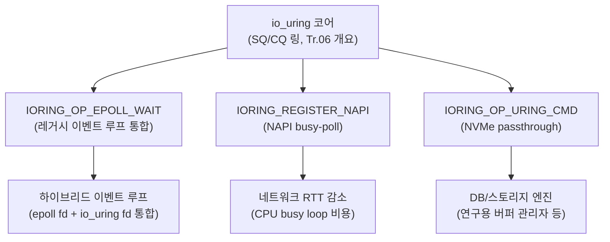

**io_uring 심화**란 io_uring의 기본 SQ/CQ 링 모델을 넘어, 이 커널 인터페이스가 기존 이벤트 루프·네트워크 스택·벤더 전용 스토리지 명령과 어떻게 통합되는지를 다루는 영역을 말합니다. io_uring이 파일 읽기/쓰기 대체재로 자리 잡은 뒤에도 실무에서는 여전히 "레거시 epoll 코드를 어디까지 남겨야 하는가", "네트워크 지연을 더 줄이려면 무엇을 켜야 하는가", "NVMe 벤더 명령까지 io_uring 경로로 보낼 수 있는가"라는 질문이 남아 있으며, 이 장은 Linux 6.15의 epoll 통합, NAPI busy-poll, `IORING_OP_URING_CMD` 기반 NVMe passthrough, 그리고 PostgreSQL 18의 io_uring 통합 사례를 통해 이 질문에 답합니다.

## 이 장을 읽기 전에

**전제 지식**: 이 장은 [Tr.06: io_uring 개요](/post/os-optimization/io-uring-overview-fundamentals/)에서 다룬 SQ(Submission Queue)/CQ(Completion Queue) 링 구조, `io_uring_setup`/`io_uring_enter` 기본 흐름, 그리고 이 트랙 [03장: 비동기 I/O 기초](/post/io-optimization/async-io-select-poll-epoll-kqueue/)에서 다룬 `epoll`의 level-triggered/edge-triggered 동작을 전제로 합니다. 두 장을 읽지 않았다면 먼저 읽는 것을 권장합니다.

**이 장의 깊이**: **심화** 단계로, io_uring 자체의 셋업 코드나 기본 opcode 목록은 다시 설명하지 않습니다. 대신 2024–2026년에 걸쳐 추가된 세 가지 확장(epoll 통합, NAPI busy-poll, `uring_cmd` NVMe passthrough)의 내부 동작과, 이를 실제로 적용한 PostgreSQL 18 사례의 수치를 어떻게 해석해야 하는지에 집중합니다.

**다루지 않는 것**: POSIX AIO와 io_uring의 성능 비교 방법론은 [13장](/post/io-optimization/posix-aio-vs-io-uring-performance-comparison/), WAL·fsync·저널링 전략의 세부는 [14장](/post/io-optimization/database-io-wal-fsync-journaling-strategy/), NVMe 큐 깊이·I/O 스케줄러 튜닝 자체는 [10장](/post/io-optimization/block-device-nvme-ssd-io-scheduler-optimization/)에서 다룹니다. 이 장은 그 경계 안에서 "io_uring이 무엇과 통합되는가"에만 집중합니다.

## 당신의 수준에 맞는 경로

| 수준 | 읽을 부분 | 핵심 목표 |
|------|---------|---------|
| **실무 적용 우선** | "epoll 통합" ~ "판단 기준" | 세 확장 기능 중 무엇을 켤지 빠르게 결정 |
| **메커니즘 이해** | "역사와 배경" ~ "NVMe passthrough" | SQE/CQE 레벨에서 각 확장의 내부 동작 파악 |
| **전문가·보안 검토** | "PostgreSQL 18 사례" ~ "비판적 시각" | 벤치마크 수치의 출처를 구분하고 운영 리스크를 판단 |

## io_uring 확장의 역사와 배경

io_uring은 Jens Axboe가 2019년 커널 5.1에 도입한 이후 매 릴리스마다 opcode와 등록 API가 늘어나는 방식으로 성장해 왔으며, 초기의 파일 읽기/쓰기 대체를 넘어 네트워킹·타이머·파일 감시까지 흡수하는 범용 비동기 인터페이스가 되었습니다. 이 장이 다루는 세 확장은 각기 다른 시점에 다른 동기로 추가되었습니다. NVMe passthrough의 기반인 `IORING_OP_URING_CMD`는 커널 5.19(NVMe 드라이버)와 6.0(ublk)부터 지원되었고, 목적은 파일시스템을 거치지 않고 벤더 고유 NVMe 명령을 io_uring 경로로 직접 보내는 것이었습니다. NAPI busy-poll 등록 API(`io_uring_register_napi`)는 이보다 뒤에 네트워크 라운드트립 지연을 줄이려는 목적으로 추가되었습니다. 가장 최근인 `IORING_OP_EPOLL_WAIT`는 Jens Axboe가 2025년 2월에 제출한 패치셋으로 시작해 커널 6.15에 병합되었으며, 목적은 상반된 두 세계관 — "모든 것을 io_uring으로 재작성하라"와 "기존 epoll 이벤트 루프를 당장 바꿀 수 없다" — 사이의 실용적인 타협입니다.



세 확장은 서로 독립적이며 하나를 켠다고 다른 것이 자동으로 활성화되지 않습니다. 아래 절에서 각각의 내부 동작을 SQE/CQE 레벨에서 살펴봅니다.

## epoll 통합: IORING_OP_EPOLL_WAIT

기존 코드베이스가 이미 `epoll_wait`로 수천 개의 파일 디스크립터를 관리하고 있을 때, 이를 한 번에 io_uring으로 재작성하는 것은 위험 대비 이득이 낮은 선택인 경우가 많습니다. `IORING_OP_EPOLL_WAIT`는 `epoll_wait(2)`의 비동기 버전으로, 기존 epoll 인스턴스의 fd를 io_uring SQE에 그대로 넘겨 완료를 CQE로 받을 수 있게 합니다. 기존에는 "io_uring fd 자체를 epoll 집합에 추가"하는 반대 방향의 통합을 써야 했는데, liburing의 [`io_uring_prep_epoll_wait(3)`](https://raw.githubusercontent.com/axboe/liburing/master/man/io_uring_prep_epoll_wait.3) 매뉴얼은 이 방식이 epoll에 io_uring 수준의 세밀한 배치 제어와 wakeup 감소가 없어 최적이 아니라고 설명합니다. epoll 이벤트를 io_uring으로 읽으면 이벤트 루프 전체를 io_uring으로 옮겨 배치 대기와 컨텍스트 스위치 감소의 이점을 얻을 수 있다는 것이 이 opcode의 취지입니다.

```cpp
#include <liburing.h>
#include <sys/epoll.h>

// epoll_wait_uring.cpp — Linux 6.15+, liburing 2.10+
// g++ -O2 -std=c++17 epoll_wait_uring.cpp -o epoll_wait_uring -luring
#include <cstdio>
#include <unistd.h>

constexpr int kMaxEvents = 32;

int main() {
  // 레거시 컴포넌트가 쓰던 epoll 인스턴스라고 가정한다. 예제는 pipe 하나를 등록한다.
  int ep = epoll_create1(0);
  int p[2];
  if (ep < 0 || pipe(p) < 0) { std::perror("setup"); return 1; }
  epoll_event ev{};
  ev.events = EPOLLIN;
  ev.data.fd = p[0];
  if (epoll_ctl(ep, EPOLL_CTL_ADD, p[0], &ev) < 0) { std::perror("epoll_ctl"); return 1; }

  io_uring ring;
  if (io_uring_queue_init(8, &ring, 0) < 0) { std::perror("io_uring_queue_init"); return 1; }

  epoll_event events[kMaxEvents];
  if (write(p[1], "x", 1) != 1) return 1;  // 읽기 가능 상태를 만든다

  // 단발(one-shot) 요청: 완료될 때마다 다시 제출해야 한다.
  io_uring_sqe* sqe = io_uring_get_sqe(&ring);
  io_uring_prep_epoll_wait(sqe, ep, events, kMaxEvents, 0);
  io_uring_submit(&ring);

  io_uring_cqe* cqe;
  if (io_uring_wait_cqe(&ring, &cqe) < 0) return 1;
  int n = cqe->res;  // 양수면 events[]에 채워진 이벤트 수, 음수면 -errno
  io_uring_cqe_seen(&ring, cqe);
  if (n < 0) { std::fprintf(stderr, "epoll_wait via io_uring: %d\n", n); return 1; }
  for (int i = 0; i < n; ++i) std::printf("ready fd=%d\n", events[i].data.fd);

  io_uring_queue_exit(&ring);
  return 0;
}
```

이 요청은 단발(one-shot)이므로 CQE 하나를 받아 이벤트를 처리한 뒤 `io_uring_get_sqe`로 새 SQE를 받아 `io_uring_prep_epoll_wait`를 다시 준비·제출하는 루프로 씁니다. `cqe->res`는 `epoll_wait(2)`의 반환값과 같은 의미(이벤트 수 또는 음수 오류)를 가지며, 마지막 인자 `flags`는 현재 0으로 둡니다. 취소는 io_uring의 일반적인 cancel 경로(`IORING_OP_ASYNC_CANCEL`)로 처리할 수 있습니다.

## NAPI busy-poll로 네트워크 지연 줄이기

네트워크 인터럽트 기반 수신 경로는 NIC가 인터럽트를 걸고 커널이 소프트IRQ에서 패킷을 처리하는 구조라, 인터럽트 지연·코얼레싱 설정·스케줄링 지연이 누적되어 수십 마이크로초 단위의 흔들림을 만듭니다. NAPI busy-poll은 이 인터럽트 경로 대신 CPU가 짧은 시간 동안 NIC 큐를 직접 반복 조회(polling)하게 해서 이 흔들림을 줄이는 기법이며, 소켓 옵션 `SO_PREFER_BUSY_POLL`과 동일한 개념을 io_uring 링 단위로 등록할 수 있게 한 것이 `io_uring_register_napi` API입니다. 커널 쪽 지원은 Linux 6.9에서 "io_uring: Add napi busy polling support"로 병합되었습니다([kernelnewbies: Linux 6.9](https://kernelnewbies.org/Linux_6.9)), 사용법은 liburing의 [`io_uring_register_napi(3)`](https://raw.githubusercontent.com/axboe/liburing/master/man/io_uring_register_napi.3) 매뉴얼을 기준으로 합니다.

```cpp
#include <liburing.h>

// 네트워크 소켓을 다루는 io_uring 링에 NAPI busy-poll을 등록.
// busy_poll_to는 마이크로초 단위 타임아웃, prefer_busy_poll은 SO_PREFER_BUSY_POLL과 대응한다.
int enable_napi_busy_poll(io_uring* ring, unsigned busy_poll_us) {
  io_uring_napi napi{};
  napi.busy_poll_to = busy_poll_us;   // 예: 50 (50us) — 워크로드에 맞춰 조정
  napi.prefer_busy_poll = 1;
  return io_uring_register_napi(ring, &napi);
}
```

busy-poll이 줄여 주는 것은 인터럽트·소프트IRQ·스케줄링 지연이므로, 얼마나 줄어드는지는 NIC의 인터럽트 코얼레싱 설정·커널 버전·패킷 빈도에 따라 달라집니다. 효과는 반드시 자신의 환경에서 켜기 전후의 RTT 분포(p50/p99)를 재서 확인해야 합니다. busy-poll은 해당 코어가 대기 시간 동안에도 100%에 가깝게 점유되므로, 코어 예산이 빠듯하거나 전력·발열이 민감한 환경에서는 오히려 손해로 돌아올 수 있습니다.

## IORING_OP_URING_CMD와 NVMe passthrough

파일시스템 계층을 거치는 일반 read/write 경로로는 표현할 수 없는 명령들이 있습니다. NVMe 벤더 고유 명령, SMART 진단, Flexible Data Placement([10장](/post/io-optimization/block-device-nvme-ssd-io-scheduler-optimization/)에서 다루는 FDP 힌트) 같은 것들이 대표적이며, 전통적으로는 블로킹 `ioctl`로만 이런 명령을 보낼 수 있어 확장성이 떨어졌습니다. `IORING_OP_URING_CMD`는 "임의의 명령 제공자(command provider)가 정의한 서브커맨드를 io_uring 경로로 비동기 전달"할 수 있게 만든 범용 opcode로, NVMe 드라이버가 이를 이용해 passthrough 인터페이스를 노출합니다.

NVMe passthrough 명령 제공자는 링 생성 시 `IORING_SETUP_SQE128`로 128바이트 "Big SQE"를 켤 것을 요구하며(일반 64바이트 SQE의 두 배, 소켓용 `uring_cmd`처럼 64바이트 SQE로 동작하는 명령 제공자도 있음), 명령 구조체를 사용자 공간에서 SQE 안에 직접 채워 넣어 `copy_from_user`를 생략하는 방식으로 zero-copy를 달성합니다. 완료 결과도 32바이트 "Big CQE"로 받아 별도의 `put_user` 호출 없이 부가 결과 필드까지 회수합니다.

```text
# uring_cmd 기반 NVMe passthrough 요청 흐름 (개념 스케치)
# 실제 struct nvme_uring_cmd 필드 배치는 커널 버전에 따라 다르므로 커널 헤더를 기준으로 확인한다.
1. io_uring_get_sqe(ring)로 SQE 획득 (링 생성 시 IORING_SETUP_SQE128 필요)
2. sqe->opcode  = IORING_OP_URING_CMD
3. sqe->cmd_op  = NVME_URING_CMD_IO   # 드라이버가 정의하는 서브커맨드
4. Big SQE의 cmd 영역에 nvme_uring_cmd(opcode, nsid, addr, data_len 등)를 인라인으로 채움
5. io_uring_submit(ring) → NVMe 드라이버가 요청을 큐에 직접 전달
6. Big CQE(32B)로 res/res2 완료 결과 회수 (IORING_SETUP_CQE32 필요)
```

이 경로는 파일시스템·블록 계층의 일반적인 검증을 건너뛰는 저수준 접근이므로, 잘못된 명령을 그대로 디바이스에 전달하면 데이터 손상이나 커널 크래시로 이어질 수 있습니다. 실무에서는 root 권한 또는 `CAP_SYS_ADMIN`급 권한과 함께 사용이 제한되는 경우가 많고, 일반 애플리케이션 코드보다는 스토리지 엔진·드라이버 레벨 최적화에 국한해 쓰는 것이 안전합니다.

## PostgreSQL 18의 io_uring 통합 사례

PostgreSQL 18은 `io_method` 설정으로 `sync`(기존 동기 방식), `worker`(백그라운드 I/O 워커), `io_uring`(io_uring 기반 비동기 I/O) 중 하나를 선택할 수 있게 되었습니다. PostgreSQL 프로젝트의 [공식 릴리스 발표](https://www.postgresql.org/about/news/postgresql-18-released-3142/)는 새 비동기 I/O가 지원하는 연산으로 순차 스캔(sequential scan)·비트맵 힙 스캔·vacuum을 들고, 벤치마크에서 특정 시나리오 기준 최대 3배의 성능 향상이 확인되었다고 밝혔습니다.

여기서 자주 섞이는 숫자가 하나 더 있습니다. Jasny·El-Hindi·Ziegler·Leis·Binnig의 연구 논문 ["High-Performance DBMSs with io_uring: When and How to use it"](https://arxiv.org/abs/2512.04859)(arXiv:2512.04859)은 스토리지 바운드 버퍼 관리자를 대상으로 업데이트 위주 YCSB 워크로드에서 fiber 기반 비동기화·등록 버퍼(registered buffers)·NVMe passthrough(`uring_cmd`)·IOPOLL·SQPOLL을 차례로 켜 단일 스레드 처리량을 초당 16.5k에서 546k 트랜잭션까지 끌어올린 과정을 보여 줍니다. 이와 별도로 논문 서론은 libaio를 io_uring으로 단순 교체하면 1.06배에 그치지만 io_uring에 맞춰 설계를 바꾸면 버퍼 관리자의 end-to-end 성능이 2.05배 오른다고 정리합니다. 이 수치들은 논문이 자체 구축한 버퍼 관리자에서 나온 것이며, 같은 논문이 이 가이드라인을 PostgreSQL 18의 실제 io_uring 통합에 적용했을 때는 테이블 스캔류 워크로드에서 약 11–15%의 추가 속도 향상을 얻었다고 별도로 보고합니다. 즉 "2.05배"는 PostgreSQL 자체의 공식 벤치마크 수치가 아니라 연구용 버퍼 관리자에서 얻은 상한선이며, PostgreSQL 18에 그대로 적용했을 때의 실측 개선폭은 이보다 훨씬 작습니다.

## 흔한 오개념 바로잡기

<strong>"io_uring 확장을 켜면 무조건 더 빠르다"</strong>는 오개념입니다. `IORING_OP_EPOLL_WAIT`는 처리량이 아니라 통합 편의성을 위한 것이고, NAPI busy-poll은 코어를 점유하는 대가로 지연을 줄이는 트레이드오프이며, `uring_cmd` passthrough는 파일시스템 캐시·버퍼링 이점을 포기하고 벤더 명령을 직접 다루는 대가로 얻는 기능입니다. 셋 다 "켜기만 하면 이득"이 아니라 워크로드에 맞는지부터 판단해야 합니다.

<strong>"PostgreSQL의 io_uring 통합이 자동으로 트랜잭션 처리량을 2.05배로 만든다"</strong>도 오개념이며, 이 숫자를 용량 계획에 그대로 넣으면 증설 규모를 과소 산정하게 됩니다. 2.05배는 연구용 버퍼 관리자의 YCSB 처리량, 3배는 PostgreSQL 18의 스토리지 읽기 시나리오에서 나온 수치로, 측정 대상도 기준선도 다릅니다.

<strong>"NVMe passthrough(uring_cmd)는 일반 read/write보다 항상 안전한 저수준 대안"</strong>이라는 생각도 위험합니다. "저수준이니 더 통제된다"는 직관과 달리, 일반 경로가 대신 해 주던 페이지 캐시·블록 계층의 요청 병합·I/O 스케줄링을 모두 애플리케이션이 떠안게 되므로 잘못 쓰면 성능과 안정성이 함께 나빠집니다.

## 판단 기준

| 상황 | 권장 | 비권장 |
|------|------|--------|
| 레거시 epoll 이벤트 루프를 점진적으로 io_uring으로 통합 | `IORING_OP_EPOLL_WAIT`로 하이브리드 루프 구성 | 전체 재작성을 먼저 강행 |
| 신규 네트워크 코드 | io_uring 소켓 opcode(`accept`/`recv`/`send`) 직접 사용 | epoll fd를 io_uring으로 감싸기만 함 |
| 초저지연 네트워크(수십 us 목표), 전용 코어 여유 있음 | NAPI busy-poll 활성화 후 RTT 재측정 | 코어 예산 없이 무조건 활성화 |
| 표준 파일 I/O로 충분한 워크로드 | 일반 read/write/readv opcode | 굳이 `uring_cmd` passthrough 도입 |
| NVMe 벤더 고유 명령·FDP 힌트 등이 꼭 필요 | `uring_cmd` passthrough + 권한·검증 절차 마련 | 검증 없이 애플리케이션 코드에 직접 노출 |
| 컨테이너·멀티테넌트·보안 민감 환경 | io_uring 자체의 seccomp/SELinux 제한 정책부터 검토 | 커널 공격표면 검토 없이 기본 허용 |

**측정 스켈레톤**: 아래는 IOPOLL(우선순위 폴링) 적용 전후로 NVMe 랜덤 읽기 지연 분포를 비교하는 `fio` 스켈레톤입니다(플랫폼: Linux 6.15+, fio 3.36+, x86-64, NVMe SSD 기준 예시).

```bash
# hipri=1 -> IORING_SETUP_IOPOLL 경로, hipri=0 -> 일반 인터럽트 기반 완료
fio --name=uring_iopoll --ioengine=io_uring --iodepth=32 --rw=randread \
    --bs=4k --direct=1 --hipri=1 --filename=/dev/nvme0n1 \
    --runtime=30 --time_based --group_reporting

fio --name=uring_no_iopoll --ioengine=io_uring --iodepth=32 --rw=randread \
    --bs=4k --direct=1 --hipri=0 --filename=/dev/nvme0n1 \
    --runtime=30 --time_based --group_reporting
```

IOPOLL은 nvme 드라이버에 폴링 큐가 있어야 동작합니다. `nvme.poll_queues` 모듈 파라미터 기본값은 0이며, 폴링 큐가 없으면 완료가 인터럽트 방식으로 처리되어 두 실행 결과가 같아지므로 `/sys/block/nvme0n1/queue/io_poll` 값부터 확인합니다. 폴링 큐가 준비된 상태에서 두 실행의 `clat` 백분위(p50/p99/p999)를 비교하면 폴링 기반 완료가 지연 분포의 꼬리를 얼마나 좁히는지 확인할 수 있습니다. `randread`는 데이터를 바꾸지 않지만 `--rw`를 쓰기 계열로 바꾸면 `/dev/nvme0n1`의 데이터가 파괴되므로, 테스트 전용 디바이스나 파일 백엔드로 바꿔 실행해야 합니다.

## 비판적 시각: 한계와 트레이드오프

세 확장 모두 커널 버전 파편화 문제를 안고 있습니다. `IORING_OP_EPOLL_WAIT`는 6.15부터, NAPI busy-poll 등록 API는 6.9부터 존재하지만, 장기 지원(LTS) 배포판의 기본 커널에는 아직 반영되지 않은 경우가 많아 자체 관리 커널이나 최신 배포판이 전제되는 경우가 흔합니다. io_uring 전반의 보안 이력도 짚어야 할 부분입니다. Google 보안팀은 2023년 6월 [kCTF VRP 회고](https://security.googleblog.com/2023/06/learnings-from-kctf-vrps-42-linux.html)에서 지난 1년간 제출된 리눅스 커널 익스플로잇의 60%가 io_uring을 악용했다고 밝혔고, ChromeOS에서는 io_uring을 비활성화하고 Android에서는 seccomp-bpf로 앱의 접근을 막았으며 GKE Autopilot은 기본 비활성화를 검토한다고 적었습니다. 2025년 4월에는 보안 업체 ARMO가 io_uring만으로 동작해 syscall 감시 기반 탐지를 우회하는 개념 증명(PoC) 루트킷 "curing"을 [공개](https://www.armosec.io/blog/io_uring-rootkit-bypasses-linux-security/)했습니다. `uring_cmd` NVMe passthrough처럼 커널 검증을 우회하는 경로일수록 이런 공격표면 논의에서 자유롭지 않으므로, 프로덕션 도입 전 보안 정책(seccomp 프로필, SELinux 정책, 컨테이너 런타임의 syscall 허용 목록)을 반드시 점검해야 합니다.

## 마무리

이 장을 통해 다음을 확인할 수 있어야 합니다.

- [ ] `IORING_OP_EPOLL_WAIT`가 처리량이 아니라 레거시 이벤트 루프 통합을 위한 것임을 설명할 수 있다.
- [ ] NAPI busy-poll의 지연 이득과 CPU 점유 비용 사이의 트레이드오프를 판단할 수 있다.
- [ ] `IORING_OP_URING_CMD` 기반 NVMe passthrough의 zero-copy 구조(Big SQE/Big CQE)와 운영 위험을 설명할 수 있다.
- [ ] PostgreSQL io_uring 통합 수치를 인용할 때 "연구 벤치마크"와 "실제 적용치"를 구분할 수 있다.
- [ ] 이 확장 기능들을 도입하기 전 커널 버전과 보안 정책(seccomp/SELinux)을 점검할 수 있다.

**이전 장**: [비동기 I/O 기초: select·poll·epoll·kqueue](/post/io-optimization/async-io-select-poll-epoll-kqueue/) (챕터 03)

**IOCP와 Windows I/O**를 다룹니다. Linux io_uring이 단일 큐에서 제출/완료를 비동기로 묶는 것과 달리, Windows IOCP는 완료 포트 중심의 다른 모델을 사용합니다. 두 모델을 나란히 이해하면 크로스 플랫폼 비동기 I/O 계층을 설계할 때 어떤 부분이 이식 가능하고 어떤 부분이 플랫폼 고유인지 구분할 수 있습니다.

→ [IOCP와 Windows I/O](/post/io-optimization/windows-iocp-io-model-optimization/) (챕터 05)
