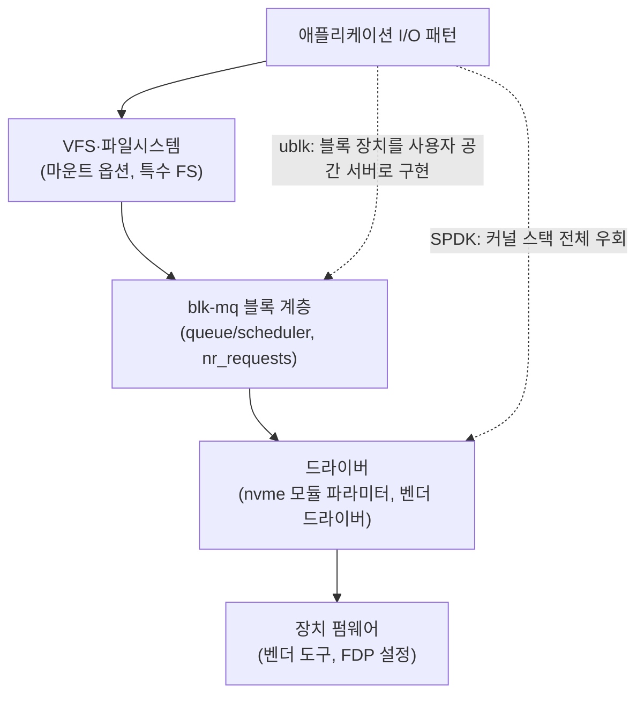

**스토리지 스택 커스터마이징**이란 애플리케이션의 `read`/`write` 패턴을 다듬는 수준(이 트랙의 앞 챕터들)을 넘어, 파일시스템·블록 계층·드라이버처럼 **스택 자체를 교체하거나 수정**하는 결정을 말합니다. 커널 모듈을 직접 작성하거나, 벤더가 제공하는 out-of-tree 드라이버를 쓰거나, 아예 커널 스택을 우회하는 사용자 공간 드라이버로 옮기는 선택이 여기에 해당합니다. 이 장은 그런 선택이 언제 정당화되는지, 그리고 그 대가로 무엇을 떠안는지를 판단하는 틀을 다룹니다.

## 이 장을 읽기 전에

**선행 챕터**: [10장: 블록 디바이스 최적화](/post/io-optimization/block-device-nvme-ssd-io-scheduler-optimization/)(blk-mq·I/O 스케줄러·NVMe 큐), [09장: 파일시스템 특성](/post/io-optimization/filesystem-performance-characteristics-ext4-xfs-zfs/)을 전제로 합니다. 사용자 공간 드라이버의 비동기 경로를 이해하려면 [04장: io_uring 심화](/post/io-optimization/io-uring-advanced-deep-dive/)와 [Tr.06: io_uring 개요](/post/os-optimization/io-uring-overview-fundamentals/)도 도움이 됩니다.

**이 장의 깊이**: **전문**입니다. 커널 모듈을 작성하는 방법 자체는 다루지 않고, 스택을 바꾸는 결정의 경계와 운영 리스크, 그리고 그 결정을 검증·되돌리는 절차에 집중합니다. 대상 플랫폼은 Linux입니다.

| 수준 | 읽을 부분 | 핵심 목표 |
|------|---------|---------|
| **실무 적용 우선** | "커스터마이징 사다리" – "판단 기준" | 지금 문제에 몇 번째 단계가 필요한지 결정 |
| **메커니즘 이해** | "스토리지 스택 계층과 조정 지점" – "리스크의 구조" | 계층별로 무엇을 바꿀 수 있고 무엇이 깨지는지 파악 |
| **운영·보안 검토** | "검증과 롤백" – "비판적 시각" | 변경 전 검증 명령과 되돌리는 절차 확보 |

## 스토리지 스택 계층과 조정 지점

Linux에서 애플리케이션의 I/O는 VFS와 파일시스템을 지나 블록 계층(blk-mq)에 요청으로 쌓이고, I/O 스케줄러를 거쳐 드라이버가 장치 큐에 넣은 뒤 펌웨어가 실제 매체에 기록합니다. [커널의 blk-mq 문서](https://docs.kernel.org/block/blk-mq.html)는 이 블록 계층을 요청이 먼저 모이는 소프트웨어 스테이징 큐와 장치로 내려보내는 하드웨어 디스패치 큐의 2단 구조로 설명하며, NVMe처럼 큐를 여러 개 가진 장치는 하드웨어 큐를 CPU별로 나눠 락 경합을 줄입니다. 각 계층에는 이미 표준 조정 지점이 있으므로, 스택을 바꾸기 전에 그 지점들을 먼저 써 봤는지가 첫 질문이 됩니다.



그림의 실선은 표준 경로이고, 점선은 스택의 일부를 사용자 공간으로 옮기는 두 가지 대안입니다. [SPDK 문서](https://spdk.io/doc/userspace.html)는 NVMe 장치를 커널 드라이버에서 떼어 `vfio`(또는 `uio`)에 다시 묶은 뒤, 사용자 공간 드라이버가 장치 BAR를 직접 매핑하고 인터럽트 대신 폴링으로 완료를 확인한다고 설명합니다. 같은 문서가 밝히듯 이렇게 떼어낸 장치의 `/dev/nvme0n1`은 사라지고 그 위의 파일시스템도 쓸 수 없게 되므로, SPDK는 "커널 스택을 튜닝"하는 것이 아니라 "커널 스택을 버리고 직접 구현"하는 선택입니다. 반대로 [ublk](https://docs.kernel.org/block/ublk.html)는 커널에 블록 장치를 남겨 둔 채 그 장치의 I/O 처리를 io_uring 패스스루 명령으로 사용자 공간 서버에 넘기는 방식이라, 커널 모듈을 새로 작성하지 않고도 커스텀 블록 장치 로직을 구현할 수 있습니다.

## 커스터마이징 사다리

스택을 바꾸는 선택지는 아래로 내려갈수록 이득의 상한이 커지지만, 되돌리는 비용과 다른 시스템과의 결합도 함께 커집니다. 문제가 생겼을 때 바로 아래 단계로 뛰어내리지 말고, 위 단계에서 측정으로 한계를 확인한 뒤에만 한 칸씩 내려가는 것이 원칙입니다.

| 단계 | 바꾸는 것 | 기대 이득 | 주된 리스크 | 롤백 비용 |
|------|---------|---------|---------|---------|
| 1. 애플리케이션 튜닝 | 접근 패턴·버퍼 크기·배치(01–15장) | 대부분의 문제를 해결 | 거의 없음 | 코드 되돌리기 |
| 2. 표준 조정 지점 | 스케줄러, 마운트 옵션, 모듈 파라미터 | 큐 깊이·지연 꼬리 조정 | 설정 드리프트 | 설정 원복·재부팅 |
| 3. 표준 커널 기능 | io_uring 폴링, FDP 힌트, 특수 FS 선택 | 시스템 콜·GC 비용 감소 | 커널 버전 의존 | 기능 끄기 |
| 4. 사용자 공간 드라이버 | SPDK, ublk 서버 | 커널 경로 우회, 폴링 | 장치 독점, 관측 도구 단절 | 장치 재바인딩·데이터 경로 재구성 |
| 5. 커스텀·벤더 커널 모듈 | out-of-tree 드라이버, 커스텀 FS | 하드웨어 특화 최적화 | ABI 파손, taint, 보안 표면 | 모듈 교체·커널 고정 |

이 사다리에서 4단계와 5단계의 차이는 실패가 어디서 터지느냐입니다. 사용자 공간 드라이버의 버그는 대개 해당 프로세스를 죽이는 데서 끝나지만, 커널 모듈의 버그는 커널 패닉이나 다른 장치의 데이터 손상으로 번질 수 있습니다.

## 리스크의 구조

가장 먼저 부딪히는 리스크는 업그레이드입니다. [커널 문서 "The Linux Kernel Driver Interface"](https://docs.kernel.org/process/stable-api-nonsense.html)는 Linux가 안정적인 바이너리 커널 인터페이스도, 안정적인 커널 내부 인터페이스도 갖지 않는다고 분명히 밝힙니다. 따라서 메인라인 밖에서 빌드한 모듈은 커널 버전이 바뀔 때마다 다시 빌드해야 하고(DKMS가 이 재빌드를 자동화하는 도구), 내부 API가 바뀌면 소스 수정까지 필요합니다. RHEL처럼 한 메이저 릴리스 안에서 일부 심볼의 kABI 호환을 약속하는 배포판도 있지만, 이는 배포판의 정책이지 커널의 보장이 아니므로 메이저 업그레이드 때는 같은 문제가 돌아옵니다.

두 번째는 지원과 디버깅입니다. [tainted kernels 문서](https://docs.kernel.org/admin-guide/tainted-kernels.html)에 따르면 독점 라이선스 모듈(`P`, 비트 0), 외부 빌드(out-of-tree) 모듈(`O`, 비트 12), 서명되지 않은 모듈(`E`, 비트 13)을 로드하면 커널이 해당 taint 플래그를 남기고, 이후 oops 메시지에도 이 표시가 붙습니다. 업스트림 개발자와 배포판 지원 조직은 taint된 커널의 버그 보고를 원인 모듈부터 의심하므로, 크래시 원인이 서드파티 모듈로 귀결되면 그 벤더의 지원 속도가 곧 복구 속도가 됩니다.

세 번째는 보안 표면입니다. 커널 모듈은 커널과 같은 권한으로 실행되므로, 모듈의 메모리 안전성 버그는 곧 커널 권한 상승 경로가 됩니다. [모듈 서명 문서](https://docs.kernel.org/admin-guide/module-signing.html)는 서명 검증을 켠 커널에서 `CONFIG_MODULE_SIG_FORCE` 또는 부트 파라미터 `module.sig_enforce=1`을 주면 유효한 서명이 없는 모듈의 로드를 거부한다고 설명합니다. 서명 정책을 운영하는 환경에서는 벤더 모듈의 서명 키 관리가 별도의 변경 승인 절차가 되며, 이 부분은 [Tr.11: 규제·보안 제약 하 성능](/post/design-decisions/regulated-secure-performance-tradeoffs-expert/)의 의사결정 틀과 직접 연결됩니다.

마지막은 관측의 단절입니다. 4단계의 SPDK로 옮기면 커널 블록 계층을 지나지 않으므로 `iostat`, `blktrace`, `/proc/diskstats` 같은 표준 도구에 해당 장치의 I/O가 보이지 않고, 지연 분석을 SPDK 자체의 통계에 의존해야 합니다. 큐 적체가 생겼을 때 어느 계층에서 막혔는지 분해할 수단을 미리 확보하지 않으면, 커스터마이징으로 얻은 지연 이득을 장애 대응 시간으로 되갚게 됩니다.

## 컨테이너·클라우드 환경의 경계

컨테이너는 호스트 커널을 공유하므로, 컨테이너 안에서 모듈을 바꾸는 일은 기본적으로 불가능하고(모듈 로드에 필요한 `CAP_SYS_MODULE`이 기본 권한에서 빠져 있음) 설령 허용하더라도 그 변경은 같은 호스트의 모든 컨테이너에 적용됩니다. 반면 VM 게스트는 자체 커널을 가지므로 모듈을 로드할 수 있지만, 그 아래의 블록 장치는 대개 하이퍼바이저가 제공하는 가상 장치(virtio-blk나 에뮬레이션된 NVMe)라서 벤더 드라이버나 펌웨어 튜닝이 실제 매체까지 닿지 않습니다. 매니지드 데이터베이스·스토리지 서비스에서는 커널 접근 자체가 없으므로 3단계 이하의 선택지는 처음부터 존재하지 않습니다. 결국 "로컬 랩에서 됐다"는 결과가 프로덕션에서 재현되려면, 랩과 프로덕션이 사다리의 같은 단계에 접근할 수 있는지부터 확인해야 합니다. cgroup I/O 제한처럼 컨테이너 안에서도 쓸 수 있는 조정 지점은 [Tr.06: cgroups v2 리소스 제어](/post/os-optimization/cgroups-v2-resource-control-performance/)에서 다룹니다.

## 검증과 롤백

스택 변경의 검증은 변경 전후를 같은 조건에서 재는 것과, 지금 커널에 무엇이 올라가 있는지 확인하는 것 두 갈래로 나뉩니다. 먼저 현재 상태를 기록합니다. 아래 명령은 장치의 스케줄러, 로드된 NVMe 관련 모듈과 서명 정보, 커널 taint 상태를 보여 줍니다.

```bash
# 현재 I/O 스케줄러(대괄호 안이 활성 값)
cat /sys/block/nvme0n1/queue/scheduler

# 로드된 모듈과 서명자 확인(서명 없는 모듈은 signer 줄이 비어 있음)
lsmod | grep -i nvme
modinfo -F signer nvme

# 커널 taint 상태: 0이면 taint 없음, 0이 아니면 비트별로 해석
cat /proc/sys/kernel/tainted
```

`tainted` 값이 0이 아니면 tainted kernels 문서의 비트 표로 어떤 이유인지 해석할 수 있고, 변경 전 기록과 비교하면 새 모듈이 taint를 추가했는지 바로 알 수 있습니다. 성능 비교는 데이터를 건드리지 않는 읽기 전용 워크로드로 시작합니다. 아래 `fio` 명령의 `--readonly`는 실수로 쓰기 작업이 섞여도 fio가 실행을 거부하게 하는 안전장치이고, `--direct=1`은 페이지 캐시를 우회해 장치·드라이버 경로의 차이만 드러나게 합니다.

```bash
fio --name=baseline --filename=/dev/nvme0n1 --readonly \
    --rw=randread --bs=4k --iodepth=32 --direct=1 --ioengine=io_uring \
    --runtime=60 --time_based --group_reporting --output=baseline.txt
```

같은 명령을 변경 후에 다시 돌려 IOPS와 `clat` 백분위(p50/p99/p999)를 비교하되, 실제 워크로드의 파일 크기·랜덤/순차 비율을 반영한 잡을 별도로 만들어 함께 비교해야 합성 벤치마크에만 맞춘 튜닝을 피할 수 있습니다. 롤백은 단계마다 절차가 다르므로 변경 전에 미리 정해 둡니다. 2단계 설정은 원래 값을 기록해 두었다가 되쓰면 되고, 5단계 모듈은 `modprobe -r <모듈>`로 언로드한 뒤 기존 드라이버를 다시 로드하는 절차를 테스트해 두어야 하며, 언로드가 불가능한 상황(루트 파일시스템이 그 장치에 있는 경우 등)에 대비해 이전 커널·모듈 조합으로 부팅할 수 있는 이미지를 고정(pinning)해 둡니다.

## 흔한 오개념

<strong>"커널 모듈로 구현하면 항상 사용자 공간보다 빠르다"</strong>는 틀린 일반화입니다. SPDK가 보여 주듯 폴링 기반 사용자 공간 드라이버는 시스템 콜과 인터럽트를 없애 커널 경로보다 낮은 지연을 낼 수 있으며, 속도를 가르는 것은 실행 위치가 아니라 데이터 경로에서 무엇을 생략하느냐입니다.

<strong>"컨테이너 이미지에 모듈을 넣으면 그 컨테이너에만 적용된다"</strong>도 오해입니다. 모듈은 호스트 커널에 로드되므로 같은 노드의 모든 워크로드가 영향을 받고, 이 때문에 모듈 변경은 컨테이너 배포가 아니라 노드 이미지 변경으로 관리해야 합니다.

<strong>"벤더 드라이버는 벤더가 검증했으니 업그레이드에도 안전하다"</strong>도 위험한 가정입니다. 벤더 검증은 특정 커널 버전 조합에 대한 것이고, 커널 내부 인터페이스는 앞서 본 것처럼 안정성을 보장하지 않으므로, 커널을 올릴 때마다 벤더의 지원 매트릭스를 다시 확인해야 합니다.

## 판단 기준

사다리의 다음 단계로 내려가기 전에 아래 항목에 모두 답할 수 있어야 합니다. 하나라도 답이 비어 있으면 아직 내려갈 시점이 아닙니다.

- [ ] 위 단계의 조정 지점을 측정으로 소진했는가 — 근거 없이 내려가면 리스크만 늘어난다.
- [ ] 목표가 IOPS인가, p99/p999 지연인가 — 폴링·전용 코어처럼 둘을 맞바꾸는 선택이 많다.
- [ ] 대상 환경(컨테이너, VM, 베어메탈, 매니지드)이 그 단계에 접근할 수 있는가 — 랩 결과의 재현 가능성을 정한다.
- [ ] 커널 업그레이드 정책(LTS 고정인지 추적인지)과 모듈 재빌드·서명 절차가 정해져 있는가 — ABI 파손 대응 비용을 정한다.
- [ ] 변경 후에도 계층별 지연을 분해할 관측 수단이 있는가 — 장애 대응 시간을 정한다.
- [ ] 롤백 절차를 실제로 연습했고, 걸리는 시간을 아는가 — 최악의 경우 서비스 중단 시간을 정한다.

## 비판적 시각: 한계와 트레이드오프

스택 커스터마이징의 이득은 대개 특정 하드웨어·커널·워크로드 조합에 묶여 있어서, 그 조합 중 하나가 바뀌는 순간 이득이 사라지거나 오히려 손해로 바뀝니다. 클라우드로 이전하거나 장치 세대를 교체하는 시점에 커스터마이징이 가장 큰 마이그레이션 장애물이 되는 경우가 많은 것도 이 때문입니다. 또한 4·5단계의 선택은 조직에 커널·드라이버 수준의 역량을 상시로 요구하므로, 성능 이득을 그 인력·온콜 비용과 함께 비교해야 공정한 판단이 됩니다. 반대로 표준 커널은 io_uring 폴링, FDP 힌트, ublk처럼 예전에는 커스텀 모듈이 필요했던 기능을 계속 흡수해 왔으므로, 오늘 5단계가 필요해 보이는 문제가 다음 LTS에서는 3단계로 풀릴 수 있다는 점도 결정에 넣어야 합니다.

## 마무리

스토리지 스택 커스터마이징은 성능 엔지니어링이면서 동시에 운영 계약의 변경입니다. 사다리를 한 칸 내려갈 때마다 기대 이득과 함께 ABI·taint·보안·관측·롤백 비용이 커지므로, 측정으로 위 단계의 한계를 확인한 뒤에만 내려가고 되돌리는 절차를 먼저 확보하는 것이 이 장의 핵심입니다. 성능 수치의 근거는 [Tr.01: 프로파일링·분석](/post/profiling-analysis/getting-started-profiling-performance-analysis-fundamentals/)의 측정 원칙으로, 변경 승인과 책임은 [Tr.11](/post/design-decisions/regulated-secure-performance-tradeoffs-expert/)의 의사결정 틀로 닫습니다.

이 장을 읽은 뒤에는 다음을 할 수 있어야 합니다.

- [ ] Linux 스토리지 스택의 계층과 계층별 표준 조정 지점을 설명할 수 있다.
- [ ] SPDK와 ublk가 커널 스택의 어느 부분을 대체하는지 구분할 수 있다.
- [ ] 커스터마이징 사다리의 단계별 이득·리스크·롤백 비용을 비교해 필요한 단계를 고를 수 있다.
- [ ] out-of-tree 모듈이 커널 ABI·taint·서명 정책과 어떻게 충돌하는지 설명할 수 있다.
- [ ] 변경 전후 상태 기록, 읽기 전용 fio 비교, 롤백 절차를 계획할 수 있다.

**이전 장**: [File Locking 성능](/post/io-optimization/file-locking-performance-impact-alternatives/) (챕터 15)

**다음 장에서는** 스택을 바꾸지 않고도 애플리케이션 쪽에서 가장 흔하게 I/O 지연을 만드는 원인 중 하나인 로깅을 다룹니다. 핫패스에서 로그 호출이 만드는 비용을 비동기 로거와 레벨 분리로 제어하는 방법을 정리합니다.

→ [로깅 성능 전략](/post/io-optimization/logging-performance-strategy-async-logger/) (챕터 17)
