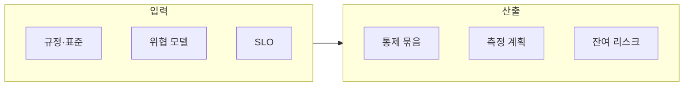

**규제·보안 제약 하의 성능**이란 법적·계약적·내부 정책상 반드시 지켜야 하는 통제(암호화, 감사 로그, 접근 통제, 데이터 상주, 격리)가 성능 예산과 충돌할 때, 그 충돌을 숨기지 않고 지표로 바꿔 협상하는 일을 말합니다. 이 장은 **전문** 난이도로, 실무에서 가장 빠른 설계와 가장 안전한 설계가 같지 않은 경우가 많다는 사실에서 출발합니다. 통제는 지연과 처리량에 직접 영향을 줄 뿐 아니라, 때로는 처리 경로의 아키텍처 형태(프로세스 안에서 처리할지, 사이드카 프록시를 둘지, 별도 하드웨어 모듈에 맡길지)까지 바꿉니다. 목표는 "보안을 무시하자"가 아니라, 통제가 만드는 비용을 가시화해서 보안팀과 성능팀이 같은 표 위에서 이야기하게 만드는 것입니다.

## 통제는 어디서 지연을 만드는가

통제마다 지연이 생기는 경로가 다르기 때문에, "보안은 느리다"는 한 문장으로 뭉뚱그리면 어느 부분을 줄일 수 있는지 알 수 없습니다. 세 가지 대표 사례로 경로를 구분해 봅니다.

첫째는 전송 구간 암호화입니다. TLS 연결은 데이터를 보내기 전에 핸드셰이크 메시지를 주고받아야 하므로, 연결을 새로 맺을 때마다 네트워크 왕복이 추가됩니다. 이미 맺은 연결 위에서 데이터를 암호화하는 비용은 이와 성격이 다르고, 연결 수가 많고 짧게 끊기는 구조일수록 핸드셰이크 비중이 커집니다. TLS 1.3을 정의한 [RFC 8446](https://www.rfc-editor.org/rfc/rfc8446)은 이전 연결에서 얻은 사전 공유 키(PSK)로 연결을 재개할 수 있게 하고, 재개 시 첫 비행(first flight)에 "early data"를 실어 보내는 0-RTT까지 허용합니다. 다만 같은 문서가 0-RTT 데이터는 연결 사이의 재전송(replay) 방어를 보장하지 않는다고 밝히므로, 지연을 줄이는 대가로 멱등하지 않은 요청에는 쓰지 않는다는 식의 제약이 붙습니다. 즉 같은 "TLS 최적화"도 보안 속성을 얼마나 양보하는지가 함께 결정되어야 하는 협상 대상입니다.

둘째는 감사 로그입니다. 감사 로그가 요청 경로에서 동기적으로 기록되면 로그 저장소의 쓰기 지연이 그대로 응답 시간에 더해지고, 여러 스레드가 하나의 파일이나 큐에 쓰면 그 지점이 경합 지점이 됩니다. 반대로 비동기 큐에 넣고 나중에 기록하면 응답은 빨라지지만 프로세스가 비정상 종료될 때 아직 기록되지 않은 이벤트를 잃을 수 있어, 유실이 허용되지 않는 감사 이벤트에는 쓸 수 없습니다. 그래서 로그를 줄이는 것이 아니라 어떤 이벤트는 반드시 동기·영속 기록하고 어떤 이벤트는 샘플링해도 되는지를 구분하는 것이 설계의 핵심이 됩니다.

셋째는 격리입니다. 컨테이너나 샌드박스가 시스템 콜을 제한하는 대표적인 방법인 seccomp 필터는, [seccomp(2) 매뉴얼](https://man7.org/linux/man-pages/man2/seccomp.2.html)에 따르면 BPF 프로그램으로 허용할 시스템 콜을 정의하며 시스템 콜 번호와 인자를 기준으로 임의의 호출을 걸러낼 수 있습니다. 호출을 판정하는 단계가 시스템 콜 경로에 추가되므로 시스템 콜을 많이 쓰는 코드일수록 영향이 커질 수 있지만, 그 크기는 필터 구성과 워크로드에 달려 있어 일반론으로 단정할 수 없고 측정해야 합니다. 데이터 상주 규정은 처리 위치를 제한해 가장 가까운 리전을 쓰지 못하게 만들 수 있고, 그만큼 왕복 거리가 늘어납니다. 이외에 데이터 마스킹·토큰화는 캐시 친화성을 떨어뜨리거나 조회 왕복을 늘리고, 제로 트러스트 네트워킹은 홉 수와 인증 토큰 검증 비용을 늘린다는 점도 같은 방식으로 경로를 나눠 봐야 합니다.

## 성능 예산과 보안 예산을 같은 표에 둔다

통제별로 한 줄씩, 목적과 성능 영향 가설, 검증 방법, 완화책, 책임 팀을 같은 문서에 적습니다. 아래 표의 한 줄은 형식을 보이기 위한 예시이며, `+x µs`는 실제 측정 전까지 채우지 않는 자리표시자입니다.

| 통제 | 목적 | 성능 영향 가설 | 검증 방법 | 완화 | 책임 팀 |
|------|------|----------------|-----------|------|---------|
| 예: mTLS everywhere | 기밀성·상호 인증 | 연결 수립 지연 +x µs | Tr.01 벤치 | 세션 재개 | 플랫폼 |

이 표에서 중요한 열은 "가설"과 "검증 방법"입니다. 이 두 칸이 비어 있으면 보안팀은 "필수", 성능팀은 "불가"로만 말하게 되어 협상할 숫자가 없습니다. 가설을 적으면 측정 계획이 생기고, 측정 결과가 나오면 완화책의 효과를 같은 표에서 비교할 수 있습니다. 다이어그램은 이 문서가 무엇을 입력받아 무엇을 내놓는지를 요약한 것으로, 규정·위협 모델·SLO를 입력으로 통제 묶음, 측정 계획, 잔여 리스크를 산출합니다.

## 완화 전략

완화는 통제를 약하게 만드는 것이 아니라 같은 보안 속성을 더 싼 경로로 얻는 방법을 찾는 일입니다. 가장 먼저 쓰는 것은 계층화로, 모든 홉에 무거운 통제를 두지 않고 신뢰 경계의 안팎을 나눠 경계에서 한 번 강하게 검증하는 구조입니다. 다음은 오프로드로, HSM이나 NIC의 암호 처리, 전용 프록시에 일을 넘겨 애플리케이션 CPU를 아끼는 방법이지만 비용과 운영 복잡도가 함께 늘어납니다. 로그는 샘플링으로 줄이되 감사에 필수인 이벤트는 샘플링 면제 규칙을 명시해야 하고, 자격 증명을 캐시하면 검증 비용이 줄어드는 대신 회전·폐기 정책과 충돌하지 않도록 캐시 수명을 정책 안에 맞춰야 합니다.

## 다른 트랙과의 연결

이 장의 주제는 앱 코드 한 줄이 아니라 플랫폼 계약에 가깝기 때문에 두 운영 트랙과 맞닿습니다. Tr.06(OS·런타임)에서 다루는 cgroup·seccomp·컨테이너 정책은 시스템 콜 경로를 바꾸고, Tr.10(네트워크)에서 다루는 TLS 버전, 인증서 검증, L7 방화벽은 패킷 경로를 바꿉니다. 측정 방법은 Tr.01에, 측정된 비용이 시간이 지나며 다시 늘어나는 것을 막는 방법은 Tr.12(회귀 방지)에 위임합니다.

## 흔한 오개념

<strong>"암호화는 항상 성능의 병목이다"</strong>는 측정 없이 굳어진 통념입니다. 이미 맺은 연결 위에서 데이터를 암호화하는 비용과 새 연결을 맺는 비용은 다른 경로이므로, 연결 재사용과 세션 재개로 후자가 대부분의 비용인 구조를 바꿀 수 있는지 먼저 확인해야 합니다. 어느 쪽이 지배적인지는 워크로드의 연결 수명과 요청 크기에 따라 달라, 이 장의 표처럼 가설을 적고 측정으로 확인해야 합니다.

<strong>"성능 때문에 통제를 잠시 끄는 것은 임시 조치라 괜찮다"</strong>도 위험합니다. 통제를 끈 구간은 규정상 위반일 수 있고, 임시라고 했던 설정이 기록 없이 남으면 잔여 리스크가 문서에서 사라집니다. 통제를 낮춰야 한다면 그 결정과 기한, 감수하는 리스크를 아래의 의사결정 기록으로 남기고 승인 주체를 분명히 해야 합니다.

<strong>"규제는 협상할 수 없으니 성능 쪽이 알아서 맞춰야 한다"</strong>는 반쪽짜리 이해입니다. 규정이 요구하는 것은 대개 보안 속성(기밀성, 무결성, 추적 가능성)이지 특정 구현이 아니므로, 같은 속성을 만족하는 더 싼 구현을 찾는 일은 협상 대상이 아니라 설계 문제입니다. 협상이 불가능한 것은 속성 자체이고, 그 속성을 어떤 경로로 얻을지는 열려 있습니다.

## 판단 기준: 의사결정 기록에 무엇을 적는가

통제의 도입이나 완화를 결정할 때는 의사결정 기록(ADR, Architecture Decision Record)에 다섯 가지를 적습니다. 맥락에는 어떤 규정과 위협을 전제로 하는지를, 결정에는 어떤 통제 묶음을 택했는지를, 성능 영향에는 어떤 지표로 감시하는지를, 거부한 대안에는 왜 택하지 않았는지를, 잔여 리스크에는 무엇을 감수하는지를 씁니다. 결정을 내리기 전에는 아래 질문이 분기 역할을 합니다.

| 질문 | 예이면 | 아니오이면 |
|------|--------|------------|
| 이 통제는 법적·계약상 필수인가 | 속성은 고정하고 구현 경로 최적화에 집중 | 권고 수준이면 대안 통제와 비용 비교 |
| 통제 실패 시 fail-closed가 가능한가 | 실패 시 차단하고 가용성 영향을 예산에 반영 | fail-open이라면 잔여 리스크로 기록 |
| 지연 상한이 고객 계약이나 SLO에 있는가 | p99까지 포함해 측정 계획 수립 | 평균 지표만 쓰지 않도록 내부 목표 설정 |
| 로그에 개인정보가 포함되는가 | 마스킹·보존 기간을 함께 설계 | 샘플링 면제 대상 이벤트만 분류 |

## 비판적 시각

이 장의 접근에는 한계가 있습니다. 통제 비용을 숫자로 옮기면 협상이 가능해지지만, 숫자가 없는 보안 이득(침해가 났을 때의 피해 크기)을 같은 표에 올릴 방법은 마땅치 않아서, 성능 비용만 선명하고 보안 가치는 흐릿한 비대칭이 생기기 쉽습니다. 또한 규정의 해석은 조직과 법무 판단에 달려 있어서, 이 장이 제시하는 틀은 법적 자문을 대체하지 않습니다. 마지막으로 완화책(오프로드, 캐시된 자격 증명, 샘플링)은 각각 새로운 공격 표면이나 유실 위험을 만들 수 있으므로 완화를 적용한 뒤에는 보안 쪽의 재검토도 함께 받아야 합니다.

## 마무리

규제·보안은 성능 최적화의 적이 아니라 제약 조건입니다. 이 장을 마치면 통제마다 지연이 생기는 경로를 구분해 설명하고, 통제 비용을 가설과 검증이 있는 표로 옮기며, 완화책을 보안 속성을 유지하는 범위에서 고르고, 결정을 ADR로 남길 수 있어야 합니다.

- [ ] TLS 핸드셰이크, 감사 로그, seccomp가 각각 어느 경로에서 지연을 만드는지 구분해 설명할 수 있다.
- [ ] 0-RTT 같은 지연 최적화가 보안 속성을 양보하는 지점을 설명할 수 있다.
- [ ] 통제별 성능 영향 가설과 검증 방법을 표로 작성할 수 있다.
- [ ] 완화책이 새로 만드는 리스크를 짚고 ADR의 다섯 항목으로 기록할 수 있다.
