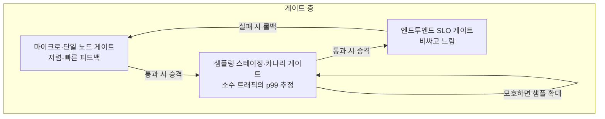

본 장은 **전문** 난이도입니다. 단일 노드에서의 회귀 방지(마이크로벤치·프로파일·PR 게이트)는 앞선 챕터들이 다루었고, 이 장은 그 게이트를 **분산·클러스터** 환경으로 확장할 때 무엇이 달라지는지를 다룹니다. 읽기 전에 [변동성 관리](/post/regression-prevention/performance-variance-noise-management/)와 [카나리 배포와 성능 검증](/post/regression-prevention/canary-deployment-performance-verification/)을 먼저 보면 용어가 자연스럽게 이어집니다.

## 이 글을 읽은 후 달성해야 할 목표

- 샤딩·다중 리전·버전 혼재가 단일 노드 게이트의 가정을 어떻게 깨는지 설명할 수 있다.
- 샤드별 분위수를 평균 내면 안 되는 이유를 수치로 보이고, 올바른 집계 방식을 고를 수 있다.
- 트래픽 믹스가 바뀌었을 때의 겉보기 회귀를 층별 비교로 걸러낼 수 있다.
- 마이크로벤치·샘플링 스테이징·엔드투엔드 SLO 게이트를 층으로 설계하고 층 사이의 승격 정책을 정할 수 있다.

## 왜 분산이 어려운가

단일 노드에서 게이트가 믿을 만했던 이유는 측정 대상이 하나의 프로세스, 하나의 하드웨어, 하나의 입력 분포였기 때문입니다. 분산 환경은 이 셋을 모두 흔듭니다. 샤딩된 저장소에서는 키 분포가 조금만 바뀌어도 특정 샤드만 뜨거워지고, 그 샤드의 꼬리 지연이 전체 요청의 꼬리 지연을 좌우합니다. 다중 리전에서는 리전 간 왕복 시간과 복제 지연이 정상 분산 자체를 넓히므로, 단일 리전에서 정한 임계값을 그대로 쓰면 오탐이 늘어납니다. 노드가 디스크·네트워크·관리 플레인을 공유하면 서로의 부하가 간섭으로 나타나고, 롤아웃 도중에는 구버전과 신버전이 같은 클러스터에서 섞여 돌기 때문에 "어느 버전의 숫자인가"부터 분리해야 합니다.

그래서 "메인 브랜치에서 벤치마크를 돌리고 끝"이라는 구조로는 부족하며, 비용과 통계적 성격이 다른 여러 게이트를 **층**으로 쌓아야 합니다. 저렴한 층은 빠르게 자주 돌고, 비싼 층은 느리게 신중하게 돌며, 한 층의 실패가 다음 층을 어떻게 트리거하는지를 정책으로 못박아 둡니다.



## 분위수는 평균 낼 수 없다

분산 게이트에서 가장 흔한 실수는 샤드마다 계산한 p99를 평균 내어 전체 p99로 쓰는 것입니다. Prometheus 문서는 요약(summary)의 사전 계산된 분위수에 대해 분위수를 집계할 수 없다고 설명하고, 히스토그램은 같은 구간(버킷)의 카운트를 더하는 방식으로 집계할 수 있다고 설명합니다(단, 버킷 경계가 서로 호환되어야 합니다)([Histograms and summaries](https://prometheus.io/docs/practices/histograms/)). 직관은 간단합니다. p99는 한 샤드 안의 요청 순위에서 정해지는 값이라서, 요청 수가 크게 다른 샤드의 p99를 같은 무게로 평균하면 요청 대부분이 몰린 샤드의 꼬리가 희석됩니다.

아래 스크립트는 이를 눈으로 확인하기 위한 것입니다. 지연은 실측이 아니라 로그정규 분포로 만든 가상 데이터이며, 핫 샤드 하나가 요청의 90%를 받고 나머지 두 샤드는 한가한 상황을 가정했습니다. 표준 라이브러리만 쓰므로 파이썬이 있으면 그대로 실행됩니다. 이 글을 쓰며 실제로 실행한 출력을 아래에 적었습니다.

```python
#!/usr/bin/env python3
# 요구 사항: Python 3.8+ (표준 라이브러리만 사용)
# 실행: python3 shard_p99.py
import random
from statistics import mean

random.seed(7)

def p99(values):
    ordered = sorted(values)
    return ordered[int(0.99 * (len(ordered) - 1))]

def shard(n_requests, median_ms, sigma):
    """로그정규 분포로 지연을 흉내 낸 가상 샤드(실측 데이터가 아님)."""
    return [random.lognormvariate(0, sigma) * median_ms for _ in range(n_requests)]

# 핫 샤드 하나가 요청 대부분을 받고, 나머지는 한가한 샤드
shards = {
    "hot":  shard(90_000, median_ms=12.0, sigma=0.9),
    "cold": shard(5_000, median_ms=10.0, sigma=0.4),
    "cold2": shard(5_000, median_ms=10.0, sigma=0.4),
}

per_shard = {name: p99(v) for name, v in shards.items()}
all_requests = [x for v in shards.values() for x in v]

print("샤드별 p99(ms):", {k: round(v, 1) for k, v in per_shard.items()})
print("샤드 p99의 단순 평균(ms):", round(mean(per_shard.values()), 1))
print("전체 요청으로 계산한 p99(ms):", round(p99(all_requests), 1))
```

```text
샤드별 p99(ms): {'hot': 97.5, 'cold': 25.8, 'cold2': 25.2}
샤드 p99의 단순 평균(ms): 49.5
전체 요청으로 계산한 p99(ms): 93.9
```

샤드 p99의 단순 평균은 49.5ms로, 요청 전체에서 구한 p99(93.9ms)의 절반 남짓입니다. 이 값으로 게이트를 만들면 핫 샤드의 p99가 두 배(약 195ms)가 되어도 단순 평균은 약 82ms에 그쳐, 지금의 전체 p99(93.9ms)보다도 낮은 값으로 남습니다. 해법은 원시 샘플이나 히스토그램 버킷 카운트를 모아서 한 번에 분위수를 계산하는 것이며, 어느 쪽이든 샤드별 값은 "어느 샤드가 문제인가"를 찾는 용도로만 남겨 둡니다. 히스토그램의 분위수가 버킷 폭 안에서 보간된 추정치라는 한계는 [모니터링 대시보드](/post/regression-prevention/performance-monitoring-dashboard-grafana-prometheus/) 장에서 이미 다룬 내용입니다.

## 샘플링과 대표성

스테이징이나 카나리에서 소수 트래픽으로 p99를 추정할 때는 샘플이 전체를 대표하는지가 게이트의 신뢰도를 정합니다. Google SRE 워크북의 카나리 장은 카나리 집단이 전체 배포를 대표할 만큼 충분히 크고 오래 유지되어야 한다고 설명하며, 몇 건의 요청만 받고 카나리를 끝내면 다양한 요청이 섞인 서비스에서는 쓸모 있는 신호를 얻지 못한다고 지적합니다([Canarying Releases](https://sre.google/workbook/canarying-releases/)). 같은 장은 오류 예산에 미치는 영향이 결함에 노출된 트래픽의 양에 비례한다는 점도 수치로 보입니다. 새 버전이 요청의 20%를 실패시키는 결함을 가졌다면, 전체 배포는 20%를, 5% 카나리는 전체 오류율 1%를 만든다는 예입니다.

얼마나 모아야 하는지는 [변동성 관리](/post/regression-prevention/performance-variance-noise-management/)의 표본 크기 식으로 어림할 수 있습니다. 두 그룹(기준선·후보)을 비교할 때 그룹당 표본 수는 대략 2·((z_α+z_β)·CV/δ)²이고, 변동계수 CV가 6%이며 3%의 변화를 검정력 80%로 잡으려면 그룹당 약 63건입니다. 이 식은 측정값이 대략 정규분포를 따른다는 가정 위의 근사이므로, 꼬리 지연처럼 분포가 치우친 지표에서는 더 많이 잡아야 안전합니다. 이 숫자를 한 번 정해 두는 것이 아니라 샤드·리전·테넌트처럼 층(stratum)별로 따로 확인해야 한다는 점이 분산 환경의 특징입니다. 전체 평균에서는 충분해 보여도 작은 층에서는 표본이 모자라 판정이 흔들릴 수 있기 때문입니다.

## 트래픽 믹스가 바뀌면 코드가 그대로여도 회귀처럼 보인다

샘플이 특정 지역·테넌트·시간대로 치우치거나, 롤아웃 단계마다 트래픽 믹스가 달라지면 전체 평균은 코드 변경과 무관하게 움직입니다. 지연이 빠른 리전 A(평균 10ms)와 느린 리전 B(평균 50ms)가 있다고 하겠습니다. 어제는 요청의 80%가 A, 20%가 B여서 전체 평균이 0.8×10+0.2×50=18ms였습니다. 오늘은 로드밸런서 설정이 바뀌어 60%가 A, 40%가 B가 되었고, 각 리전의 지연은 하나도 변하지 않았지만 평균은 0.6×10+0.4×50=26ms가 되어 약 44% 느려져 보입니다.

이런 겉보기 회귀를 걸러내려면 층별로 먼저 비교하고, 필요하면 기준 믹스로 가중해서 합칩니다. 위 예에서는 리전 A와 B를 각각 어제와 비교하면 둘 다 변화가 없다는 것이 바로 드러납니다. 롤아웃 중 버전이 섞이는 경우도 같은 논리입니다. 요청에 버전 레이블을 달아 구버전 요청과 신버전 요청을 같은 층 안에서 비교해야, 신버전이 느린 것인지 신버전이 느린 샤드에 더 많이 배정된 것인지를 가릴 수 있습니다.

## 오탐을 줄이는 습관

분산 환경의 오탐은 대개 비교 대상이 달라서 생깁니다. 같은 하드웨어 세대, 같은 데이터 스냅샷, 같은 시간대 같은 조건을 맞춘 직전 배포를 기준선으로 삼고, 절대 임계값보다 그 기준선 대비 변화량을 보는 편이 안전합니다. 한 가지 지표만 보면 처리량이 무너지는 회귀를 놓칠 수 있으므로 지연과 처리량, 오류율을 함께 봅니다. 환경이 바뀌는 사건(노드 설정, 커널 파라미터, 컨테이너 이미지)이 있었다면 그 지문을 게이트 입력에 같이 기록해 두어, 앱과 무관한 회귀를 코드 탓으로 돌리지 않게 합니다. 기준선 관리 방법은 [기준선 관리](/post/regression-prevention/performance-baseline-management-strategy/) 장에서 다룹니다.

## 비용 통제와 한계

분산 게이트는 돈과 시간이 듭니다. 층이 올라갈수록 비용이 커지므로 CPU 시간·네트워크·스토리지에 상한을 두고, 모호한 결과가 나왔을 때 샘플을 무한히 늘리지 않도록 확대 횟수에도 한도를 둡니다. 한도를 넘으면 사람의 판단으로 넘기는 편이 자동 반복보다 낫습니다. 예를 들어 다음과 같은 정책을 문서화할 수 있습니다(이 글이 가정한 예시 정책이며 특정 출처의 규정이 아닙니다). 마이크로 게이트가 통과하면 카나리로 승격하고, 카나리에서 결과가 임계값 근처의 모호한 영역에 들면 표본을 한 번 늘려 다시 판정하며, 두 번째 판정도 모호하면 사람에게 넘깁니다. 임계값을 분명히 넘으면 즉시 롤백하고, 롤백 뒤에는 어느 층이 먼저 신호를 냈는지를 기록해 층별 임계값을 조정합니다. 알림 쪽 정책은 [알림 전략](/post/regression-prevention/performance-alerting-strategy-design/) 장에서 이어집니다.

이 접근에는 한계도 있습니다. 층을 많이 쌓을수록 어느 층이 어떤 회귀를 책임지는지 모호해지고, 샘플링 게이트는 드문 요청 유형이나 작은 테넌트의 회귀를 놓칠 수 있습니다. 엔드투엔드 게이트는 비용 때문에 자주 돌릴 수 없어서, 회귀가 들어온 시점과 발견되는 시점 사이의 간격이 길어집니다. 또한 이 장의 스크립트와 수치는 가상 데이터와 어림식이며, 실제 클러스터에서의 값은 직접 측정해서 확인해야 합니다. 이 글의 코드는 파이썬으로만 실행해 보았고 실제 클러스터에는 적용해 보지 않았습니다.

## 흔한 오개념

<strong>"평균 지연만 봐도 충분하다"</strong>는 오개념입니다. 위 예에서 평균은 믹스 변화에도 움직이고, 반대로 일부 샤드의 꼬리가 나빠져도 평균은 거의 변하지 않을 수 있습니다. 꼬리 지연은 요청 전체 순위에서 따로 계산해야 합니다. <strong>"카나리가 통과하면 전체 배포도 안전하다"</strong>도 틀릴 수 있습니다. 카나리 집단이 전체를 대표하지 않거나 관찰 시간이 짧으면 신호가 없는 채로 통과하기 때문입니다.

## 판단 기준

| 상황 | 권장 | 피할 것 |
|---|---|---|
| 샤드 간 요청 수가 크게 다름 | 원시 샘플·히스토그램 버킷을 합쳐 전체 분위수 계산 | 샤드 p99의 단순 평균 |
| 롤아웃 중 구·신버전 혼재 | 버전 레이블로 층을 나눠 비교 | 클러스터 전체 평균과 직전 값을 직접 비교 |
| 트래픽 믹스가 바뀐 날 | 리전·테넌트별 비교, 기준 믹스 가중 | 전체 평균 변화만으로 회귀 판정 |
| 카나리 표본이 적음 | 표본을 늘리거나 판정을 보류 | 소수 요청만 보고 통과 처리 |

## 마무리

분산 클러스터의 성능 회귀 방지는 통계·운영·아키텍처가 함께 맞물리는 문제입니다. 도구 이름보다 층별 게이트의 계약, 즉 어느 층이 무엇을 책임지고 어떤 결과에서 다음 층으로 넘어가는지를 먼저 정해 두는 것이 이 장의 핵심입니다. 인시던트로 이어졌을 때의 대응은 [성능 장애 대응](/post/regression-prevention/performance-incident-response-process/) 장을 참고하세요.

- [ ] 분위수를 합산·평균하면 안 되는 이유를 숫자로 설명할 수 있다.
- [ ] 믹스 변화로 생긴 겉보기 회귀를 층별 비교로 걸러낼 수 있다.
- [ ] 카나리 표본이 대표성을 갖는지 판단하는 기준을 말할 수 있다.
- [ ] 게이트 층 사이의 승격·롤백·샘플 확대 정책을 설계할 수 있다.
