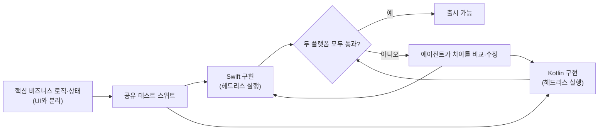

2020년에 React Native를 모바일의 미래로 선언했고 2025년에도 입장을 재확인했던 Shopify가, 2026년 9월 전체 앱을 Swift와 Kotlin 네이티브로 다시 만들겠다고 발표했다. 흥미로운 점은 이유가 "React Native가 실패했다"가 아니라는 것이다. 공개된 설명의 핵심은 AI 코딩 에이전트 덕분에 "같은 기능을 두 번 만드는 비용"이 예전만큼 크지 않다는 판단이다. 이 글은 InfoQ와 The Pragmatic Engineer의 보도를 바탕으로 무엇이 확인된 사실이고 무엇이 아직 검증되지 않은 주장인지를 구분해 정리한다.

## 무엇이 발표되었나

InfoQ(2026-09-16)에 따르면 Shopify는 주력 앱을 SwiftUI와 Jetpack Compose 기반 네이티브로 재작성한다. 모바일 총괄 Mustafa Ali는 이제 네이티브 코드베이스를 유지하는 쪽이 추상화 계층을 쓰는 쪽보다 비용 대비 효과가 낫다고 판단했다. 진행 상황은 다음과 같이 보도됐다.

- **Shop 앱**: 재작성 완료. 엔지니어 한 명이 일주일 만에 개념 증명을 만들었고, 이후 엔지니어 여섯 명이 12주 만에 처음부터 프로덕션까지 끌고 갔다.
- **Shopify 메인 앱**: 화면 300개 이상에 위젯, Apple Watch 앱, Siri 단축어까지 있는 앱이며 올해 안을 목표로 한다.
- **POS와 Inbox**: 앞으로 1년 안에 진행할 계획이다.

즉 "모든 앱이 이미 네이티브로 전환됐다"가 아니라 "한 앱이 끝났고 나머지는 진행 중"이라는 상태다. 일부 요약 글이 이를 뭉뚱그리므로 주의해야 한다.

## 왜 지금인가: 세 가지 요인

보도에서 읽히는 이유는 하나가 아니다. 첫째, AI 모델과 에이전트, 하네스가 빠르게 좋아져 처음부터 다시 쓰는 일이 현실적인 선택지가 되었다. Ali는 2025년 초 이후 코딩 모델이 충분히 좋아져서 Swift와 Kotlin으로 같은 기능을 만드는 비용이 예전 같지 않다고 말했다(The Pragmatic Engineer). 둘째, React Native의 New Architecture로 넘어가려면 큰 리팩터링이 필요했다. 어차피 큰 공사를 해야 한다면 공사의 방향을 다시 고를 수 있다는 뜻이다. 셋째, 한 번 만든 기능을 두 번 만들지 않는다는 목표와 인력 이동성(iOS·Android를 한 사람이 다루는 팀 구성) 같은 조직적 이점이 있다.

React Native는 본래 "iOS와 Android를 따로 만드는 중복 비용"을 줄이려는 기술이다. 에이전트가 한쪽 구현을 보고 다른 쪽을 상당 부분 옮겨 줄 수 있다면, 프레임워크가 제공하던 핵심 이점이 줄어들고 프레임워크가 만드는 비용(추상화 계층, 플랫폼 API 접근의 간접성, 디버깅 난이도)이 상대적으로 커진다. 이것이 이번 사례를 "AI가 만든 경제성 변화"로 읽는 이유다.

## 에이전트를 어떻게 썼나: 검증 장치가 핵심

이 사례에서 눈여겨볼 부분은 에이전트에게 코드를 맡겼다는 사실보다, 맡긴 결과를 검증하는 구조다. 보도된 내용은 다음과 같다.

비즈니스 로직과 상태를 UI에서 분리해 시뮬레이터 없이 데스크톱에서 빠르게 테스트할 수 있게 했고, 시뮬레이터는 엔드 투 엔드 테스트에만 썼다. 같은 테스트가 두 플랫폼에서 모두 통과해야 기능이 출시된다. 에이전트는 플랫폼 간 기능 이식, 구현 비교, 차이 수정, 테스트, 리뷰를 맡지만 아키텍처 설계, 작업 계획, 검증, 오류 수정은 여전히 엔지니어의 몫이었다고 InfoQ는 전한다. 에이전트의 생산성이 아니라 "두 구현이 같은 동작을 한다"를 기계적으로 보장하는 장치가 이 전략을 성립시킨 셈이다. 이 장치가 없다면 이중 구현은 곧 이중 유지보수 부담이 된다.

## 공개된 수치를 어떻게 읽을까

InfoQ가 전한 수치는 콜드 스타트 지연이 iOS에서 23%, Android에서 50% 줄었고, 세션 안정성이 99.5%에서 99.95%로 올라 크래시로 끝나는 세션이 약 10분의 1로 줄었으며, Android 릴리스 빌드 시간이 75% 줄고 피드 스크롤이 별도 튜닝 없이 120FPS를 유지했다는 것이다. 다만 읽을 때 조심할 점이 있다.

- 비교 기준이 문제다. 개선 폭이 옛 React Native 아키텍처 대비인지 New Architecture 대비인지에 따라 의미가 달라진다. 반론으로는 New Architecture만으로도 비슷한 개선이 나왔을 수 있다는 지적이 있다. 참고로 The Pragmatic Engineer는 New Architecture 이전 이후로 시작 속도가 Android 약 10%, iOS 약 3% 개선됐다고 적고 있다.
- 앱 하나(Shop)와 처음부터 다시 만든 코드베이스의 수치이므로, 300개 화면이 넘는 메인 앱까지 일반화하기는 이르다.
- 위 수치의 1차 출처는 Shopify의 발표이고, 보도 매체는 이를 전달한다. 독립 검증 결과가 아니다.

## 트레이드오프와 남은 비용

Ali 스스로 "네이티브는 여전히 두 플랫폼에서 소프트웨어를 만들고 유지한다는 뜻이며 그 비용이 사라진 것은 아니다"라고 말했다. 구체적으로는 다음 비용이 남는다.

- **배포 속도**: 네이티브는 over-the-air 업데이트가 불가능해 앱스토어 심사에 따라 릴리스 주기가 느려질 수 있다는 지적이 있다.
- **이중 코드베이스의 인지 부하**: 한 사람이 두 플랫폼을 다루려면 에이전트가 만든 코드를 양쪽에서 읽고 판단할 수 있어야 한다.
- **포팅의 품질**: 에이전트가 만든 이식 코드가 관용적인 플랫폼 코드인지는 테스트가 아니라 리뷰가 확인해야 한다.

## 우리 팀에 적용할 수 있을까: 판단 기준

Shopify의 결론을 그대로 복사하기보다 어떤 전제가 성립했는지를 확인하는 편이 안전하다.

| 전제 | Shopify | 확인할 질문 |
|------|---------|-------------|
| 로직과 UI 분리 | 비즈니스 로직·상태를 분리해 헤드리스 테스트 | 우리 코드는 UI 없이 로직을 테스트할 수 있는가 |
| 공유 테스트 | 두 플랫폼이 같은 스위트를 통과해야 출시 | 동작 동일성을 자동으로 보장하는가 |
| 인력 | 숙련 엔지니어가 설계와 검증을 주도 | 에이전트 산출물을 리뷰할 사람이 있는가 |
| 재작성 동기 | New Architecture 이전을 위한 대공사가 이미 필요 | 어차피 갈아엎을 이유가 있는가 |
| 규모와 성능 요구 | 대형 앱, 성능·플랫폼 기능 요구가 큼 | 공유 코드의 개발 속도 이점이 여전히 더 큰가 |

작은 팀이거나 화면 대부분이 단순한 CRUD라면 크로스플랫폼의 공유 이점이 여전히 클 수 있다. 반대로 플랫폼 기능 의존도가 높고 테스트 자산이 탄탄한 팀이라면 "에이전트 포팅 + 공유 테스트"가 현실적 대안이 된다. 한 회사의 선택이 업계의 정답이 되는 것은 아니며, 이 사례가 보여 주는 것은 비용 구조가 바뀌면 오래된 아키텍처 결정도 다시 계산해야 한다는 점이다.

## 정리

- Shopify는 React Native에서 Swift·Kotlin 네이티브로 전환 중이며, 2026년 9월 기준 완료된 앱은 Shop 하나다.
- 근거로 제시된 논리는 AI 에이전트가 이중 구현 비용을 낮췄다는 것이고, 이를 뒷받침하는 장치는 로직·UI 분리와 공유 테스트 스위트다.
- 성능·안정성 수치는 인상적이지만 비교 기준과 일반화 범위에 한계가 있고, 이중 플랫폼 유지 비용은 사라지지 않았다.

## 참고 문헌

- [The Pragmatic Engineer, "Shopify drops React Native"](https://newsletter.pragmaticengineer.com/p/shopify-native-mobile) (2026-09-29)
- [InfoQ, "Shopify drops React Native for native Swift and Kotlin"](https://www.infoq.com/news/2026/09/shopify-drops-react-native/) (2026-09-16)
